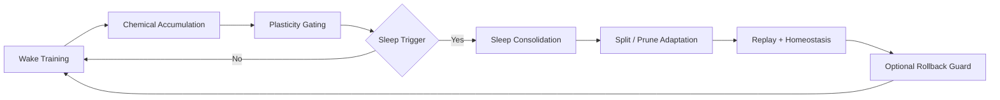
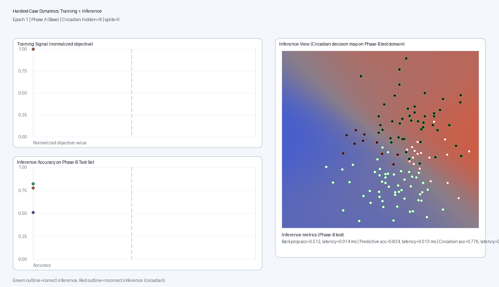
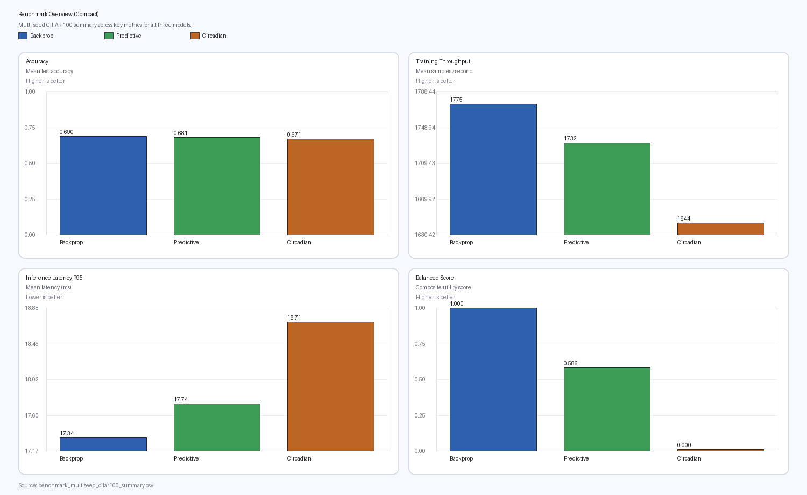
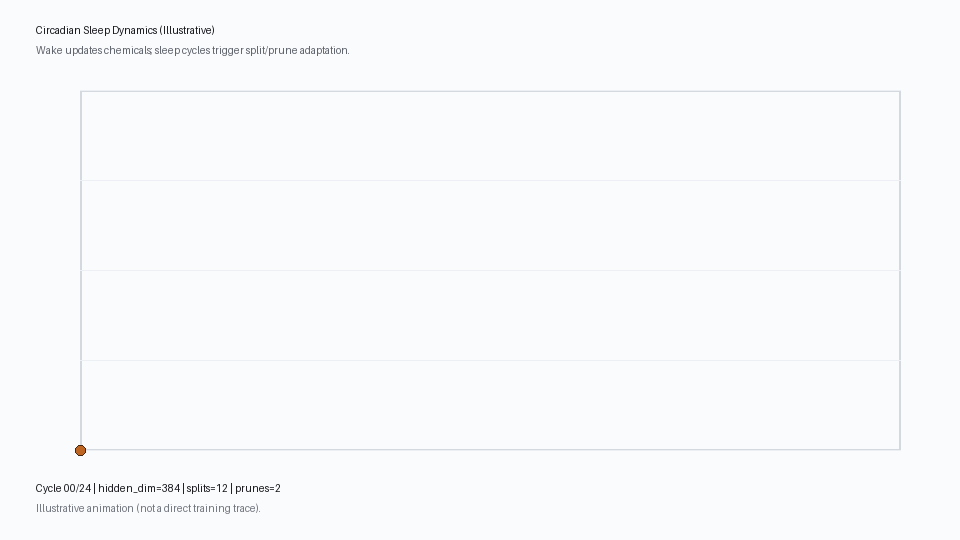

# Circadian Predictive Coding

[Detached CLM probe reviews can now be inspected offline](docs/clm-probe-inspector.md)
through the existing export command. Recorded marker learning, old TRAIN errors,
costs and missing native outcomes remain visible without loading models or
computing new scores. Final pure checks pass on both platforms; interactive
browser verification remains open because local file navigation was blocked.

[An isolated installed-package check](docs/reports/clm-inspector-package-20261025.md)
also exports literal CLM reviews using the packaged module/template outside the
checkout, with model-library imports blocked. The source archive includes the
usage guide; interactive UI and scientific gates remain separate and open.

[The existing isolated-probe runner now accepts the workflow32 source](docs/clm-reserved-probes.md#workflow32-source-and-original-train-readout)
and reads its twelve original TRAIN rows without updating the source. The final
software checks pass on both platforms. Its [one native source32→probe6 case](docs/reports/clm-workflow-fresh-native-20261025.md)
learned one of two reserved markers while old TRAIN accuracy fell12/12→10/12
inside the disposable probe. The source stayed unchanged; reliable acquisition,
joint retention and context return remain open.

The same workflow probe now accepts an explicit `parameter_scope="state_only"`
to keep its action head and scale fixed. [59 final checks per platform](docs/reports/clm-workflow-probe-state-only-20261025.md)
qualify that option and unchanged default behavior; its native learning effect
remains unmeasured.

The [native state-only control attempt](docs/reports/clm-workflow-state-only-native-20261025.md)
stopped at its frozen memory preflight before model loading. It supplies no new
learning result; the failed attempt and original limits are preserved.

[The separate 32-pass TRAIN-only CLM case](docs/reports/clm-train32-native-20261025.md)
fit all 12 fixed known TRAIN rows, including legacy/password, in about 305 seconds
with 15 GiB sampled peak RSS. Its 384 query exposures and 32-step schedule are distinct
from the earlier eight-pass case. No new workflow rollouts, retention, fresh-task
generalization or circadian benefit were established; the CLI still defaults to 8.

[The public-observation CLM native case](docs/reports/clm-public-native-20261025.md)
completed ordinary and stale ticket workflows; the external dispatcher blocked a
revoked commit. Its eight-pass TRAIN fit improved from4/12 to10/12, with legacy/password choices
still wrong. Original costs and negative results remain; this fixed known-task
case establishes neither a circadian advantage nor generalization.

[CLM TRAIN observations can now match live public requests](docs/clm-ticket-workflow.md#public-observation-train-option)
through an explicit option, preserving the original recipe. A learned-only mode
also avoids repeating an already-observed unchanged control. Focused Windows/Linux
checks qualify both paths; the native report records their measured scope and limits.

[CLM workflow TRAIN diagnostics](docs/clm-ticket-workflow.md#optional-train-fit-diagnostic)
now offer an explicit `--record-train-fit` option for phase-specific accuracy and
probability margins before and after training. Tiny Windows/Linux checks verify
that the reads preserve training and episode behavior. The public-observation
study records their first native diagnosis separately from task outcomes.

[The earlier original-recipe CLM observation](docs/reports/native-clm-ticket-workflow-20261025.md):
training enabled one stale-parcel recovery in three episodes, versus zero for the
unchanged heads. Invoice remained unsuccessful; reliable adaptation and a
circadian advantage remain unproved. The fixed run's costs and failures are kept.

[Failed-run budget evidence](docs/train-budget-evidence.md) can now retain the
original training clock and charges even when model readback fails. Sixteen
scripted cases qualify per platform; no model training was needed for the repair.

[Public-cue learner health](docs/public-cue-activation-health.md) now reads
existing activity, saturation and rank diagnostics under the original guards
and budgets. Scoped software and zero-update Torch qualification pass; cold
metrics establish neither task learning nor recovery.

[Public-head schedule validation](docs/weighted-prefix-validation.md) now reuses
bounded immutable prefix counts while retaining source and full-state checks.
96 focused checks pass per platform; scripted component timings improve. The
earlier native experiment remains incomplete and is not rerun.

[The class-balanced recurring TRAIN pilot](docs/weighted-recurrent-context.md)
now uses the existing stream and readonly evaluator, with fixed middle-task
observations and an explicit CLI mode. Existing protocol defaults are preserved.

[Public-cue weighted learning](docs/public-cue-weighted-stream.md) now runs through
the existing delayed-label stream with exact episode binding and permanent paid
failure handling. Software and native parity checks pass; a useful adaptation
experiment remains a separate gate.

[Class-balanced public-cue training](docs/public-cue-weighted-training.md) now
offers an explicit TRAIN-episode update using the existing native weighted loss.
Software and native parity checks pass; task success remains unproved.

[Recurrent snapshot validation](docs/recurrent-snapshot-validation.md) now avoids
temporary optimizer setup on readonly copies while retaining exact full-state
checks. Focused native parity and corruption checks pass on Windows and Linux;
the earlier incomplete game run remains an open limitation.

[Public-cue probe games](docs/public-cue-probe-games.md) now connect the existing
isolated learner to the readonly game evaluator. Software checks pass; the sole
native case stopped at its original readout deadline after majority-only fitting
and one failed F game. Its partial result and original charges are preserved.

[Isolated fresh-task probes](docs/public-cue-fresh-task-probe.md) already accept
the public-cue recurrent learner through the existing generic interface. Focused
checks qualify source/actor isolation, both head clocks and the same-fork return
path. Actual fresh-task game success remains a separate, unfinished gate.

[Bounded recurrent episode replay](docs/recurrent-episode-replay.md) adds explicit
recent/coverage controls to the existing stream pilot, with equal extra fitting
and both learners trained before readouts. Software checks and native outcomes
remain separate; original no-replay results and defaults are preserved.
The first paired run lost its detailed report at the original output-size cap;
no comparative learning result is established. [Results and limits](docs/reports/balanced-recurrent-replay-20261025.md)
record that failure and the separately tested compact export repair.

The existing command now exposes [ordinary recurring adaptation](docs/ordinary-fourth-task.md)
as `circadian-affine-game --example-affine-recurring`. Add `--describe` to inspect
the fixed recipe before work, or a new `--output` path to retain its result. It
uses bundled TRAIN data and the existing G collector/learner; no research archive
or saved model is required. Normal/private modes and final-evaluation separation
remain unchanged.

Replay that saved result in the [shared offline inspector](docs/affine-workflow-inspector.md#ordinary-recurring-reports):
`python -m scripts.build_key_door_inspector --source-artifact new-recurring-run.json --output recurring-learning.html`.
It shows acquisition/return curves, complete recorded G/A games and original
costs, including worse confidence and missing/failed evidence. Playback performs
no training or simulation.

[Frozen affine held-out games](docs/heldout-affine-games.md) evaluate the saved
ordinary endpoint on original D without refitting. The fixed result is mixed:
red succeeds in13steps; blue truncates at16. Full trajectories, costs, model/RNG
preservation and the failed cue remain recorded. This is one held-out-from-TRAIN
layout observation, not reliable generalization or a circadian advantage.

[Public-cue native neural baseline](docs/public-cue-neural-baseline.md) binds two
original BP/PC/neutral/active heads to existing public history and provides a fixed
conventional BP known-A route through the existing stream and native evaluator.
Complete optimizer/adaptive/RNG state, failed work and original budgets remain
owned; the scoped software checks pass. Native learning outcomes and comparative
scientific claims are separate. Actual qualification encountered budget-admission
and post-training finalization failures; both boundaries are repaired. The paid
128-update run produced no scored or native-game outcome, so qualification is open.

[Ordinary fourth-task adaptation](docs/ordinary-fourth-task.md) adds an API mode
to the existing workflow: collect original TRAIN G, learn A/B/C/G/A with bounded
joint reuse, then play known G and returning A from the actual endpoint. Original
probe/final separation, receipts, failure charges and old workflow defaults remain.
The fixed local observation learned G at18/18 while retaining ABC at18/18; all
four known G/returned-A games succeeded in nine steps each. Extra replay and
confidence costs remain explicit; generalization and CPC benefit are unproved.

[Bounded recurring TRAIN planning](docs/recurring-train-catalogue.md) adds an
explicit ten-arrival option to the existing catalogue, retaining three earlier
packets per public cue with causal spans and separate replay/memory costs.
Original defaults remain. The existing TRAIN runner also supports this explicit
ten-update mode, with all scores deferred until learning finishes. Software
integration is checked; the separate original G workflow above now provides its
native fourth-task source and fixed known-task adaptation observation.

[Inspect private learning and retention](docs/private-affine-inspector.md) shows
the frozen reference, both controls, recorded costs and partial game traces in
the existing offline viewer. Failed and unrun outcomes stay visible; no training
or gameplay runs during export or inspection.

[From-birth private adaptation](docs/portable-affine-adaptation.md) adds
`circadian-affine-game --example-affine-adaptation --output private-adaptation.json`:
learn bundled ABC, collect F, fit both private controls, then play F and returning A.
No saved research models are required. The TRAIN reference stays frozen.
The first installed qualification stops at its work deadline after five of eight
games; full completion remains unqualified and the partial result is preserved.

[Native return after private rehearsal](docs/affine-rehearsal-return-games.md)
now tests actual F games followed by old A. Both models solve F; rehearsal also
solves returning A, while the equal-row F-only control times out on A. This is
one fixed known-task observation; broader reliability and generalization remain open.

[Private rehearsal with an equal-row control](docs/affine-private-rehearsal.md)
learns the fixed F probe while retaining A/B/C correct actions in the observed
diagnostic. The current-only control forgets some old actions. Cross-entropy
tradeoffs and all costs are recorded; native retention is still unmeasured.

[Saved fresh-task policy games](docs/affine-fresh-task-games.md) execute the
isolated F probe before and after its two private fits, using the existing native
game loop and no new training. Fixed-task execution and all costs are recorded;
old-task recovery, generalization and circadian benefit remain separate questions.

[Clean affine setup](docs/affine-clean-install.md) now checks optional game
dependencies before spending TRAIN work. A fresh Linux NumPy-only installation
supports descriptions, bundled data and saved-result inspection; native play
refuses missing dependencies before creating a learner. Native extras and full
release readiness remain separate requirements.

[Inspect affine learning and native games](docs/affine-workflow-inspector.md)
shows saved A/B/C learning curves, causal receipts, replay costs and real B/C
playback in the existing offline viewer. Source dialogs retain exact evidence;
missing outcomes and costs stay unknown. No new training runs to view a result.

[Fresh affine train and play](docs/portable-affine-workflow.md) runs from a
checkout or installed wheel without the research archive: six causal TRAIN fits,
then four complete known B/C games. The installed smoke passed all four games;
known-task execution does not establish generalization or a circadian advantage.

[Isolated affine fresh-task diagnostics](docs/affine-fresh-task-probe.md) use
the existing reserved-task helper: F15/18→18/18 after two private fits, with
old-task interference. The benchmark model remains unchanged; this is fit,
not heldout generalization or CPC benefit.

[Native B/C readout after third-task learning](docs/after-c-linear-games.md)
solves all four known games in nine steps each from the saved after-C model,
with zero new fits. This is known-task usefulness, not generalization or CPC benefit.

[Finite replay capacity for a third task](docs/catalogue-capacity.md) now uses
the existing delayed stream to fit C_train from a saved after-B model, comparing
one versus two retained packets per public cue. Both learn C_train at18/18;
two retain A/B at18/18, using18extra replay rows and a larger bank. This is
TRAIN evidence; the separate native follow-up above now qualifies known B/C games.

[Known old/new native games](docs/retained-context-linear-games.md) now succeed
from the retained after-B model: four fixed A/B games, nine steps each, zero
new fits. This is known-TRAIN usefulness; generalization, reliable return and
circadian advantage remain unproved.

[Bounded arrived-TRAIN reuse](docs/arrived-cue-catalogue.md) keeps both known
tasks at **18/18** through the fixed A/B/A training observation, using **90** row
exposures versus **54**; its extra replay and confidence costs remain explicit.

[Chronological affine TRAIN learning](docs/context-linear-stream.md) now runs
through the existing delayed stream. Its replacement baseline learns and
recovers the current task while forgetting part of the other. The
[causal native-game command](docs/context-linear-causal-games.md) is available;
its first six-game attempt hit the time limit before saving complete outcomes.

[Inspect guarded contextual learning](docs/context-serving-inspector.md) using
the existing offline inspector. Every saved task phase, guard rejection, actor
version and rollback remains source-linked; no additional model work runs.

[Run the guarded contextual CPU learner from an installed package](docs/context-example.md)
with --example-context-source. The bundled qualified source preserves its full
training history; the existing actor/guards learn a new known task and retain
old tasks. No research archive or simulator is needed.

[Complementary context-order validation](docs/withheld-context-orders.md) uses
the existing comparison with two separate balanced recipes and seven frozen
controllers. Receipt clocks, cumulative native work and acknowledgements are
checked before all14 results can be scored. Original comparison defaults remain.
The sole cohort stopped after publication in its fifth case; no comparison
scores exist. A subsequent owner-retirement repair passes scalar checks while
the repaired native tail remains unverified. Failed evidence and costs remain.

[Fixed drift can consume private task returns](docs/task-return-feedback.md)
through the existing live schedule. One bounded case published after two updates;
task failures and diagnostic costs remain visible. Scoped checks pass; this is
not evidence of a better controller or scientific benefit.

[Closed-loop controller-development trials](docs/controller-task-trials.md) now
score private task outcomes through the existing runner. Scoped checks pass.
The first fit invocation failed report serialization; its work is recorded,
but task outcomes and fitted policy are unverified. The output limit is fixed
without repeating the scientific run. Future oversized task-trial reports retain
a bounded failed-work summary; outcomes and fit remain explicitly unavailable.

[Correct TRAIN acknowledgement](docs/correct-training-acknowledgement.md) now
advances past already-correct queued packets without optimizer updates. One clean
case used two updates/four acknowledgements and passed unchanged publication
guards; later legacy tasks succeeded. The outer metering-limit defect is recorded;
measured work stayed within the declared limits, with no scientific benefit claim.

The [contextual stream comparison](docs/context-stream-comparison.md) adds a
shared scenario preview and completes ten missing controller applications.
All ten retained old tasks but improved no served new-task outcome. Candidate
feedback stalled behind an already-correct pending packet; noisy drained
candidates failed retention guards. Costs and negative results are preserved.

The [contextual TRAIN recipes](docs/context-training-recipes.md) now support
delayed recurrence and named synthetic label noise. Clean learning was published;
the noisy candidate was rejected for old-task regression. An incomplete pre-run
scenario description limits the engineering evidence; comparative validation remains open.

The [candidate-feedback variant](docs/candidate-training-feedback.md) now exposes
shadow TRAIN errors causally. One development case repaired and published the
conventional learner, passing6/6 common tasks; three extra reads over15rows were
charged. Existing drift and fitted-controller negatives remain unchanged.

The [contextual controller fit](docs/context-controller-learning.md) now runs four
disposable TRAIN trials and one frozen live application. It reproduced drift's
5/6 task outcome with repair pending; no task benefit from fitting was demonstrated.
Fit and application costs are recorded separately.

The [fixed contextual references](docs/context-reference-comparison.md) now compare
the same six tasks without rerunning accepted periodic evidence. Periodic serves
6/6; no-learning, drift and the unchanged budget-aware rule serve5/6. Drift leaves
repair pending; budget-aware's reserve exceeds its credits. Costs are unpaired
proxies, with no efficiency or CPC advantage claim.

The [contextual live-worker mode](docs/context-head-live.md) now serves declared
public contexts through the existing learning schedule, priority gate, guarded
publication and rollback. The single case completed; typed inference did not
overlap the short model calls, and that negative timing result is preserved.

The [guarded contextual serving mode](docs/context-head-serving.md) now rejects
an old-task regression, then publishes a repaired conventional learner solving
6/6 known workflows after two updates and nine rows. A frozen control stays5/6; rollback restores
that original behavior. This is a synchronous TRAIN-template demonstration.

The [isolated head probe](docs/context-head-probe.md) now tests further learning:
the warm control learns v1legacy, loses password temporarily, then recovers it
while retaining both legacy tasks. The fresh control loses v1legacy on return.
Probe weights remain separate from benchmark/deployed models; all costs are recorded.

The [separate-head conventional control](docs/context-head-control.md) now learns
both known public contexts and retains all four workflows through A→B→A. It uses
96coefficients versus60for the shared control; known-context and capacity
assumptions are explicit. This establishes scoped task usefulness, not CPC benefit.

The [contextual queue rehearsal](docs/context-queue-rehearsal.md) extension runs
recent and context-coverage TRAIN replay. Both fixed cases finish at the original
3/4 task success despite50%more training exposure; coverage changes the old/new
invoice tradeoff at the B checkpoint. The negative result and costs are preserved.

The [context-return example](docs/context-return-stream.md) now demonstrates fresh
A→B→A learning: an old invoice skill is lost and recovered, while the returning
task displaces the newer invoice skill. Retention remains incomplete.

The existing [joint-context perceptron control](docs/joint-context-perceptron.md)
learns all four known workflows with eight passes and preserves effect permissions.
It provides a simpler working control; its joint fit is separate from the
chronological result above.

Run the existing [BP qualifier with public context](docs/context-bp-qualification.md).
The fixed joint case learned password/v2invoice workflows but failed v1invoice/
v2parcel; lower loss and distinct inputs did not establish complete joint ability.

Opt into [observable policy context](docs/ticket-policy-context.md) in ticket
requests, TRAIN teachers and episodes. Original D7 defaults remain; explicit D9
inputs distinguish conflicting rules. Verified plumbing does not establish learning.

Run an [isolated warm/fresh policy-learning probe](docs/ticket-policy-learning-probe.md)
with separate old-task readouts and return updates. The fixed native case retained
old warm tasks but failed revised invoice acquisition; fresh solved no endpoint tasks.

Diagnose the frozen policy study's [saved v1 TRAIN fit](docs/ticket-train-diagnosis.md#saved-policy-comparison-mode)
without retraining. All six states fit5/6 rows; the revised invoice action remains
wrong after four updates. Lower loss alone does not demonstrate task adaptation.

Compare frozen controllers with [same-phase no-learning controls](docs/phase-matched-controllers.md).
The fixed policy study found identical task outcomes across all five controllers;
extra training and the fitted chooser established no task benefit.

Run [native policy-change reference trials](docs/native-policy-trials.md) with
finite original authority and phase-bound development readouts. The first fixed
case preserves v2 tasks but does not demonstrate v1 invoice acquisition or recovery.

Exercise genuine v1→v2 task rules and old-domain return with the existing runner:
[versioned policy stream](docs/versioned-policy-stream.md). The fixed conventional
case learns parcel and retains password, then loses parcel while adapting invoice.

Continue private learning from fresh feedback after one guarded publication:
[two-window native serving mode](docs/post-publication-learning.md). One lifetime
budget and versioned receipts span both windows; the published actor stays frozen.
Optional `--followup-training-recipe clean|noisy` declares matched twelve-row
new+old feedback and delay2 only in the second window, with explicit noise metadata.

Execute one bounded native [component-sleep action](docs/component-sleep-actions.md)
through the existing NumPy TRAIN/consolidation path. Original quotas, source,
actor and no-sleep Torch rules remain; no task or circadian benefit is claimed.

Select bounded per-update plasticity effects through the original TRAIN runtime:
[native gate actions](docs/gate-actions.md). Defaults, chemistry, immutable policy
and budgets are preserved; the tiny engineering case establishes no task benefit.

Read the fixed FIFO36 benchmark on held-out D games without training:
[final-only memory readout](docs/fifo-heldout-games.md).
The same guide shows how to build an offline player for the saved final traces,
with exact source links and separate TRAIN, probe and FINAL evidence.
Both cues fail on unmatched keys despite earlier successful known-context recall;
final outcomes remain separate from fitting, promotion and probe selection.

Inspect an explicit TRAIN-standardized MiniGrid BP control:
[standardization contract and negative result](docs/standardized-minigrid-bp.md).

Run the conventional public-cue contextual game control through the existing CLI:
[two-head CPU control and fixed recurrence](docs/contextual-minigrid-control.md).

Use the existing FIFO36 game control from a local wheel:
[optional MiniGrid setup and installed protocol command](docs/minigrid-cpu-install.md).
It improves row fit but fails both cue games; original defaults and successful
FIFO memory evidence remain preserved.

Exercise explicitly marked bad TRAIN labels during live adaptation:
[live TRAIN recipes](docs/live-training-recipes.md). In the fixed case the candidate
learned legacy but lost password; the unchanged guard rejected it and kept the
deployed actor unchanged. This is a scoped negative result, not general robustness.

Publish a guarded candidate at the causal TRAIN drain and continue live serving:
[drained publication mode](docs/drained-ticket-publication.md). Later legacy
requests now use the learned actor; earlier failures, original budgets, stale
feedback history and complete rollback remain visible.

Serve real local typed workflows during native shadow updates:
[live serving mode](docs/live-ticket-serving.md). The bounded trace records
serving-priority deferrals, actor versions and instrumented latency, including
six live legacy failures before the learned candidate is later published.

Choose a bounded learning-rate effect for one native wake update while retaining
the original policy and optimizer history: [per-update rate actions](docs/learning-rate-actions.md).
The four-family correctness checks and two-update example establish mechanics;
they do not establish a tuned-controller or CPC advantage.

Execute fixed complete TRAIN replay between native wake updates through the
original serving gate: [categorical replay actions](docs/categorical-replay-actions.md).
The bounded example preserves source/actor/RNG and separate exposure charges;
it establishes execution correctness, not a replay or CPC benefit.

Evaluate frozen controllers under recurring, diluted and noisy TRAIN receipts,
with all candidates finished before readonly task evaluation:
[withheld controller streams](docs/withheld-controller-streams.md).
No controller is refitted; fitting costs and unknown all-in utility remain explicit.

Fit a small wait/wake chooser from disposable native trials, then apply its
frozen choices through the existing stream: [trained contextual controller](docs/contextual-controller.md).
The observed chooser learns useful actions but pays sixteen discarded fit
updates and establishes no advantage over the existing simple control.

Run a fixed controller study with a prospective cost-aware utility and separate
development, validation and readonly sealed stages:
[outer objective and chronology](docs/controller-outer-objective.md).
This engineering path does not fit a controller or establish generalization.

The native serving demo now offers causal no-learning, periodic, drift-triggered
and budget-aware references: [usage and observed tradeoffs](docs/reference-controllers.md).
The frozen case preserves four-update failures and matches the saved fixed
schedule at eight updates; it establishes no drift-detection or CPC advantage.

Choose explicit no-update or bounded wake work under existing runtime limits:
[finite adaptation actions](docs/adaptation-actions.md). This opt-in API preserves
serving priority and paid failures; advanced action executors and controller
benefit remain open research/development work.

Learn into the serving actor with measured publication guards and complete
rollback: [native BP typed serving](docs/native-ticket-serving.md). This reuses
the qualified old-task checkpoint and trains eight new batches through the
existing stream; it does not establish generalization or a CPC advantage.

Run a fresh learned BP candidate without historical artifacts:
`python -m scripts.run_native_ticket_controls --fresh-bp --output fresh.json`.
This explicitly trains112bounded CPU updates and records acquisition/retention/
return task traces. [Run requirements and limits](docs/fresh-bp-ticket-demo.md).

Saved ticket examples now work from an installed wheel without local research
artifacts: `python -m scripts.build_key_door_inspector --example-ticket bp --output bp.html`.
Select BP, PC, neutral or active CPC; original failures, costs and source links
are preserved. [Portable usage and limits](docs/portable-ticket-examples.md).
This reads saved evidence and runs no learner or native inference.

The [saved ticket inspector](docs/ticket-workflow-inspector.md) now shows BP and
native-control task endpoints, complete action/effect traces, original charges
and source links through the existing offline viewer. Failed outcomes and
unknown mechanisms remain visible. It runs no learner or native inference.

The [native task controls](docs/native-ticket-controls.md) now run the same
96old +8new +8return TRAIN sequence as saved BP. PC, neutral CPC and gated CPC
fail all full-task endpoints at this fixed dose; PC-neutral evidence matches
exactly. All336updates returned, scoped checks pass, failures preserved.
BP remains the working demonstration here; no general ranking or CPC benefit.

The [qualified BP new-context case](docs/bp-new-contexts.md) now acquires `legacy`,
transfers `password` initially, retains both old tasks and keeps all four after
return.16new updates/96rows reuse the prior qualified state without refitting;
stale recovery and permission refusal pass.20checks/platform/scoped statics pass.
This is one fixed synthetic stream, not broad generalization or CPC advantage.

The [isolated BP fit qualification](docs/ticket-bp-fit-qualification.md) now fits
all six teacher states under a fixed96-update joint TRAIN budget. Both ordinary
tasks and stale recovery succeed; both revoked commits are refused.7focused
checks/platform and scoped statics pass. This is known-template task ability,
not chronological retention, generalization or CPC benefit.

The [saved BP TRAIN diagnosis](docs/ticket-train-diagnosis.md) checks phase fit
without refitting: teacher/runtime features align, but commit and ready-action
margins remain wrong despite falling CE.19checks/platform/scoped statics pass;
all prior task failures remain unchanged.

The [chronological task recipe](docs/recurring-ticket-workflow.md#native-family-option)
now accepts existing native BP/PC/neutral+gated CPC.39checks/platform and scoped
statics pass. One fixed12-update case per family failed both tasks at every
checkpoint; traces/costs and all prior negatives are retained. No CPC advantage.

The [native typed readout](docs/torch-typed-decisions.md) connects existing
categorical BP, PC and CPC checkpoints to the typed decision/task port. It keeps
full frozen state and masks permitted logits before normalization. Literal
integration checks are separate from learned adaptation evidence.

Track current work and agent progress in the
[GitHub project tracker](https://github.com/OptimumAF/Circadian-Predictive-Coding/issues/18).
See [the issue workflow](docs/github-issue-tracking.md); the plans and development
log preserve historical evidence rather than live task status.

The [CLM temporal runner](docs/clm-catalog-learning.md#live-typed-memory-with-a-frozen-clm-fallback)
now combines TRAIN memory with typed serving: four known requests use memory,
then a fixed unlabeled unknown request calls the frozen trained head. Separate
copied-view costs keep the original memory record/counters sealed.35focused
checks pass per Windows/WSL, with scoped lint/format/type checks and self-review.
This executes literal heads/fake encoder; native joint-serving quality and broad
adaptation or CPC benefit remain unproven.


The [typed memory wrapper](docs/decision-evidence.md) now has an explicit fallback
mode: use eligible TRAIN evidence, otherwise call the existing frozen predictor
once with its unchanged input.79checks/platform and scoped statics pass; existing
retrieval/context behavior remains covered. A separate native CLM observation
completed12head updates with memory: head outputs/losses exactly unchanged,
memory answered0/3/3/4 fixed requests across phases, correct wherever answered.
This does not demonstrate native fallback quality, generalization or CPC benefit.
[Native outcomes/costs](artifacts/runs/clm-train-evidence-memory-20261022/NATIVE_RESULTS.md).


The optional [CLM TRAIN evidence memory](docs/clm-catalog-learning.md#phase-delayed-train-evidence-memory)
now composes the existing causal memory store with the catalog stream. It admits
only reuse-consented TRAIN after actual receipts validate, preserves head updates,
and reports unavailable queries, phase coverage, choices and retrieval/storage
costs. 27 focused checks pass on Windows and WSL, with scoped lint/format/type
checks. Literal memory choices answer0/3/3/4 of four requests at baseline/A/B/return,
correct wherever answered; this is fixed-template software behavior, not a native
comparison, generalization or circadian benefit.


[Catalog TRAIN support composition](docs/clm-catalog-learning.md#explicit-train-support-recipes)
now connects the existing explicit repeat/route recipes to catalog learning and
its TRAIN/development diagnostics through the same CLI and stream. Both owners
finish before scoring; objective/receipt/index/counter and shared-prefix checks
admit the comparison. 224focused checks per platform, scoped statics and independent software review
pass. In one fixed native study, repeat reached4/4 at return while route stayed3/4;
the simpler control was preferable. The collector failed after training; saved
results received qualified acceptance, with timing/provenance limits retained.
[All outcomes and failures](artifacts/runs/clm-catalog-support-learning-20261022/RESULTS.md).
No reliable retention, recovery or circadian benefit is established.

[Catalog-objective reserved-task probes](docs/clm-reserved-probes.md#optional-full-catalog-objective)
now run through the existing temporal CLI with explicit phase labels, separate
consent and budgets, preserved benchmark state, and scoring after all training.
200 focused checks per platform and scoped lint, format and type checks pass.
One frozen native case shows partial new-task learning and severe old-task damage
inside B/return probes (3/4 to0/4); the benchmark learner remains isolated. No
retention, recovery or circadian advantage is established.
[Full outcomes/costs](artifacts/runs/clm-catalog-reserved-probe-20261022/RESULTS.md).

[Explicit full-catalog CLM training](docs/clm-catalog-learning.md) is now available
as a default-off supervised recipe through the existing temporal stream. It uses
ordered candidate IDs/indexed TRAIN targets, a separately named directional loss
and permanent candidate/logit costs.222focused checks/platform and scoped statics
pass. One fixed native case gives accuracy1/4→2/4→3/4→3/4; it underperforms paired
CLM afterA and ties later accuracy with better probability/calibration metrics.
The revised invoice rule still fails. Paired defaults, historical controls and
all earlier negative results are preserved; no circadian or recovery claim.

[Reserved CLM checkpoint probes](docs/clm-reserved-probes.md) now run a fixed
new-task diagnostic through the existing stream with separate consent/budgets,
preserved benchmark state and scoring after all training.93checks/platform,
scoped statics and independent review pass. The native pilot shows partial TRAIN
learning and incomplete suffix transfer; old choices stay unchanged, while some
probability/calibration metrics worsen. All outcomes and costs are retained.
No circadian advantage, recovery or repository-wide readiness is established.
[Disposable ownership boundary](docs/clm-owned-probe.md).

[Optional CLM TRAIN support recipes](docs/clm-temporal-sequence.md#optional-catalog-support-recipes)
now compare explicit new route supervision with an equal-row invoice-repeat
control through the existing stream.94checks/platform and scoped statics pass.
The fixed native comparison improves development accuracy from3/4 to4/4 afterB,
then returns to3/4: invoice revision and auxiliary TRAIN fit remain incomplete.
All phase metrics, negative results, extra data and costs are preserved; no
circadian advantage or generalization claim follows.

The optional [TRAIN catalog diagnosis](docs/clm-temporal-sequence.md#optional-train-catalog-diagnosis)
shows that the CLM invoice error also occurs on the exact TRAIN query, beyond the
development suffix. It preserves the original trajectory and reports all TRAIN
choices/margins and diagnostic costs. Current-rule learning remains incomplete;
the support comparison above supplies a limited recipe observation, with coverage
causation and reliable transfer still unresolved.

[CLM temporal-rule learning](docs/clm-temporal-sequence.md) connects the existing
changing-tool corpus to frozen released features and native paired head updates.
Its sole development pilot completed: accuracy1/4→3/4→3/4→3/4, with persistent
failure to replace the still-allowed invoice rule. Learned v2 ties the unchanged
control's accuracy with worse probability metrics. No recovery or circadian
advantage is demonstrated; full outcomes and costs remain recorded.

[Rectangular CLM choice readout](docs/clm-choice-readout.md) ranks independent
query and candidate sets through the existing owned learner. It supports the
existing temporal corpus's four queries and three active tools while keeping
paired training strict. Scoped software checks pass; the separately budgeted temporal-rule
pilot above uses this interface.

[Conventional CLM head adaptation](docs/clm-head-adaptation.md) connects frozen
released features to the existing delayed TRAIN learner for a fixed
password/parcel → refund/parcel → password/parcel diagnostic. It reports
per-task acquisition, retention, actual loss/recovery and cost against frozen
released heads. These known TRAIN examples do not establish generalization.

[Released CLM frozen features and typed choice](docs/clm-frozen-encoder.md)
connect pinned local Qwen3-8B/CLM weights to the existing TRAIN feature and decision
ports. Scoped checks and one CPU reference case pass; that case incorrectly
routes a password request to **refund** (p0.804). This separate HF plain-text
recipe is not vLLM serving parity or evidence of useful adaptation. The usage
guide lists optional dependencies, local asset arguments and focused commands.

[Frozen-feature CLM head training](docs/clm-head-baseline.md) supplies the
conventional paired contrastive update through the existing learner/inbox ports.
Its tiny source-parity example is separate from released encoder/head runtime
qualification and useful adaptation. Its recorded numerical checks pass; the
engineering pair allowance failed and remains documented.

[Causal online temporal feedback](docs/online-temporal-feedback.md) connects
explicitly consented TRAIN feedback to bounded memory beside the existing delayed
learner. It records live-prefix readouts and scores them after TRAIN, reporting
unavailable evidence separately from wrong or uncertain model outputs.

[Editable temporal decision evidence](docs/decision-evidence.md) adds bounded
TRAIN-label revisions and causal retrieval beside frozen weights. Retrieval-only
and actual context-model outputs are reported separately. The optional
[four-arm native comparison](docs/native-memory-comparison.md) uses one shared
fit to compare frozen context, retrieval-only, adapter-only and hybrid memory;
scientific benefit requires measured outcomes, not software correctness.

The [learned local ticket workflow](docs/local-ticket-workflow.md) executes
bounded open/workflow/commit episodes with independent permission checks and
recorded stale-state recovery, beyond one-step ranking.
An [optional native driver](docs/local-ticket-workflow.md#optional-cached-native-model)
uses the existing cached Open-Jev owner with this same sandbox and typed effects.
Its frozen small protocol keeps TRAIN, evaluation and permanent work separate.

The [native temporal workflow](docs/native-temporal-workflow.md) connects the
fixed changing-tool/rule task to the existing native learner. It trains before
scoring fixed learned/unchanged/frozen-A states and records every declared cost.

## Test native task acquisition, retention and return

The [fixed A→B→A native stream](docs/native-choice-sequence.md) uses the existing
Open-Jev TRAIN adapter and delayed-label inbox. It records all old/new/return
development outcomes and costs against reused unchanged-baseline readouts.
Use its frozen local protocol; it does not tune or assume adaptation success.
The [cold-start B control](docs/native-choice-sequence.md#isolated-cold-start-b-control)
tests the same B recipe without prior A and reuses its accepted baseline.
The [declared optimizer reset control](docs/native-choice-sequence.md#declared-optimizer-history-control)
tests one empty AdamW replacement between A6 and B6 while preserving learned
weights and permanent work allowances; the continuous-AdamW default is retained.
The [bounded TRAIN rehearsal option](docs/native-choice-sequence.md#bounded-train-only-rehearsal)
revisits two prospectively authorized old cases after B updates and reports its
six added training exposures. Development and probe cases are excluded.
Optional [`--update-health`](docs/native-choice-sequence.md#train-only-realized-update-health)
records head/LoRA group gradient and actual AdamW-step norms, with separate
diagnostic costs. It adds no model call and does not select training work.
The [seven-update TRAIN diagnosis](docs/native-choice-sequence.md#seven-update-train-diagnosis)
binds accepted A6 weights before observing one B update, with zero readouts.
Opt-in [disposable native ownership](docs/native-choice-sequence.md#disposable-native-ownership)
copies mutable state for a future isolated probe while sharing frozen weights
and inheriting spent limits. A fork alone is not a learnability result.
The [fixed reserved-text probe](docs/native-choice-sequence.md#reserved-text-task-probe)
uses that fork for a new marker task, with old-task/anchor readouts and source
preservation checks. Probe targets stay outside the source learner.
The [same-task cold C control](docs/native-choice-sequence.md#same-task-cold-c-control)
reuses the accepted warm result and fixed observed task from an original source;
its A endpoint measures transfer, and total history/compute differ.
The [bounded factor-composition module](docs/low-rank-composition.md) supplies
exact low-rank sums and optional rank projection for future native consolidation;
it does not change the learner or establish a task benefit.
Opt-in [native adapter projection](docs/native-choice-sequence.md#explicit-native-adapter-projection)
installs those factors using existing owners and explicit reset authority;
the [fixed projection stream](docs/native-choice-sequence.md#fixed-projection-stream)
compares one declared rank against the accepted reset-only history. Allocated
rank stays fixed and later training can regrow dormant coordinates.
Opt-in [two-state consolidation](docs/native-choice-sequence.md#fixed-two-state-adapter-consolidation)
retains one owned factor reference and interpolates its operator with the current
one at fixed half/half weights. The current head is preserved. The
[terminal consolidation stream](docs/native-choice-sequence.md#terminal-consolidation-stream)
captures A6, continues warm B6, then consolidates before the original readouts;
task benefit is evaluated separately from operator correctness.
The [saved calibration/rank summary](docs/native-consolidation-calibration.md)
compares fixed native outputs using existing Brier/five-bin ECE and recorded
spectra, with zero model calls or temperature fitting.

## Run one native Choice TRAIN update

The optional [native training adapter](docs/native-choice-bridge.md#native-train-update)
uses the pinned Open-Jev head/LoRA recipe and existing delayed-label inbox.
The bounded CLI records old/new development readouts and saves a fresh inference
package with inherited, unrecalibrated temperature. This slice does not establish
task acquisition, retention, return recovery or circadian advantage.

## Prepare native Open-Jev Choice requests

The [pure wire bridge](docs/native-choice-bridge.md) preserves native candidate
order, probabilities and confidence without loading a model or inventing logits.
[Pinned, distinct upstream contracts](docs/upstream/README.md) document the
remaining model-execution and licensing gates.

## Run the learned linear routing reference

The [temporal tool/policy reference](docs/temporal-decision-reference.md) uses
the existing stream for A→B→old-domain return while the revised policy remains
active. It distinguishes retired-tool masking from learning changed rules and
counts still-allowed obsolete choices as errors, with unchanged/frozen-A controls.

`python -m scripts.run_temporal_decision_reference --output temporal-routing.json`

`python -m scripts.run_linear_decision_reference --output linear-routing.json`

Six TRAIN-only passes learn old and new vocabulary through the existing stream;
all checkpoint scoring follows training. The fixed sequence retains errors and
signed acquisition/retention/return results. [Usage and limits](docs/linear-decision-reference.md).

## Run the typed routing reference

`python -m scripts.run_decision_reference --output routing.json`

A small lexical control selects immutable allowed candidates and reports routing
errors, candidate recall and descriptive calibration. No training or tool actions.
[Schema, limitations and checks](docs/typed-decision-reference.md).

## Inspect the saved four-family comparison

`python -m scripts.build_key_door_inspector --example-comparison --output comparison.html`

Displays accepted learning/retention/return contrasts and costs without training.
All four controls and adverse outcomes remain visible; no circadian advantage is
established. [Usage and limitations](docs/continuous-comparison-inspector.md).
Validate the accepted bundled controls without training using
`python -m scripts.continuous_replay_example --example-baseline --validate-baseline-only`.
[Portable control input and execution limits](docs/portable-continuous-comparison.md).

## Install the CPU memory demo

Standard wheel/source packaging now includes the original numeric data. A fresh
isolated Linux installation reproduced all 70 recorded commands without checkout
imports or SDKs. Source-archive rebuilding and independent review passed. The
initial Windows fixture-ID failure is preserved; this is a scoped alpha package.
[Build, install, run and check](docs/cpu-memory-package.md) ·
[Executed evidence and limits](artifacts/runs/cpu-memory-package-20261021/RESULTS.md).

## Run the portable CPU memory example

```powershell
python -m scripts.run_taskspace_memory_demo --output replay.json
```

Rebuilds220 released TRAIN rows and checks70 recorded commands without SDKs or
research archives.34 tests pass per Windows/Linux; both platforms and an isolated
source/data copy reproduce all commands with independent acceptance. The recorded
success scores are historical; this command runs no simulator. Initial admission
and recorder/stdout-recovery failures remain documented.
[Setup, files and checks](docs/taskspace-memory-demo.md) ·
[Evidence and limitations](artifacts/runs/portable-memory-demo-20261021/RESULTS.md).

For fresh physics in the prepared Linux/WSL simulator environment:

```bash
python -m scripts.run_taskspace_memory_demo --native --output fresh-native.json
```

The optional path passed 61 focused checks on Windows and Linux and independent
review. A fresh CPU simulation completed Pick19/17/20 and Push17 in 22/15/15/18
controls. The initial serialization failure and its costs are preserved. These
known TRAIN resets establish this path's operation; clean installation, optional
GPU mode, generalization and CPC benefit remain unproved.
[Native setup, costs and failure](docs/taskspace-memory-demo.md#optional-native-fresh-run) ·
[Executed evidence](artifacts/runs/native-memory-demo-20261021/RESULTS.md).

## Known-TRAIN Pick19 repaired with complete trajectory coverage

Appending complete B22 after all198 prior rows yields Pick19 success in22
controls; Pick17/Pick20/Push17 retain success15/15/18.60 focused tests pass on
Windows/Linux; scoped statics and independent source/software/actual review pass.
Extra storage/data/appends are recorded. This does not establish neural,
held-out, population reliability or circadian benefit. Prior failures remain.
[Usage and checks](docs/taskspace-memory-control.md) ·
[Commands, costs and evidence](artifacts/runs/b22-memory-repair-20261021/RESULTS.md).

## Pick19 saved-data diagnosis

All24 focused checks pass per Windows/Linux with independent source and result
acceptance. The failed trajectory reproduces exactly; B22/B50 have no exact
native-command conflict. Earlier coverage differs, while late stored actions
agree. No repaired-control or circadian benefit is established.
[Usage and safe extension](docs/pick19-memory-diagnosis.md) ·
[Evidence, costs and next action](artifacts/runs/pick19-memory-diagnosis-20261021/RESULTS.md).

## All198 supervision checked: no exact target conflicts

A bounded grouped diagnostic now retains all19,503 input pairs and charges repeated work. **46 focused checks pass per Windows/Linux**, scoped statics and independent actual review pass. Three shared Push-reset pairs have identical targets; zero raw/native32 conflicts. This does not explain the earlier control failures or establish useful adaptation.
[Usage, boundaries and commands](docs/aggregated-supervision-consistency.md) · [Evidence and next action](artifacts/runs/aggregated-supervision-consistency-20261021/RESULTS.md).

## All198-row corrective learning: negative native result

The existing study now fits both correction batches with all old data retained. **337 focused checks pass per Windows/Linux** and independent review accepts the one fixed experiment. Every native TRAIN scene failed50; the previously successful Pick17 endpoint was lost. Better current-correction fit did not yield useful adaptation. Full goal remains active.
[Evidence, commands, costs and next action](artifacts/runs/aggregated-correction-study-20261021/RESULTS.md).

## Retain all correction data in explicit198-row learning (2026-10-21)

The existing mixed continuation now supports explicit198-row updates while
preserving its148-row default. Both accepted50-row correction packets load with
distinct IDs and unchanged original labels/history/receipts. **103 checks pass per
Windows/Linux**, including real198-row learning; scoped statics and independent
actual100-row input acceptance pass. Task-level fitting and useful adaptation
remain open; no physical/CPC benefit is claimed.
[API, files and commands](docs/push-cube-learned-continuation.md) ·
[Evidence, costs and next action](artifacts/runs/expanded-corrective-continuation-20261021/RESULTS.md).

## Current student supervision:50 new labels (2026-10-21)

The existing collector now labels the unchanged balanced120 student's observed
states after exact reconstruction/readout checks. Its failed50-control trajectory
reproduces;49 inputs lie outside the original correction packet's exact inputs.
**268 focused checks pass per Windows/Linux**, scoped statics and independent
actual review pass. No fitting of new labels or physical improvement yet.
[Usage, modules and safe extension](docs/push-cube-corrections.md) ·
[Commands, results, full costs and review](artifacts/runs/balanced-student-corrections-20261021/RESULTS.md).

## Private velocity fit control: mixed negative result (2026-10-21)

The existing Push study can compare a private zero-velocity learner with the
fixed inherited control, keeping source/data/weights/eight updates unchanged.
**273 focused checks pass per Windows/Linux**, scoped statics and independent
actual review pass. Correction mean improves slightly, while first-action,
expert Push and all three old-task means worsen. No new physical outcome or
CPC advantage; useful adaptation and the full goal remain open.
[Usage, files and extension](docs/push-cube-learned-continuation.md) ·
[Commands, all results/costs and review](artifacts/runs/push-velocity-fit-20261021/RESULTS.md).

## Saved Push control gap (2026-10-21)

The existing diagnostic now accepts Push D12 traces.122 checks/platform, scoped
statics and independent actual review pass. Both expert and correction records
match only the reset input, where action error remains0.343; later coverage is
descriptive, with no invented action labels. No new model or simulator work.
[Usage and commands](docs/learned-control-diagnosis.md) ·
[Evidence and limits](artifacts/runs/push-control-gap-20261021/RESULTS.md).

## Fixed balanced corrective learning: Push still fails (2026-10-21)

One frozen all148-row/eight-update study now runs through the existing learner,
readouts and native endpoints. **252 focused checks pass per Windows/Linux**,
plus23 per platform for the final narrow cache-reader repair; scoped statics and
independent actual review pass. Pick17 recovers in22 controls; Push17 and
Pick19/20 still fail50. First-action/expert fit improves while mean correction
fit worsens. All groups, negative results and costs remain recorded. Useful
adaptation and the full goal stay open; no CPC advantage is established.
[Usage, modules and extension](docs/push-cube-learned-continuation.md) ·
[Commands, results, entry failure and review](artifacts/runs/balanced-correction-study-20261021/RESULTS.md).

## Weighted learning through the existing continuation (2026-10-21)

The recorded mixed continuation now carries fixed positive row weights, their
exact provenance and real exposure costs through the existing actor/shadow runtime.
**57 focused checks pass on Windows and Linux**, including all148 rows, real
weighted updates, default equivalence and paid failures. Scoped statics and
independent executed review pass. The fixed prefix/group-balanced study is
reported above; useful overall adaptation and the full goal remain open.
[API, files and safe extension](docs/push-cube-learned-continuation.md) ·
[Commands, costs, outcomes and review](artifacts/runs/weighted-mixed-continuation-20261021/RESULTS.md).

## Positive row weights in continuous BC (2026-10-21)

The existing loss and native learner now accept optional positive row weights.
Uniform weights preserve exact unweighted results; explicit weights carry named
objectives and real row counts. **144 focused checks pass per Windows/Linux**,
including every parameter derivative, real momentum updates and failure isolation.
Scoped statics pass. The first Windows fixture failure is preserved. Recorded
continuation integration and the fixed weighted study are reported above. This
capability establishes no physical or CPC benefit.
[API, modules and safe extension](docs/continuous-bc.md) ·
[Commands, costs, failures and independent review](artifacts/runs/weighted-continuous-bc-20261021/RESULTS.md).

## Corrective fit diagnosis: means hide a worse first action (2026-10-21)

Five-group detached TRAIN readouts now compare112/120 using the existing study.
**247 focused checks pass per Windows/Linux**; scoped statics and independent
actual review pass. The fixed
diagnosis shows correctionhalfMSE .04476→.00644, originalPush expert .03600→.07240,
and first-action error .03275→.07349. This supplies learning evidence, not physical
success; all four accepted120 native failures remain. No new dose or simulator
scene. [Usage/tree/commands](docs/push-cube-learned-continuation.md) ·
[Results, accounting and review](artifacts/runs/corrective-learnability-readouts-20261021/RESULTS.md).

## Corrective fit: all four fixed TRAIN scenes fail (2026-10-21)

The existing study now fits all148 released correction/expert/old-task rows in
eight mixed updates, then evaluates frozen checkpoint120. **279 focused checks
pass per Windows/Linux**, scoped statics and independent actual review pass.
Push17 and Pick17/19/20 all fail50 controls; Pick17 loses its prior112 success.
200controls/1000known CONTROLphysics, plus fully charged training/reconstruction.
Useful adaptation remains open; all negative results are retained.
[Usage, tree and extension notes](docs/push-cube-learned-continuation.md) ·
[Exact commands, results, costs and next action](artifacts/runs/mixed-correction-fit-20261021/RESULTS.md).

## Push labels on student-visited states (2026-10-21)

The new TRAIN-only correction path keeps the learner frozen, queries the existing
teacher and executes only student commands. One accepted native run releases50
provisional labels on the exact earlier failed112 trajectory. That collection
includes no fitting; the later corrective fit is reported above. Linux234focused
cases pass; Windows183unchanged+51repaired module passes,
with original2failures retained. Scoped statics and independent actual review pass.
Useful Push acquisition and reliable retention remain open.
[API/tree/commands](docs/push-cube-corrections.md) ·
[Results, costs, failures and next action](artifacts/runs/push-on-policy-corrections-20261021/RESULTS.md).

## Fixed112 physical endpoint: acquisition still fails (2026-10-21)

The existing study's `--native-endpoint` mode verifies the accepted112 reconstruction
before one Push17 and Pick17/19/20 evaluation. **173 focused cases pass per platform**;
scoped statics and independent actual review pass. Push still fails50controls;
Pick17 succeeds41,19fails50,20fails50. Better TRAIN fit did not yield useful Push
acquisition and further weakened retention.191new controls/955known CONTROLphysics,
no extra training dose or tuning. [Usage](docs/push-cube-learned-continuation.md) ·
[Exact results, costs, failures and next action](artifacts/runs/mixed-longer-native-endpoint-20261021/RESULTS.md).

## Longer conventional TRAIN fit: a tradeoff (2026-10-21)

Explicit mixed continuation now permits up to64 updates per finite scope;
default8 and head-GN maximum8 remain. The existing study's `--longer-fit` mode
performs one fixed TRAIN-only fit. **193 focused checks pass on each Windows/Linux**,
scoped statics and independent actual review pass. Push TRAIN half-MSE improves
0.3482→0.0360, while all three old-task group errors grow. No new physical scene
was run; useful acquisition and retention at the new endpoint remain open.
[API and commands](docs/continuous-train-continuation.md) ·
[Exact results, costs, failures and next action](artifacts/runs/mixed-longer-train-fit-20261021/RESULTS.md).

## Isolated reserved-reset probes after mixed adaptation (2026-10-21)

The existing study supports explicit `--reserved-probes` with the retention profile
and `--diagnostics-only`. One private update improves reserved test imitation at
both source40 and mixed48; mixed has smaller gains and greater old-task fit loss.
Source/deployed learners remain unchanged, with zero new physical scenes.
Scoped software and independent actual review pass: Linux143checks; Windows134
unchanged passes plus9repaired passes, with the original9failures preserved.
[Usage/tree/checks](docs/push-cube-learned-continuation.md) ·
[Full endpoints, costs, failures, review and next action](artifacts/runs/mixed-remaining-learnability-20261021/RESULTS.md).

## Per-group TRAIN fit diagnosis (2026-10-21)

The fixed study now supports detached conditioning and physical residual readouts
with `--training-diagnostics`; add `--diagnostics-only` to the retention profile
for zero new native scenes. All118focused checks pass on each Windows/Linux,
scoped lint/format/types pass, and independent actual review accepts the one
budgeted diagnosis. Mean Push fit improves, but its first gripper remains wrong
and all three old-task TRAIN group errors grow. Useful adaptation is still open.
[Usage/tree/commands](docs/push-cube-learned-continuation.md) ·
[Results, costs, limitations and next action](artifacts/runs/push-train-fit-diagnosis-20261021/RESULTS.md).

## Mixed retention: negative adaptation result (2026-10-21)

The Pick-only profile `--profile bp_mixed_retention` reuses the verified Push
negative and exactly reproduces the paid source/mixed continuation before three
new native scenes. Pick17/20 succeed in16/14controls; Pick19 fails50, versus source
successes17/20/20. Push still fails. Final93checks/platform, scoped statics and
independent actual review pass; this does not establish useful adaptation.
[Commands, costs, failures and next fit diagnosis](artifacts/runs/mixed-pick-retention-20261021/RESULTS.md).

## Previous mixed Push study: negative endpoint, original retention unfinished (2026-10-21)

The existing study now selects `--profile bp_mixed` and reuses accepted source
controls. Eight mixed updates completed, but Push17 still failed within50controls.
The enclosing trial stopped before Pick because saved-list/live-tuple comparison
rejected equal reset values. That defect is fixed without numeric tolerance;
original terminal failure and costs remain. Initial54checks/platform passed;
final19affected regression checks/platform and scoped statics passed, independently
reviewed. Pick retention was unobserved in that run; the successor above observes
its reproduced candidate.
[Protocol, commands, failures, costs and exact acceptance](artifacts/runs/mixed-push-study-20261021/RESULTS.md).

## Private mixed-gripper continuation (2026-10-21)

`run_continuous_train_continuation(..., update_rule="bp_mixed")` now uses the
existing XYZ-MSE/gripper-BCE learner on a private fork, preserving the original
source, stable actor, momentum, counters and normalization. The head-GN default
remains. All **44 focused checks pass per platform**, with scoped statics and
independent review. Controlled endpoint learning is verified; physical Push benefit
remains unproven and the previous negative trial is preserved.
[API, tree and commands](docs/continuous-train-continuation.md) ·
[Results, costs and limits](artifacts/runs/mixed-gripper-continuation-20261021/RESULTS.md).

## Learned Push continuation: negative local result (2026-10-21)

The fixed in-process study now passes22focused checks per Windows/Linux, scoped
statics and independent review. Eight updates on18Push+80old TRAIN reference rows
preserve all three known Pick successes (17/37/20controls); Push still fails before
and after50controls. Pick19 uses17more controls than the accepted source. All
original failures and costs remain; this is no circadian or generalization claim.
Next learning repair targets the observed gripper-label mismatch using existing
mixed BP math, with the current head-GN default preserved.
[Usage/tree/checks](docs/push-cube-learned-continuation.md) ·
[Protocol, exact results/costs/failures/review](artifacts/runs/push-cube-learned-continuation-20261021/RESULTS.md).

## PushCube TRAIN supervision (2026-10-21)

The fixed geometric teacher and TRAIN-only collector now pass 48 checks on each
Windows/Linux runtime, scoped lint/format/type checks and independent review.
One frozen TRAIN-17 native trial succeeds after 18 controls and exports 18
qualified labels, with 90 known control-physics steps and 19 grasp queries.
The original failed checks and their prospective repairs remain recorded.
This proves hand-written supervision on one known reset; learned Push adaptation
and retention remain next. [API, tree and commands](docs/push-cube-supervision.md) ·
[Results, costs and limitations](artifacts/runs/push-cube-supervision-20261021/RESULTS.md).

## Explicit PushCube TRAIN boundary (2026-10-21)

`ManiSkillPushCubeEpisode` reads structured physical positions and an explicit
Panda grasp sensor. It preserves actual commands, native sparse reward/end flags
and paid failures. Its D12 encoder and fake SDK boundary pass 69 checks on each
Windows/Linux runtime, with independent review and scoped lint/format/type checks.
One native TRAIN-17 episode also completes: 50 controls, 250 known control-physics
steps, zero task success. Both earlier numerical-admission failures are preserved;
the reviewed correction permits bounded scalar quaternion roundoff with exactly
zero rotation. Supervision is now accepted above; learned adaptation remains next. Pick defaults stay
unchanged. [API](docs/push-cube-train-port.md) ·
[Commands, costs and limitations](artifacts/runs/push-cube-train-port-20261021/RESULTS.md).

## Continue an existing learned BP source (2026-10-21)

`run_continuous_train_continuation` accepts newly released TRAIN data and explicit
old references through the existing private runtime, preserving source/actor,
frozen normalization, counters, delayed labels and paid failures. Tiny real
continuation and focused isolation checks are independently accepted: Windows26
original passes plus one repaired case, Linux27PASS. The original fixture failure
and all23GN/344row charges remain. This is software evidence, not new physical
learning or circadian benefit. [API/tree/commands](docs/continuous-train-continuation.md) ·
[Results and review](artifacts/runs/continuous-train-continuation-20261021/RESULTS.md).

## Ordinary fixed joint acquisition CLI (2026-10-21)

`python -m scripts.run_continuous_robot_learning --joint-acquisition` now accepts
six bounded qualified receipts, preserves original clocks/work and source
bindings, and routes the fixed existing recipe. Mixed legacy flags refuse before
reads; owned receipt metadata stays guarded.95focused checks pass per repaired
Windows/Linux, actual module --help and scoped statics/independent review accepted.
The initial invalid synthetic fixture and review-format failure are preserved.
Tests spend no learner/SDK work. The separately budgeted actual native command
now also passes independent review: known TRAIN17/19/20 succeed in17/20/20
controls,57total/285known control physics. Full training reports reproduce the
accepted acquisition experiment; all three old-group fit regressions remain.
[Actual command, costs and limits](artifacts/runs/joint-acquisition-native-cli-20261021/RESULTS.md).
[Usage and boundaries](docs/learned-continuous-robot.md) ·
[Commands, costs, failures and acceptance](artifacts/runs/joint-acquisition-cli-20261021/RESULTS.md).


## Typed joint acquisition workflow (2026-10-21)

The existing robot-learning runner now exports `run_joint_acquisition_rollouts`:
qualified typed inputs → source32 → eight joint updates →40/2776 → frozen known
TRAIN17/19/20. It preserves paid failures, input/model/report ownership and output
exclusivity; complete negative scenes continue.58focused checks pass per platform,
scoped statics and independent review accepted. These tests use fake native IO;
CLI receipt intake and the separately budgeted actual command are now accepted. No new scientific
benefit or repository-wide readiness claim.
[API and example](docs/learned-continuous-robot.md) ·
[Commands, costs, failures and review](artifacts/runs/joint-acquisition-workflow-20261021/RESULTS.md).

## Frozen rehearsal learner passes one development guard (2026-10-21)

The accepted acquisition learner succeeds on the fixed scoring-only guard31 in22
controls; the saved source32 learner failed at50. Training reports reproduce
exactly before guard data is loaded, and training stays closed during scoring.
Independent review accepted provenance, costs and all three +1 score differences.
This is one reused development reset, not general reliability or a CPC advantage.
The earlier renderer failure, negative31 and37 timeout remain preserved.
[Exact commands, result, costs and review](artifacts/runs/train20-acquisition-guard31-20261021/RESULTS.md).

## Acquisition with old-reference rehearsal (2026-10-21)

The existing joint API acquired TRAIN20 while retaining native success on known
TRAIN17/19 after eight updates:17/20/20 controls. The saved TRAIN20-only strategy
lost17/19. All three old imitation losses rose slightly; added rehearsal exposure
and costs are explicit. This fixed result is independently accepted, with no
claim of unseen-reset reliability or circadian advantage. Production APIs and
defaults are unchanged.
[Results, exact commands, costs and review](artifacts/runs/train20-acquisition-rehearsal-20261021/RESULTS.md).

## Explicit old-information rehearsal control (2026-10-21)

The existing joint correction API now supports `old_information_control=True`:
original115 old-context rows plus15 ordered A17 reference repetitions, with no
TRAIN20 labels in the eight new return updates. Original provenance, clocks,
commands, source/actor isolation and paid failures remain guarded; defaults stay
unchanged.68 focused checks pass on each platform, independently accepted.
The frozen native old-information control succeeds17/19 but fails20 at50controls;
saved retained20 succeedsall3. Same130rows/eightupdates/solve shapes, different
context weighting/data/costs; independently accepted, no CPC/generalization claim.
[Native outcomes, exact commands, costs and review](artifacts/runs/native-old-information-rehearsal-20261021/RESULTS.md).
[API](docs/joint-readiness-corrections.md) · [Checks, commands, costs and review](artifacts/runs/rehearsal-old-information-control-20261021/RESULTS.md).

## Learned fixed-mass transfer and default return

The unchanged rehearsed BP policy succeeds under doubled cube mass and after a
fresh default reset, in17controls each. Independent review accepts both outcomes,
original mass/history evidence and costs. This fixed condition needed no new
learning; it does not establish general robustness or circadian benefit.
[Physical results and commands](artifacts/runs/learned-mass-transfer-20261021/RESULTS.md).
The explicit mass/history API passes169focused checks per Windows/Linux.
[API examples](docs/pick-cube-mass-context.md) · [Software checks](artifacts/runs/taskspace-mass-binding-20261021/RESULTS.md).

## Latest fixed private-update result (2026-10-21)

The rehearsed BP policy still solves known TRAIN17/19/20 resets after one private
fresh-data update, in17/19/16controls. Reserved test24 fails before and after
50controls, despite better imitation error. Independent review accepts all five
outcomes, isolation and costs; this shows fixed-reset retention, not new-task
success, generalization or circadian advantage. Production behavior is unchanged.
[Results, exact commands and limits](artifacts/runs/rehearsed-probe-native-transfer-20261021/RESULTS.md).

## Known A recovers while B remains successful (2026-10-21)

Eight fixed updates on all115 released TRAIN rows recover A17 in17 controls;
B19 remains successful in18. Independent checks accept the native results,
source isolation and costs. Old A imitation error worsened and remains recorded.
This is one known-context result, not reliability, generalization or CPC benefit.
[Results, commands and costs](artifacts/runs/returning-a-curated-corrections-20261021/RESULTS.md).

The fixed old-data control now recovers A in15 controls but loses B after50,
despite improved imitation errors. The curated recipe preserves both at the
same update/context-row dose; data, stage distribution and historical query
costs differ. Independent checks accept both outcomes; no generalization or
CPC advantage follows. [Control evidence](artifacts/runs/matched-old-information-control-20261021/RESULTS.md).
One disposable SGD update from the corrected state improves reserved-reset
training/test imitation error while old A/B fit worsens slightly. Independent
checks accept isolation and all cached comparisons; the larger gain still leaves
worse final error than several earlier checkpoints.
[Probe evidence and limits](artifacts/runs/post-correction-fresh-probe-20261021/RESULTS.md).
The supported Python stream API now composes both correction stages at its
existing detached B checkpoint and returns the adapted candidate.15 focused
integration tests pass on Windows and Linux. A frozen run matches the original
benchmark, all16 correction updates and all35 saved commands exactly; independent
review accepts that scope. This adds no new physics or general reliability claim.
[API and example](docs/joint-readiness-corrections.md) ·
[Results and preserved review-tool failures](artifacts/runs/joint-readiness-stream-20261021/RESULTS.md).
The existing rollout API now supports scoring-only reserved guard resets with
48 focused checks passing per platform and independent acceptance. The native
study is incomplete: reset31 failed after50 controls; reset37 has no returned
result after timeout. Known-reset success therefore does not show transfer.
[Guard API, observations, failures and costs](artifacts/runs/corrected-policy-guard-20261021/RESULTS.md).
An explicit TRAIN-only diagnostic now describes all115 released rows with
34 focused checks passing per platform and independent acceptance. It reports
marginal feature/history support without learner, query or native work. The
curated A return has40 lift rows and no settle rows; this does not explain the
guard failure causally. [API](docs/joint-readiness-corrections.md#train-only-feature-support) ·
[Description and costs](artifacts/runs/train-feature-support-20261021/RESULTS.md).
The optional recorded-stage sampler is now implemented and checked:90 focused
cases pass per Windows/Linux, with independent acceptance. Its frozen comparison
worsens all three final TRAIN losses. Native A17 still succeeds17controls; B19
fails50, while the saved unbalanced recipe succeeded on both. The unbalanced
default remains. [Sampling API](docs/joint-readiness-corrections.md#optional-recorded-stage-sampling-control) ·
[TRAIN evidence](artifacts/runs/stage-balanced-corrections-20261021/RESULTS.md) ·
[Physical negative result and costs](artifacts/runs/stage-balanced-known-context-20261021/RESULTS.md).
The existing isolated probe now exposes synchronous read-only before/after
endpoints, with explicit reserved-test24 frozen serving.180 focused checks pass
on each platform, scoped statics and independent acceptance. Original defaults
and private probe updates remain; no learner is returned.
[API and commands](docs/continuous-probe-endpoints.md) ·
[Software evidence](artifacts/runs/continuous-probe-endpoints-20261021/RESULTS.md).
The frozen native before/after24 question completed: both endpoints fail after50
controls, with zero physical gain despite exactly reproduced imitation gains.
Independent review accepts the negative result, isolation and costs.
[Native evidence](artifacts/runs/native-fresh-probe-endpoints-20261021/RESULTS.md).
The fixed old-context retention case also completed: A17 still succeeds in17
controls; B19 in19 versus the cached source's18. Independent review accepts
source/probe equivalence, physical outcomes and costs. This preserves both old
successes in one case; reserved24 acquisition remains unsuccessful.
[Retention evidence](artifacts/runs/native-probe-old-retention-20261021/RESULTS.md).
The ordinary teacher and typed readiness reader now admit explicit TRAIN20,
preserving17/19 and reserved-role gates. For a separately budgeted collection
inside the existing optional native environment:

```powershell
python -m scripts.maniskill_task_teacher_smoke --output fresh-teacher-20.json --train-seed 20 --geometry-readiness --observed-grasp
```

The single budgeted TRAIN20 collection qualified and succeeded in15controls;
the typed reader preserved its original episode, feedback and75knownphysics steps.
Independent review accepts this demonstration coverage; no learner was run.
[Collection and admission evidence](artifacts/runs/train-context-diversity-20261021/RESULTS.md).
Outputs are exclusive; an existing receipt is preserved. A mismatched returned
TRAIN allocation remains recorded with its paid work and fails qualification.
The existing action-history learner path now also admits declared20, with117
focused checks passing per platform. Independent review verified all360 TS12
coordinates and the original commands, clocks and costs from that demonstration.
[Feature-admission evidence](artifacts/runs/train20-action-history-20261021/RESULTS.md).
One fixed four-family A17→20→A17 run now completes through the existing stream.
All families improve new-context imitation; old-context error also improves during
the new phase and on return, so this does not demonstrate forgetting and recovery.
BP has the lowest final errors; PC and neutral CPC match, active CPC is higher.
Independent review accepts all endpoints, comparisons and costs. There are no
learned native rollouts or new-task/generalization/circadian-benefit claims.
That matched diagnostic is separate from the corrected BP continuation: eight
private TRAIN20 head updates now change native20 failure to success in19controls,
while previously successful17/19 both fail50. Source and actor remain unchanged.
This fixed case demonstrates acquisition with forgetting; retained old skills,
recurrence, generalization and circadian benefit remain unestablished.
[Continuation results and costs](artifacts/runs/train20-corrected-continuation-20261021/RESULTS.md).
The fixed return case then applies eight existing joint old-context updates:
TRAIN17/19 recover success in17/19controls, while TRAIN20 fails50. This records
recovery after forgetting and a retention gap across the three known contexts.
[Return evidence and costs](artifacts/runs/train20-context-return-20261021/RESULTS.md).
The joint API now supports an optional separately qualified TRAIN20 reference
during return training. Independent functional acceptance covers179checks on each
platform, including actual130-row native GN work and unchanged defaults. One
frozen native comparison now solves all three known TRAIN17/19/20 contexts in
17/19/16 controls, preserving acquired20 while recovering17/19. Against the
cached old-only return, native success is unchanged for17/19 and improves for20;
all three old imitation-error endpoints worsen. This adds120 training exposures
and more compute. Earlier20-only forgetting remains, and these known resets do
not establish unseen-task learning, reliability or circadian benefit. Windows
software memory-resource conformance remains unproven because RSS was not measured.
[Optional rehearsal API](docs/joint-readiness-corrections.md) ·
[Software checks and acceptance scope](artifacts/runs/joint-train20-rehearsal-20261021/RESULTS.md) ·
[Accepted native results and costs](artifacts/runs/native-train20-rehearsal-20261021/RESULTS.md).
[Matched diagnostic](artifacts/runs/train20-matched-learnability-20261021/RESULTS.md).
The private probe recipe and all closed studies remain unchanged.
All earlier failures and negative results remain.

The existing private probe now supports up to three old TRAIN readouts, allowing
17/19/20 to remain visible during one fresh-task probe. Source/actor isolation,
role refusal, diagnostics and paid failures pass78 focused checks on each platform
with independent acceptance. This is software support; the probe on the rehearsed
48/2896 policy has now also run once and passed independent review. Its private
update improves fresh TRAIN23/test24 imitation, slightly worsens old17/20 fit and
improves old19 fit. Both fresh gains and final errors are worse than the saved
32-update probe. All21 comparisons and costs remain; no new native success or
circadian benefit is established.
[API, costs and checks](docs/continuous-fresh-task-probes.md).
[Rehearsed-policy probe results](artifacts/runs/rehearsed-policy-fresh-probe-20261021/RESULTS.md).


## Saved A-return corrections with explicit new clocks (2026-10-21)

A bounded adapter can annotate an already recorded TRAIN return without
backdating its labels or replacing executed actions.43 focused checks pass on
Windows and pinned Linux, with scoped statics and independent acceptance.
One saved A17 trace now has50 provisional labels and arrival-gated TS12 pairs;
no training or simulation in that curation step. The subsequent known-context
recovery result is above. A worker source-read
engineering limit is unproven and preserved.
[API and example](docs/saved-readiness-curation.md) ·
[Executed evidence and costs](artifacts/runs/saved-readiness-curation-20261021/RESULTS.md).


## Joint supervision preserves B but does not recover A (2026-10-21)

Eight joint A15+B50 TRAIN updates preserve B19 success in19 controls; A17 still
fails at50, with40 grasp-positive observations. Recorded-label error decreases
on both tasks. Independent checks validate the outcomes, isolation and costs;
69 controls345 known physics. Earlier negatives and matched controls remain.
[Results, exact commands and limitations](artifacts/runs/joint-supervised-corrections-20261021/RESULTS.md).

The reviewer closeout's final conservative bound was60.21s against60s. Strict
conformance is unproven and the full plan item stays unchecked; no experiment
retry or retrospective waiver. Reliability, returning-A recovery, unseen tasks
and CPC benefit remain open. Next: explicitly clocked provisional corrections
on the already-paid A return, using the existing teacher and runtime.


## GN checkpoints retain measured imitation learnability (2026-10-21)

Four isolated one-update SGD probes improve reserved training and test error at
all four GN checkpoints, with small mixed effects on old-task error. The original
GN benchmark remains exact. Independent review accepted all results and saved
control comparisons; no simulator or baseline rerun. Probe gains are lower than
the controls at8/24 and higher at16, without a uniform advantage.
[Results, absolute errors, costs and commands](artifacts/runs/gn-checkpoint-probes-20261021/RESULTS.md).

This is held-out-reset imitation learnability, not native control or a new physical
task. Earlier failed rehearsal results remain. The TRAIN compatibility check and
joint-supervision question subsequently executed above; no exact label conflicts
were found, which does not establish global identifiability or control.

## Reference rehearsal fails the fixed recovery question (2026-10-21)

GN corrections now compose with existing reference rehearsal;42 focused checks
pass per platform with scoped statics and independent acceptance. The fixed
native experiment adds four replays of the original A bank to eight B updates.
Both tasks fail at50controls. A remains lost and B loses its no-replay success;
all three score changes are A0/B-1. No retry or tuning;100controls500knownphysics.
[Software evidence](artifacts/runs/continuous-head-correction-replay-20261021/RESULTS.md) ·
[Negative experiment, costs and limits](artifacts/runs/gn-reference-rehearsal-20261021/RESULTS.md).

The isolated learnability question completed above using the existing probe
API and reserved data. Retention, reliability, unseen tasks and CPC benefit remain
open; this fixed negative result establishes none of those broader claims.

## Fixed SGD correction control remains negative (2026-10-21)

Using the same source,50 saved labels and8updates, default SGD fails A17 and B19
at50controls each. The reused GN method succeeds on B19 in18controls; both fail
A17. All three B score differences favor GN locally, with no generalization or
circadian advantage claim. GN freezes hidden layers while SGD updates them;
total computation differs.

The first control attempt stopped before simulation on an invalid bit-equality
check between two equivalent MSE reductions. Its failure and charges remain.
An explicitly reviewed amendment verified each reduction exactly, then completed
the comparison. [Evidence, costs and limits](artifacts/runs/same-label-sgd-corrections-20261021/RESULTS.md).

GN now supports the existing reference rehearsal path.42 focused checks pass
on each platform, with scoped statics and independent acceptance. Original wake
and replay budgets and actual costs remain separate. The fixed old-A recovery question
completed negatively above. [Software evidence](artifacts/runs/continuous-head-correction-replay-20261021/RESULTS.md).

## Arrived corrections acquire known B; retention remains open (2026-10-21)

The existing correction runtime and native composition now support explicit
BP head GN updates.21focused checks pass on each platform with scoped static
checks and independent acceptance. Default SGD remains unchanged.
[API and commands](docs/bp-head-gauss-newton.md).

One fixed experiment used50arrived labels and8private updates. Known B19 changed
from failure to success in18controls; A17 remained unsuccessful. All original
negative results are retained.118controls/590knownphysics in total; no unseen-task,
reliability, safety or circadian advantage claim. [Results, costs and limitations](artifacts/runs/gn-arrived-corrections-20261021/RESULTS.md).

The same-label SGD comparison is now accepted above. Equal update/row exposure
does not imply equal compute.

## Neural phase readouts and a negative adaptation result (2026-10-21)

The existing neural runner now exposes optional detached phase readouts for
frozen control comparisons.56focused checks passed on Windows and pinned Linux,
with scoped statics and independent acceptance. Default schema/SGD stay unchanged.
[Contract, file tree and commands](docs/continuous-phase-readouts.md).

A fixed GN study found A success1→0 after B training, B success0→0, and A recovery1
from the accepted return-A run. Four newreturns used165controls825knownphysics.
B acquired grasp/transport behavior but failed taskcompletion; no general
adaptation or circadian advantage follows. All negative results, metrics and
sampledjointviolations remain. [Study, costs and limitations](artifacts/runs/gn-native-adaptation-20261021/RESULTS.md).

Arrived correction work is now accepted above. Reliability, unseen tasks, safety
and repository readiness remain open.

## GN-trained neural policy completes known PickCube reset (2026-10-21)

One frozen GN-trained BP policy completed known TRAIN17 PickCube in15controls
with sparse return1 and final success true. The full24-update/416-row benchmark
reproduced exactly before serving. Existing soft native32 actions, causal TS12
history and frozen ownership checks were used; no production source changed.
Scoped driver statics and independent actual review passed.

This is one known-reset neural success, not reliability or generalization.
Earlier failed controls and the offline acquisition/forgetting tradeoff remain:
GN final A error .001915 vs SGD .060225, but B .086033 vs .064604. Solver and
storage costs differ; no matched-compute or circadian advantage claim.
[Native evidence, costs and limitations](artifacts/runs/bp-head-native-control-20261021/RESULTS.md).

Detached phase readouts now support the controlled native question above. [API/commands](docs/bp-head-gauss-newton.md) ·
[Stream software](artifacts/runs/bp-head-stream-20261021/RESULTS.md) ·
[All TRAIN metrics](artifacts/runs/bp-head-train-study-20261021/RESULTS.md).

## Fixed hidden features fit TRAIN references (2026-10-20)

The new TRAIN-only readout diagnostic fits one disposable output head while
leaving the existing BP/PC-family source unchanged.29 focused tests passed on
Windows and pinned Linux; scoped statics and independent review accepted it.

One frozen study reduced physical TRAIN MSE from0.125657 to2.91e-13 using fixed
hidden features. Large condition number93960.5 and coefficient norm9354.94 limit
interpretation: this is recorded-row fitting, with no head deployment or native
success claim. All prior control negatives remain. Next is a bounded original-MSE
BP head proposal, not a seed/dose sweep or circadian-advantage claim.
[API and checks](docs/frozen-hidden-readout-fit.md) ·
[Results, costs and limits](artifacts/runs/frozen-hidden-readout-fit-20261020/RESULTS.md).

## Explicit gripper execution; native check remains negative (2026-10-20)

Frozen common-MSE BP/PC/neutral/active serving now has an optional fixed binary
rule for the gripper, with separate prediction, selected-command and actual-native
receipts. XYZ and old soft defaults are preserved.39 focused checks passed on
both platforms with independent acceptance.

One unchanged24-update BP source still failed its decoded TRAIN17 return after
50 controls. All gripper predictions were positive, so all commands stayed open.
The complete negative, prior soft result and working memory controls are retained;
this establishes no CPC or general control benefit. Next is a bounded TRAIN-only
readout-fit diagnostic before further native experiments.
[API and commands](docs/gripper-action-decoding.md) ·
[Native result and costs](artifacts/runs/gripper-decoded-control-check-20261020/RESULTS.md).

## Fixed-input memory retains robot control (2026-10-20)

The existing nearest learner now supports explicit identity-scaled inputs, and
its existing delayed-release stream can skip fitting. Scoped checks passed on
Windows and pinned Linux:39 per platform, independently accepted. Legacy fitted
behavior and default stream schemas are preserved.

Using the same taskspace12 information, A15+B22 memory completed one frozen
TRAIN17 return in15 controls, selecting the original A prototypes in order.
This is a useful known-context control result with different memory and compute
from BP. It establishes no circadian advantage, unseen-task reliability or safety.
A paired B19 check also passed independent review: A-only memory failed after
50 controls; adding the delayed22 B rows produced success in22 controls from
the same initial observation.
[Usage and checks](docs/taskspace-memory-control.md) ·
[Retained-A evidence](artifacts/runs/taskspace-memory-control-native-20261020/RESULTS.md) ·
[B adaptation, costs and limits](artifacts/runs/taskspace-memory-b-adaptation-20261020/RESULTS.md).

## Offline learning still falls short of BP robot control (2026-10-20)

The24-update BP source reproduced the accepted offline benchmark exactly, then
failed one frozen TRAIN17 return:50controls,zero success,no observed grasp.
Independent review accepted this complete negative and preserved4sampled joint6
limit violations. No learner/controller defaults changed. Positive imitation/probe
gains do not establish autonomous control. Next is a same-taskspace memory control
through existing nearest and frozen-serving components, after scoped checks.
[Full results, costs and limitations](artifacts/runs/robot-learnability-control-check-20261020/RESULTS.md).

## Learnability on recorded robot trajectories (2026-10-20)

One fixed offline A/B/A study used the existing BP, PC, neutral CPC and active
CPC learners plus disposable reserved-reset probes. All four improved fixed A/B
imitation fit and all16one-step probes improved TRAIN/test error. BP had the
smallest final A/B errors; PC and neutral matched; active CPC had mixed differences
and no overall advantage.112updates/1952row exposures, extra diagnostics charged,
independent actual review accepted. No new native rollout or learned-control claim.
[Full metrics, protocol, costs, failures and next action](artifacts/runs/reserved-robot-learnability-20261020/RESULTS.md).

## Reserved robot probe inputs (2026-10-20)

The existing teacher/CLI now collects prospectively fixed probe-train reset23
and score-only probe-test24 with original role, commands, flags and paid work.
70 scoped cases/platform and independent review passed (Windows coverage is
aggregate after two preserved harness failures). One frozen native collection
qualified18rows at each reset; raw and causal TS12 exports passed independent
review. The existing probe plan is constructed but unexecuted: no learner,
probe update or score was run. Held-out-reset expert inputs are not learned
adaptation, a new physical task or circadian benefit.
[Usage](docs/reserved-robot-probes.md) ·
[Checks and failures](artifacts/runs/reserved-robot-probe-input-20261020/RESULTS.md) ·
[Native evidence and next action](artifacts/runs/reserved-robot-probe-input-native-20261020/RESULTS.md).

## TRAIN input/target consistency (2026-10-20)

A bounded diagnostic compares raw42 and existing taskspace12 actual-history
inputs while keeping queried targets, executed commands and original provenance
separate.34 focused checks passed on Windows and pinned Linux, with scoped
statics and independent acceptance. One saved31-row diagnosis found one shared
reset in each view with identical targets and no exact target conflicts.
This does not explain the neural control failure or establish representation
adequacy. No training or simulator work was added.
[Usage](docs/readiness-label-separation.md) ·
[Evidence, costs and next action](artifacts/runs/readiness-label-separation-20261020/RESULTS.md).

## Student-prefix teacher completion (2026-10-20)

The existing robot collector can execute a fixed student prefix then the
observed-v2 teacher, preserving actual command history and paid failures.
100 focused checks/platform, scoped statics and independent acceptance passed.
In one fixed native case,12 student +4 teacher controls solved the task; eight
private updates still left the pure student unsuccessful and worsened both
reference fits. Mixed success is not autonomous learning. Existing nearest-exemplar
context adaptation remains accepted; this result concerns the neural state policy.
[Usage](docs/readiness-roll-in.md) ·
[Results and costs](artifacts/runs/student-prefix-teacher-completion-native-20261020/RESULTS.md).

## Stage-balanced TRAIN acquisition packets (2026-10-20)

The existing stream and robot CLI can explicitly use three original rows per
recorded stage in each 15-row A-only packet. Targets and causal histories stay
intact; empirical weighting changes and extra selection/copy costs are reported.
44 focused checks passed on each platform, with scoped statics and independent
acceptance. Default uniform behavior is preserved. A separately frozen native
trial was independently accepted as negative: grasp fit improved, but the student
never entered the goal region and had zero task success. Useful control remains
open. [Native evidence and costs](artifacts/runs/stage-balanced-acquisition-native-20261020/RESULTS.md).
[Usage](docs/observed-grasp-corrections.md) ·
[Checks, commands and costs](artifacts/runs/stage-balanced-acquisition-20261020/RESULTS.md).

## First-step readiness diagnostics (2026-10-20)

The existing private correction API can opt into read-only TRAIN reference/stage
step-direction diagnostics.20 focused tests passed on Windows and pinned Linux;
scoped lint/format/typing and independent review accepted. Enabling the readout
left the tiny fixture's default candidate, receipts and charges identical. Failed
diagnostics retain the paid first update and stop further work. These checks do
not establish robot usefulness; PC/CPC execution remains unqualified here.
[Usage](docs/observed-grasp-corrections.md) · [Evidence and costs](artifacts/runs/readiness-correction-step-diagnostics-20261020/RESULTS.md).
A separate no-simulator diagnosis found a first-step direction against old grasp
fit on both references; inherited momentum points toward better warm grasp fit.
These are local derivatives, not task success.
[All stages and scientific limits](artifacts/runs/readiness-step-interference-20261020/RESULTS.md).

## Goal-consistent student-state corrections (2026-10-20)

The existing collection/private-update/pure-return path can explicitly select v2
supervision while preserving v1, source isolation, clocks and paid work.47 focused
checks/platform, scoped statics and independent acceptance passed. A separate
frozen native trial was accepted as negative: both episodes failed the task and
both original TRAIN reference fits worsened. Useful learned recovery remains open.
[Native outcome and costs](artifacts/runs/goal-consistent-readiness-recovery-20261020/RESULTS.md).
[Usage](docs/observed-grasp-corrections.md) · [Commands and costs](artifacts/runs/goal-consistent-readiness-corrections-20261020/RESULTS.md).

## Goal-consistent observed teacher (2026-10-20)

Explicit observed-grasp v2 uses Euclidean20mm entry/25mm retention through the
existing teacher collector/CLI. Legacy behavior and evidence are preserved.
122 focused checks/platform and independent acceptance passed. The teacher
qualified at TRAIN17 in15controls, but its demonstration exactly matches v1.
There is no new training coverage; useful learned control remains open.
[Usage](docs/observed-grasp-teacher.md) · [Evidence](artifacts/runs/goal-consistent-observed-teacher-20261020/RESULTS.md).

## Fixed conventional fit-depth result (2026-10-20)

One frozen384-update BP trial is independently accepted as negative: it grasped
but did not solve TRAIN17 in50controls, despite improved imitation fit. No reliable
learned control or CPC advantage is established. A pure diagnosis also reproduces
a teacher stopping region outside the native goal radius. Explicit v2 semantics
are now implemented; teacher qualification did not establish learned control.
Earlier failures remain.
[Results, costs, failures and next action](artifacts/runs/observed-warm-fit-depth-20261020/RESULTS.md).

## Explicit observed warm-source learning (2026-10-20)

The existing robot learning CLI now has an explicit observed-grasp warm-source
route, requiring readiness+A-only+nonvisual inputs. It preserves original B19
as read-only TRAIN diagnostics and each source teacher definition. 189 focused checks per platform, scoped statics and independent software
acceptance passed. One native question executed with producer-reported zero success; saved-evidence
acceptance remains incomplete after two checker failures. No learned success claim. [Usage and costs](docs/observed-grasp-teacher.md).

## Observed-grasp teacher collection (2026-10-20)

The existing teacher collector/CLI supports explicit --geometry-readiness
--observed-grasp with strict current feedback and a distinct result.90 focused
checks/platform and independent review passed. One frozen TRAIN17 teacher-only
case qualified in15controls/75knownphysics, sparse1/finaltrue. Learner acquisition
remains unproven; old failures and default v1 behavior are preserved.
[Usage, commands and scoped evidence](docs/observed-grasp-teacher.md).

## Observed-grasp TRAIN readiness corrections (2026-10-20)

Opt-in current official grasp feedback selects closed transport/settle supervision
through the existing query, arrived-update and frozen-return path. A separate
teacher and record version retain feedback across raw/history views; geometry-only
v1 defaults, thresholds, actual student commands and all prior negatives remain.
Software146 checks/platform independently accepted. One native question corrected
held-state labels to10ALIGN40LIFT, but return still failed/no grasp; A reference
fit worsened, B slightly improved. All auxiliary readback failures are preserved.
Reference composition also passes6 focused checks/platform. Its frozen A20 replay
trial still had zero success/no updated grasp and worsened A/B fit versus
correction-only despite4 extra updates80rows. Useful retention stays open.
[API, rationale, costs and scoped evidence](docs/observed-grasp-corrections.md).

## Explicit mixed BP private corrections (2026-10-20)

Existing correction adapter and robot runner accept explicit binary_gripper_axis=3
for exact mixed BP. Arrived endpoint labels and optional complete TRAIN replay
retain original clocks, budgets, permanent charges and mixed receipts; soft student
commands/history and frozen source remain unchanged. No new math or native recovery
claim. Software169 checks/platform and one separately budgeted native recovery
question are independently accepted. Native recovery was negative: all50 labels
were ALIGN despite source grasp, updated student never grasped, and both TRAIN
reference fits worsened. [Usage, costs and next dependency](docs/bp-binary-gripper-robot.md).

## Explicit BP binary-gripper robot objective (2026-10-20)

The robot learning API/CLI can select the existing BP mixed binary-gripper loss,
with explicit candidate/receipt binding and unchanged soft tanh serving. MSE
remains the default; PC/CPC objectives are unchanged.79 focused checks per platform
and independent review passed. A native run grasped/lifted the cube but missed the
goal; task success remains zero, and readback-budget conformance is unverified.
[Usage and qualified evidence](docs/bp-binary-gripper-robot.md).

## Optional reference rehearsal during corrections (2026-10-20)

The existing private correction and robot return APIs can compose bounded TRAIN
reference replay for all four neural families. Eight wake updates remain; replay
adds separately charged consolidations and exposure. Defaults are unchanged.
[API, costs and boundaries](docs/correction-reference-rehearsal.md). Final196
focused checks per platform and independent review passed. A subsequent native
trial remained negative: extra replay modestly reduced reference-fit damage but
delivered no autonomous success. [Evidence](artifacts/runs/taskspace12-reference-rehearsal-acquisition-20261020/RESULTS.md).

## Optional fixed physical taskspace12 (2026-10-20)

The existing fourfamily learner and robot/correction runner accepts a separate
12-input official-state recipe with fixed0.1m displacement scaling and causal
actual-command history. No empiricalfit; raw42 and default47 paths retained.
197focusedchecks/platform and independentreview pass, including a preserved
admissionfailure and repair. This establishes scoped softwarecorrectness. One subsequent pure native12 trial
completed with zero success; useful autonomouscontrol remains open.
[Usage and boundaries](docs/official-state-taskspace12.md) ·
[Evidence](artifacts/runs/official-state-taskspace12-20261020/RESULTS.md).

## History-consistent readiness corrections (2026-10-20)

The existing correction runner now supports47D history BP/PC/neutralCPC/activeCPC:
raw arrived labels, optional bounded teacher roll-in,8privateupdates and pure
studentreturn. History follows actual commands; source/statistics stay frozen.
62focusedchecks/platform and independent review pass. One subsequent native trial completed: assisted collection succeeded, but the
updated pure student failed. Autonomous acquisition remains open. [Usage](docs/causal-action-history.md#readiness-corrections) ·
[Scoped evidence](artifacts/runs/action-history-corrections-20261020/RESULTS.md).

## Causal executed-action history (2026-10-20)

The existing learner/robot path supports47D causal executed-action inputs and an
equal-width zero control, with fixed history scaling and original raw traces.
137 focused checks per platform, scoped statics and independent review pass.
The first native zero arm failed during final capture after50zero-reward controls;
the originally unlaunched executed arm subsequently completed with zero success.
The comparison remains incomplete; no comparative benefit is established.
[Usage](docs/causal-action-history.md) · [Evidence](artifacts/runs/causal-action-history-20261020/RESULTS.md).

## Readiness phase residual diagnostics

The existing learner now partitions residuals by original qualified TRAIN phases,
with owned row/source bindings and the same diagnostic prediction count. [Usage
and commands](docs/readiness-stage-residuals.md). The final 106 focused checks pass
on both platforms, with scoped static checks and independent review. Prior native results remain zero-success; phase
fit for those old reports remains unavailable. [Evidence/limits](artifacts/runs/readiness-stage-residuals-20261020/RESULTS.md).

## Explicit frozen observation scale floors

The existing four-family learner/robot paths can apply declared positive scale
floors while retaining empirical statistics and default behavior. [Usage and
commands](docs/observation-scale-floors.md).77focusedcases/platform/statics and
independent acceptance. One fixed native unit-floor case still scored zero;
A imitation fit was worse than the reused empirical-scale control.
[Negative evidence/costs](artifacts/runs/state42-scale-floor-acquisition-20261020/RESULTS.md).

## Bounded readiness teacher roll-in

The existing collector can execute an explicit teacher prefix then hand back to
its frozen student. Every command records its behavior source and exact native
float32 action. [Usage and commands](docs/readiness-roll-in.md).72focused cases
per platform/statics and independent review pass. One native case broadened
teaching coverage to grasp/lift, but pure updated student task success stayed0.
[Negative evidence and costs](artifacts/runs/readiness-roll-in-acquisition-20261020/RESULTS.md).

## Canonical readiness corrections

[Existing private corrections](docs/state42-canonical-corrections.md) now support
canonical state42 and an explicit TRAIN17 acquisition route.130focusedcases per
platform and independent functional review pass. One native correction case
reduced training loss but still had zero task success; all50query labels were
ALIGN. Useful learned control remains open. [Evidence](artifacts/runs/state42-canonical-acquisition-20261020/RESULTS.md).

## Explicit state42 quaternion features

The [opt-in feature recipe](docs/state42-quaternion-features.md) canonicalizes
TCP/object quaternion signs before training and frozen serving, preserving raw
native traces.404focusedcases/platform and independent functional review pass.
The single fixed-dose native control remains negative(zero task success); four
sampled joint violations remain. Fixture shared-CPU scheduling conformity is
withheld following a recorded overlap. [Evidence and limitations](artifacts/runs/state42-quaternion-recipe-20261020/RESULTS.md).

## Geometry-readiness teaching

The [explicit readiness teacher](docs/pick-cube-readiness-teacher.md) uses current
TCP/cube/goal geometry to wait for approach, attempt closing and recover approach
after lost proximity. It reuses the existing bounded robot collector and CLI,
with distinct TRAIN provenance. The original fixed teacher remains available.
Geometry alone does not establish grasp or off-reference expert quality.
The [official state42 acquisition diagnostic](artifacts/runs/state-readiness-acquisition-20261020/RESULTS.md)
qualified two full-phase teachers but the fixed BP A-only learner still had zero
native success. This accepted negative leaves useful learned control unresolved.
A separately frozen larger dose improved fit but still failed control and recorded
34sampledjoint-limit violations. The [explicit state42 saved diagnostic](docs/learned-control-diagnosis.md#official-state42-mode)
now describes all42 coordinates with zero new model/native work;84focusedcases
pass per platform. Recorded support departure is descriptive, not a causal claim.
The [existing private correction pipeline](docs/readiness-corrections.md) now
accepts distinct readiness labels and bases query closing progress on executed
student commands.339focused cases/platform and independent implementation review
pass; student usefulness remains a separate native question.


## Private PC/CPC robot corrections

The [existing corrective recipe](docs/continuous-corrective-adaptation.md) now
accepts exact PC, neutral CPC and active CPC alongside BP and nearest memory.
Eight arrived TRAIN updates continue native momentum/chemistry in a private
candidate, with frozen source/actor, bounded paid evidence and native work costs.
131 focused cases pass per platform and independent implementation review
accepted. Correctness alone does not establish useful adaptation or CPC benefit.


## Paired recurrent interaction control

The [existing game CLI](docs/paired-quota-control.md) pairs frozen and trained
recurrent policies at equal96-step physical TRAIN allowances, with their own
trajectories and fixed phase/guard timing. A validated `--paired-wall-seconds`
option sets one prospective cap for the whole pair (default90/max180); existing
birth budgets cannot be renewed.105focused cases/platform, scoped statics and
independent source/actual review pass.

One declared resource amendment completed both original catalogue pairs. All160
live evaluations had zero success. First-pair accuracy worsened; avoiding two
negative terminals cost10moresteps. The second pair was unchanged. The original
bounded R4.3 criterion is met, with no demonstrated useful learning or circadian
advantage. The earlier90s failure and all cumulative costs remain preserved;
this retry is not independent replication. [Results and original criterion map](artifacts/runs/paired-wall-allowance-20261020/RESULTS.md).

The [shared recorded inspector](docs/paired-inspector.md) now displays both paired
arms, physical/native stages, all signed cells, costs and exact sources, including
the original failure. 150 focused cases pass per platform and independent
functional review accepted; browser lifetime exceeded its allowance, so resource
conformity remains withheld. Full shared-inspector requirements remain open.
The selected native checkpoint now also shows recorded architecture, actual array
shapes and tensor-memory scope with exact pointers. The187-case combined scope
and independent presentation checks pass; full lineage/sleep coverage stays open.

## Camera input and recurring robot contexts

The [existing stream CLI](docs/camera-stream-input.md) now accepts the fixed saved
TRAIN17 camera teacher with separate warm/new recipes and strict qualification.
75input/compatibility checks and13case checks pass per platform in separate groups;
scoped statics and independent source/actual review pass. One native camera trial
changes return0→1 after its arrived labels; mass, lighting and A remain successful.
Original R4.5 is accepted for the declared known-TRAIN sequence. Prior mass no-gain
and eight failed-lighting sampled joint violations remain; no neural, heldout,
safety or circadian benefit is established. [Results and costs](artifacts/runs/camera-stream-input-20261020/RESULTS.md).

## Cumulative TRAIN context sequence

The existing [continuous stream](docs/continuous-context-sequence.md) accepts up to
three delayed TRAIN releases with a fresh detached observer before and after each.
One runtime and birth budget preserve earlier prototypes, frozen statistics, source
and serving actor. The default two-episode behavior is preserved. Scoped checks
and independent source/result review pass. A fixed TRAIN native case acquired
lighting success and retained A/mass success; mass already worked before learning.
The failed lighting readout's eight sampled joint violations remain recorded.
[Results and costs](artifacts/runs/continuous-context-sequence-20261020/RESULTS.md).

## Fixed RGB-range nearest control

A [single frozen range-transform control](docs/nearest-rgb-range-control.md)
retained A success and left B unsuccessful, matching the empirical pilot on all
15 reported differences. It added one TRAIN statistics fit; no corrective or
circadian benefit is established. 24 metadata tests pass on both platforms and
independent review accepted the scoped execution. Production code is unchanged.


## Arrived corrective labels for nearest control

The existing [corrective pipeline](docs/nearest-corrective-adaptation.md) now
supports one private nearest-prototype append. 27 focused cases pass on both
platforms with independent review. Its fixed native pilot preserved A success
but did not improve B; all costs and negative results remain. No circadian or
generalization benefit is established.


## Saved robot-control diagnosis

A new [saved-TRAIN diagnostic](docs/learned-control-diagnosis.md) found a known-input
command error before rollout drift. It uses exact observation matches and never
transfers off-trajectory teacher labels. Both platforms passed 44 focused cases;
independent review accepted the single analysis. No training or simulator ran,
and no neural task success or circadian benefit is established. Existing useful
nearest-control adaptation evidence remains accepted.


## Fixed replay comparison example

The existing stream now has a small [runnable comparison](docs/continuous-replay.md)
that reuses saved controls. Its fixed pilot improved warm-task retention but
reduced new-task acquisition and worsened final fresh-task errors. All costs and
negative results are retained; no overall replay/circadian benefit is established.
[Exact results](artifacts/runs/continuous-replay-comparison-20261020/RESULTS.md).


## Continuous TRAIN replay

The existing continuous A/B/A Python runner accepts an opt-in fixed warm-TRAIN
replay plan with separate exposure accounting. The default path is preserved;
scoped76-case checks passed on Windows/Linux with independent acceptance.
This establishes correctness, not scientific benefit.
See [API, structure, costs and validation status](docs/continuous-replay.md).


## Latest evidence: matched disposable fresh-task learning

A bounded continuation ran only the three missing PC/CPC arms and reused accepted
BP evidence. Fresh-task gains improved after zeroing velocity, with worse old A
retention; active CPC fresh gains remained below PC. No uniform reset benefit,
native/generalization or circadian advantage.38focused cases/platform and scoped
statics/independent review pass. Original failed invocation is unchanged; a
66-versus69 forward-row estimate correction qualifies cost conformance.
[Usage, file tree and checks](docs/continuous-fresh-task-probes.md) ·
[All outcomes/costs/commands and next implementation](artifacts/runs/continuous-probe-continuation-20261020/RESULTS.md).

## Latest functionality: reserved fresh-task inputs in the stream CLI

The existing continuous-mlp-learnability command accepts reserved probe_train/
probe_test JSON files, fixed probe updates, diagnostics and optional disposable
velocity control. Inputs are strict/bounded and validated before fit; no role
conversion or final/guard access.124focused cases pass/platform, scoped statics
and independent engineering review accepted. No new scientific/native claim;
original failed matched example remains open/spent. [Schema, command, file tree
and checks](docs/continuous-fresh-task-probes.md) ·
[Exact evidence/limitations/next action](artifacts/runs/continuous-probe-cli-20261020/RESULTS.md).

## Latest functionality: paired disposable fresh-task control

ContinuousProbePlan now accepts zero_velocity_control=True, composing two existing
isolated probe scopes with independent budgets and unchanged benchmark/fullwake.
Same120focused cases/platform plus1metadata repair case/platform and scoped statics
pass; independent engineering acceptance. Sole example failed after BP on a JSON
comparison defect, repaired with saved data only; other families unexecuted.
Partial BP improved fresh gain while worsening old A retention; no CPC advantage.
[API, file tree and checks](docs/continuous-fresh-task-probes.md) ·
[Evidence and precise next action](artifacts/runs/continuous-probe-control-20261020/RESULTS.md).

## Latest functionality: learned continuous candidate to robot

Run `python -m scripts.run_continuous_robot_learning --help` for the explicit
A/B/A learning -> frozen TRAIN17 robot command. It supports BP/PC/neutral/active
CPC, preserves paid reports and full state/wake ownership, refuses bad handoffs
and records sampled joint constraints.57focused cases pass on each platform,
scoped statics and independent implementation review pass.

A separate four-arm native cohort completed200controls/1000control-physics steps:
allfour returned0/no task success, with0sampledjoint violations. PC/neutral raw
episodes match exactly. This verifies runnable inference, not useful robot skill,
generalization, continuous safety or circadian advantage. All budgets are spent.
[API, file tree, run/test/check commands](docs/learned-continuous-robot.md) ·
[Executed evidence and remaining work](artifacts/runs/continuous-learned-robot-20261020/RESULTS.md).

## Latest evidence: matched continuous appearance adaptation

The existing stream command completed a frozen four-family lighting TRAIN cohort:
96updates/2784rows, with each arm validated before the next. PC and neutral CPC
match exactly in common report fields; active CPC has higher final error on both
contexts. No circadian benefit, new physical task, generalization or robot skill
is established. Learner/probe/runtime functionality is unchanged.
[Usage and boundaries](docs/continuous-mlp-learnability.md) ·
[All results, commands, costs and preserved failures](artifacts/runs/matched-continuous-lighting-20261020/RESULTS.md).

## Latest functionality: frozen PC/CPC robot inference

The existing frozen robot Python entrypoint now accepts exact continuous PC,
neutral CPC and active CPC learners with complete source/private adaptive-state
checks. Existing zero/BC/nearest/serving routes stay compatible.156focused tests
pass on Windows/Linux, scoped statics and independent review pass. One untrained
activeCPC native smoke completed50controls with0updates/0sampledjointviolations,
but0return/no task success. This establishes the path, not learned robot skill.
[API, structure and commands](docs/frozen-bc-robot-rollout.md) ·
[All evidence and remaining work](artifacts/runs/continuous-pc-rollout-20261020/RESULTS.md).

## Latest functionality: opt-in probe fit and step direction

Set `ContinuousProbePlan(..., diagnostics=True)` for physical fresh-training
fit and read-only common task-gradient comparisons with each actual native step.
Default reports/updates stay unchanged. Same83focused tests pass on Windows/Linux,
scoped statics and independent review pass. The sole budgeted synthetic example
is saved: later TRAIN and held-out gains are negative for all four families;
local uphill directions do not prove a cause or circadian advantage.
[API, structure and commands](docs/continuous-fresh-task-probes.md) ·
[Executed evidence and next action](artifacts/runs/continuous-probe-direction-20261020/RESULTS.md).

## Latest functionality: isolated continuous fresh-task probes

The existing A/B/A runner now accepts an optional continuous probe plan: four
independent disposable learners score fresh and old tasks without changing the
benchmark or deployed actor. Run `python -m scripts.continuous_probe_example`
for the fixed synthetic integration (28updates total). Windows306+51 and Linux357
checks, scoped statics and independent review pass. Later fresh gains are negative
for every family; the cause and scientific benefit remain open.
[API, file tree and commands](docs/continuous-fresh-task-probes.md) ·
[All results and preserved failures](artifacts/runs/continuous-isolated-probe-20261020/RESULTS.md).

## Latest functionality: continuous BP/PC/CPC through the existing stream

The A/B/A learnability runner now selects BP, PC, neutral CPC or active CPC and
reports common physical diagnostics with separate native costs. Run
`python -m scripts.continuous_learnability_example` for the fixed synthetic
four-family sequence (12updates total).306focused checks pass on each platform,
scoped statics and independent acceptance. PC/neutral match exactly; active results
are mixed, with no advantage claim. Reserved continuous probes remain open.
[API, file tree and commands](docs/continuous-mlp-learnability.md) ·
[Executed evidence](artifacts/runs/continuous-learnability-modes-20261020/RESULTS.md).

## Latest functionality: matched continuous CPC modes

The continuous PC learner now supports neutral and active CPC with owned adaptive
state, atomic updates and detached fork/restore. Run
`python -m scripts.continuous_cpc_example` for the fixed PC/neutral continuation.
81focused cases pass on each platform, with scoped static checks and independent
acceptance. Exact neutral equivalence and active arithmetic are verified; useful
adaptation/retention/recovery and scientific advantage remain open.
[API, file tree and commands](docs/continuous-cpc.md) ·
[Evidence and next integration](artifacts/runs/continuous-cpc-bridge-20261020/RESULTS.md).

## Latest functionality: owned continuous PC learner

The continuous PC adapter now updates parameters with momentum through the
existing native/actor-shadow interfaces, preserves failed work and supports
isolated snapshot/restore/fork. Run `python -m scripts.continuous_pc_learner_example`
for one fixed two-row/four-action update.177focused checks/platform plus50final
repair checks/platform and independent acceptance pass. Task benefit and matched
continuous CPC remain open. [API and commands](docs/continuous-pc-learner.md) ·
[Executed evidence](artifacts/runs/continuous-pc-learner-20261020/RESULTS.md).

## Latest functionality: bounded continuous PC latent inference

Run `python -m scripts.continuous_pc_inference_example` for fixed four-action
latent inference with exact stopping-work counters. Unsafe proposals retain the
last accepted state; parameters and target-free deployment remain unchanged.
127focused cases/platform and independent review pass. An owned parameter-learning
adapter and scientific comparison are still open. [API and check commands](docs/continuous-pc-inference.md) ·
[Executed evidence/costs](artifacts/runs/continuous-pc-inference-20261020/RESULTS.md).

## Latest functionality: continuous PC task energy

A separate pure continuous energy now accepts bounded multi-axis robot labels,
returns exact free-state derivatives, and matches the existing BC task head.
Run `python -m scripts.continuous_pc_example` for the fixed two-row/four-action
math example.65focused cases pass on Windows/Linux with no skips, plus scoped
statics and independent review. Continuous inference/learning and scientific
benefit remain open. [API, equations and check commands](docs/continuous-pc-energy.md) ·
[Executed evidence and costs](artifacts/runs/continuous-pc-energy-20261020/RESULTS.md).

## Latest functionality: joint telemetry in ordinary frozen rollouts

Use monitor_joint_positions=True in run_frozen_rollout, or --monitor-joint-positions
in the existing smoke CLI. Reports retain signed position deviations and paid work,
validate raw qpos after cleanup, and withhold failed corrections. Defaults unchanged.
363focused checks on both platforms and independent review pass; no new native or
scientific benefit claim. [Usage](docs/joint-position-telemetry.md) ·
[Checks, failures and next action](artifacts/runs/joint-rollout-integration-20261019/RESULTS.md).

## Latest functionality: optional physical joint-position telemetry

The existing CPU episode port can report signed per-joint limit exceedances and
costs without changing learner features or control actions. Zero tolerance,
owned reset-time limits, bounded storage; default behavior preserved.
365 matching focused Windows/Linux checks and independent review pass. One native
TRAIN17 teacher recorded30samples/0observed violations; this is not a broader
safety or learner-performance claim. Full R4.5/release remain open.
[Usage and limits](docs/joint-position-telemetry.md) ·
[Evidence, failures and next action](artifacts/runs/joint-position-telemetry-20261019/RESULTS.md).

## Latest evidence: matched lighting updates trade B fit for A retention

A jointly frozen MLP comparison used the existing runner: treatment final A/B
half-MSE .04109/.31199 versus A-only .02748/.44287. Both full curves, six metrics,
receipts and costs are retained; no overall or circadian advantage is established.

**The one-thread gate was not verified inside WSL, so full protocol acceptance is
withheld.** Both runs remain spent; explicit Linux environment forwarding was
verified without models for future commands. No native success claim follows.
[Results, limitations and next implementation](artifacts/runs/lighting-mlp-joint-20261019/RESULTS.md).

## Latest integration: saved lighting data in the learning stream

The existing stream CLI accepts --lighting-drift with visual TRAIN17 teachers,
preserving original acquisition costs and default/mass workflows. Strict input
validation precedes fitting; existing MLP diagnostics and A-only options compose.
375 matching Windows/Linux checks and independent actual-input review pass.

No learner or simulator ran in this increment. Next freeze the lighting treatment
and equal-exposure A-only control jointly before fitting; no neural/CPC claim.
[Usage, structure and tests](docs/pick-cube-lighting-context.md#saved-lighting-teachers-in-the-existing-stream) ·
[results and limits](artifacts/runs/lighting-stream-input-20261019/RESULTS.md).

## Latest integration: native lighting acquisition and A return

A fixed case restores the saved RGB nearest baseline, privately appends29 lighting
examples through the existing delayed-update runtime, then succeeds under lighting
and on fresh default A. Warm lighting return0 -> private return1; A return1.
110 tests pass on Windows/Linux with scoped statics and independent review.

This is same-task/same-seed memory evidence, with doubled prototype storage; no
neural generalization or circadian advantage. Full R4.5 remains open.
[Structure, tests and extension](docs/pick-cube-lighting-context.md#fixed-lighting-acquisition-and-a-return) ·
[six outcomes, commands and costs](artifacts/runs/lighting-context-return-20261019/RESULTS.md).

## Latest integration: lighting-aware teacher and frozen rollout

The existing teacher and frozen-rollout APIs/CLIs now carry typed lighting context,
original readback and paid work. Default CLI fields remain compatible.411 focused
checks pass on Windows and Linux, with scoped statics and independent review.

Actual frozen MLP and nearest-actor inference is verified on fake IO; no new native
simulation or training ran. Lighting adaptation and broader R4.5 remain open.
[API, flags and commands](docs/pick-cube-lighting-context.md#teacher-and-frozen-rollout-integration) ·
[checks and limitations](artifacts/runs/lighting-context-interfaces-20261019/RESULTS.md).

## Latest integration: verified native lighting context

The existing visual episode port supports one fixed TRAIN17 half-ambient context,
with owned readback, explicit refresh costs and unchanged defaults.323 focused
checks pass on Windows and Linux, plus scoped statics and independent review.

One zero-control native check observed the exact ambient change and changed pixels;
a fresh default scene restored the original frame and features exactly. This
verifies an input boundary; adaptation, task success and CPC benefit remain open.
[API, file tree and check commands](docs/pick-cube-lighting-context.md) ·
[actual frames, results and costs](artifacts/runs/pick-cube-lighting-context-20261019/RESULTS.md).

## Latest integration: matched A-only update control

The existing MLP stream runner supports `--a-only-control`: it updates A in every
phase while diagnosing actual TRAIN A/B, with source-specific exposure costs and
unchanged default behavior.80tests pass on Windows and pinned Linux, plus scoped
lint/format/types and independent review.

One frozen equal-exposure comparison found no aggregate benefit from mass-B
labels: warm acquisition tied, five other original metrics favored A-only.
Treatment had slightly better gripper residuals; large errors remain in both.
This is saved-trajectory evidence, with no new native/generalization/CPC claim.
[Usage and check commands](docs/pick-cube-mass-context.md#matched-a-only-control) ·
[complete results and limits](artifacts/runs/mass-a-only-control-20261019/RESULTS.md).

## Latest integration: qualified mass input and MLP learning diagnostics

The existing stream CLI accepts fixed mass-TRAIN17 receipts with `--mass-drift`,
retaining original measurements/acquisition costs and refusing inconsistent or
heldout inputs before training. Default TRAIN17/19 routes stay compatible.

One frozen ordinary MLP A/B/A run completed24updates/696row exposures. Training
half-MSE fell on both contexts; A improved during B, with no observed forgetting.
This is saved-trajectory learning, not native skill/generalization/CPC advantage;
large gripper errors remain. A matched A-only continuation is the next control.
[Usage, tests, lint and type commands](docs/pick-cube-mass-context.md) ·
[all checkpoints, six metrics and costs](artifacts/runs/mass-mlp-learnability-20261019/RESULTS.md).

## Latest integration: mass acquisition and original-task return

A fixed native TRAIN17 memory control now runs through existing teacher, frozen
rollout and actor/shadow APIs. The unchanged serving baseline fails at doubled
mass; one private 29-pair append succeeds there and retains success on the
original task. Teacher cost is included: 137 controls/685 known physics steps,
10,672 B prototype growth. Serving stays unchanged; no final/probe data is used.

This demonstrates stored-trajectory memory on one training seed, not neural
learning, generalization or circadian advantage. The original prephysics launch
failure is retained alongside the reviewed corrected run. Full R4.5 and release
remain open. [Files, checks and safe next extension](docs/pick-cube-mass-context.md) ·
[outcomes, exact commands and limitations](artifacts/runs/mass-context-return-legacy-20261019/RESULTS.md).

## Latest integration: mass-aware teacher and frozen rollout

The existing teacher and frozen-rollout APIs/CLIs now carry the explicit TRAIN17
mass context, original readback and measured work. Strict qualification/source
and final metadata checks retain paid failures and preserve default CLI fields.
210cases pass perplatform plus scoped statics/independent review; initial failures
are preserved. No new native learning result is claimed. Next: one frozen small
mass acquisition/return case through the existing runtime; full R4.5 remains open.
[API/files/examples/check commands](docs/pick-cube-mass-context.md).

## Latest functionality: bounded robot mass context

The existing PickCube episode port now supports one explicit TRAIN17 mass-only
intervention, with exact readback, identity guards and unchanged defaults.
216tests pass perplatform plus scoped statics/independent review. A small native
check observes0.064kg→0.128kg and fresh-default restoration; it demonstrates the
API, with no learner or adaptation claim. Earlier negative neural results stand.
[Files/API/example/check commands/limits](docs/pick-cube-mass-context.md).
Next: existing teacher/frozen-rollout propagation, then a small drift/return
study. Full R4.5, neural generalization, committed serving and release stay open.

## Latest native result and next milestone

The saved mixed-objective model still fails both fixed TRAIN contexts:50steps,
return0, no success; all six differences from MSE are0.41tests perplatform,
scoped statics and independent review pass. Offline mean gains have not produced
native success; no circadian advantage is established.

Original R4.4 small-baseline acceptance is complete using accepted state then
frozen-visual nearest-policy results. Neural generalization remains open.
Next: R4.5 bounded object-mass context and drift/return through existing ports;
full research, committed serving and release gates remain open.
[Implementation/tree/commands/limits](docs/public-vector-mixed-native.md) ·
[results and scientific limits](artifacts/runs/public-vector-mixed-native-20261019/RESULTS.md).

## Latest learner result: slight mean gains with mixed-gripper tradeoffs

One fixed public21 mixed-objective arm improves final TRAIN A/B physical errors
slightly versus the saved MSE arm, with the same96updates/2816rows. Acquisition,
retention and translation harms remain; added CE work prevents equal-compute
claims.58tests perplatform/scoped statics/independent review pass. Saved fullstate;
no native task benefit established. [Results and commands](docs/public-vector-mixed-control.md).

## Latest native result: public21 corrections still yield no success

One fixed source collection plus eight private updates improves the sequence of
recorded training losses, but both corrected TRAIN17/19 episodes still return0
with no success. All six differences from the uncorrected model are0; original
source state remains exact.50focused checks perplatform/scoped statics/independent
review pass. New cost8SGD/400rows/50queries; all negative evidence remains.
[Composition, commands, outcomes and limits](docs/public-vector-corrective-native.md).

## Public21 corrective adaptation through the existing runtime

A frozen public21 MLP now collects raw789 paired TRAIN corrections and continues
a private candidate through eight updates, with unchanged source state and
original label clocks. Default raw789 behavior remains.276focused checks pass on
each platform; scoped statics and independent review pass. No native experiment
or learning-benefit claim in this increment; earlier failures remain.
[API, tree, commands and limits](docs/public-vector-corrections.md).

## Latest native result: longer-trained public21 MLP still fails both contexts

The saved96-update model reproduces42source diagnostic values exactly without
retraining, but both fixed TRAIN17/19 episodes return0/no success after50steps.
All6differences from p8 are0; full state unchanged.55tests perplatform, scoped
statics and independent review pass. Offline mean improvement did not transfer
to native success here. [Composition and evidence](docs/public-vector-mlp-depth-native.md).

## Latest depth study: better mean TRAIN fit, mixed retention and axis errors

One fixed96-update public21 MLP study reduces final A/B imitation error to
.02713/.04567 from .04825/.19450, using4xtrainingexposure and~2.67xtotal dense
computation. Three retention/acquisition metric differences and largest gripper
errors worsen.72tests perplatform/scoped statics/independent review pass.
No native task benefit or CPC/generalization claim; earlier negatives remain.
[Study, tree, commands and limits](docs/public-vector-mlp-depth.md).

## Bounded update counts in the existing learnability runner

The MLP stream CLI accepts `--phase-updates 1..128`; the default remains8 per
A/B/A phase. Budgets and reported costs derive from the admitted count, with
unchanged source/actor isolation and failed-work receipts.103focused tests pass
on each platform, including86new; scoped statics and independent review pass.
No new comparative/native experiment was run. Earlier neural failures remain.

[API, examples, structure, test commands and costs](docs/continuous-phase-updates.md).

## Latest native result: saved public21 MLP still fails both TRAIN contexts

The saved24-update MLP restores without retraining and exactly reproduces42
source residual values. One fixed native TRAIN17/19 case reaches50steps with
zero return/no success each, matching the RGB MLP.76focused tests pass on both
platforms; scoped statics and independent review pass. Full learner state stays
unchanged. No neural/CPC/generalization benefit established; all negatives kept.

[Composition, tree, developer commands and limits](docs/public-vector-mlp-native.md) ·
[exact outcomes/costs/review](artifacts/runs/public-vector-mlp-native-20261019/RESULTS.md).

## Latest learner result: public21 input reduces cost, final errors worsen

The stream CLI now exposes the fixed public21 view for the existing MLP
learnability recipe.61focused tests pass on each platform, including52new cases;
statics and independent review pass. One24-update arm has slightly worse final
A/B errors than unchanged RGB-MSE despite lower model computation; all tradeoffs
and earlier negatives remain. Final parameters/momentum are saved for a later
native check without retraining. No native/generalization/CPC benefit claimed.
[API/tree/run/test commands](docs/public-vector-mlp-learnability.md) ·
[all outcomes/costs/failure/review](artifacts/runs/public-vector-mlp-learnability-20261019/RESULTS.md).

## Latest native control: A-only public21 memory suffices locally

The same frozen A29 nearest actor succeeds under the known camera shift and
fresh original return,29controls each, without new fit/labels/training updates.
Both raw789 traces exactly reconstruct teachers. Model payload/distance work
shrinks; rendering and full-source validation remain charged.45new tests pass
on each platform, statics/repaired lint and independent review accept scope.
This limits the earlier RGB-adaptation interpretation; no neural/CPC/generalization
benefit follows. Prior failures remain. Next: existing MLP learnability runner
with fixed public21 TRAIN inputs, separately frozen before any comparison.
[Tree/API/commands/costs/limits](docs/public-vector-camera-control.md) ·
[exact evidence/review](artifacts/runs/public-vector-native-20261019/RESULTS.md).

## Latest implementation: explicit public21 model input

The existing frozen rollout can give a matching21D learner/actor the fixed public
qpos9/qvel9/goal3 view while preserving validated rawRGB789 traces and rendering
costs. Default behavior remains unchanged. Final564 Windows/563 Linux scoped
checks pass (one unchanged mathematical reference executed once on Windows),
including59 new cases per platform; statics and independent review pass.
No native comparison or neural/CPC benefit is established. Next is a separately
frozen A29-only nearest camera control; all prior negative results remain valid.
[API/tree/commands/limits](docs/pick-cube-public-vectors.md) ·
[exact evidence/review](artifacts/runs/public-vector-projection-20261019/RESULTS.md).

## Latest native result: camera memory acquisition and original-context return

One fixed5cm camera shift at physical seed17 makes the warm actor fail. After
one private29-pair append, the candidate succeeds in the shifted camera and the
fresh original-camera return; both reconstruct their teacher trajectories.
Source/deployed actor remain unchanged.54 new cases pass on each platform,
scoped statics and independent source/gate/actual review pass. Extra labels,
memory, interactions and computation are charged; prior negatives retained.
This known-task memory result does not establish generalization or CPC benefit.
[Tree/API/commands/costs/next control](docs/camera-context-acquisition.md) ·
[exact artifacts/review](artifacts/runs/camera-context-return-20261019/RESULTS.md).

## Latest implementation: one explicit TRAIN camera context

Existing RGB port, TRAIN teacher and frozen rollout APIs/CLIs now support one
named5cm camera displacement at physical seed17. Defaults remain unchanged.
Strict owned metadata, role/recipe/qualification/cleanup checks preserve context
binding and paid failures. Final690 scoped tests pass on each platform, including
90 new zero-SGD cases; statics and independent review pass. Actual camera frames,
native drift adaptation and recurrence remain unexecuted; prior failures retained.
[API/tree/run/test commands](docs/pick-cube-camera-context.md) ·
[results/limits/next native protocol](artifacts/runs/camera-drift-context-20261019/RESULTS.md).

## Latest validation: RGB-range learner has no native success

The fixed range24 learner now reproduces its accepted offline report and runs
TRAIN17 then19 through the existing frozen native rollout. Both reach50 controls
with0 return/no success; all action-bound and full-state checks pass.100 new
cases pass on each platform, scoped statics and independent review accept the
negative result. No neural/generalization/circadian benefit claim. Production
source is unchanged; original failures and offline tradeoffs remain preserved.
[Commands, artifacts, costs and next implementation](artifacts/runs/rgb-range-native-20261019/RESULTS.md).
Next: explicit bounded camera-drift context using existing native paths and the
working simple nearest-memory control; full research/release requirements open.

## Latest implementation: explicit RGB-range normalization

The existing visual MLP recipe can fit TRAIN vector features while using fixed
sensor-range RGB scaling; empirical normalization remains the default. 74new/
437 perplatform focused checks, scoped statics and independent review pass.
One fixed offline arm lowers final mean action errors in both contexts, but
Bforgetting and several axis errors worsen; wrong-sign grip errors remain.
No native task/generalization/CPC benefit established. All previous negatives kept.
[API/tree/run/test commands](docs/pick-cube-rgb-standardization.md) ·
[all results/tradeoffs/costs/next action](artifacts/runs/rgb-range-normalization-20261019/RESULTS.md).

## Latest implementation: private corrective learning; native result negative

The existing robot rollout now returns owned paired corrections and composes
source19 collection, eight private updates and frozen17/19 rollouts. Source
weights/stats/momentum remain unchanged; original arrivals and paid receipts are
preserved. 39new/exact346 perplatform checks, scoped statics and independent review
pass. One fixed native case completes, but source and both updated task rollouts
all return0 with no success. Changed controls/lower pre-update losses did not
produce native benefit. No circadian/generalization/query-necessity claim.
[API/tree/run/test commands](docs/continuous-corrective-adaptation.md) ·
[negative result/costs/next action](artifacts/runs/corrective-adaptation-20261019/RESULTS.md).

## Latest implementation: provisional labels on student-visited TRAIN states

The existing frozen robot rollout can optionally query its nominal teacher while
executing the student's unchanged commands. Labels remain separate from actual
actions/rewards, with arrival gates, TRAIN seed/owner binding and full learner
state checks. 80 new/exact351 Windows+351 Linux focused cases and scoped statics
pass; independent review accepted the implementation. No new native episode or
learning benefit was tested; off-reference labels are provisional.
[API/tree/run/test commands](docs/pick-cube-corrections.md) ·
[checks/failures/costs/next action](artifacts/runs/train-corrective-queries-20261019/RESULTS.md).

## Latest implementation: explicit existing objective; matched visual tradeoff

The fixed MLP recipe/result API and CLI accept an optional binary-gripper axis;
default MSE behavior stays unchanged. 48 new cases, exact300 Windows/300 Linux
checks, scoped statics and independent review pass. One fixed mixed arm reused
the accepted MSE control: final old-task error slightly improves, new-task error
worsens and both forgetting costs increase. Wrong-sign gripper errors remain.
No native/held-out run, overall repair or circadian benefit is established.
[API/tree/run/test commands](docs/continuous-learnability-objective.md) ·
[complete evidence/costs/next action](artifacts/runs/visual-mlp-binary-control-20261019/RESULTS.md).

## Latest implementation: owned MLP result; native task failures preserved

Python callers can retain the existing detached final learner; the stream CLI
report remains unchanged. 52 new/exact253 checks per Windows/Linux and scoped
statics pass. One independently reviewed native case reproduced the fixed recipe,
then both TRAIN17/19 failed at50 controls with zero return and unchanged state.
Action bounds pass; other physical constraints remain unmeasured. No native skill,
generalization or CPC benefit claim; all earlier negatives retained.
[API/tree/commands](docs/continuous-learnability-result.md) ·
[full evidence/costs/next action](artifacts/runs/visual-mlp-native-20261019/RESULTS.md).

## Latest implementation: fixed MLP learning and return

The existing stream CLI now runs a fixed TRAIN A8/B8/Areturn8 MLP sequence with
arrival/budget isolation, all losses, endpoint diagnostics and costs. 160 Windows/
159 Linux checks and scoped statics pass; independent review accepted one real
saved-visual-data run. Both contexts fit; learning B worsens A, and returning A
recovers A while worsening B. No simulator, guard/probe/final access or circadian/
generalization claim. Previous negative guards remain preserved.
[API/tree/run/test commands](docs/continuous-mlp-learnability.md) ·
[full endpoints, costs and handoff](artifacts/runs/visual-mlp-learnability-20261019/RESULTS.md).

## Latest implementation: TRAIN-only learner conditioning

Continuous BC can now report bounded activation saturation and actual objective
gradients without changing the learner. 48 new cases; 323 Windows pass/five platform
skips and 367 Linux pass, scoped statics and independent review accepted. One fixed
read-only visual A/B initialization reports hidden saturation 0.43%/76.93% under
frozen A-only statistics. This flags conditioning, not trained learning failure
or benefit. No updates/guard/probe/final reads; prior native rejection preserved.
[API/tree/commands](docs/continuous-bc-conditioning.md) ·
[exact checks, costs, failures and next action](artifacts/runs/continuous-bc-conditioning-20261019/RESULTS.md).

## Latest native result: guard rejects larger nearest candidate

Two fixed fresh-reset guards qualify, but the unchanged59-row candidate ties
warm29 on seed37 and worsens imitation on seed31. Existing controller rejects
all three frozen performance gates. Serving remains unchanged; zero new
training/publication/serving rollout.294cases perplatform/scoped statics and
independent actual readback accepted. This is a preserved negative, not a
circadian/generalization benefit. [API/tree/commands](docs/native-guard-promotion.md) ·
[full evidence/costs/next action](artifacts/runs/native-guard-promotion-20261019/RESULTS.md).

## Latest implementation: isolated guard-only teacher data

Existing PickCube teacher/CLI now collects explicitly allocated inner_guard31/37
with arrival-gated owned extraction. Training pairs, fitting, learners and stream
refuse guard data; TRAIN17/19 defaults and probe/final reservations remain.
96new/676Windows/exact676Linux cases and scoped statics independently accepted.
Native guard collection/publication remain unverified; no scientific benefit.
[API/tree/commands](docs/guard-only-teacher.md) ·
[evidence, preserved failures and next action](artifacts/runs/guard-only-teacher-20261019/RESULTS.md).

## Latest implementation: actual promotable actor controls

The existing PickCube smoke accepts the actual nearest PromotableActor. A private
update leaves serving unchanged; an existing-controller commit changes later
controls. Mid-rollout bundle changes refuse and retain completed work.66new/
435Windows/exact435Linux tests, scoped statics and independent review pass.

Fake robot IO only: native publication still needs legitimately allocated,
arrived/disjoint inner_guard data. No new native or scientific benefit claim;
all earlier negative results remain. [API/tree/commands](docs/promotable-actor-robot-boundary.md) ·
[evidence/limits/next action](artifacts/runs/promotable-actor-robot-boundary-20261019/RESULTS.md).

## Latest native result: visual candidate acquisition and A return

One fixed PickCube visual case through the existing runtime: A-only serving
fails B in50steps; one delayed30pair append makes the private candidate succeed
on B in30 and fresh A in29. Exact teacher trajectories, frozen A stats and one
permanent charge verified. Serving remains unchanged; no promotion occurred.

55new/459Windows and55+404Linux checks, scoped statics and independent actual
readback pass. This demonstrates stored-memory candidate acquisition/retention,
not neural generalization, domain drift or circadian benefit. Baseline failures
and all prior negative results remain. [Tree/commands](docs/visual-context-acquisition.md) ·
[evidence, costs and open requirements](artifacts/runs/visual-context-return-20261019/RESULTS.md).

## Latest runtime input: released visual TRAIN labels

The existing continuous-nearest stream CLI now accepts --visual-observation:
two qualified789D RGB recipe receipts, each<=4MiB. Default42D/1MiB state inputs
remain. Strict recipe/type/range/mode/context checks precede fitting/runtime.
No new runner or learner.72new/333Windows+333Linux checks and scoped statics pass;
one synthetic CLI replay verifies delayed private update and frozen serving.
This does not establish real visual adaptation or circadian benefit.
[API/tree/run/test/lint/types](docs/continuous-delayed-stream.md) ·
[evidence, costs and open requirements](artifacts/runs/visual-delayed-stream-20261019/RESULTS.md).

## Latest robot input: frozen public RGB features

The existing PickCube port, TRAIN teacher and frozen smoke offer opt-in
`visual_observation=True` / `--visual-observation`: fixed789D RGB block means,
public proprioception and goal. Default42D state/rendernone is preserved.
Current owned frame only, explicit frame/feature costs, fixed recipe checks;
no pretrained model, fitting or privileged object input.

Final641 tests on each Windows/Linux and scoped statics pass. One independently
reviewed software-rendered TRAIN17 teacher and frozen nearest reconstruction
both succeed in29controls with identical transitions. This establishes one
trajectory reconstruction, not visual generalization or circadian benefit.
[API/tree/run/test/lint/types](docs/pick-cube-rgb-features.md) ·
[evidence, costs, failures and open requirements](artifacts/runs/pick-cube-rgb-features-20261019/RESULTS.md).
Full visual adaptation/domain recurrence and repository/release goals remain open.

## Latest robot boundary: actual stable serving actor

The existing smoke accepts main(actor=runtime.actor) for an exact warm TRAIN
nearest-BC StableActor. Controls call that actual actor; versions/backend/full
native state are guarded around predictions/commands/cleanup. Candidate updates
remain isolated. Existing learner/default/clock routes remain available.

[API/tree/run/test/lint/type commands](docs/stable-actor-robot-boundary.md) ·
[432Windows/432Linux checks and independent review](artifacts/runs/stable-actor-robot-boundary-20261019/RESULTS.md).
Verified with fake native IO; this new actor route has no real simulator run.
Promotion/visual/generalization/research/release and full goal remain open.

## Latest runtime example: delayed continuous TRAIN pairs

The existing stream CLI now has an opt-in continuous-nearest recipe: warmA
serving stays fixed while a private candidate appends the B episode only after
its tick2 label, under a one-update budget. Qualified saved TRAIN17/19 inputs;
no simulator, promotion or optimizer in this example. All30 savedB actor actions
still differ from labels; candidate reconstruction does not imply native success.

[API/tree/run/test/lint/type commands](docs/continuous-delayed-stream.md) ·
[236 Windows +236 Linux checks and independently reviewed replay](artifacts/runs/continuous-delayed-stream-20261019/RESULTS.md).
Full repository/scientific/release requirements remain open.

## Latest local robot behavior: fixed TRAIN acquisition and return

Explicit TRAIN seeds17(default)/19 now bind reset identity and context through the
existing teacher and frozen actor commands. Reserved probe/final seeds refuse
before creation. In one fixed lookup case, Bbefore failed; adding30 B pairs made
B succeed and retained A success on a fresh reset. This is same-task stored-memory
acquisition/retention, not generalization or CPC benefit. Full goal remains active.

See [API, file tree and run/test/lint/type commands](docs/pick-cube-train-contexts.md)
and [822 WSL/139 Windows checks, fixed protocol, costs and independent review](artifacts/runs/continuous-context-return-20261019/RESULTS.md).
No new experiment is authorized by replaying these documentation examples.

## Nearest BC reconstructs one TRAIN robot trajectory

A bounded nearest-observation control now runs through the existing frozen robot
path with full state and work guards.683 scoped WSL/79 Windows cases/statics and
one native case pass independent review:29steps/reward1, with all29transitions
exactly matching the teacher. This is same-initial-state reconstruction with
stored data; strongBC/generalization/adaptation remain open. All negative MLP
results stay preserved. [API, module tree and costs](docs/nearest-continuous-bc.md)
· [exact commands and independent evidence](artifacts/runs/continuous-nearest-bc-20261019/RESULTS.md).

## Optional binary-gripper BC loss

The continuous BC learner supports an explicit endpoint-label classification loss
for the normalized gripper, with full configuration state and default all-axis
MSE preserved.604 scoped tests/statics and a fixed matched TRAIN study pass
independent review. Common final MSE improves .019050→.018535, but grasp/align
and all translation-axis errors worsen; wrong-sign grasp grip remains. No new
native case or robot skill is established. [API/math/compatibility](docs/binary-gripper-bc.md)
· [commands, negatives and next control](artifacts/runs/continuous-bc-binary-gripper-20261019/RESULTS.md).

## Clocked BC native execution: both task outcomes negative

Saved zero/elapsed-clock policies now run with explicit recipes and frozen full
state through the existing robot smoke.109 focused WSL cases, platform collection
checks, scoped statics and independent source/actual review pass. Both fixed
TRAINseed17 cases reach50steps with zero reward and no success; the small offline
fit improvement did not deliver task success. StrongBC/adaptation remain open.
[Exact commands, bounded costs, failures and next learner action](artifacts/runs/continuous-bc-clock-20261019/NATIVE_RESULTS.md).

## Optional public episode-step input

Continuous TRAIN demonstrations and the frozen robot entry point now support an
explicit public step/horizon feature with a matched zero-clock control.475 focused
tests, scoped statics and independent review pass. In one fixed matched TRAIN
study, final half-MSE is .018974zero versus .018162elapsed; initial and some
stage/axis errors worsen. No clocked native rollout or useful robot skill is
established. All prior negatives remain. [API, ownership and limits](docs/continuous-episode-clock.md)
· [commands and complete evidence](artifacts/runs/continuous-bc-clock-20261019/RESULTS.md).

## Fixed1024 TRAIN optimization evidence

Both BC policies completed the matched continuation with full state/history
preserved and independent acceptance. Final TRAIN half-MSE .025183raw versus
.016886standardized; standardizeddescend-stage error worsened. No new robot
rollout was performed and earlier task negatives remain. Useful robot BC and
adaptation are still open. [Exact curves, costs and next phase-input question](artifacts/runs/continuous-bc-1024-20261019/RESULTS.md).

## Optional frozen TRAIN input standardization

The continuous BC policy now owns optional TRAIN-fitted observation statistics;
raw input remains the default.425focused tests/statics and a matched study pass
independent review: final TRAIN loss .032012raw vs .019050standardized. The
standardized start was worse, and both fixed policies fail the actual TRAIN robot
task. All negatives stay preserved. [Usage, exact evidence and costs](docs/continuous-bc-standardization.md).

## Frozen robot BC execution; task success remains negative

The existing smoke entry point accepts a frozen TRAIN BC learner while keeping
its zero-action CLI default.358focused checks/statics and one real seed17 rollout
pass independent integration review. The fixed256-update policy completes50
steps but earns zero reward even in TRAIN context; no useful robot skill or CPC
benefit is established. [API, runnable usage, costs and next work](docs/frozen-bc-robot-rollout.md).

## Fixed TRAIN BC continuation

The existing learner completed one frozen continuation at64/128/256 updates:
TRAIN half-MSE .062273→.042838→.032012, with all losses and action diagnostics
retained and independently accepted. No new simulator/probe work or production
learner change. Better fit on one demonstration does not establish robot skill;
prior failed probes remain. [Commands, costs and limitations](artifacts/runs/continuous-bc-train-continuation-20261019/RESULTS.md).

## TRAIN BC action diagnostics

The existing continuous BC learner now reports bounded per-axis/stage TRAIN
errors with one forward and no model update. 226 focused tests, scoped statics,
and the saved-state diagnosis pass independent review. Gripper error accounts
for 75.10% of TRAIN squared action error; prior failed probes remain unchanged.
Robot skill, retention/recovery, and circadian benefit remain unproven.
[API, costs, commands, and next learning question](docs/continuous-bc-diagnostics.md).

## Real robot demonstration; learned BC quality remains open

A fixed TRAIN-only task-space teacher completed PickCube in29steps.288focused
checks and independent native review pass. The existing BC learner then improved
TRAIN action loss after64updates, but both untrained and trained frozen probe
policies returned zero. No learned robot skill or CPC advantage is established.
[API, runnable commands and exact evidence](docs/pick-cube-task-teacher.md).

## Robot expert runtime repaired; teacher qualification negative

An isolated compatible runtime now constructs the official planner. Unsupported
MPlib0.1.1/NumPy2 combinations fail before scene creation.305focused checks pass.
The fixed50-step official expert earned no sparse success; no BC data qualified.
All earlier failures remain preserved. [Configuration, evidence and next teacher work](docs/maniskill-expert.md).

## Bounded official robot expert bridge

The TRAIN collector now routes official joint-space expert conversion through
the existing continuous port, with separate success/cost gates and refusal of
unqualified BC data.238focused tests pass. The one real expert attempt crashed;
no robot expert dataset or BC skill is established. Earlier CPU-port compatibility
remains accepted. [API and remaining dependency](docs/maniskill-expert.md).

## Real CPU robot integration accepted

The existing ManiSkill PickCube port now exports an actual50-step episode in
WSL Ubuntu using CPU physics and a software Vulkan device. Real Panda FK/IK,
224focused checks and independent trajectory review pass. All rewards were zero;
BC skill, adaptation and full-lifetime process-tree memory remain unverified.
Windows/OpenMP and initial Linux failures are preserved.
[Runnable configuration and limits](docs/maniskill-continuous.md) ·
[Commands and evidence](artifacts/runs/maniskill-wsl-cpu-20261019/RESULTS.md).

## Earlier Windows runtime finding: OpenMP conflict isolated

The isolated dependency setup and207boundary/guard tests pass, but Panda CPU IK
aborts on conflicting OpenMP runtimes. No new robot rollout or BC skill is claimed.
Windows failures remain preserved; the next supported route is WSL CPU simulation.
[Evidence and next action](artifacts/runs/maniskill-cpu-ik-20261019/RESULTS.md).

## Earlier ManiSkill port milestone: boundary verified, Windows startup blocked

An optional real PickCube/Panda CPU port and fixed smoke CLI now bind normalized
continuous controls to owned episode records. 200focused tests and scoped statics
pass. The first native attempt failed on missing Windows Pinocchio CPU IK; no
complete rollout, BC skill or adaptation is claimed. [API, failure and next step](docs/maniskill-continuous.md).

## Continuous-action CPU BC learner

An owned NumPy tanh MLP now implements the existing native learner port with
explicit normalized loss, physical action bounds and full momentum continuation.
229focused checks and a hand-authored example pass; simulator/task quality is
unmeasured. [Usage, objective and limitations](docs/continuous-bc.md).

## Continuous-action demonstrations for the planned robot baseline

New pure records validate declared units/bounds, complete trajectories, separate
termination/truncation and matching training roles. 165focused tests and scoped
checks pass. No robot learner or simulation is implemented by this boundary.
[API and example](docs/continuous-demonstrations.md).

## H32 fixed versus bounded weighted probes: no stopping benefit observed

Both frozen full F16/A16 cases complete with identical saved learning curves and
work counts. Bounded uses its full two-step cap; weighted adaptation trades ordinary
CE for balanced CE and does not recover an acquired skill. Existing benchmark and
all negative results are preserved. [Results](docs/reports/h32-bounded-probe-study-20261019.md).

## Existing weighted PC probes now run at H32

Use `--wide-neural --probe-inference fixed-weighted` or `bounded-weighted` with
the existing PC/neutral joint F16/A16 recipe. Benchmark training remains unchanged;
the isolated probe/return objective is explicitly class-weighted. 359 scripted
checks and four single-update native fixtures pass. Full native comparative study
is pending; no benefit claim. [Usage and evidence](docs/reports/h32-bounded-probe-integration-20261019.md).

## H32 runtime diagnostic works; frozen comparison remains incomplete

Fixed executable H32 prior-gradient admission;117 focused tests pass. The frozen
PC case reproduces original fit and measures15positive joint prior-gradient dots.
BP failed before training; its SPENT attempt is retained. No comparative or
circadian benefit claim. [Evidence](docs/reports/h32-prior-gradient-study-20261019.md).

## Inspect TRAIN gradients in the existing H32 joint route

`--wide-neural --joint-catalogue --prior-gradient-geometry` now composes the existing
TRAIN prior-CE diagnostic with original BP/PC/neutral/active recipes. Checkpoints,
objectives and baselines stay fixed. Corrected259scripted checks and four native
fixtures pass; an initial test-selection budget violation remains recorded/unmet.
[Usage, limits and evidence](docs/reports/h32-prior-gradient-integration-20261019.md).

## Saved count control succeeds autonomously after task return

The existing evaluator now admits the two genuine FIFO36 after-return states.
Both succeed on fixed A/F games for both cues:8/8 games,72 predictions/steps,
zero new training. 174 scoped tests and independent review pass. This demonstrates
known-task count recall, without neural/circadian or heldout benefit.
[Outcomes, API and costs](docs/reports/saved-fifo-probe-games-20261019.md).

## Inspect saved count-memory learning and retention

The existing offline builder now opens the accepted FIFO36 F16/A16 report. Compare
the initial and mature cohorts, phase curves, signed changes and costs; inspect
the original incomplete run separately. No learner runs and no games are invented.
146 scoped checks pass. Interactive browser QA remains open due to URL policy.
[Usage and limitations](docs/key-door-inspector.md#saved-fifo36-fresh-task-probe) ·
[Saved page](artifacts/runs/saved-fifo-inspector-20261019/inspector.html).

## Isolated saved FIFO36 fresh-task and return probe

The existingmemoryprobe CLI now supports genuineFIFO36 savedstates. Bothcohorts
learnF; matureA stays exact. This establishes isolatedcountrecall/retention,
not mature recovery or a neural/circadian advantage. 202scopedcases and independent
review support the implementation; originalfailedbudgets remain recorded.
[Usage, outcomes andcosts](docs/reports/saved-fifo-fresh-return-20261019.md).

## Known-task memory: acquisition, eviction and return

The finite FIFO36 control now has all30 TRAIN readouts: it learns each task,
loses A after retirement, and recovers A when it returns. New readouts used zero
training; the original wall-time failure and censored attempt stay recorded.
209focused checks and independent review pass. This is count recall, with no
neural or circadian advantage established.
[Outcomes and costs](docs/reports/saved-fifo-readouts-20261019.md) ·
[Saved-state CLI](docs/saved-fifo-readouts.md).

## Matched S64 controls: partial fit, stronger BP control

The full H32 PC/neutral S64 pair now matches exactly. At the fixed TRAIN endpoint,
BP fits51/54 actions, S64PC/neutral42/54, and S2PC/neutral30/54. Both PC recipes
remain non-exact; no CPC benefit is established. All1,526 comparisons and costs
are independently checked; the original learner defaults remain unchanged.
[Comparison and limitations](docs/reports/h32-relax64-matched-controls-20261019.md) ·
[Commands and evidence](artifacts/runs/h32-relax64-matched-controls-20261018/RESULTS.md).

## Explicit H32 fixed64 learner control

The existing PC/neutral S64 methods now support `--wide-neural` on the original
joint/F16/A16 route.605focused checks and native two-update parity pass; one full
PC case reaches42/54 TRAIN actions versus original S2's30/54, with zero exact
sequences. F fit partly regresses when A returns; no CPC or gameplay advantage.
[Preview and costs](docs/fixed-relaxation-controls.md#explicit-h32-composition) ·
[Observed curves and limits](docs/reports/h32-relax64-control-20261018.md).

## Inspect realized PC updates on H32 TRAIN checkpoints

The existing `--wide-neural --pc-update-diagnostics` combination now supports
original PC/neutral joint F16/A16.525 focused checks and one native PC case pass;
benchmark/probe outputs match accepted evidence. Both detached proposals descend
locally, while the learning plateau remains unexplained. No CPC benefit claim.
[Preview, scope and costs](docs/pc-update-diagnostics.md#explicit-h32-composition) ·
[Observed results and independent review](artifacts/runs/h32-pc-train-diagnostics-20261018/RESULTS.md).

## Matched native exposure: eight fixed observations

The existing F48 and old-A replay paths now have complete BP, PC, neutral CPC and
active CPC observations. PC and neutral match exactly; source128 PC-family fits
stay5/9 percue, and active endpoint CE is higher. BP fits more actions but old-A
red stillfailsfullrecovery. All curves/costs/signs are retained; no CPC advantage.
[Human tables and limits](docs/reports/matched-exposure-controls-20261018.md) ·
[Commands,24savedchecks and independent review](artifacts/runs/matched-exposure-controls-20261018/RESULTS.md).

## F48 exposure control and BP tradeoff

The existing CLI now supports `--wide-neural --extra-f-exposure` on the explicit
joint/F48/A16 route. It matches old-A replay's native calls/rows while preserving
original input bounds and isolation.785focused checks/scopedstatics/independent
review pass. One BP pair shows better F fit with F-only exposure but higher A CE;
neither route fully recovers old A-red. No gameplay/CPC benefit is established.
[Run/preview and costs](docs/f48-exposure-control.md) ·
[Comparison/evidence/remaining work](artifacts/runs/f48-exposure-control-20261018/RESULTS.md).

## H32 old-A rehearsal on isolated learners

The existing CLI now accepts `--wide-neural --old-a-rehearsal` on the explicit
joint/F16/A16 route for the four original methods. One BP native case verifies
256updates/8064rows, separate replay charges and unchanged source/actor/budgets;
472 focused checks and independent review pass. A-red fit still fails full
retention/recovery; this is extra training exposure, not a comparative win.
[Run/preview and limits](docs/minigrid-probe-rehearsal.md#explicit-h32-composition) ·
[Evidence and next control](artifacts/runs/wide-old-a-rehearsal-20261018/RESULTS.md).

## Matched H32 adaptation observations

The deferred path now completes all64 fixed game observations for BP, PC,
neutral CPC and active CPC. PC and neutral match exactly; each PC-family method
has zero goal successes. BP's single F-red success disappears after A-return.
All costs, cues and signed comparisons are retained; no circadian benefit or
full retention/recovery is established. Existing code and BP evidence were reused.
[Results and cost tables](docs/reports/deferred-h32-controls-20261018.md) ·
[Commands,22saved-data checks and independent review](artifacts/runs/deferred-h32-controls-20261018/RESULTS.md).

## Deferred games on actual learned H32 endpoints

The existing learnability CLI now accepts explicit
`--wide-neural --deferred-probe-rollouts`: four full endpoint snapshots, all
training completed, then sixteen frozen A/F games. 401 focused checks, scoped
statics and independent review pass. One actual BP case completes under original
40s/endpoint and180s/body limits. Only one game succeeds; that F-red success is
lost after A-return. No retention/recovery or circadian advantage is established.
[Run/preview and guard scope](docs/wide-neural-probe-games.md#games-after-all-isolated-training) ·
[Exact evidence, costs and remaining work](artifacts/runs/deferred-h32-games-20261018/RESULTS.md).

## Exact large packet checks

Known-task packet guards now compare large native arrays bit for bit through
views, avoiding a full feature byte temporary. All metadata, owner, mutation and
callback checks remain;166 scoped tests and independent review pass. Timing is
inconclusive and the native game study remains incomplete.
[Commands, evidence and limits](artifacts/runs/h32-preservation-components-20261018/OUTER_RESULTS.md).

## Native endpoint cost diagnosis

A single frozen neutral-CPC run measured preservation spans at53.79/58.77seconds,
versus about0.25seconds of prediction at each source0 endpoint. The final observer
deadline still failed; all eight recorded games had no goal/reward. This identifies
a runtime target, not a learning advantage or completed study.
[Observed costs and limits](docs/reports/neutral-endpoint-profile-20261018.md) ·
[Saved inspector](artifacts/runs/neutral-endpoint-profile-20261018/profile-inspector.html)
(interactive QA remains open).


## H32 endpoint cost breakdown

Existing inline H32 game reports now retain bounded elapsed preservation, input,
prediction and physics spans, including failures and unknown intervals. All
original budgets remain.214 scoped scripted checks and independent review pass;
no new native run or performance benefit is claimed.
[Timing scope and usage](docs/wide-neural-probe-games.md#recorded-endpoint-phase-costs).


## Saved fresh-task learning and old-task return

The [offline inspector](docs/key-door-inspector.md#h32-fresh-task-learning-and-old-task-return)
now opens the four saved H32 F16/A16 reports, including failed/unrun games,
both cue curves, exact public-frame playback and unknown/lower-bound costs.
[BP page](artifacts/runs/learnability-inspector-20261018/bp-final.html).
474 inspector checks and independent source/publication review pass. Browser
interactive QA is still open after a security denial. The scientific study
remains incomplete; this view establishes no comparative or circadian benefit.


## Latest original-source adaptation games

The frozen four-method study is incomplete under its declared limits. BP has one
completed new-task F-red success, plus an F-blue wrong-key failure; full retention/
recovery and comparative ranking remain unqualified. All failures and costs are
preserved. [Observed outcomes, limits and cost table](docs/reports/original-wide-probe-games-20261018.md).

## H32 games after isolated learning and return

The existing learnability CLI now offers explicit `--extended-wide-probe-budget`
with `--wide-neural --probe-rollouts`:60s readonly endpoints/240s whole case.
The bounded public integration completes192 updates and16 games with source,
input, RNG and native state isolation. 284 focused checks and scoped statics pass;
independent review accepted runtime and a later cleanup-preview correction.

All16 synthetic games failed with zero return. Useful adaptation and circadian
benefit remain unproven. Default40/180 limits and their failed qualification remain.
[Usage and costs](docs/wide-neural-probe-games.md),
[exact checks, failures, metadata correction and review](artifacts/runs/extended-wide-probe-budget-20261018/RESULTS.md).

## Earlier implementation milestones

## H32 post-adaptation games — implementation in qualification

Explicit `--wide-neural --probe-rollouts` now connects fixed A/F games to the
existing isolated F16/A16 path.360 scoped checks pass, but the public synthetic
chain times out its unchanged20s endpoint budget; full execution remains open.
[Usage, costs, preserved failures and next repair](docs/wide-neural-probe-games.md).
Original-source row-fit evidence below is unchanged; no new benefit claim.

## Latest original-data H32 probe/return evidence

The fixed quartet completed isolated F16→A16 diagnostics. BP improved new-F fit,
lost its previously exact A-red fit and did not fully recover it. PC/neutral
matched; active CPC showed no advantage. [All cues, costs and limits](docs/reports/wide-neural-probe-return-20261018.md).
These are teacher-forced fit results; post-adaptation game success remains open.

## H32 isolated fresh-task and return diagnostic

The existing MiniGrid learnability CLI now accepts explicit `--wide-neural` on
the fixed joint TRAIN/F16/old-A/A16 route. Probe updates stay on disposable
learners; both A cues and original source/actor/RNG/budgets remain guarded.
[Usage, costs, structure and checks](docs/wide-neural-learnability.md).
354scoped checks pass; synthetic execution is not useful adaptation evidence.

## Latest known-TRAIN game evidence — 2026-10-18

The fixed H32 quartet's actual known-A games are qualified: BP succeeds on red
but fails blue with−1return; all PC-family games fail. No circadian advantage or
heldout/retention claim. [Results and costs](docs/reports/wide-neural-known-a-games-20261018.md).
Use existing `--wide-neural METHOD --train-a-rollout --fit-updates 128` CLI;
all native recipes/defaults unchanged.

## Width-32 known-TRAIN games

The existing fit CLI now supports `--wide-neural METHOD --fit-updates 128
--train-a-rollout`: both fixed A games use frozen owned readers with zero live
updates.308scoped cases qualify after four preserved artifact-save failures and
a targeted harness repair. The public synthetic BP check completes both games
with0success/return; no acquisition or CPC benefit is established.
[Usage, structure and commands](docs/wide-neural-train-rollout.md).

## Real width-32 TRAIN study

All four fixed 128-pass cases completed. Full fits remain negative: BP51/54;
PC/neutral/active30/54. PC and neutral match exactly; active CE is higher at the
same accuracy. Independent review checked432probability rows and512receipts.
No acquired retention/recovery or CPC advantage follows.
[Results, costs and next live-game implementation](docs/reports/wide-neural-original-train-fit-20261018.md).

## Fixed width-32 neural TRAIN recipes

The saved-source CLI now offers `--wide-neural bp|pc|neutral_cpc|gated_cpc` through
the existing isolated TRAIN stream. Complete state ownership and explicit native
versus derived costs are verified. 194 scoped tests and independent review pass;
all original width-8 recipes stay frozen. Real acquisition/retention/recovery and
CPC benefit remain unproven. [Usage and commands](docs/wide-neural-train-fit.md).

## Learned affine policy completes known game tasks

The existing CLI now exposes `--context-linear-game`. One frozen known-A pair
succeeded for both cues in nine steps each, using the saved model with no refit.
This is known-task gameplay, not chronological adaptation or generalization.
[Command, evidence and costs](docs/context-linear-games.md).

## Complete public-cue affine TRAIN fit

The existing diagnostic fitter now offers `--context-linear-fit`. One fixed
original-source case classified 54/54 TRAIN actions and all six traces correctly.
No games or chronological adaptation ran. [Usage and limits](docs/context-linear-train-fit.md).

## Contextual TRAIN alignment diagnosis

The existing diagnostic CLI now supports `--context-bounds` without a learner
or game. The original54TRAIN rows align correctly and have no exact-input
conflicts in either routed head. This does not prove linear fit or live success.
[Usage, executed result and costs](docs/context-game-train-diagnosis.md).

## Real polynomial-kernel TRAIN result

The single fixed 128-pass case completed: 47/54 correct actions, 3/6 exact traces,
CE 0.88949. Full fit remains negative. All 108 saved probability rows and 128
receipts were independently verified. No neural acquisition, retention/recovery
or CPC advantage follows. [Results and costs](docs/reports/kernel-perceptron-original-train-fit-20261018.md).

## Bounded nonlinear TRAIN learner

The existing saved-source CLI now offers `--kernel-perceptron`: a fixed degree2
kernel classifier with a128-prototype cap, owned snapshots and atomic refusal.
203scoped checks and independent review pass; fixed16-pass XOR learns. The
synthetic public fit completes but stays negative. No real-source acquisition,
retention/recovery or CPC advantage is established.
[Usage, structure, commands and costs](docs/kernel-perceptron-train-fit.md).

## Real perceptron TRAIN result

The single frozen128-pass fit completed:52/54correct rows,4/6exact traces,
CE0.565923. Full fit remains negative; A-blue CE worsened. All108saved probability
rows and128update receipts were independently checked. No retention/recovery,
linear impossibility or CPC advantage follows.
[Results and costs](docs/reports/perceptron-original-train-fit-20261018.md).

## Simple multiclass TRAIN learner

The saved-source fit CLI now offers `--perceptron`: a separate deterministic
mistake-based classifier using the existing bounded TRAIN-only stream.179scoped
checks/statics and independent review pass; a fixed separable example learns.
The synthetic public route completes but its full-fit result is negative.
[Usage, structure, commands and limits](docs/perceptron-train-fit.md).

## Real checkpoint128 TRAIN observation

One frozen BP run reproduces all270 historical benchmark probability rows exactly.
Its isolated three-update TRAIN cycle lowers old-A CE0.393744→0.390614, with local
descent signs for aggregate carried momentum. This provides no causal explanation
of historical F interference and no retained acquired skill or CPC benefit.
[Results, costs and limitations](docs/reports/bp-checkpoint128-train-cycle-20261018.md).

## Checkpoint128 BP TRAIN readout

The existing MiniGrid history pilot now offers `--bp-update-diagnostics` on its
original BP joint route. It observes actual momentum at128 on an isolated
three-update TRAIN copy before F collection and reports the additional costs.
237 distinct scoped checks and independent review pass. This engineering result
does not establish real-source retention, recovery or circadian benefit.
[Usage and commands](docs/bp-realized-update.md),
[results and costs](artifacts/runs/minigrid-bp-update-route-20261018/RESULTS.md).

## Realized BP TRAIN updates

A bounded diagnostic now reports actual SGD/momentum directions and old-A fit
changes on a detached B/A/A TRAIN cycle. The public saved-TRAIN example runs;
105scoped checks and independent review qualify its correctness. It does not
explain the historical warm BP result or establish acquired retention.
[Usage, structure and commands](docs/bp-realized-update.md),
[results, costs and preserved failures](artifacts/runs/bp-realized-update-20261018/RESULTS.md).

## Old-A rehearsal: working comparison, mixed learning results

The saved-data CLI now compares qualified original replay/no-replay MiniGrid
reports. All four frozen replay cases completed against reused controls. Warm BP
rehearsal worsened both F learning and old-A fit; PC/neutral improved those fit
measures and matched each other. Old A remained unacquired, so acquired retention,
recovery and circadian benefit remain unproven.111scoped checks and independent
review pass. [Usage/results/costs](docs/minigrid-rehearsal-comparison.md),
[all curves, exact commands and preserved failures](artifacts/runs/old-a-rehearsal-comparison-20261018/RESULTS.md).

## Public MiniGrid old-A rehearsal

The existing history pilot/CLI now offers `--old-a-rehearsal` for fixed old-A TRAIN
replay during isolated F learning, then A return on the same candidate. Separate
budgets and public exposure/storage/compute costs are preserved.323scoped checks,
a complete native BP CLI run and independent review pass. No comparative benefit
or acquired retention/recovery is established; existing negative results remain.
[Usage, structure and commands](docs/minigrid-probe-rehearsal.md),
[observed checks and costs](artifacts/runs/minigrid-rehearsal-cli-20261018/RESULTS.md).

## Isolated fresh-task replay and old-task return

The existing fresh-task probe can now rehearse a fixed old-A TRAIN bank through
its disposable stream, preserving probe roles and separate charges, then continue
A return on the same candidate. All four native methods pass;1,079scoped cases
and static/independent checks qualify. No comparative learning benefit is claimed.
The callable API is also exposed by the subsequent public pilot/CLI increment.
[Usage, structure, costs and commands](docs/isolated-probe-rehearsal.md),
[executed evidence and preserved failures](artifacts/runs/isolated-probe-rehearsal-20261018/RESULTS.md).

## Fixed public old-A TRAIN rehearsal

The existing stream now supports a fixed complete TRAIN episode bank. A small
MiniGrid factory composes raw296/K7 old-A episodes with the original four native
learners, separate replay charges and ordinary continuation.263scoped cases pass,
including24native updates216rows with source/actor isolation. This verifies replay
functionality; comparative learning benefit remains untested.
[Usage, costs and checks](docs/minigrid-fixed-rehearsal.md),
[executed evidence](artifacts/runs/minigrid-fixed-train-rehearsal-20261018/RESULTS.md).

## Real cue-relative BP adaptation result

One frozen real joint-training/F/A-return case completed with qualified source,
work and saved arithmetic. Warm F loss improves, while old-A fit worsens and is
only partly restored on return. The preserved invariant control has larger F
gain and smaller old-A loss. Neither encoding establishes acquired old-A
retention; the original default remains. No production code changed this session.
[Results, costs and limits](docs/cue-relative-bp-adaptation.md),
[exact commands/evidence](artifacts/runs/cue-relative-bp-adaptation-20261018/RESULTS.md).

## Cue-relative public fresh-task probes

The existing joint MiniGrid pilot now offers `--cue-relative-history` for all
four native methods, with isolated F learning, old-A readouts and A-return.
254scoped cases and static/independent checks pass; native coverage includes
four disposable F/A-return cases and a complete BP public integration. These
synthetic checks establish functionality, not scientific adaptation benefit.
Prior fit failures and unproven retention/recovery/CPC advantage remain.
[Usage and check commands](docs/cue-relative-probe.md),
[executed evidence](artifacts/runs/cue-relative-probe-20261018/RESULTS.md).

## Cue-relative constructive TRAIN recipe

The existing CLI now accepts `--constructive-bp --cue-relative`, preserving the
original BP recipe and default behavior.187scoped cases, static checks and
independent review pass. One frozen128-update TRAIN run reaches48/54rows versus
the preserved control45/54, but neither fits any complete trace. Full fit remains
unmet; this establishes no retention, recovery or circadian advantage.
[Usage, boundaries and checks](docs/constructive-train-fit.md),
[executed evidence](artifacts/runs/cue-relative-fit-20261018/RESULTS.md).

## Optional public cue-relative key encoding

A pure public-observation codec and separate learner binding now encode key
colors relative to the preserved initial cue for all four native methods.
110scoped cases, static checks and independent review pass, including a small
existing delayed training-only stream run. Apply once to raw histories; the
mapping is not idempotent. Saved54TRAIN mapping checks pass without a model.
Pilot/CLI registration and learning/retention/recovery evidence remain open;
the earlier52/54fit failure and absence of a circadian advantage are unchanged.
[API, boundaries and checks](docs/cue-relative-encoding.md),
[executed evidence](artifacts/runs/cue-relative-encoding-20261018/RESULTS.md).

## Selected TRAIN cue-turn gradients

The existing prior-gradient API can select rows of complete TRAIN episodes.
The constructive CLI's optional `--cue-turn-gradients` reads original Astep2
only after all fit scores, under the same budget.150scoped cases/statics/review
pass. One qualified reconstruction preserves all fit probabilities and finds
near-opposed final cue-turn gradients; fit remains52/54 with both A errors.
This diagnostic does not establish their cause or an adaptation advantage.
[Usage and scope](docs/cue-turn-gradients.md),
[executed evidence](artifacts/runs/cue-turn-gradients-20261018/RESULTS.md).

## Disposable TRAIN fit with a fixed work cap

The existing saved-source CLI now offers `--constructive-bp`: the original H8
BP learner through the training-only stream, with up to512updates and detached
TRAIN scoring under one budget.197scoped cases/statics/independent review pass.
The frozen512case reaches52/54rows and4/6exact traces; both A cues still miss
step2. Full acquisition and useful old-A adaptation remain unestablished.
[Usage and costs](docs/constructive-train-fit.md),
[executed negative result](artifacts/runs/constructive-train-fit-20261018/RESULTS.md).

## TRAIN input bounds and fit gaps

The existing joint MiniGrid pilot offers optional `--train-fit-bounds`; the
saved-source linear-control CLI offers `--bounds-only` without a fit or model.
The reports preserve original metrics and expose signed row-accuracy/CE gaps.
335scoped cases/statics/review pass. Current54distinct inputs have no label
conflicts, but the saved weighted-PC checkpoint fits only31/54rows. This reports
underfit; finite-network capacity and useful adaptation remain unestablished.
[Usage, mathematics and costs](docs/train-fit-bounds.md),
[executed evidence](artifacts/runs/train-fit-bounds-20261018/RESULTS.md).

## Matched weighted MiniGrid probe recipes

The existing MiniGrid pilot now offers explicit `fixed-weighted` and
`bounded-weighted` F16/old-task/A16 probes. They share the weighted objective,
warm checkpoint and native cap; original benchmark/control defaults remain.
439integration/regression cases plus5driver cases and scoped statics pass.
The paired PC case found no stopping reduction; neutral-CPC timed out, leaving
the two-method comparison incomplete. No learning or circadian advantage is established.
[CLI usage](docs/categorical-bounded-inference.md#minigrid-f16-and-a16-probe-recipes),
[correctness and paired study evidence](artifacts/runs/minigrid-bounded-probe-route-20261018/RESULTS.md).

## Isolated bounded fresh-task probes

An explicit warm PC/neutral probe learner now works with the existing fresh-task
runner, including old-task readouts and sixteen TRAIN return updates. Original
reserved roles, native clocks, source isolation and separate native/publication
costs are preserved.628scoped checks and independent review pass; scientific
learning/retention/recovery benefit remains unestablished.
[Usage and checks](docs/categorical-bounded-inference.md#isolated-reserved-task-probe),
[evidence and limitations](artifacts/runs/categorical-bounded-probe-20261018/RESULTS.md).

## Bounded scheduled TRAIN streams

The existing scheduled learner now supports optional bounded PC/neutral inference
with owned stopping diagnostics and separate native/publication work receipts.
303scoped tests/statics/independent review pass, including delayed updates and
ordinary pause/resume. Fixed formats remain intact. Managed capture and isolated
probe composition still need separate qualification; no learning benefit claimed.
[Usage and checks](docs/categorical-bounded-inference.md#scheduled-train-stream),
[all evidence](artifacts/runs/categorical-bounded-stream-20261018/RESULTS.md).

## Atomic bounded TRAIN updates

An explicit PC/neutral episode API now publishes complete native updates with
bounded inference and owned stopping/work diagnostics.96scoped tests/statics/
independent review pass. Scheduled bounded stream binding is still unfinished;
fixed controls and prior negative results are preserved.
[Usage and checks](docs/categorical-bounded-inference.md#atomic-train-episode-api),
[executed evidence](artifacts/runs/categorical-bounded-adapter-20261018/RESULTS.md).

## Bounded categorical PC core

A detached TRAIN proposal now supports declared stopping and safe fallback to
its last accepted latent state, with rejected work and finalization counted.
87 scoped math/regression tests, statics and independent review pass. The atomic
bounded learner adapter remains unfinished; fixed controls are unchanged.
[API example and checks](docs/categorical-bounded-inference.md),
[executed evidence and limits](artifacts/runs/categorical-bounded-inference-20261018/RESULTS.md).

## Paid-report runtime improvement

The scalar report guard preserves its original corruption checks and is 31.2%
faster on a fixed saved receipt;346 focused tests and scoped statics pass.
Native validation still times out: five games complete, one censored, ten unrun.
The next learner increment is optional bounded categorical PC inference, with
fixed controls preserved. [Checks](artifacts/runs/paid-report-guard-20261018/RESULTS.md),
[all outcomes and costs](artifacts/runs/minigrid-paid-guard-games-20261018/RESULTS.md).

## Deferred count-game runtime result

Qualified boundary composition passes224 focused tests and scoped statics while
preserving original clock, state and paid-history checks. A frozen native case
completed its first four games, then timed out during the return readout: five
complete games, one censored, ten unrun. Full completion remains open; this is
no circadian advantage claim. [Code and checks](artifacts/runs/deferred-qualified-boundary-20261018/RESULTS.md),
[all native outcomes and costs](artifacts/runs/minigrid-qualified-deferred-games-20261018/RESULTS.md).

## Weighted S64 comparison result

The two frozen PC/neutral cases each fit31/54 TRAIN rows and0/6 exact traces,
versus35/54 for the existing ordinary S64 controls and48/54 for weighted BP.
All results and costs are retained; useful adaptation or circadian benefit is
not established. [Full results](artifacts/runs/weighted-relax64-study-20261018/RESULTS.md).

## Existing fixed64 weighted catalogue controls

The joint weighted route supports `pc_relax64` and `neutral_cpc_relax64` using
existing S64 policies, native PC/neutral methods and ordinary isolated probes.
Original S2/default recipes stay unchanged.280 scoped cases pass, including both
full S64 routes and an S2 regression; this establishes implementation correctness.
[Preview command and costs](docs/weighted-categorical-pc.md#existing-fixed64-weighted-catalogue-controls),
[executed evidence](artifacts/runs/weighted-catalogue-relax64-20261018/RESULTS.md).

## Weighted PC mechanistic result

One frozen original-recipe reconstruction matches the earlier negative run
exactly. Both0/128 detached updates reduce ordinary/weighted CE and fixed-latent
energy, while the learner still fits only16/54 rows and0/6 complete traces.
This local-descent observation establishes no useful adaptation or circadian
advantage. [Results and costs](artifacts/runs/weighted-pc-mechanistic-20261018/RESULTS.md).

## Weighted PC checkpoint readouts

Combine --joint-catalogue --weighted-catalogue --pc-update-diagnostics with
explicit PC/neutral and the original distinct-probe/old-A/return recipe. After
six TRAIN scores at0/128, the existing runner derives TRAIN-only aggregate weights
and measures the exact detached proposal with separate costs and original guards.
284 current scoped cases qualify via retained failure/repair and native gates;
this is engineering correctness, not learned benefit.
[Command and limits](docs/weighted-categorical-pc.md#public-weighted-checkpoint-diagnostics),
[evidence](artifacts/runs/weighted-pc-public-diagnostics-20261018/RESULTS.md).

## Exact weighted PC update diagnostics

`diagnose_pc_update(snapshot, train_sources, class_weights=weights)` measures one
exact detached weighted proposal, ordinary/weighted CE, gradient/delta geometry
and fixed-final-latent energy. It does not train the source. None keeps the original
unweighted API.93 numerical cases/statics/independent review pass; public weighted
checkpoint composition is now accepted above. [Usage](docs/weighted-categorical-pc.md#exact-weighted-update-diagnostics),
[executed checks and costs](artifacts/runs/weighted-pc-update-diagnostics-20261018/RESULTS.md).

## Explicit weighted joint catalogue API/CLI

Use --joint-catalogue --weighted-catalogue with explicit BP/PC/neutral and the
existing distinct-probe/old-A/return recipe. Fixed aggregate TRAIN weighting is
separate from online episode flags; probes stay ordinary unweighted and isolated.
247 scoped cases/statics/CLI/review pass. The fixed real-data comparison now
executes, with mixed/negative outcomes and no complete acquisition or benefit claim.
[Command and limits](docs/weighted-categorical-pc.md#public-joint-catalogue-apicli),
[engineering evidence](artifacts/runs/weighted-catalogue-public-20261018/RESULTS.md),
[real-data outcomes and interpretation correction](artifacts/runs/weighted-joint-study-20261018/RESULTS.md).

## Weighted catalogue streams

`TorchTrainWeightedLearner.from_catalogue(bound_policy, catalogue, updates)` binds
one owned TRAIN catalogue to the existing delayed stream for BP/PC/neutral. Exact
arrays/labels, aggregate weights, fixed prefix limits and native publication guards
are verified alongside original episode/recurrent behavior. Public joint weighting uses the separate option above; scientific comparisons
have scoped evidence above; broader benefit remains open. [Usage](docs/weighted-categorical-pc.md#catalogue-binding-to-the-existing-sequential-stream),
[executed checks and failures](artifacts/runs/weighted-catalogue-stream-20261018/RESULTS.md).

## Weighted TRAIN catalogue update API

`src/adapters/torch_catalogue_weighted.py` owns up to six complete TRAIN sources
and54 independent rows with their original spans. It derives distinct fixed
catalogue weights and stages one atomic BP/PC/neutral update; all-one native
state/continuation parity and atomic refusals are verified. Public weighted joint
streams use the separate option above. [Usage and limits](docs/weighted-categorical-pc.md#typed-weighted-train-catalogues),
[checks and retained failures](artifacts/runs/weighted-catalogue-adapter-20261018/RESULTS.md).

The [explicit weighted PC/neutral API/CLI](docs/weighted-categorical-pc.md#explicit-online-apicli-composition)
now runs the existing online TRAIN stream with isolated ordinary unweighted
fresh-task/old-task/return checks.183 distinct cases qualify through composite
gates; statics, actual CLI description and independent review pass. Initial test
failure/engineering timeout remain recorded. Scientific benefit remains open.

The [existing weighted TRAIN schedule](docs/weighted-categorical-pc.md#existing-weighted-train-schedule)
now supports PC/neutral with full continuation, isolated delayed updates and
separate objective receipts.136 focused cases, scoped statics and independent
review pass, including original BP/recurrent regressions. Public composition
above now uses it; scientific benefit remains open.

[Weighted categorical PC/neutral updates](docs/weighted-categorical-pc.md#atomic-complete-episode-pcneutral-update)
now atomically train complete TRAIN episodes and preserve full native continuation.
60 focused cases, scoped statics and independent review pass, including exact
all-one S2/S64 full-state parity. The existing schedule above now composes this
update; correctness establishes no acquisition or circadian benefit.

The explicit [weighted categorical PC primitive](docs/weighted-categorical-pc.md)
now returns owned parameter proposals from a normalized TRAIN-role objective.
39 focused tests verify independent derivatives and exact all-one native PC/
neutral parameter identity; scoped statics pass. The complete episode adapter
above now uses this primitive; scientific evidence remains unfinished.

The existing joint runner now supports
[two target-free known TRAIN A games](docs/joint-train-a-live.md) from its genuine
frozen128/6912 checkpoint, including fixed64 controls.221 distinct scoped cases
and static checks qualify wiring/accounting. One frozen real PC64 readout matches
all270 reference probabilities exactly, then fails both known A games:16forward
inputs each,0return, truncation. [Results and costs](artifacts/runs/joint64-a-live-study-20261018/RESULTS.md).
Independent review accepts the negative result; useful neural adaptation remains open.

The existing runner now supports separately named
[fixed64-step PC/neutral controls](docs/fixed-relaxation-controls.md), including
isolated fresh-task/old-task/return updates and explicit inference costs.
166 distinct scoped cases, static checks and independent review qualify runtime
behavior. Two frozen real-data cases improve some fit measures but reach35/54
TRAIN actions and0/6 exact traces; useful acquired-skill retention/recovery remains
open. [Results, costs and qualifications](artifacts/runs/relax64-acquisition-study-20261018/RESULTS.md).
Original S2 defaults and all negative results are preserved; no circadian advantage.

The existing joint MiniGrid route now supports optional
[PC update diagnostics at checkpoints0/128](docs/pc-update-diagnostics.md#opt-in-joint-checkpoint-integration).
169 scoped cases, static checks and independent review pass. One frozen TRAIN-only
replay reproduces all270 old probability rows exactly and measures local descent
with nonzero latent residual; exact acquisition remains0/6. It does not establish
the failure's cause or benefit. [Results and costs](artifacts/runs/pc-realized-train-replay-20261018/RESULTS.md).

The [TRAIN-only realized PC readout](docs/pc-update-diagnostics.md) now reports
latent residuals, native update alignment and counterfactual CE from owned PC or
neutral-CPC snapshots. It changes no learner. All43 focused tests, scoped static
checks and independent review pass. This verifies the diagnostic; useful task
acquisition and its failure's cause remain open.

The existing [MiniGrid learnability API/CLI](docs/joint-train-catalogue.md#public-acquisition-and-isolated-adaptation-route)
now runs explicit joint54-row TRAIN updates and isolated fresh-task/old-task/return
checks. Defaults and final-data isolation are preserved.85 distinct scoped cases
qualify through composite gates; final lint/format/type checks and independent
review pass. [Commands, retained failures and costs](artifacts/runs/joint-catalogue-route-20261018/RESULTS.md).

Four fixed local cases completed: BP45/54 TRAIN actions, PC/neutral/active30/54,
all0/6 exact traces. Fresh-task fit improves, but acquired-skill retention and
circadian benefit remain unestablished. The frozen probability-recomputation
criterion is partial because probe DTOs omit probabilities; all spent cases and
negative results are preserved. [Results and qualification](artifacts/runs/joint-catalogue-study-20261018/RESULTS.md).

The [isolated linear TRAIN-fit CLI](docs/linear-train-fit.md) now fits one fixed
disposable least-squares head without changing the online learners.145 focused
tests, scoped lint/format/type checks and independent review pass. The sole frozen
case gets52/54 actions and4/6 traces exact: a negative all-label fit result, not
proof of inseparability or adaptation. All original failed/incomplete comparisons
and spent budgets remain preserved. [Commands and evidence](artifacts/runs/linear-train-fit-20261018/RESULTS.md).


Optional [TRAIN action margins](docs/minigrid-learnability.md#train-action-probability-margins)
now report target-versus-competitor probability gaps from existing paid predictions,
with all rows/classes and separate costs.208 distinct scoped cases qualify through
retained/repaired evidence; four native methods preserve state and scores with
zero extra forwards. Saved BP results expose an action tradeoff, while all exact
traces remain0. [Commands, failures and evidence](artifacts/runs/train-action-margins-20261018/RESULTS.md).

The [weighted BP schedule checker](artifacts/runs/weighted-schedule-witness-20261018/RESULTS.md)
now avoids repeated observation serialization while retaining complete mutation
and copy checks.205 scoped tests, lint/format/type checks and independent review
pass. Fixed model-free timing shows89%lower metadata-check cost, with added bounded
witness memory/setup cost. Full learner runtime and scientific benefit remain
unestablished; the earlier incomplete comparison and all negatives are preserved.

The [first fixed weighted/unweighted BP recurring-task attempt](artifacts/runs/matched-weighted-bp-20261018/RESULTS.md)
is incomplete: ordinary BP completes, weighted BP reaches its body cap after the
first F probe and two A-return updates. Both retain zero exact TRAIN traces.
Saved arithmetic/matchedness checks preserve the partial; no full comparison or
scientific benefit follows. A model-free profile identifies repeated full-schedule
serialization as a concrete cost to reduce while retaining mutation refusal.

The [opt-in weighted BP learnability route](docs/weighted-feature-bp.md#opt-in-minigrid-learnability-route)
now runs the original TRAIN stream with distinct weighted receipts and ordinary
isolated probes.153 scoped cases qualify through152 retained passes plus one
corrected native case; lint/format/type checks pass.128 weighted updates and16
unweighted probe updates execute on synthetic frames. Scientific benefit remains
open. [Commands and failure](artifacts/runs/weighted-learnability-route-20261018/RESULTS.md).

The [weighted BP episode and stream adapter](docs/weighted-feature-bp.md) now
runs through the existing delayed-label runtime with a sealed TRAIN schedule,
owned fork/restore and distinct objective receipts.129 focused tests, scoped
lint/format/type checks and independent review qualify this integration. A small
three-update native sequence passes; learning benefit remains unproven.
[Evidence and failures](artifacts/runs/weighted-feature-stream-20261018/RESULTS.md).

One [frozen trained-PC diagnostic](artifacts/runs/minigrid-pc-prior-diagnostic-20261017/RESULTS.md)
now completes with measured RSS and isolated fresh-task probes. CE improves, but
TRAIN argmax selects action2 everywhere after32 updates:5/9 accuracy and no exact
traces. Both probes also fail exact acquisition. This validates the diagnostic;
useful task skill and circadian benefit remain unproven.

The optional [bound prior-gradient diagnostic](docs/minigrid-learnability.md#bound-feedforward-prior-ce-gradients)
now reads TRAIN-only prediction gradients for the existing BP/PC/neutral/active
heads without updating them.123 focused checks and scoped lint/type checks pass;
full state, costs and isolation are guarded. This does not establish learning
benefit or circadian advantage. [Evidence](artifacts/runs/minigrid-prior-gradients-20261017/RESULTS.md).

The [finite-capacity FIFO control](docs/minigrid-action-memory.md#optional-finite-capacity-fifo-control)
now runs on the existing recurring stream.117 focused checks/scoped statics and
independent source review pass. The single native case preserves all 128 updates
and five count states, but is incomplete at180 s. A succeeds at32 and64; saved-state
arithmetic verifies its counts are lost at96 and relearned 128. Later live return
and full B/C acquisition remain unverified. No retry or circadian-benefit claim.
[Commands, partial evidence and costs](artifacts/runs/minigrid-recurring-fifo-20261017/RESULTS.md).

The existing [MiniGrid count runner](docs/minigrid-action-memory.md#optional-invariant-recurring-task-control)
now supports `--invariant-memory` on its A/B/C_train/A stream.242 focused tests,
scoped lint/type checks and independent source review pass; raw defaults remain.
The single native case exhausted180s and lost its report at a late wrapper check:
it is failed/spent, with unknown learner outcomes. A future-only reporting repair
passes12model-free checks; no retry or scientific benefit is claimed.
[Evidence and next action](artifacts/runs/minigrid-recurring-invariant-20261017/RESULTS.md).

Optional [post-training A/F games](docs/minigrid-learnability.md#optional-post-training-af-endpoint-games)
now capture four paid states during fixed training and use frozen count readers.
459 focused checks and scoped lint/type checks pass. Two local attempts remain
incomplete: the first exposed a repaired entry-clock ordering bug; the second
completed three games before its20s deadline. Cold A blue/red failed; Fblue
succeeded. Fred's closing refusal keeps its outcome censored. Full16-game,
generalization and circadian-benefit claims remain open. Both failures are kept.
[Results, costs and next action](artifacts/runs/minigrid-deferred-probe-games-repaired-20261017/RESULTS.md).

The [bounded invariant exact-memory control](docs/minigrid-learnability.md#bounded-invariant-exact-memory-adaptation-control)
now runs the fixed A128/F16/A16 assay through the existing CLI.110 focused tests,
scoped lint/type checks and independent review pass. One local case fits both A
and distinct F teacher traces exactly, preserves A during F, and keeps both fits
on return, using at most36keys/87264logical table bytes. This is finite trace fit;
live F/return validation was unfinished at that stage; the partial game results
above retain that limitation. All neural failures
remain preserved. [Results and costs](artifacts/runs/minigrid-memory-control-20261017/RESULTS.md).

The [known TRAIN A128 live readout](docs/minigrid-learnability.md#known-train-a128-live-games)
now runs through the existing learnability CLI and frozen neural evaluator.
158focused checks/scopedstatics/independent review pass. In the fixed BP case,
red succeeds and blue fails:1/2knownTRAINgames, meanreturn−.253125. All preceding
TRAIN/probe numerical evidence is unchanged. [Results, costs and next simpler
control](artifacts/runs/minigrid-train-a-rollout-20261017/RESULTS.md).

The [matched A128/F16/A16 native assay](artifacts/runs/minigrid-matched-a-only-execution-20261017/RESULTS.md)
now completes for PC, neutral CPC and active CPC, with exact PC-neutral numerical
parity and an accepted BP reference. All acquisition gates still fail; active CPC
shows no benefit in this fixed case. Useful live task skill remains unproven.
The known TRAIN A readout above completes that integration with separate costs.

The [matched A-only learnability recipe](docs/minigrid-learnability.md#matched-a-only-native-method-recipes)
now supports the existing BP, PC, neutral CPC and active CPC heads with identical
A128/F16/A16 inputs and unchanged native settings.116focused checks and scoped
lint/format/type checks pass. The original comparative native grant failed before
model work at a PID-file lock and produced no comparison. Its SPENT failure and
bounded dummy-process repair check remain preserved. The separately frozen fresh
execution is completed in the current result above.
[Original failure evidence](artifacts/runs/minigrid-matched-a-only-20261017/RESULTS.md).

The [learnability CLI](docs/minigrid-learnability.md#explicit-existing-method-qualifications)
now selects any existing bound neural head while preserving the PC alias/defaults.
The fixed BP control reached77.8% TRAIN accuracy versus PC55.6%, but neither met
exact-sequence acquisition gates. [Evidence and costs](artifacts/runs/minigrid-bp-qualification-20261017/RESULTS.md).
Useful retention/recovery and circadian benefit remain unproven.

The existing [TRAIN activation diagnostics](docs/native-activation-health.md#encoding-bound-train-health)
now support encoding-bound neural checkpoints, including the canonical-PC route.
Zero-update native math/isolation and guarded readout behavior pass focused checks.
A [frozen trained-PC measurement](artifacts/runs/minigrid-pc-health-measurement-20261017/RESULTS.md)
found zero dead/saturated prior activations under fixed cutoffs, while acquisition
still failed. Useful adaptation remains unproven; previous spent evidence is preserved.

The [single canonical-PC qualification](docs/minigrid-learnability.md#single-canonical-pc-qualification)
now runs the existing TRAIN stream and isolated fresh-task probes. Its frozen local
case completed, but no task reached exact-sequence acquisition (trained accuracy
55.6%, all forward predictions). Retention, recovery and circadian benefit remain
unproven. [Results and costs](artifacts/runs/minigrid-pc-qualification-20261017/RESULTS.md).

The existing [learnability route](docs/minigrid-learnability.md#encoding-bound-public-history-route)
now supports bound neural TRAIN-fit diagnostics and separately budgeted disposable
probes. Native synthetic tests verify source/benchmark/RNG isolation and paid-work
refusal; real acquisition, retention and recovery remain unproven. Preview with
`python -m scripts.run_coupled_attribution --scenario torch-minigrid-history-learnability --invariant-history --describe`.

The [encoding-bound neural path](docs/minigrid-invariant-encoding.md#encoding-bound-neural-heads)
now composes all four existing Torch heads with canonical public inputs, the TRAIN
stream and fixed frozen evaluator. Native equivalence, full continuation, PC-neutral
parity and source/probe isolation are verified, including four32-update integrations.
Original objectives/raw defaults are preserved. The existing history-smoke CLI now
has an [opt-in matched neural comparison](docs/minigrid-invariant-encoding.md#matched-neural-a32-comparison)
using the original saved TRAIN inputs, paired initial states and fixed A/E games.
This mode targets exploratory acquisition/nuisance transfer; the incomplete run
establishes no matched effect, retention, recovery, independent generalization
or circadian benefit. The sole
comparison exhausted its300s limit after all8arms trained; canonical evaluation
is incomplete/SPENT, with no matched result or retry.
[Observed costs and failure](artifacts/runs/minigrid-neural-representation-comparison-20261017/RESULTS.md).


The [explicit public encoding control](docs/minigrid-invariant-encoding.md) now has
an executable saved-A32 recipe through the existing TRAIN runner and evaluator.
After32updates/288original TRAIN rows, both raw/invariant controls succeed on both
A cues; only the invariant control succeeds on both previously inspected E cues.
The single16game/214decision run completed within budget; independent arithmetic
has zero probability error. This is narrow public nuisance transfer, not neural
learning, independent generalization or a circadian advantage. Raw defaults and
all previous failed/negative results remain preserved.

The [saved-memory game readout](docs/minigrid-action-memory.md#frozen-saved-return-game-readout)
now executes actual target-free A/E games with zero retraining. The mature FIFO
endpoint succeeds on both known A and both inspected E cues; the failed exact
prefix succeeds on both A and one E cue. All379 decisions were independently
reconstructed. Native qualification remains **failed/SPENT** because the launcher
emitted a runpy warning; original sources/results are preserved, no retry ran.
These are exploratory known-game outcomes, not generalization or circadian benefit.

The [matched MiniGrid memory-return assay](docs/minigrid-action-memory.md#opt-in-matched-new-task-and-return-comparison)
now measures new-task fitting, forgetting and relearning on isolated copies.
Mature FIFO learns E, partially forgets A, then relearns A while retaining E;
26evictions/704retired exposures leave eightoriginal keys absent. The exact-memory
capacity failure stays incomplete. These are exploratory teacher-forced results;
qualified saved known-game readouts appear above; circadian benefit remains unproved.

The [FIFO count control](docs/fifo-action-memory.md) can keep acquiring within a
fixed retained-table cap by retiring its oldest entries. Native/helper/stream
fixtures verify learning, forgetting, relearning and exposure accounting; live
MiniGrid A/E game readouts are recorded above with their failed packaging gate.
The original refusal control and its
negative capacity result remain intact.

The [MiniGrid saved-state capacity assay](docs/minigrid-action-memory.md#isolated-saved-state-e16-capacity-assay)
now runs isolated E16 probes without repeating benchmark training. The empty copy
fits the reserved task; the mature copy reaches63/64 keys and refuses its next
batch. The incomplete result and costs are preserved; no circadian advantage
is established.

The [MiniGrid count control](docs/minigrid-action-memory.md) now runs through the
existing game/stream/evaluator ports. One reviewed case acquires A/B/C, retains A
and succeeds when A returns:54keys/130896 logical bytes,128count updates,
124.47supervisor seconds. This is known TRAIN memorization with different capacity
and computation from neural controls; no generalization or circadian benefit.

The [bounded count learner](docs/key-door-action-memory.md#explicit-minigrid-geometry)
now accepts MiniGrid's explicit296-feature/seven-action public-history packets.
It retains old defaults and requires an explicit larger byte allowance for64
MiniGrid keys. Known TRAIN live evidence is available above; unseen-layout
generalization remains unproved.

The [recorded inspector](docs/key-door-inspector.md#public-history-and-bounded-memory-reports)
now accepts memory live/E16 and matched-history reports through the existing
builder, preserving negative results, costs and source links. Source/file checks
pass; interactive browser QA remains open after local-file navigation was blocked.
[Generated memory page](artifacts/runs/r47-public-history-inspector-20261017/memory-live.html).

The [memory capacity mode](docs/key-door-action-memory.md#isolated-e16-capacity-assay)
uses existing isolated probe helpers after benchmark training. Both initial and
mature copies fit reserved E16 packets without changing the benchmark; the fixed
64-key cap stays intact. This is deterministic reserved fit, not generalization.
[Executed checks and costs](artifacts/runs/action-memory-probes-20261017/RESULTS.md).

The [bounded supervised memory control](docs/key-door-action-memory.md) uses the
existing stream and live runner with exact public observation/action counts.
Its fixed local case learns known TRAIN rooms, retains A through B/C and succeeds
when A returns. Eight count-storage updates are not SGD; capacity and computation
differ from neural controls. [Checks, costs and limits](artifacts/runs/bounded-action-memory-20261017/RESULTS.md).

The [closed-loop history scenario](docs/key-door-public-history.md#closed-loop-train-layout-history)
uses fresh public history and frozen native state per episode for the same four
learners. It reports actual actions, returns, timeouts and partial costs through
the existing episode runner. The native case completes but all120readouts stop
on illegal actions with zero successes; useful acquisition remains unproved.
[Commands, checks and outcomes](artifacts/runs/matched-history-live-20261017/RESULTS.md).

The [matched history capacity scenario](docs/key-door-public-history.md#matched-fresh-task-capacity)
adds isolated reserved E16 probes at genuine initial/end checkpoints of the same
four BP/PC/neutral CPC/active CPC learners. It reuses the existing stream/probe
helpers, keeps separate charges and constructs no final data.
All252focused checks and the one native case pass. Probe endpoints reach50%
by predicting only the majority action; useful skill and CPC benefit remain unproved.
[Protocol, executed checks and limitations](artifacts/runs/matched-history-probes-20261017/RESULTS.md).

The [matched public-history route](docs/key-door-public-history.md) gives existing
BP/PC/neutral CPC/active CPC learners identical causal initial+current inputs
through the existing TRAIN stream. All159focused checks and the one fixed native
qualification pass; PC-neutral parity is exact. Eight updates produce no complete
TRAIN sequence, so useful adaptation and circadian benefit remain unproved.
[Executed checks, raw curves and costs](artifacts/runs/matched-public-history-20261017/RESULTS.md).

The [quota learning-capacity route](docs/key-door-quota-probes.md) runs disposable
E16 probes at genuine initial/end checkpoints, with separate charges and no final
evaluation. The fixed native case completes: end-checkpoint E teacher-forced
accuracy improves25%→62.5% while the original benchmark history stays unchanged.
This is incomplete supervised fit; retention/recovery and circadian benefit remain
unproved. [Checks, raw curves, failures and costs](artifacts/runs/quota-fresh-task-probes-20261017/RESULTS.md).

The existing exact state comparator now avoids repeated Tensor/dataclass
inspection for builtin records while still checking every value. All 354 combined
checks pass. The local saved-record median falls from 18.7 ms to 10.4 ms; the full
native qualifier still hits its original 240-second limit. Frozen readout finishes,
reward readout remains partial, and useful joint adaptation is unproved.
[Executed checks, costs and preserved failures](artifacts/runs/r43-exact-comparison-20261017/RESULTS.md).

The [fixed TRAIN-prefix quota route](docs/acquired-quota-prefix.md) connects
native recurrent demonstration training to mapped reward continuation. It checks
full prefix-state equality against a frozen-prefix control, preserves original
budgets and clocks, and defers all finals until both arms finish. A prescribed
prefix does not guarantee acquisition; raw results and all failures remain visible.

The [existing game CLI now supports a fixed repeated-instance reward/control comparison](docs/key-door-reward-comparison.md).
It pairs each trained recurrent policy with a frozen recurrent nonlearning policy,
each collecting its own96physical steps. Reports retain physical-stage curves,
all failures and actual unequal computation costs. This does not supply trained
BP/PC/CPC baselines or establish useful adaptation or circadian benefit.
[Checks and experimental evidence](artifacts/runs/r43-repeated-reward-control-20261017/RESULTS.md).

The [game quota runner has an explicit frozen recurrent control](docs/key-door-action-remapping.md#frozen-recurrent-nonlearning-control).
It collects its own96physical steps with no optimizer updates, then evaluates
five distinct physical stages while native update indices remain zero. This is
a nonlearning reference with explicit costs; trained matched baselines and
useful adaptation remain open requirements.
428combined checks and61closing checks pass. The saved native report completes
96steps with zero updates, but its parent launcher-exit check failed; that
qualification remains failed/spent. All40live evaluations fail to reach the goal.
[Evidence, failures and costs](artifacts/runs/r43-frozen-recurrent-control-20261017/RESULTS.md).

The [existing game quota runner accepts explicit environment instances](docs/key-door-action-remapping.md#explicit-environment-instances):
declare separate training and final-only catalogue indices while retaining learner
and sampling seeds. A/B/C share geometry; B alone changes controls. Omitted inputs
preserve the original recipe. This enables a future repeated-instance protocol;
it does not establish useful learning, generalization or circadian benefit.

The [game runner can now fill shared physical-interaction quotas](docs/key-door-action-remapping.md#fill-a-shared-interaction-quota)
across fresh episodes.193focused checks and one reviewed native case pass:
exactly96training steps, nine optimizer updates. All10B evaluations still time
out; learned mapping and circadian benefit remain unproved.
[Commands, trajectories and costs](artifacts/runs/r43-interaction-quota-20261017/RESULTS.md).

The [existing game/reward runner now supports explicit action remapping](docs/key-door-action-remapping.md).
Only B's controls change; spatial observations keep their meaning.521focused
checks and one reviewed eight-update engineering case pass. All greedy B readouts
time out; the A/C outcomes include successes and wrong-key failures. These results
do not establish learned remapping or a circadian advantage.
[Full trajectories, costs and failures](artifacts/runs/r43-action-remapping-20261017/RESULTS.md).

The [shared offline inspector now compares saved coherent streams](docs/key-door-inspector.md#coherent-stream-comparison):
all eight BP/PC/neutral-CPC/active-CPC arms, A/B curves, signed old/new/return
outcomes and unequal costs. Filters preserve failure and summary rows; every
reported cell links to its source. 386 focused checks and browser QA pass, with
independent review. [Open the saved comparison](artifacts/runs/r47-coherent-stream-inspector-20261017/learning-comparison.html).
No new training ran; the unresolved and negative scientific findings stand.

The [existing rehearsal CLI now runs a fixed independent-data replay-removal family](docs/stream-rehearsal.md#independent-data-removal-family):
all four methods, replay present/absent, original initialization and fixed fresh
data.276focused checks and one reviewed192-update case pass. The original R2.8
bounded study is accepted with an **unresolved bundle finding**: no equivalence
or circadian advantage. [All outcomes, failures and costs](artifacts/runs/r28-removal-confirmation-20261017/RESULTS.md).

The [rehearsal CLI now has an explicit no-replay control](docs/stream-rehearsal.md#explicit-no-replay-control).
It removes replay allocations and updates while preserving delayed wake training
and optional isolated C probes. 222 focused checks and 13 describe-only previews
pass. Existing native evidence is reused within scope; no new native run or
circadian advantage is claimed. [Results and limitations](artifacts/runs/r28-no-replay-control-20261017/RESULTS.md).

An [isolated C-task assay now reuses saved inversion checkpoints](artifacts/runs/r21-saved-inversion-probes-20261017/RESULTS.md)
without repeating benchmark training.55restoration checks and one reviewed
64-update probe run pass. All methods reduce C BCE slightly, with mixed accuracy;
active CPC does not improve the gains. Benchmark B recovery remains censored.
All probe, diagnostic, memory and computation costs are recorded.

The [sensor demo now supports a fixed contrast-inversion condition](docs/sensor-drift-demo.md#fixed-contrast-inversion-condition)
through `--contrast-inversion --monitoring --heldout`. The original R4.6 bounded
engineering criteria are accepted:279checks and one reviewed seven-case run.
All B prearrival accuracy remained0 and recovery was censored; partial replay
readout gains disappeared on return. No circadian advantage is established.
[Results, costs and limitations](artifacts/runs/r46-contrast-inversion-20261017/RESULTS.md).

The [shift pilot can measure isolated learning after replay](docs/shift-signals.md#isolated-learnability-after-replay)
with `--calibrated --incidents --incident-replay --learnability`. Probe updates
stay separate from benchmark training. Saved results show positive BP fresh-task
gains and negative warm PC/CPC endpoints. Corrected source and offline checks are
accepted; the original run failed an incorrect snapshot-size parity gate and
remains marked incomplete. [Evidence](artifacts/runs/r21-incident-learnability-20261017/RESULTS.md).

The [shift pilot offers incident replay](docs/shift-signals.md#optional-incident-replay)
with `--calibrated --incidents --incident-replay`. Its fixed stationary/recurring
cases expose false-trigger costs and the tradeoff between learning B and retaining
A. The 386 focused checks pass; all eight native cases finished, but the wrapper's tensor export
failed, so native qualification remains incomplete. No circadian advantage is
established. [Evidence and failure](artifacts/runs/r27-shift-incident-feedback-20261017/RESULTS.md).

The [sensor CLI has a stationary monitoring control](docs/sensor-drift-demo.md#stationary-monitoring-control):
`python -m scripts.run_sensor_drift_demo --describe --stationary --monitoring`.
It counts eight post-calibration opportunities on unchanged A data and reports
absent shift/return recovery as not applicable; no statistical FPR claim.

The [sensor CLI now offers incident-gated replay](docs/sensor-drift-demo.md#incident-gated-replay)
through `--replay --monitoring --incident-replay`. An arrived feature onset can
admit one later replay boundary; clears, continuation, paid failures and pause
state are explicit.437focused checks/scoped statics/26old descriptor matches and
one independently reviewed16SGD52row case pass. Allaccuracy1/no deficit; no
recovery or circadian advantage. [Resource observation limitation](artifacts/runs/r27-incident-replay-20261017/RESOURCE_NOTE.md).

The [offline inspector also opens stationary sensor controls](docs/key-door-inspector.md#stationary-sensor-controls),
with explicit absent phases, null recovery, partial costs and source pointers.
Seven saved reports publish without learner work; 329 scoped checks and browser
QA pass. Full research and release claims remain open.

The [shared offline inspector now opens saved sensor reports](docs/key-door-inspector.md#recorded-sensor-evidence):
prearrival, heldout and isolated-probe curves; signed retention; null recovery;
partial failures and costs. Every recorded cell opens its source JSON pointer.
277focused checks, scoped statics, six final CLI publications and independently
reviewed browser evidence pass. Separate resource-file association is explicitly
unverified. No new learner work or scientific advantage is claimed.

The [sensor demo now measures heldout context outcomes](docs/sensor-drift-demo.md#heldout-context-readout)
with `--heldout`, after all training and requested probes finish. All 13 checkpoints,
signed retention metrics and partial failure costs are retained. 375 focused
checks, scoped statics and six independently reviewed native cases pass. All
heldout accuracies remain 100%; no forgetting deficit, recovery or CPC advantage
is established. [Exact evidence and costs](artifacts/runs/r46-sensor-heldout-20261017/RESULTS.md).

The [sensor demo now offers isolated fresh-task probes](docs/sensor-drift-demo.md#isolated-fresh-task-probes-and-activation-health)
with `--learnability`. Existing probes and activation diagnostics observe fixed
checkpoints without changing benchmark forecasts or the actor.193focused checks,
scoped statics and four independently reviewed native cases pass. Small BCE gains
coexist with worse cold-probe accuracy; no circadian advantage is established.

The [sensor demo now supports existing PC/CPC methods](docs/sensor-drift-demo.md#existing-pc-and-cpc-methods)
through `--method pc`, `neutral_cpc`, or `gated_cpc`. Preview with
`python -m scripts.run_sensor_drift_demo --describe --method pc --monitoring`.
150focused checks/scoped statics and three independently reviewed native qualifications pass.
Neutral CPC exactly matches PC's parameter trajectory; active CPC provides no
observed advantage. All accuracies remain100%; actual recovery/retention is open.

The [sensor replay control](docs/sensor-drift-demo.md#arrived-only-recent-replay)
now reuses arrived rows through the existing rehearsal helper. Preview with
`python -m scripts.run_sensor_drift_demo --describe --replay --monitoring`.
85focused checks/scoped statics and one independently reviewed native case pass:
12wake updates/48rows plus10replay updates/10rows, bounded retention544numericB.
Lower observed BCE uses extra exposure; allaccuracy1/no deficit, so recovery,
matched comparative benefit and circadian advantage remain unproven.

The [scheduled sensor baseline](docs/sensor-drift-demo.md#scheduled-finetuning-control)
now buffers four arrived batches per BP update:12arrival receipts/3SGD48rows.
Preview with `python -m scripts.run_sensor_drift_demo --describe --scheduled --monitoring`.
96focused checks/scoped statics and corrected native qualification pass; the
initial failed qualification is preserved. Accuracy remains100%, with higher
lastprearrival BCE than onlineBP; no recovery or circadian advantage is claimed.

The [sensor demo's opt-in monitoring](docs/sensor-drift-demo.md#opt-in-calibrated-monitoring)
now calibrates on its stationary A prefix and reports alarms plus explicit
no-deficit/censored recovery. Preview with
`python -m scripts.run_sensor_drift_demo --describe --monitoring`.105focused
checks/scoped statics and one native case pass. A return-window carryover alarm
is retained; no learner recovery or circadian benefit is established.

The [recurring sensor demo](docs/sensor-drift-demo.md) now predicts from the
current shadow model before delayed labels arrive, using the existing stream
and matched BP. Run `python -m scripts.run_sensor_drift_demo --describe` for the
fixed small recipe.142focused checks, scoped statics and one independently
reviewed12-update native qualification passed. This repeated-pattern fixture
already had100%initial accuracy; recovery and comparative benefit remain open.

The [public-history acquisition condition](docs/reports/paired-history-acquisition-20261017.md)
completed with a negative result:17/18teacher actions and one of two native goals.
The simpler raw paired control had greater CE improvement; joint acquisition is
still false. Preview the separately budgeted condition with
`python -m scripts.run_minigrid_paired_bc_smoke --describe --public-history`.

The [paired public-history readout](docs/recurrent-episode-batches.md#cold-public-history-control)
now scores original TRAIN-A traces and runs target-free native episodes using
each episode's own first/current public frames.159focused checks and one cold
two-cue native qualification passed with0training updates. Both cold episodes
timed out without goals; acquisition and comparative benefit remain unproven.

The [cold public-history recurrent control](docs/recurrent-episode-batches.md#cold-public-history-control)
now runs through the existing delayed TRAIN stream. It copies the raw learner's
starting predictions while adding trainable public first-frame inputs; trained
state conversion is refused.223focused checks and one native3-update/54-row
qualification passed. Useful acquisition and comparative benefit remain unproven.

The [reserved-E experiment](docs/reports/paired-reserved-e-20261017.md) completed:
both cold and A-trained paired checkpoints reduced E cross-entropy. The warm
checkpoint already matched17/18teacher actions and gained no additional correct
action. Its smaller CE gain does not establish plasticity loss. No learner live
success, joint acquisition or circadian advantage follows from this probe.

The [paired MiniGrid probe observer](docs/recurrent-episode-batches.md#warm-isolated-fresh-task-probes)
now connects original reserved E episodes to the existing isolated runner with
eight paired updates/144rows and separate local/native clocks.92focused checks
and one native synthetic integration pass. Its actual fresh-task measurement is
linked above; component checks establish source isolation and accounting.

The [warm paired probe adapter](docs/recurrent-episode-batches.md#warm-isolated-fresh-task-probes)
connects full paired checkpoints to the existing disposable fresh-task probe.
It preserves optimizer history, original probe roles, source isolation and paid
failure costs.196focused plus4native qualification cases pass, with scoped static
checks. This establishes the component boundary; new-task/retention/recovery
measurements and broader release gates remain open.

The [endpoint-first paired measurement](artifacts/runs/r21-paired-endpoint-first-20261017/RESULTS.md)
observed one of two native goals and failed joint acquisition. The original
control matched goals/returns and had a larger CE gain in this fixed case.
Endpoint evidence is validated; the full five-readout run remains incomplete.

The [opt-in paired-episode recurrent learner](docs/recurrent-episode-batches.md)
averages two independently reset episode losses in one SGD step, with separate
step/episode/row clocks. The explicit TRAIN stream/raw/live integration passes
scoped checks. Preview the row-matched acquisition protocol with
`python -m scripts.run_minigrid_paired_bc_smoke --describe`; execution is separately
budgeted. Useful acquisition and broader scientific claims remain open.
The [first recorded case](artifacts/runs/r21-paired-acquisition-20261017/RESULTS.md)
completed64updates but exhausted its diagnostic budget before endpoint readouts;
acquisition is inconclusive. Its failed allowance is spent.
Measured identity-comparison overhead has since been reduced with125focused
cases passing; [the fake-route profile](artifacts/runs/r21-paired-readout-cost-20261017/RESULTS.md)
does not establish native acquisition or completion within the readout limit.
The [separately reviewed optimized native case](artifacts/runs/r21-paired-acquisition-optimized-20261017/RESULTS.md)
also exhausted20seconds before the endpoint. Both failures and their costs are
retained; acquisition remains inconclusive.
The explicit `--endpoint-first --describe` option previews fixed endpoint-first
observation in the same pilot. It preserves all five completion requirements and
separates validated endpoint evidence from an incomplete full run; see the
[paired learner guide](docs/recurrent-episode-batches.md#endpoint-first-observation).

Preview the [RNN-only A128 gradient measurement](docs/minigrid-warm-gradients.md)
with `python -m scripts.run_minigrid_gradient_smoke --describe`. It reuses the
original warm reconstruction and parity checks, then reads frozen TRAIN gradients.
Add `--cue-update-check --describe` to preview two isolated blue/red single-update
arms with original momentum and all six TRAIN readouts; the default is unchanged.
Every reconstruction is newly charged; scientific conclusions remain separate.

The [TRAIN recurrent gradient diagnostic](docs/recurrent-gradient-geometry.md)
compares original mean-CE gradients on detached snapshots, with signed geometry,
explicit undefined zero-norm cosines and paid forward/backward counts. It applies
no learner update. Component qualification and scientific conclusions are separate.
Preview its existing checkpoint-scorer integration with
`python -m scripts.run_coupled_attribution --scenario torch-minigrid-learnability --cue-gradient-geometry --describe`.
The explicit option binds original TRAIN cue pairs and reports diagnostic costs.

The [explicit native momentum-only control](docs/minigrid-momentum-control.md)
is a component for matching additional SGD updates on unchanged observed TRAIN
episodes. The explicit v2 mode completes the native paired updates and all three readouts.
[The conditional result](docs/reports/minigrid-momentum-control-20261016.md) favors
the simpler control on CE and one goal, while both fail joint acquisition. The
original diagnostic timeout remains preserved.

The [warm reward TRAIN readout route](docs/minigrid-warm-readout.md) supports owned
128/136 snapshots with actual variable row counts. Preview it with
`python -m scripts.run_minigrid_reward_smoke --warm-start --train-readouts --describe`.
All reward training finishes before these known-TRAIN diagnostics; completed
training charges stay frozen and diagnostic work has a separate bounded budget.
Scoped checks pass; native qualification and learning claims are recorded separately.
The first diagnostic-mode native attempt stopped at the original training deadline
before readouts. Its paid partial work and failure remain preserved.
A separately qualified repair then completed both readouts under unchanged limits;
[the recorded endpoints](docs/reports/minigrid-warm-reward-readouts-20261016.md)
show worse CE and lost goal successes, with no learning benefit established.

Preview the [MiniGrid BC-to-reward continuation](docs/minigrid-reward-collection.md#fixed-bc-warm-prefix-opt-in)
with `python -m scripts.run_minigrid_reward_smoke --warm-start --describe`.
The opt-in warm prefix preserves full optimizer state; the cold route remains
the default. Qualification and learning outcomes are recorded separately.
The repaired route completed all eight native reward commits; the original
six-commit budget failure remains preserved. Sampled outcomes show no benefit.

Preview the [reference-based weighted recurrent control](docs/minigrid-weighted-bc.md)
with `python -m scripts.run_minigrid_weighted_bc_smoke --describe`. It reuses the
accepted unweighted A128 evidence and trains only the distinct weighted arm.
The recorded case passes scoped qualification but both objectives still fail
joint both-cue acquisition; weighting changes which cue succeeds.

Preview the [MiniGrid delayed reward route](docs/minigrid-reward-collection.md#delayed-train-reward-runtime-route)
with `python -m scripts.run_minigrid_reward_smoke --describe`. Its fixed TRAIN
A/B/C/A stream uses the existing actor/inbox runtime and sampled reward learner.

The [TRAIN-only MiniGrid reward collector](docs/minigrid-reward-collection.md)
connects sampled native episodes to the existing recurrent reward-update port.
It preserves truncation, raw seven-action draws, full behavior state and failed
work; qualification evidence is recorded separately from learning claims.

The [recorded MiniGrid inspector](artifacts/runs/r47-minigrid-inspector-20261016/inspector.html)
shows all five learners, public observations, history inputs and saved success/
failure traces without running a learner. [Build and use it](docs/key-door-inspector.md#recorded-minigrid-fixed-a-run).

The existing history CLI also supports a [fixed-A acquisition control](docs/minigrid-history-evaluation.md#fixed-a128-acquisition-control):
`python -m scripts.run_minigrid_history_evaluation_smoke --fixed-a-acquisition --describe`
previews its128-update TRAIN-only protocol and joint raw/live acquisition criteria.

Run the [public-history live boundary](docs/minigrid-history-evaluation.md) with
`python -m scripts.run_minigrid_history_evaluation_smoke` (`--describe` previews
its fixed local TRAIN-only protocol). It composes existing trained learners and
target-free MiniGrid episodes; useful acquisition remains a separate outcome.

Optional TRAIN-only native feature health: [usage and costs](docs/native-activation-health.md).

Shared causal public-frame memory for all four feedforward controls:
[usage, costs and limits](docs/minigrid-public-history.md).

The [MiniGrid checkpoint learnability scenario](docs/minigrid-learnability.md)
composes the existing stream with raw TRAIN-fit readouts and isolated E-task
probes. Preview its fixed protocol with
`python -m scripts.run_coupled_attribution --scenario torch-minigrid-learnability --describe`.
It keeps final D unavailable and reports diagnostic work separately from training.

The [existing isolated fresh-task probe](docs/categorical-fresh-task-probes.md#full-minigrid-observations)
now accepts full148-coordinate MiniGrid packets and reserved E-blue/E-red contexts.
Its bounded native component smoke passes for five learners; useful checkpoint
learnability and complete-sequence learning remain separate unfinished outcomes.

The [actual MiniGrid learning route](docs/minigrid-learning.md) composes five
existing learners with the training-only stream and owned checkpoint readouts.
Run `python -m scripts.run_coupled_attribution --scenario torch-minigrid-cue-key-door`
after the optional installs; `--describe` previews the fixed local protocol.
Raw TRAIN fit, live known layouts and final-only D remain separate evidence.
The current native case exhausts its evaluation wall budget; its partial result
and unfinished completion gate are recorded in the linked usage/evidence.

The [actual MiniGrid cue/key/door game](docs/minigrid-key-door.md) has a transient
cue, neutral lock and public-observation-only teacher across declared layouts.
Run `python -m scripts.run_minigrid_key_door_demo` after the optional dependency
install; `--describe` previews its bounded demonstration-only protocol.

An [optional actual MiniGrid Memory adapter](docs/minigrid-memory.md) preserves
the full public observation and seven native actions through existing episode
ports. Install `requirements-minigrid.txt`, then run
`python -m scripts.run_minigrid_memory_smoke` (`--describe` previews the fixed
environment-only protocol). It performs no model updates.

The [recorded key/door inspector](docs/key-door-inspector.md#acquired-task-train-reports)
also supports single acquired-task TRAIN reports: the same offline builder
shows every saved cue, recorded playback, wake/native clocks, metrics and costs.

Existing replay can be compared in the acquired-task stream with
`--scenario torch-key-door-acquired-recent48-replay` or
`--scenario torch-key-door-acquired-coverage-replay` (`--describe` previews
protocols). Each fixed arm uses320wake+160replay updates and isolated TRAIN
readouts; [usage and interpretation](docs/acquired-task-return.md#existing-replay-controls).

## Acquisition, retention and task return

[The acquired-task return recipe](docs/acquired-task-return.md) runs with
`--scenario torch-key-door-acquired-return` (`--describe` previews it).
It extends the existing A192 prefix with C_train64/A64 and uses matching-law
owned train-only readouts at192/256/320. Initial acquisition is verified for
interpretation after fixed training; failures do not change its schedule.

## Equal-A-exposure control

[The A128 train-only control](docs/train-acquisition.md) runs with
`--scenario torch-key-door-fixed-a-exposure` (`--describe` previews it).
It matches the128A updates in the accepted A64→B64→A64 recipe while recording
128vs192 total-update costs. Raw A comparisons and standalone legal live diagnosis
remain separate; initial incomplete acquisition and historical negatives stay.

329 focused cases and the bounded native run pass. The A128 control reaches
93.75% trace accuracy but only one of two cues succeeds live. The return endpoint
has better trace fit at equal A exposure and64extra B updates; no recovery-savings
or circadian-benefit conclusion follows.

## Train-only operational acquisition

The explicit `--scenario torch-key-door-weighted-train-live` option composes the
existing current-episode weighted objective at the same64-update dose/seed and
raw scoring/legal readout. `--describe` previews its fixed protocol. Mean-CE
defaults and the earlier weighted negative remain. See the
[weighted option and boundaries](docs/train-policy-diagnostics.md).

263 scoped tests and the single frozen weighted case pass. Weighting provides no
endpoint live success or accuracy gain; raw CE is worse than the mean control.
All intermediate points, refusals and costs remain visible; no CPC benefit claim.

[Closed-loop train diagnosis](docs/train-policy-diagnostics.md) runs with
`--scenario torch-key-door-train-live` (`--describe` previews the fixed recipe).
197 focused checks and one bounded native case pass. Teacher fit improves after
64 updates, but both training cues still fail live; the prior comparison is
undefined after actual zero-legal-mass refusals. All costs and negative results
are retained. Useful adaptation and circadian benefit remain unproven.

## Matched replay controls

[Recent-only and partitioned four-phase replay](docs/matched-four-phase-replay.md)
now use matched update/storage ceilings. Both retain zero final B/C live success
despite50% more training work than the earlier no-replay reference. All outcomes,
cue-coverage limits, failed checks and costs remain visible; no CPC benefit claim.

## Live four-phase behavior

[Post-training four-phase evaluation](docs/four-phase-policy-evaluation.md) now
keeps all40 actual episodes at five checkpoints. C_train succeeds at192 but is
forgotten after A returns at256; both A episodes then succeed. All B/D attempts
fail.153 focused cases and one frozen local run pass scoped checks/review;
retention, generalization and circadian benefit remain unmet.

## Four-phase context return

[Run the train-only A→B→C_train→A sequence](docs/four-phase-training.md) through
the existing stream and continuous recurrent optimizer. One frozen case learns
both C training sequences then forgets them after A return; A refits fully.
181 focused checks and the bounded native case pass. Live retention,
generalization, recovery savings and circadian benefit remain unproven.

## Inspect recorded game runs

[Build an offline key/door inspector](docs/key-door-inspector.md) from saved
single/paired reports. It plays actual recorded frames, preserves all failed
episodes, shows independent fresh-task curves and replay/resource costs, and
links readouts to source JSON. No training or server is required.

## Fresh-task probes after context return

Two explicit return-probe routes measure fixed E-task learning on disposable
initial/post192 forks, with separate budgets and final evaluation unavailable.
Both improve reserved fitting, but no complete E sequence is learned. Replay-on
ends worse than replay-off on E despite a larger CE gain from a worse start.
[Usage, source structure, limits and observed evidence](docs/return-fresh-task-probes.md).

## Fixed context-return episode replay

The `torch-key-door-return-replay` scenario adds the existing bounded complete-
episode replay service to A64/B64/A64 and evaluates only after training finishes.
One frozen case retains more B cached accuracy at50% extra training work, but
B live success is absent at the final checkpoint and all held-out C/D attempts
fail. No generalization/CPC advantage is established.
[Usage, source structure and exact evidence](docs/return-episode-replay.md).

[Post-training return-policy evaluation](docs/return-policy-evaluation.md) now
runs with `--scenario torch-key-door-return-policy` (`--describe` previews it).
Both A live episodes succeed at update192; all other30episodes fail, including
all B/C/D attempts.152 focused cases and the frozen native run pass scoped review.
Training matches the accepted case exactly; final evaluation never updates it.
Known-context behavior is verified; retained B skill/generalization remain open.

[Train-only context return](docs/train-acquisition.md)
is runnable with `--scenario torch-key-door-train-return` (`--describe` previews
it).199 focused cases and one frozen A64/B64/A64 run pass scoped review. A fits
both training sequences by192, while B accuracy falls from87.5% to50% after the
return. Initial A fit was incomplete; live success, generalization and recovery
of fully learned skill remain unproven.

[Train-only acquisition diagnostic](docs/train-acquisition.md) runs with
`--scenario torch-key-door-train-fit` (`--describe` previews the fixed protocol).
The 64-update case reaches62.5% train accuracy versus50% majority, but learns
neither complete sequence.158 scoped cases qualify after one corrected test;
independent review passes. This is partial train fit, not useful adaptation or
generalization. Final evaluation is absent from this recipe.

[Mean and weighted BC-only key/door recipes](docs/weighted-bc.md) are runnable via
`--scenario torch-key-door-bc` and `--scenario torch-key-door-weighted-bc`.
81 focused cases and one frozen weighted case pass scoped checks. Weighted CE
and accuracy are worse than the accepted historical mean control; both have zero
live success/return. Useful adaptation and circadian benefit remain unproven.

[Explicit class-weighted demonstrations](docs/class-weighted-demonstrations.md)
now use the existing recurrent owner and shadow runtime, with weights derived
from each released train episode. Original mean-CE/reward behavior and snapshot
formats remain unchanged.147 focused cases plus24 native math/state/runtime cases
pass scoped checks/review. The first native launch remains unknown with its full
allowance reserved; the observed recovery is preserved separately. No learning
benefit has been measured. [Commands, failures and costs](artifacts/runs/r42-weighted-demonstration-20261016/RESULTS.md).

[Key/door learnability diagnostics](docs/key-door-learnability.md) now run with
`--scenario torch-key-door-learnability --probe-decision-diagnostics` (`--describe`
previews the fixed protocol).88 focused cases and one frozen native measurement
pass scoped checks/review. All four reserved probe endpoints choose left at every
step, explaining majority-level50% accuracy; all80 benchmark live episodes still
fail. Original results are exactly preserved. Useful acquisition, retention and
recovery remain open. [Decisions and costs](docs/reports/key-door-decisions-20261016.md).

[Reserved-probe decision diagnostics](docs/probe-decision-diagnostics.md) are
available with `run_fresh_task_probe(..., decision_diagnostics=True)`: class
support, confusion, per-class metrics and ordered row/episode decisions from
existing predictions. Defaults and native work stay unchanged.155 focused cases
and one native equivalence check pass scoped lint/format/types and independent
review. This establishes reporting correctness; useful adaptation remains open.
[Commands and costs](artifacts/runs/r21-probe-decision-diagnostics-20261016/RESULTS.md).

[Matched warm-start control](docs/warm-start-control.md) now runs with
`--scenario torch-key-door-warm-start-control` (`--describe` previews it). The
BC-only and BC→reward arms match full native state before reward work and finish
training before final evaluation.187 focused cases and one frozen native pair
pass scoped checks/review. All64 live episodes fail; CE improves but accuracy
falls, with zero reward signal and carried momentum. No useful-learning or
circadian benefit established. [Results and costs](docs/reports/warm-start-control-20261016.md).

[Demonstration→reward phases](docs/demonstration-reward-phases.md) now have a
separate `--scenario torch-key-door-warm-start-rl` route (`--describe` previews it).
Typed packets share one native optimizer and one original runtime budget.
172 scoped cases qualify; a train-only native check verifies 11 SGD steps and
exact owned continuation. Sampled rewards remain zero, and carried BC momentum
moves weights. Its sixteen-update arm is now measured in the matched comparison
above; useful learning remains unproven. Reserved per-decision/class diagnostics
are available through the API above. [Phase engineering commands and costs](artifacts/runs/r42-demonstration-reward-phase-20261016/RESULTS.md).

[Separate recurrent RL](docs/recurrent-rl-key-door.md) now runs through the existing
runtime with `--scenario torch-key-door-rl`; `--describe` previews its protocol.
125 focused cases qualify, scoped lint/format/types pass, and independent review
accepts the route and one frozen native case. All eight sampled episodes returned
zero reward; parameters stayed unchanged and all 40 final live episodes failed.
Useful acquisition, recall, recovery and full R4.2 remain open. The diagnostic
CLI above now measures reserved decisions while keeping original final isolation
and metrics. [Pure-RL results and costs](docs/reports/recurrent-rl-key-door-20261016.md).

[Recurrent reward learning](docs/recurrent-reward-learning.md) now adds an explicit
reward-trajectory update and bounded actual policy sampling, alongside the
existing supervised learner. Independent BPTT/SGD, atomicity, role isolation and
owned RNG/optimizer continuation checks pass:175focused cases, scoped statics and
independent review. Actual tiny sampled episodes still fail with zero reward.
The separately evaluated route is now available above; useful navigation remains unfinished.

[Checkpoint learnability measurements](docs/key-door-learnability.md) now run with
`--scenario torch-key-door-learnability` (`--describe` previews the frozen protocol).
Four reserved disposable probes reduce CE while preserving the complete original
benchmark trajectory. Final probe accuracy50% matches a majority rule; all80
benchmark live episodes still fail. This is limited deterministic-trace fitting,
not useful navigation or a circadian advantage. [All curves/costs and next learner work](docs/reports/key-door-learnability-20261016.md).

[Categorical complete-episode fresh-task probes](docs/categorical-fresh-task-probes.md)
now run through the existing disposable-fork probe, with explicit reserved roles,
class binding and unchanged binary behavior.197 scoped tests pass, including native
recurrent source/serving-actor isolation; independent review accepts the component.
The fixed checkpoint experiment above is now measured. No new learned
navigation or scientific advantage is established; prior negatives remain intact.

[Recurrent behavior cloning](docs/recurrent-behavior-cloning.md) now provides a
trainable episode-history control through existing native/complete-packet ports,
with full BPTT/SGD, owned continuation and isolated bounded live sessions.199
scoped cases qualify after two fixture repairs; independent review accepts the
component and stream integration. The existing CLI now also offers
`--scenario torch-key-door-recurrent` with two recurrent replay arms and fresh
live sessions; the original eight feedforward arms remain available. Its sole
fixed case fails all80live episodes, preserving the old320failures. Reserved categorical checkpoint probes are measured above. No useful-adaptation
or CPC claim.

The attribution CLI now offers `--scenario torch-key-door` (`--describe`
previews its fixed protocol). [Actual hidden-cue key/door navigation](docs/key-door-navigation.md)
collects real complete demonstrations and executes isolated live categorical
policies through the existing stream. Scoped implementation independently
accepted:267 focused cases pass. All320 learned native episodes fail on illegal
actions, with zero success/return; all16 scripted demonstrations succeed. These
negative results establish no useful adaptation or circadian advantage. Next:
trainable recurrent behavior cloning with explicit episode-state resets;
separately evaluated recurrent RL and full R4.2 remain open.

The attribution CLI now offers `--scenario torch-categorical-rehearsal` (use
`--describe` for its fixed protocol). [Categorical demonstration replay](docs/categorical-trajectory-rehearsal.md)
uses the existing stream for whole packets, bounded replay, resume and isolated
final scoring. The accepted synthetic case changes no accuracy; no useful
adaptation or circadian advantage follows. Actual key/door episodes are now
implemented above, with their negative outcomes retained.

The existing Torch feature learner now supports explicit categorical actions
(`TorchFeaturePolicy(..., num_classes=3)`), retaining its binary default.
[Categorical feature actions](docs/categorical-feature-actions.md) documents full
probability outputs, owned continuation and the passing native checks. The
[categorical stream path](docs/categorical-trajectory-rehearsal.md) is now accepted;
MiniGrid, useful adaptation and scientific advantage remain unfinished.

The attribution CLI now offers `--scenario torch-trajectory-rollouts` with an
explicit `--source-artifact` (use `--describe` for the frozen protocol).
[Live policy evaluation](docs/line-policy-evaluation.md) reproduces recorded
native checkpoints, then records actual complete environment episodes with
method/seed/local actor/task/evaluation/learning metadata and work costs.
Independent original R4.1 acceptance:43 successes/21 illegal-action failures;
every final B episode fails. No useful-retention or circadian-benefit claim.

The existing attribution CLI now offers `--scenario torch-trajectory-rehearsal`
(`--describe` previews it). [Complete demonstration replay](docs/trajectory-rehearsal.md)
preserves ordered transitions and whole-episode charges through native Torch
heads and owner-local resume. The accepted tiny case ends with B accuracy0
in every arm; no useful-policy or circadian-benefit claim follows.

The shift CLI now supports `--incidents` with either calibration mode.
[Incident reporting](docs/shift-signals.md#optional-incident-transitions) distinguishes
new onset from continued alarms without changing scores or thresholds. The
accepted saved traces still have false feature incidents and no fresh return
onset; this is no deployable-detection or scientific-benefit claim.

The existing rehearsal CLI now offers `--scenario capacity-comparison` (add
`--describe` to preview the frozen protocol). [Full capacity cohorts](docs/capacity-comparison.md)
report actual capacity/work alongside split/prune, growth, fixed-width and
renewal outcomes. The accepted case rejected every prune and selected no renewal
units; all negatives remain. No efficiency or circadian advantage is claimed.

The existing stream now supports [capacity measurements alongside bounded
renewal](docs/renewal-capacity.md). Wake means, post-reset observations, original
permanent charges and reset event time remain separate. Native measured/unmeasured
PC/CPC trajectories match; the full comparison is accepted above with negative outcomes.

The rehearsal CLI also offers `--scenario capacity-bp` (`--describe` previews
the fixed protocol). [Structural matched BP](docs/structural-matched-bp.md)
continues the unchanged raw BP learner after compatible split/merge/prune and
rollback. Its accepted two-arm engineering case reuses the capacity runner and
retained PC/CPC evidence. Full R2.6 is accepted above; useful adaptation remains open.

The rehearsal CLI now offers `--scenario capacity` (`--describe` previews the
fixed protocol). [Capacity boundaries](docs/stream-capacity.md) records actual
stored arrays, completed work and wake-weighted means while guarding a scheduled
split. The native example verifies accounting; the full R2.6 comparison and any
efficiency or learning-benefit claim remain open.

The existing rehearsal CLI now offers `--scenario slow-teacher` (`--describe`
previews its fixed protocol). [Versioned teacher replay](docs/slow-teacher-replay.md)
adds wake-only EMA and arrived-row native probability distillation. Its accepted
local comparison shows more forgetting and less recovery in all four learners;
all outcomes and extra teacher costs are retained. No scientific advantage claim.

The attribution CLI now offers `--scenario torch-feature-rehearsal` (add
`--describe` for its fixed protocol). [CPU native Torch feature rehearsal](docs/torch-feature-rehearsal.md)
uses existing PC/CPC/matched BP heads and shared replay, with owned full state,
separate wake/replay charges and unchanged native objectives. Whole-stream resume
against the original local owner is now verified via
[`--scenario torch-feature-continuation`](docs/attribution-stream-continuation.md),
including actual candidate/inbox/buffer reconstruction and unchanged outcomes.
Trajectory/process recovery and scientific benefit remain open.

The rehearsal CLI's `--scenario long-stream` now runs64updates with the existing
four matched learners and bounded replay. [Verified retention and sparse exposure](docs/reports/long-stream-rehearsal-20261016.md)
complete R2.3's original implementation criteria; no circadian advantage is claimed.

Opt-in [bounded unit renewal](docs/unit-renewal.md) now uses the existing candidate
stream with fixed maturity/gradient eligibility and permanent replacement charges.
The native reset and equal-capacity control are engineering checks; adaptation
or circadian benefit has not been established.
The existing attribution CLI now offers `--scenario renewal-learnability` (add
`--describe` to inspect its frozen protocol). The first fixed setting selected
zero units; [all outcomes and unchanged controls](docs/reports/unit-renewal-adaptation-20261016.md)
are preserved without threshold tuning.

Opt-in coupled PC/CPC models can now retain committed per-unit gradient histories
and update ages through the existing owned learner and replay stream. See
[learnability diagnostics](docs/learnability-diagnostics.md#opt-in-committed-histories-for-coupled-pccpc)
for the API, bounded storage and explicit format-2 persistence limitations.
Use `--scenario tracked-learnability` in the rehearsal CLI for the fixed combined
history/probe case. [Verified diagnostics and isolation](docs/reports/tracked-learnability-20261016.md)
include complete retained curves and measured costs; no learning advantage is claimed.

For executed rehearsal on the coherent four-method stream, preview
`python -m scripts.run_stream_rehearsal_pilot --describe`, then use `--run`.
See [native shared rehearsal](docs/stream-rehearsal.md) for separate wake/replay
budgets, failure charges, deferred scoring and the fixed small protocol.
Add `--diagnose-learnability` for the separately budgeted reserved sixteen-step
probes on copied rehearsed checkpoints; probes remain disposable and isolated.
Use `--recent-only` for the matched recent FIFO control; it can be combined with
the probe flag. Both retention composition and within-event ordering change.
Use `--scenario paired-retention` for the fixed seeds41/59 comparison of both
policies/all four methods, without probes (480updates/2496row exposures).
The [paired initialization results](docs/reports/paired-retention-initializations-20261016.md)
retain the A-versus-B tradeoff and all failures; no universal winner is established.

For bounded recent/reservoir retention, the existing train-only replay schedule
supports `--partitioned`. See [partitioned replay](docs/partitioned-replay.md)
for quotas, detached selections and CLI usage. This emits proposed replay work;
the separate legacy native consumer integration remains open.
Add `--rotate-reservoir` to opt into deterministic reservoir exposure across
boundaries; the original rank-first mode and negative trace remain available.

For arrived-only uncertainty, input-feature drift and delayed residual signals,
preview `python -m scripts.run_shift_signal_pilot --describe`, then use `--run`.
The fixed matched stream keeps observations separate from training policy;
see [shift observations](docs/shift-signals.md) for timing, bounds and limitations.
The [guarded ticket diagnostic option](docs/context-shift-serving.md) adds
measured arrived-only K6 predictions without changing serving decisions.
The [arrived-before-wake option](docs/arrived-candidate-shift.md) can request
bounded learning while the candidate waits. Its first native case trained old
FIFO packets and left new-task data queued; useful scheduling remains unproved.
The [same-recipe reference study](docs/context-fifo-reference-study.md) found
17/24live successes for periodic and19/24for existing correct-example
acknowledgement. Their costs differ; periodic has the higher frozen utility.
A [separate role-bound stress validation](docs/context-reference-validation.md)
kept configurations fixed before access. Both trained candidates were rejected
under corrupted labels; all controls scored15/24, with no deployed gain.
The [explicit categorical observer](docs/categorical-shift-observer.md) supports
arrived K-class probabilities through the same bounded stream callback; binary
defaults remain unchanged. The [fixed contextual study](docs/context-shift-study.md)
observed uncertainty/residual onset after a known task change and no stationary
alarms, but missed a separate return onset; feature drift missed both changes.
The earlier fixed binary pilot missed every recurring change. All negatives are
retained; no general deployable detection or circadian benefit is established.

Opt-in `--calibrated` describes/runs a separate training-prefix calibration
protocol with frozen fitted thresholds, explicit reachability and observation
costs. It preserves the original defaults and negative evidence; see the guide.

For isolated fresh-task learning, retention and context-return observations,
preview `python -m scripts.run_learnability_pilot --describe`, then use `--run`
for the fixed local four-method pilot. Probe updates stay separate from benchmark
learners; see [learnability diagnostics](docs/learnability-diagnostics.md).

The separately named `--scenario sixteen-update` records the full fixed
0/1/2/4/8/16 probe curve using the same four methods and original data prefix.
Use it with `--describe` to inspect its 328-update local budget. The original
four-update scenario and its negative findings are preserved.

For the legacy CPC learner's recorded unit importance, update age and lineage,
run `python -m scripts.run_native_stream_demo --seed 23 --diagnose-units`.
The read-only observations include measured overhead. Coupled models have no
corresponding native histories; see the [field definitions and limits](docs/learnability-diagnostics.md#native-importance-and-age-observations).

The capture API also supports successive successful current updates after a
restore when both original history flags were enabled at construction. It keeps
retired history fixed and verifies each current update under the original budgets;
see [continued restored capture](docs/managed-composite-capture.md#one-current-update-after-restore).

For a runnable continuation after restore, preview
`python -m scripts.run_numpy_managed_capture --describe --successive-replay`,
then use `--run --successive-replay`. This fixed three-update example includes
pause/resume and reports complete detached data with original cumulative charges;
see [successive replay example](docs/managed-composite-capture.md#runnable-successive-replay-example).

For complete current/retired CPC replay observations after an actual managed
restore, preview `python -m scripts.run_numpy_managed_capture --describe --restored-replay`,
then use `--run --restored-replay`. This fixed one-update example preserves
original paid limits and reports detached data; see
[restored replay example](docs/managed-composite-capture.md#runnable-restored-replay-example).

For a trained CPC checkpoint with nonempty replay, preview
`python -m scripts.run_numpy_managed_capture --describe --issued-snapshot`, then
use `--run --issued-snapshot` for the fixed one-update capture. The report includes
complete snapshot data and original token/resource preservation; see
[managed capture](docs/managed-composite-capture.md#runnable-issued-snapshot-example).

For actual Backprop/CPC populated and retired holder capture, preview
`python -m scripts.run_numpy_managed_capture --describe`, then use `--run` for the
bounded zero-training example. See [complete managed capture](docs/managed-composite-capture.md).
  Captured data grants no restoration authority. The callable capture API now
  accepts original retained checkpoint constructor-copy witnesses through
  `replay_copies`. Original still-pending issued snapshots use optional
  `replay_checkpoints=manager` with its original `replay_origins=ledger`; other
  roles remain unfinished. One unchanged restored current/retired pair can use
  that same API when the original manager was constructed with
  `retain_capture_history=True`; see
  [restored replay capture](docs/managed-composite-capture.md#nonempty-replay-after-one-real-handoff).

For a detached complete observation of an existing paused coupled managed owner,
see [coupled managed capture](docs/coupled-managed-capture.md). The reusable API
preserves full native policy/state, managed history and payload aliases under
original limits. It does not grant restoration authority.
For bounded bytes preserving that complete detached graph and its aliases, see
[coupled composite checkpoints](docs/coupled-composite-codec.md). Decode returns
data records and keeps live authority outside the format.
To copy and verify those complete checkpoints on disk, use the
[complete checkpoint file CLI](docs/coupled-composite-files.md):
`python -m scripts.run_coupled_composite_files --describe` previews its finite
bounds and independently supplied expectations without filesystem work.
For complete B/C files produced during live managed continuation and cleanup,
preview `python -m scripts.run_coupled_candidate_handoff --describe --complete-checkpoints`.
The corresponding run requires `--run --complete-checkpoints --directory NEW`.

For candidate handoff preserving complete learner policy, delayed-label cursor
and original actor/resources, see [coupled candidate handoff](docs/coupled-candidate-handoff.md).
`python -m scripts.run_coupled_candidate_handoff --describe` previews the fixed
six-case refusal, ownership transfer and matched continuation example.
Add `--repeat-handoffs` for three successive transfers under one controller and
the original cumulative preparation/update limits; the default stays unchanged.
Use `--resource-stops` for deterministic inherited wall/RSS refusal controls
across handoffs, with injected resource values clearly identified in the output.
Use `--endurance` for a fixed16-transfer control with real monotonic time and
OS RSS sampling. Each optional control is selected separately.
Use `--managed-consent` to demonstrate original consent guards and permanent
opt-out over a stale checkpoint refusal and fresh handoff. This blocks future
training use; raw records remain and no deletion or unlearning is claimed.
Use `--managed-cleanup` for the separate registry-owned raw cleanup control:
retired/current inboxes and pending checkpoints are cleared conservatively while
learned state and spent quotas remain. Caller-owned copies remain outside cleanup.
Use `--managed-copies` for the separate retained raw-copy byte control. It counts
inbox/checkpoint copies, refuses exhausted capacity before cloning, and preserves
spent byte capacity after cleanup. These logical bytes exclude learned weights
and process memory.
Use `--elapsed-retention` for original-clock deadline refusal, automatic owned raw
cleanup and bounded worker shutdown across a coupled handoff. The clock is injected;
this validates deadline semantics and local threading without a physical-latency claim.
Use `--managed-serving-expiry` to include a populated managed serving cache and
pending promotion in expiry cleanup, preserving learned state and spent limits.
Use `--cleanup-failure` for a fixed manual erasure fault and terminal retry,
keeping candidates stopped and the original driver failed after raw cleanup.
Use `--busy-serving-cleanup` to demonstrate a joined worker with unfinished
cleanup, closed public access, and terminal cleanup after the busy holder releases.
Use `--committed-serving-expiry` to expire current and previous bundles after a
committed promotion and verify that rollback cannot resurrect expired data.

For checkpoints containing complete coupled learner state and update settings,
see [learner checkpoints](docs/coupled-learner-checkpoint.md).
`python -m scripts.run_coupled_learner_checkpoint --describe` previews six fixed
PC/neutral/active continuation controls under fixed and guarded inference.

For complete native checkpoint continuation after a physical coordinator crash,
see [native coordinator transfer](docs/native-coordinator-transfer.md).
`python -m scripts.run_native_transfer --describe` previews the fixed PC/neutral/
active example, including original quotas and its 18 native training calls.
Add `--interrupt-after-train` to preview or run the fixed replacement-interruption
control, which preserves B and spent uncertain work before refusing C/retry.

For a physical Windows coordinator crash and replacement under original quotas,
see [Windows transfer](docs/windows-coordinator-transfer.md).
`python -m scripts.run_windows_transfer --describe` previews the fixed four-child,
zero-native engineering example.

For an explicit witnessed coordinator transfer preserving original time and
quotas, see [coordinator transfer](docs/coordinator-transfer.md). Its SQLite path
and terminal reconciliation are composed by the physical supervisor adapter above.

For actual native failures before and after an applied receipt, see
[native failure accounting](docs/coupled-native-failures.md).
`python -m scripts.run_coupled_native_failures --describe` previews the fixed
local failure and actor-availability controls without constructing models.

For valid old-version feedback arriving while a promoted native actor serves,
see [delayed feedback](docs/coupled-delayed-feedback.md).
`python -m scripts.run_coupled_delayed_feedback --describe` previews its fixed
chronology, refusal checks and original-quota controls without constructing models.

For native cache expiry/eviction controls followed by guarded promotion and exact
rollback, see [cache transactions](docs/coupled-cache-transactions.md).
`python -m scripts.run_coupled_cache_transactions --describe` previews the fixed
local engineering protocol without constructing models.

For a fixed native growth/refusal endurance workload with bounded streaming
summaries, see [finite endurance](docs/coupled-growth-endurance.md).
`python -m scripts.run_coupled_growth_endurance --describe` previews its budget;
actual execution is a separately budgeted local engineering run.

For an explicit width ceiling before coupled split allocation, see
[bounded split growth](docs/coupled-growth-limit.md).
`python -m scripts.run_coupled_growth_limit --describe` previews the fixed local
growth/refusal/continued-training example.

For repeated rejected native consolidations with consumed attempt IDs and stable
actor/cache state, see [bounded refusals](docs/rejected-consolidations.md).
`python -m scripts.run_coupled_rejected_consolidations --describe` previews the
fixed local engineering stream.

To exercise actual candidate checkpoint corruption before native completion,
use `python -m scripts.run_coupled_update_completion --corrupt-checkpoint --describe`.
See [native completion](docs/native-update-completion.md#corrupted-candidate-checkpoint-control)
for the bounded Windows refusal example and new-directory execution command.

For actual native-worker termination after computation but before checkpoint
delivery, see [native update interruption](docs/native-update-interruption.md).
`python -m scripts.run_coupled_update_interruption --describe` previews the bounded
Windows example; actual execution requires a new `--directory`.

For explicit completion of an admitted native-only candidate update while actor A
stays unchanged, see [native completion](docs/native-update-completion.md).
`python -m scripts.run_coupled_update_completion --describe` previews the bounded
success/refusal example; actual execution requires a new `--directory`.

For a Windows checkpoint writer interruption with a surviving native actor and
retained attempt counters, see [writer interruption](docs/checkpoint-writer-interruption.md).
`python -m scripts.run_coupled_checkpoint_interruption --describe` previews the
bounded example; actual execution requires a new `--directory`.

For bounded native checkpoint files and recovery after a failed replacement,
see [checkpoint files](docs/checkpoint-files.md).
`python -m scripts.run_coupled_checkpoint_files --describe` previews the example;
use `--directory <new-directory>` to write and verify all three model families.

For complete native coupled PC/CPC snapshot bytes and restored continuation,
see [coupled snapshot codec](docs/coupled-checkpoint-codec.md).
`python -m scripts.run_coupled_checkpoint_codec --describe` previews the bounded
round-trip example; the full command includes PC, neutral CPC and active CPC.

For the separate30ms allocated-time inference comparison with observed iteration
qualification, use `python -m scripts.run_coupled_inference_comparison --granularity-aware --describe`.
See [timing comparison](docs/coupled-inference-comparison.md) for budgets and the
preserved original10ms protocol; actual runs are prospectively budgeted experiments.

For tolerant linear MLP/residual merge with isolated observed damage limits,
see [linear merge gate](docs/linear-merge-gate.md).
`python -m scripts.run_linear_width_merge --describe` previews the fixed example;
run without `--describe` for acceptance, amplification rejection and source recovery.

For mixed raw split/merge/prune candidate learning and guarded serving rollback,
see [mixed structural runtime](docs/coupled-structural-runtime.md).
`python -m scripts.run_coupled_structural_runtime --describe` previews the fixed
example; run without `--describe` for full histories, refusals and serving states.

For raw nonlinear split/compatible merge with explicit precision and CPC-state
mapping, see [raw coupled structure](docs/coupled-scaling-structure.md).
`python -m scripts.run_coupled_scaling_structure --describe` previews the local
example; run without `--describe` for energy/gradient and continued-learner checks.

For complete raw-state pruning, candidate consolidation and guarded serving
commit/rollback, see [raw topology runtime](docs/coupled-raw-topology-runtime.md).
Preview with `python -m scripts.run_coupled_raw_topology_runtime --describe`;
run without `--describe` for the bounded PC/neutral/active CPC engineering example.

For raw PC/CPC uniform-width prune candidates with factor rebinding, retained
chemistry and isolated damage checks, see [raw scaling pruning](docs/coupled-scaling-pruning.md).
`python -m scripts.run_coupled_scaling_pruning --describe` previews the engineering
example; it includes accepted, rejected and failed cases with owned continuation.

For isolated measurements of the local nonlinear raw mapping, see the
[measurement guide](docs/nonlinear-scaling-measurement.md) and the retained
[complete three-scheme study](docs/reports/nonlinear-scaling-complete-20261015.md).
`python -m scripts.run_nonlinear_scaling_pilot --describe` previews its frozen
protocol; `--legacy-only --describe` previews the separate extension. The completed
study found no circadian benefit. Actual studies require a prospective local budget.

For BP matched to the nonlinear raw-coordinate initialization and update factors,
see [scaled matched BP](docs/scaled-matched-backprop.md).
`python -m scripts.run_scaled_matched_backprop --describe` previews the local check.

For opt-in raw/effective scaling of coupled tanh/BCE PC/CPC, see
[coupled scaling](docs/coupled-pc-scaling.md).
`python -m scripts.run_coupled_pc_scaling --describe` previews the local equation check.

For opt-in native PC/CPC width changes through consolidation, guarded serving
promotion and rollback, see [coupled topology runtime](docs/coupled-topology-runtime.md).
`python -m scripts.run_coupled_topology_runtime --describe` previews the local example.

For complete native PC/CPC pruning with retained chemistry and a probe damage
gate, see [coupled width pruning](docs/coupled-width-pruning.md).
`python -m scripts.run_coupled_width_pruning --describe` previews the local example.

For linear pruning with validation damage limits and source retention on failure,
see [linear width pruning](docs/linear-width-pruning.md).
`python -m scripts.run_linear_width_pruning --describe` previews the local example.

For opt-in linear MLP/residual width splitting and compatible merging, see
[linear width structure](docs/linear-width-structure.md).
`python -m scripts.run_linear_width_structure --describe` previews the local
equation check; the full command prints tensors and four real SGD continuations.

For the fixed/adaptive PC timing CLI, see
[allocated-time inference comparison](docs/coupled-inference-comparison.md).
`python -m scripts.run_coupled_inference_comparison --describe` prints the frozen
protocol without training. Actual runs are local, prospectively budgeted experiments.

For active work, start with the [GitHub tracker](https://github.com/OptimumAF/Circadian-Predictive-Coding/issues/18).
The [R0 baseline audit](docs/r0-baseline-audit.md) records the checkout delta,
platform-specific checks, supported test environments and remaining gates.

Later Phase 6 progress notes and their “exact next action” passages record
historical handoffs. Use the owning GitHub issue and its latest comments
for current work; the roadmap and development log preserve evidence. The owning-with
guard repair is user-deferred; its counterexample keeps scientific admission
closed. The supported local Linux baseline now passes; see the audit for exact
counts, skips and remaining limits. The [first local pilot preflight](docs/local-pilot-budget.md)
checks fixed CPU/simulation resource plans before any new pilot is dispatched.

```powershell
python -m scripts.run_local_pilot_preflight
```

[](https://github.com/OptimumAF/Circadian-Predictive-Coding/actions/workflows/ci.yml)
[](LICENSE)
[](https://www.python.org/downloads/)
[](https://github.com/OptimumAF/Circadian-Predictive-Coding/releases)

Circadian Predictive Coding is a research-first repository focused on biologically inspired learning where models adapt their own structure over wake and sleep cycles.

The [model card](docs/model-card.md) distinguishes the matched frozen-feature
head track, practical image references and descriptive NumPy studies. It records
data-access rules, training-energy limits, backend capabilities, resource scope
and retained negative or unresolved results. Use the named
[evaluation protocol](docs/evaluation-protocols.md) and
[original publication evidence](docs/published-experiment-register.md) when
interpreting a comparison.

## Small local runtime example

Run `python -m scripts.run_linear_pc_reference` for the fixed
[published linear equilibrium reference](docs/linear-pc-reference.md), including
optimal hidden states, local gradients and a small weight update. This is a
correctness calculation; scaling and comparative studies remain separate.
The [linear scaling controls](docs/linear-pc-scaling.md) now include the published
mean-field raw/effective SGD mapping alongside explicit initialization controls.
Run `python -m scripts.run_linear_pc_scaling` for exact tensors and one step;
use `python -m scripts.run_linear_scaling_pilot --describe` for the fixed
[measurement protocol](docs/linear-scaling-measurement.md). Its first
[81-case report](docs/reports/linear-scaling-measurement-20261014.md) retains
all seeds, norms, cost and isolated heldout results. Residual depth scaling
and broader scientific acceptance remain unfinished.
Run `python -m scripts.run_residual_linear_pc` for exact fixed-identity residual
[scaling and SGD controls](docs/residual-linear-pc.md). Residual width/depth
measurements require their own fixed protocol after these equation checks.
Use `python -m scripts.run_residual_scaling_pilot --describe` to inspect the
[isolated residual measurement protocol](docs/residual-scaling-measurement.md).
Omitting `--describe` runs its fixed local grid with complete seed/failure output.
The first [residual report](docs/reports/residual-scaling-measurement-20261014.md)
retains all 81 cases, exact initial tensors, norms, costs and heldout intervals.

For an opt-in learner with one explicit differentiated scalar energy, see the
[coupled predictive-coding guide](docs/coupled-predictive-coding.md). It includes
the complete binary objective, native update example and numerical checks;
legacy models and scientific comparison results remain separate.
Use `python -m scripts.run_coupled_inference --stream` for the fixed bounded-policy
A→B→A demo: PC/neutral/active CPC, original delayed stream and isolated final
readouts, signed learning/retention/return scores and original resource limits.
It is an engineering integration, with no matched-compute or advantage claim.

Run `python -m scripts.run_coupled_inference` for the
[bounded inference example](docs/coupled-bounded-inference.md): fixed steps,
early stopping and explicit fallback with native PC/neutral-CPC parity. The
default remains fixed-step; this example makes no efficiency or benefit claim.
The [reviewed allocated-time comparison](docs/reports/engineering-preset-comparison-20261017.md)
completed all six cases with the existing engineering stop preset. Its quality
interval includes zero; earlier timing failures and fixed defaults are preserved.
The [coupled neutral CPC control](docs/coupled-neutral-control.md) runs real
chemistry while preserving exact PC wake updates at unit plasticity.
Use `python -m scripts.run_native_stream_demo --scenario coupled-neutral --seed 23`
to run them through the existing delayed-label runtime with
[complete state-owning adapters](docs/coupled-learner-ports.md).
Use `--scenario matched-baselines` for [stable-BCE backprop](docs/matched-backprop.md),
PC and neutral CPC from exact shared initial tensors at two hidden layers. Their
native objectives and work still differ; this is an integration example.

For the fixed stationary/recurring comparison, run
`python -m scripts.run_coupled_attribution --describe` to inspect the protocol,
then omit `--describe` to execute it. The [runner guide](docs/coupled-attribution.md)
documents deferred held-out scoring and budgets. The first
[exploratory report](docs/reports/coupled-attribution-20261014.md) retains the
negative/inconclusive gated-CPC result and every seed outcome.

Run `python -m scripts.run_native_stream_demo --seed 23` for a CPU-only JSON
trace of the existing backprop and CPC adapters learning from the same four
delayed-label arrivals while their serving actors remain stable. See the
[native stream guide](docs/native-stream-demo.md) for the schedule, separate
experiment/model versions, checks and extension points. This is an integration
example; its native diagnostics are not comparative learning evidence.
Add `--scenario promotion-rejection` to inspect a real guard refusal and verify
the original serving actor/cache remain available.

## Why This Repo

This project is built around one central idea:

- **Circadian Predictive Coding** should be compared rigorously against
  - traditional backpropagation
  - traditional predictive coding

The baseline models stay in the repo as stable references, while circadian behavior is the primary innovation surface.

## Circadian Loop

The circadian model is the primary focus of this project. Backprop and predictive coding baselines are kept to ensure fair comparison and reproducible evaluation.



### Hardest-Case Dynamics (Train + Inference)



This checked-in animation is historical. Its generator scored phase-B test
labels at intermediate epochs, and its original execution settings are not
fully recoverable. New runs of `scripts/generate_hardest_mode_dynamics.py`
default to protocol `validation_dynamics_v1`: they reserve deterministic
phase-local validation splits, plot intermediate phase-B **validation**
metrics, and score final test only after training. The default output names
include `validation_v1`, so the historical figures are not overwritten. The
explicit `--protocol-id legacy_test_informed_v0` option preserves the earlier
test-informed behavior for reproduction and also uses distinct output names.
The validation dynamics protocol is an offline visualization: it shows
phase-B validation data during phase A, but those scores do not control
training or sleep. It does not establish a strict-online continual protocol.
New dynamics figures and interactive payloads label their NumPy algorithm
versions and descriptive comparison scope. The default three-hidden-layer
comparison uses unmatched PC and circadian update rules, so its plotted
ranking does not isolate a circadian mechanism. The checked-in historical
animation remains unchanged.

For a bounded output check, add `--tiny-smoke` and point
`--gif-output-path`/`--interactive-output-path` at new local files. This
fixed 40-row, four-epoch fixture preserves the chosen validation or explicit
legacy evaluation route, prints its full config, and uses separate default
smoke filenames. Its scores describe the tiny fixture only.

Interactive version (Plotly, with internals replay):

- [Hardest-Case Dynamics Interactive](https://optimumaf.github.io/Circadian-Predictive-Coding/figures/interactive_hardest_mode_dynamics.html)

## Core Idea

The circadian algorithm models wake and sleep phases:

- Wake: train with predictive-coding updates while each neuron accumulates a chemical usage signal.
- Sleep: consolidate with architecture updates (split high-usage neurons, prune low-usage neurons), optional rollback, and homeostatic controls.

This lets model capacity adapt over time instead of staying fixed.

## Features

- NumPy circadian predictive coding baseline for small-scale experiments
- Torch ResNet-50 benchmark pipeline for speed and accuracy comparisons
- Adaptive sleep triggers, adaptive split/prune thresholds, dual-timescale chemical dynamics
- Supervised difficulty modulation of wake learning and adaptive sleep budget scaling (NumPy + ResNet circadian head); the reward proxy uses labeled training error.
- Function-preserving split behavior and guarded sleep rollback
- Multi-seed benchmark runner with JSON/CSV output

Sleep defaults to `legacy` budget-gated behavior. Set
`sleep_mode="components"` in a NumPy or Torch circadian config to run
enabled consolidation even with zero split/prune budgets, and use its
component switches for ablations. `sleep_mode="disabled"` makes sleep a
true no-op. NumPy supports replay during sleep; the Torch head does not.
The vision CLI exposes `--circ-sleep-mode` and `--circ-disable-*` switches.
See [ADR-0033](docs/adr/ADR-0033-independent-sleep-components.md).

After a guarded sleep rejection, `components` mode waits one completed
epoch and at least one new successful wake batch before another due sleep
attempt. `legacy` keeps its prior no-cooldown schedule. Set
`--circ-sleep-rollback-cooldown-epochs N` to override either mode (zero
disables the retry gate). Reports include the resolved cooldown, actual
sleep attempts, and due attempts suppressed by cooldown. See
[ADR-0051](docs/adr/ADR-0051-sleep-rollback-retry-gate.md).

An interval schedules a sleep attempt after that many completed runner
epochs. In component mode, adaptive-ready sleep can also be attempted
between intervals; a forced periodic call bypasses the adaptive check.
The configured warmup and guarded retry cooldown still apply.
Disabled mode schedules no attempts. See
[ADR-0034](docs/adr/ADR-0034-sleep-attempt-scheduling.md).

Runners pass completed epochs separately from each model's wake-batch
clock. `get_sleep_clocks()` reports successful wake batches/examples,
replay updates, and performed events; NumPy replay does not advance the
wake clock. See [ADR-0035](docs/adr/ADR-0035-typed-sleep-clocks.md).

NumPy and Torch `sleep_event()` results now include `telemetry` with resolved
core budgets, stable split/prune IDs, chemical summaries, widths, duration,
and an applied or skipped reason. NumPy counts exact replay examples and
updates; Torch reports zero replay. Timing is excluded from sleep-result
equality and model snapshots. The toy NumPy runner now attaches one typed
decision per epoch, including unscheduled and disabled epochs, to its report
and checkpoint. Supported vision and arrived-role routes record guarded outcome decisions.
See the [structured observation audit](docs/structured-observation-audit.md),
[ADR-0088](docs/adr/ADR-0088-numpy-core-sleep-facts.md),
[ADR-0089](docs/adr/ADR-0089-torch-core-sleep-facts.md), and
[ADR-0090](docs/adr/ADR-0090-toy-sleep-event-history.md).

Component-mode adaptive sleep restarts its plateau window after an actual
hidden-width change and uses the minimum structural budget scale while
the new-width window fills. Legacy mode keeps its original history rule.
See [ADR-0036](docs/adr/ADR-0036-width-sensitive-sleep-history.md).

NumPy circadian models can copy and restore their full model-owned state
in memory with `snapshot_state()` and `restore_state(saved)`, including
replay and local random state. Snapshot APIs support current rollback and trusted local checkpoint routes.
Core sleep and guarded vision sleep restore rejected or invalid events.
Continuation formats and boundaries differ by route; see
[checked v14 trial-prefix resume](docs/v14-checked-resume.md).
See [ADR-0037](docs/adr/ADR-0037-numpy-in-memory-full-snapshot.md) and
[ADR-0049](docs/adr/ADR-0049-atomic-core-sleep.md).

Torch circadian heads also copy and restore their in-memory adaptive state,
including the model-owned noisy-split generator. The current ResNet sleep
guard still snapshots the head; see
[ADR-0038](docs/adr/ADR-0038-torch-head-snapshot-rng.md).

For a Torch circadian classifier, `snapshot_full_state()` and
`restore_full_state(saved)` additionally copy the backbone's parameters,
buffers, and train/eval modes. This explicit in-memory API leaves the
head-only sleep guard unchanged; see
[ADR-0039](docs/adr/ADR-0039-classifier-full-state-boundary.md).

NumPy external neuron proposals now reject invalid or over-budget
structural requests before changing the model. Explicit prune requests
take precedence over overlapping split candidates; see
[ADR-0040](docs/adr/ADR-0040-numpy-external-proposal-preflight.md).
The same typed policy proposal is checked against the active phase's
split/prune budget: a request for both actions is rejected when either
budget is zero, and can run in a phase that permits both. Scoring,
candidate selection, budget checks, and tensor mutation stay separate;
Torch retains its different post-split prune planner (ADR-0110).

Built-in NumPy sleep proposals are likewise checked together before
structural mutation; overlapping prune requests take precedence and
pending gradual prunes count toward minimum-width protection. See
[ADR-0041](docs/adr/ADR-0041-numpy-builtin-structural-preflight.md).

Torch built-in sleep also checks structural proposals before changing the
live head. A detached candidate preserves its existing post-split prune
selection, including eligible new children; see
[ADR-0042](docs/adr/ADR-0042-torch-post-split-preflight.md).

NumPy and Torch adaptive neurons expose persistent IDs and split-parent
references through `get_neuron_lineage()`. Pruning changes positions while
surviving IDs stay stable; see
[ADR-0043](docs/adr/ADR-0043-numpy-neuron-lineage.md) and
[ADR-0044](docs/adr/ADR-0044-torch-neuron-lineage.md).
Executed sleep results also retain immutable lineage before and after
the event, so removed IDs remain identifiable even when positions shift;
see [ADR-0045](docs/adr/ADR-0045-sleep-event-lineage.md).

Isolated single and repeated splits conserve the represented function
within float64/float32 tolerance when other sleep components are off.
Seeded noisy splits retain outgoing-row conservation; see
[ADR-0046](docs/adr/ADR-0046-isolated-split-conservation.md).

Executed sleep results now separate stable IDs requested for pruning,
marked for gradual removal, and actually removed. NumPy wake results
also report delayed finalization. Existing `pruned_indices` and runner
`total_prunes` counts retain their historical request meaning; see
[ADR-0048](docs/adr/ADR-0048-prune-outcome-timeline.md).

## Visual Results

The figures and result tables below are historical snapshots. The reviewed
vision runner used test labels for early stopping and sleep rollback, and its
backprop/PC heads and backbone states were not matched. The source CSV for
several charts is absent. See [historical benchmark provenance](docs/historical-benchmark-provenance.md)
before interpreting a ranking; these outputs are not corrected-protocol
results. The [development plan](DEVELOPMENT_PLAN.md) tracks the validation and
matched-baseline work.

### Multi-seed CIFAR-100 Snapshot (3 seeds, subset benchmark)



Interactive dashboard:

- [Benchmark Dashboard (GitHub Pages)](https://optimumaf.github.io/Circadian-Predictive-Coding/)
- [Dashboard Source](docs/index.html)

Interactive Plotly chart files:

- [Overview (interactive, compact)](https://optimumaf.github.io/Circadian-Predictive-Coding/figures/interactive_benchmark_overview.html)
- [Accuracy (interactive)](https://optimumaf.github.io/Circadian-Predictive-Coding/figures/interactive_benchmark_accuracy.html)
- [Training speed (interactive)](https://optimumaf.github.io/Circadian-Predictive-Coding/figures/interactive_benchmark_train_speed.html)
- [Inference latency P95 (interactive)](https://optimumaf.github.io/Circadian-Predictive-Coding/figures/interactive_benchmark_inference_latency_p95.html)
- [Interactive chart source files](docs/figures/)

Note: GitHub README pages do not execute custom JavaScript, so Plotly interactivity will not run inline inside README itself.

### Circadian Dynamics (Illustrative)



## Results Snapshot

### Multi-seed subset benchmark (`benchmark_multiseed_cifar100_summary.csv`)

| Model | Accuracy Mean | Train SPS Mean | Inference P95 (ms) |
|---|---:|---:|---:|
| BackpropResNet50 | 0.6901 | 1775.3 | 17.34 |
| PredictiveCodingResNet50 | 0.6810 | 1732.1 | 17.74 |
| CircadianPredictiveCodingResNet50 | 0.6715 | 1643.6 | 18.71 |

### Hard full CIFAR-100 run (single-seed, 48 epochs, 2026-02-27)

| Model | Accuracy | Train SPS | Inference SPS | Notes |
|---|---:|---:|---:|---|
| BackpropResNet50 | 0.706 | 1350.7 | 4672.4 | fixed head |
| PredictiveCodingResNet50 | 0.723 | 2093.4 | 4839.0 | fixed head |
| CircadianPredictiveCodingResNet50 | 0.734 | 2059.9 | 4831.4 | hidden 384->394, splits=12, prunes=2, rollbacks=7 |

### Historical master verification run (single-seed subset, 2026-02-28)

Recorded historical command (running it on the current code will use a new
validation holdout and need not reproduce the table):

```powershell
python resnet50_benchmark.py --dataset-name cifar100 --classes 100 --dataset-train-subset-size 20000 --dataset-test-subset-size 5000 --epochs 12 --device cuda --target-accuracy -1 --backprop-freeze-backbone --backbone-weights imagenet
```

| Model | Accuracy | Cross-Entropy | Train SPS | Inference P95 (ms) | Notes |
|---|---:|---:|---:|---:|---|
| BackpropResNet50 | 0.678 | 1.7144 | 981.3 | 23.03 | fixed head |
| PredictiveCodingResNet50 | 0.692 | 1.1175 | 965.2 | 20.77 | fixed head |
| CircadianPredictiveCodingResNet50 | 0.685 | 1.1082 | 874.2 | 23.27 | hidden 384->384, splits=0, prunes=0, rollbacks=0 |

Raw benchmark output: [`docs/benchmarks/benchmark_master_cifar100_subset_2026-02-28.txt`](docs/benchmarks/benchmark_master_cifar100_subset_2026-02-28.txt)

## Strengths and Weaknesses

The observations in this section describe the retained February 2026 runs;
“latest” refers to that historical master check. The corrected September 30
hardest-profile reproduction reports PC `0.786122` and circadian `0.768163`.
That tuned profile is descriptive. The retained H1–H4 confirmation leaves
105 simultaneous intervals including zero and 11 statements ineligible;
advantage and equivalence remain unresolved. See the
[corrected profiles](docs/p62-corrected-profile-results.md),
[current findings](docs/p612-current-findings-publication.md), and
[model card](docs/model-card.md) for current claim scope.

Strengths:

- Competitive retention/adaptation behavior under hard continual shift.
- Strong balance in the moderate strength-case stress test (circadian balanced score `0.949` vs predictive coding `0.947` vs backprop `0.946`).
- Sources:
  - [`docs/benchmarks/benchmark_continual_shift_strength_case_2026-02-28.txt`](docs/benchmarks/benchmark_continual_shift_strength_case_2026-02-28.txt)
  - [`docs/benchmarks/benchmark_continual_shift_hardest_case_2026-02-28.txt`](docs/benchmarks/benchmark_continual_shift_hardest_case_2026-02-28.txt)
- Dynamic capacity adaptation is observable and measurable (updated hardest-case: mean splits `48.57`, hidden size `24 -> 72.57`).
- Competitive behavior in moderate continual-shift stress tests with stable multi-seed performance.

Weaknesses:

- Not best on every benchmark; on the latest CIFAR-100 subset master check, predictive coding accuracy (`0.692`) was higher than circadian (`0.685`).
- In the updated ultra-hard hardest-case setting, the margin between circadian and predictive coding is small (`0.812` vs `0.808`) with high variance, so ranking can flip across seeds/configurations.
- Extra algorithmic machinery (sleep scheduling, replay, split/prune controls) adds tuning burden and implementation complexity compared with fixed-width baselines.
- Speed overhead can appear depending on configuration; in the latest CIFAR-100 subset master check, circadian train speed (`874.2` SPS) was lower than predictive coding (`965.2` SPS).
- Results are regime-dependent; claims should be tied to specific benchmark settings and seeds instead of treated as universal.

## Repository Layout

```text
src/
  core/       # Learning rules and model definitions
  app/        # Experiment and benchmark orchestration
  adapters/   # CLI entrypoints
  infra/      # Dataset and dataloader construction
  config/     # Environment-backed defaults
  shared/     # Small cross-cutting runtime helpers
tests/        # Unit/integration tests
docs/
  adr/        # Architecture decision records
  modules/    # Module responsibility docs
  figures/    # Generated and static figures for documentation
scripts/      # Reproducible benchmark scripts
```

## Quickstart

```powershell
py -3.14 -m venv .venv
.\.venv\Scripts\Activate.ps1
pip install -r requirements.txt
```

The audited Windows CPU `.venv` uses Python 3.14.7, NumPy 2.4.6,
Torch 2.14.0+cpu and torchvision 0.29.0+cpu. Original Python 3.11
environments remain in ignored `*-py311-snapshot` folders. The configured
Linux CI matrix targets Python 3.11, 3.12 and 3.14; minimum syntax and the
configured type target remain Python 3.11. At committed HEAD `1820775`,
[CI run 37511207519](https://github.com/OptimumAF/Circadian-Predictive-Coding/actions/runs/37511207519)
passed its eight-module Torch CPU job with Torch 2.14.1+cpu / torchvision
0.29.1+cpu. All three general jobs failed type checking and skipped testing;
the inspected 3.11 log reports eight Windows-only ctypes/msvcrt errors.
The subsequent uncommitted R0 platform repair has scoped local Linux/Windows
validation. Its expanded CPU and Windows-native jobs await remote execution.
R0.3 and G0 remain open after the general suites exceeded their storage
allowance and Linux emitted three unresolved failure markers. The
[R0 audit](docs/r0-baseline-audit.md) records exact scopes and environments.

For exact versions from the tested Windows CPU environment, use the dated
[dependency constraints and reproduction guide](docs/dependency-reproducibility.md).
Supported ranges remain in the requirements files; clean-install validation
is recorded separately from checks of the existing environment.

Optional torch benchmark dependencies:

```powershell
pip install -r requirements-resnet.txt
```

For NVIDIA GPUs, use the separate [recorded CUDA environment](#recorded-cuda-environment)
and [dependency guide](docs/dependency-reproducibility.md). Keep the exact
versions of a retained experiment with that experiment's environment record.

## Configuration defaults

The toy CLI reads integer defaults from the process environment before
applying explicit command arguments. [`.env.example`](.env.example) lists
those names; copying it does not load values automatically. Invalid integer
values raise a named configuration error.

| Variable | Default | Meaning |
| --- | ---: | --- |
| `PC_BASE_SEED` | 7 | Toy source/model base seed |
| `PC_DATASET_SIZE` | 400 | Toy sample count |
| `PC_EPOCHS` | 160 | Toy training epochs |

For example, set `$env:PC_EPOCHS = "2"` in PowerShell before invoking the toy
CLI. An explicit `--epochs` takes precedence over that valid default. The
versioned fixed studies retain their own sealed configurations; these variables
do not rewrite their requests or budgets. See
[configuration contracts](docs/configuration-entrypoint-audit.md).

## Main Commands

Toy baseline:

```powershell
python predictive_coding_experiment.py
```

The NumPy toy API can record and reverse model execution order for a small
reproducibility check:

```python
from src.app.experiment_runner import ExperimentConfig, run_experiment

result = run_experiment(ExperimentConfig(
    sample_count=80, epoch_count=6,
    model_order=("circadian_predictive_coding", "predictive_coding", "backprop"),
))
print(result.training_order, result.split_hashes)
```

The default order and `toy_validation_v1` data roles remain the same.

For a local JSON result with the complete typed sleep decision sequence:

```powershell
python predictive_coding_experiment.py --samples 80 --epochs 4 --json-result toy-result.json
```

The file is written only after training and final-test scoring and must not
already exist. `result.circadian_sleep.events` and the JSON `circadian_sleep.events`
contain one record for each epoch; `event_count` retains the legacy meaning
of sleep events that changed topology. New CLI JSON results also include
`resolved_config`: the full `ExperimentConfig` (including inherited baseline
rates and nested circadian settings), the mode, ordered seed/noise grid, and
explicit inputs. The toy route has no sleep guard.

The root toy CLI's `historical-toy` preset retains the original defaults;
`PC_BASE_SEED`, `PC_DATASET_SIZE`, and `PC_EPOCHS` still supply defaults
before flags. For either mode, add `--resolved-config toy-config.json` to
save a complete request after a successful run. Trial configs for indepth
mode are recorded in noise-level then seed order. Existing flags remain
available, and typed `--override FIELD=JSON` values apply after them
for their corresponding config fields. Overrides require `--json-result`,
`--resolved-config`, or a budgeted `--run-state`; unknown fields and invalid values reject before
training. The record contains no scores or winner choice (ADR-0128).

The toy API can resume all three NumPy models from a trusted local file,
including a partial model-order epoch or a sleep with structural replay:

```python
from src.app.experiment_runner import ExperimentConfig, run_experiment
from src.infra.circadian_checkpoint_files import TrustedLocalToyCheckpointStore

store = TrustedLocalToyCheckpointStore("local-toy.checkpoint")
run_experiment(ExperimentConfig(epoch_count=6), checkpoint_store=store)
# After an interrupted run, use the same config and store:
result = run_experiment(
    ExperimentConfig(epoch_count=6),
    checkpoint_store=store,
    resume_from_checkpoint=True,
)
```

The file binds the training and validation arrays, every runner setting,
the model order, progress counters, and the NumPy/Python random streams.
It also saves the complete typed sleep-event history at wake and sleep
boundaries. This runner payload is now version 2; older version-1 toy
checkpoints are rejected before restoring or training because they cannot
recover the missing earlier decisions.
Only the stateless default adaptation policy is supported for this durable
route. Do not load a pickle checkpoint from an untrusted source. Final-test
scoring still occurs after training. See
[ADR-0055](docs/adr/ADR-0055-toy-runner-file-resume.md).

Toy baseline with review-driven circadian controls:

```powershell
python predictive_coding_experiment.py --adaptive-sleep-trigger --adaptive-sleep-budget --reward-modulated-learning --reward-scale-min 0.8 --reward-scale-max 1.4
```

The reward-named switch uses supervised mean absolute output error
relative to an EMA baseline; it does not observe an environmental reward.
The [fixed signal audit](docs/difficulty-modulation-audit.md) shows that
one flipped label or feature outlier can saturate its update factor.
Clipped error and constructed loss improvement are diagnostic comparisons
only. Run the fixed, globally sealed NumPy/CPU-Torch learning comparison:

```powershell
New-Item -ItemType Directory -Force data | Out-Null
.\.venv\Scripts\python.exe -m scripts.run_difficulty_matched_comparison --result data/difficulty-modulation-v11-result.json
```

Use a new result path for each run; the adapter rejects an occupied path
before training and retains its exclusive write. The
[v11 comparison](docs/difficulty-modulation-comparison.md) records all
24 clean/label-flip/feature-outlier trials, equal work, train-only signals,
and held-out accuracy/forgetting. Modulation changed actual scales but no
matched accuracy or forgetting pair on this fixed small budget; no new
heuristic was selected (ADR-0112).

The [structural rank audit](docs/structural-reward-ranking-audit.md)
checks the existing reward-weighted importance EMA at fixed neuron
state and one-change caps in both backends. A changing reward factor can
switch split/prune candidate IDs, while a constant factor leaves the
normalized rank unchanged. The follow-up [v12 structural comparison](docs/structural-ranking-comparison.md)
separates wake scaling, reward weighting of importance history, and use
of importance in ranking. Run its train-only gate before the complete
locally sealed comparison, writing each result to a new path:

```powershell
New-Item -ItemType Directory -Force data | Out-Null
.\.venv\Scripts\python.exe -m scripts.run_structural_rank_comparison --train-only --result data/structural-ranking-v12-train.json
.\.venv\Scripts\python.exe -m scripts.run_structural_rank_comparison --result data/structural-ranking-v12-result.json
```

All 32 fixed cells used equal within-backend work and one split/prune
event. Reward weighting of importance history changed no selected ID or
held-out accuracy/forgetting pair in this small run. Existing importance
scoring changed two prune choices without consistent benefit. No new
reward-ranking heuristic was selected (ADR-0114); the documented weak
learning in some cells limits broader claims.
Both v12 CLI modes reject an occupied result path before training and
report the saved file's SHA-256; exclusive writes remain in place.

The [fixed v13 sleep-trigger timing study](docs/sleep-trigger-comparison.md)
compares periodic, unchanged adaptive, and no-sleep controls on
stationary noisy and axis-shifted A→B streams. It keeps model width and
wake work fixed, with chemical-reset-only component sleep. Write each
artifact to a new local path:

```powershell
New-Item -ItemType Directory -Force data | Out-Null
.\.venv\Scripts\python.exe -m scripts.run_sleep_trigger_comparison --train-only --result data/sleep-trigger-v13-train.json
.\.venv\Scripts\python.exe -m scripts.run_sleep_trigger_comparison --result data/sleep-trigger-v13-result.json
```

Use unused filenames when repeating either command; the adapter refuses
to overwrite an existing artifact.

All twelve trials passed train-only preflight before final release.
Periodic sleep executed four times per trial; adaptive executed zero
times under its unchanged thresholds and matched the no-sleep control.
Periodic outcomes were mixed across seeds and metrics. No new trigger
rule was selected. The separate full-stack v14 comparison below
subsequently addressed the broader sleep components (ADR-0115).

The [fixed v14 full-stack trigger protocol](docs/full-stack-trigger-comparison.md)
first records the same prediction-independent replay supply at every
arrived train-only wake epoch for both new seeds. It binds capacity and
guard budgets before model training. Its periodic subset exactly matches
the existing v9 replay schedule. The later guarded and scored v14 gates
are documented below.
To reproduce this schedule to a new local file:

```powershell
.\.venv\Scripts\python.exe -m scripts.run_continual_trigger_replay_schedule --result data/trigger-replay-v14-opportunities-new.json
```

The adapter refuses to overwrite an existing artifact. The schedule
records potential rows; guarded replay and scoring use separate gates
(ADR-0116).

The fixed v14 train-only guarded runner now trains all three NumPy
methods for both seeds and all three trigger arms. It checks the shared
selection before every decision and applies matched PC/backprop replay
only after circadian sleep passes its inner guard. Write its six-trial
unscored trace to a new local file:

```powershell
.\.venv\Scripts\python.exe -m scripts.run_continual_trigger_replay_training --result data/trigger-replay-v14-training-new.json
```

The recorded periodic arms accepted six sleeps per seed and pruned two
or three neurons; unchanged adaptive and no-sleep arms made no sleep
attempt. After all six train-only trials pass, the fixed v14 outcome
route releases common final roles and scores every method and contrast:

```powershell
.\.venv\Scripts\python.exe -m scripts.run_continual_trigger_replay_outcomes --result data/trigger-replay-v14-outcomes-new.json
```

All three fixed v14 raw-output CLIs reject an occupied `--result` before
scheduling or training; their exclusive writes still protect the final file.

The [full result table](docs/full-stack-trigger-comparison.md) retains
mixed periodic effects, zero adaptive-minus-no-sleep differences, and
the extra replay work and reduced circadian capacity. No new trigger
rule was selected (ADRs 0117–0118). The
[backend capability matrix](docs/backend-capability-matrix.md) and
[v14 result metadata](docs/result-backend-metadata.json) state that this
replay comparison uses NumPy only; Torch has no sleep replay in the
current head (ADR-0119).

For a new run with execution provenance, use the opt-in
[versioned manifest contract](docs/versioned-run-manifest.md):

```powershell
.\.venv\Scripts\python.exe -m scripts.run_versioned_v14_bundle --run-id p51-v14-local --preset fixed-v14
.\.venv\Scripts\python.exe -m scripts.run_versioned_v14_bundle --verify-run artifacts/runs/p51-v14-local
```

This writes an ignored local directory with the unchanged v14 train-only
and scored JSON plus a validated `manifest.json`. It records the executing
Git/workspace state, exact source-role hashes, seed derivations, runtime
versions, CPU hardware, float64 precision, and unmeasured timing scope.
`fixed-v14` is the only accepted preset and is also the default;
unknown preset names and setting switches fail before training. The
complete resolved fixed manifest remains in `manifest.json`.
The run ID must be new; a partial directory cannot pass verification
(ADR-0120).
The [P5.7 reproducibility scope](docs/reproducibility-scope.md) records
two verified separate-process repeats, exact deterministic payload hashes,
the model-order test boundary, and CPU/GPU and cross-version tolerance
policy (ADR-0139).

To inspect only the observations that v14 actually recorded, derive the
[P5.2a structured streams](docs/structured-observation-audit.md):

```powershell
.\.venv\Scripts\python.exe -m scripts.project_v14_observations --run artifacts/runs/p51-v14-local
.\.venv\Scripts\python.exe -m scripts.project_v14_observations --verify-run artifacts/runs/p51-v14-local
```

This adds exclusive JSONL sleep, topology, replay, validation, role,
and final-result files plus a CSV of final method rows. The raw v14
files remain unchanged. Wake rows explicitly label per-epoch training
metrics unavailable because the v14 runner did not record them
(ADR-0121).

For a descriptive table derived only from a completed, verified v14 bundle:

```powershell
.\.venv\Scripts\python.exe -m scripts.build_v14_artifact_report --run artifacts/runs/p51-v14-local
.\.venv\Scripts\python.exe -m scripts.build_v14_artifact_report --verify-run artifacts/runs/p51-v14-local
```

This writes an exclusive `summary-report-v1` directory with JSON/CSV rows
for every configured arm and method. Rows show both seed count and the
observed mean/minimum/maximum/range of four existing final metrics. The
report includes outcome protocol, source commit/dirty state, and the fixed
NumPy synthetic continual track. Its zero failed cells applies only to the
verified completed bundle; failed attempts outside that bundle were not
recorded. The table is descriptive across unmatched learning rules and
does not select a winner. It does not modify v14 result bytes or replace
the historical dashboard (ADR-0137; P5.6a).

To generate a static dashboard and four observed-range plots from that
verified table, run these commands after the report exists:

```powershell
.\.venv\Scripts\python.exe -m scripts.build_v14_dashboard --run artifacts/runs/p51-v14-local
.\.venv\Scripts\python.exe -m scripts.build_v14_dashboard --verify-run artifacts/runs/p51-v14-local
```

Open `artifacts/runs/p51-v14-local/dashboard-v1/dashboard.html` locally.
The exclusive directory contains that page, four PNGs for the existing
final metrics, and a hash manifest. Verification checks the source bundle
and table, then re-derives every page and plot byte; a stale report or
hand-edited figure is rejected. The page lists all nine arm/method cells,
seed count, observed mean/min/max/range, protocol, source commit, fixed
track, and the narrow failure scope. Bars show the observed two-seed
minimum–maximum, not uncertainty intervals. The historical
`docs/index.html` now displays the provenance warning alongside its
unchanged historical charts; it is not replaced by the new page
(ADR-0138; P5.6b).

For genuine metrics on a **new** bounded v14 run, use the
[measured wake workflow](docs/measured-wake-observations.md):

```powershell
.\.venv\Scripts\python.exe -m scripts.run_versioned_v14_bundle --run-id p52-measured-local --capture-wake-diagnostics
.\.venv\Scripts\python.exe -m scripts.project_v14_observations --run-measured artifacts/runs/p52-measured-local
.\.venv\Scripts\python.exe -m scripts.project_v14_observations --verify-measured-run artifacts/runs/p52-measured-local
```

Its separate sidecar records the existing train-update returns for
every method/epoch, and its measured projection adds JSONL and CSV
without changing fixed v14 outcomes (ADR-0122).

The [P5.3a publication boundary](docs/atomic-artifact-publication.md)
now stages these local directories under hidden sibling paths and
makes each complete bundle visible with one same-volume rename.
Interrupted stages remain labeled for inspection (ADR-0123). The
[P5.3b checked resume route](docs/v14-checked-resume.md) stores a
validated unscored trial prefix under a hidden run-state directory:

```powershell
.\.venv\Scripts\python.exe -m scripts.run_versioned_v14_bundle --run-id p53-local --resumable --capture-wake-diagnostics
.\.venv\Scripts\python.exe -m scripts.run_versioned_v14_bundle --run-id p53-local --resume --capture-wake-diagnostics
```

Resume requires the same source, runtime environment, fixed config,
protocol, and capture mode. The final roles stay sealed until all six
trials preflight; an interrupted trial restarts from its beginning.
The original v14 raw and measured bytes remain unchanged (ADR-0124).

Continual shift stress test (retention vs adaptation):

```powershell
python scripts/run_continual_shift_benchmark.py --profile strength-case --seeds 3,7,11,19,23,31,37
```

The configurable continual route also accepts repeatable typed
`--override FIELD=JSON` values after its named profile and existing
flags. Overrides require `--json-result` or `--resolved-config` so the
fully resolved settings are saved; unknown keys and changes to model
order, protocol ID, or baseline learning rates are refused before
training. See the [configuration workflow](docs/configured-continual-experiments.md)
(ADR-0125). This historical route is descriptive and does not alter
the fixed matched v14 comparison.
The [active CLI configuration audit](docs/configuration-entrypoint-audit.md)
records configuration contracts for fixed v14, configurable continual,
toy, and both descriptive ResNet routes.

For a local JSON artifact of a completed v0–v5 continual result, add
`--json-result continual-result.json`. It contains one typed circadian sleep
decision per completed phase A/B epoch for each seed, including skipped
epochs. These historical routes do not pass an inner sleep guard, so their
event `guard` is `null`; arrived v6 now records its own inner-guard history,
while v7 propagates candidate/trial/frozen-selection sleep history under
its current format-8 checkpoint (ADRs 0094–0095). The existing
`--output-file` continues to write the human
summary, and neither file is overwritten. See
[ADR-0091](docs/adr/ADR-0091-historical-continual-sleep-history.md).
The summary describes the configured Phase B noise and transform; zero
rotation/translation with equal noise is an identity-source control. The
v0–v5 generator uses the same source seed across phases, so use the
[v13 stationary-noise study](docs/sleep-trigger-comparison.md) when an
independently sampled stationary stream is required.

For a small continual order check through the Python API:

```python
from src.app.continual_shift_benchmark import (
    ContinualShiftConfig, run_continual_shift_benchmark,
)

result = run_continual_shift_benchmark(
    ContinualShiftConfig(
        sample_count_phase_a=80, sample_count_phase_b=80,
        phase_a_epochs=3, phase_b_epochs=3,
        model_order=("circadian_predictive_coding", "predictive_coding", "backprop"),
    ),
    seeds=[13],
)
print(result.seed_results[0].training_order)
```

The default order and corrected/legacy data roles are unchanged. This is a
local reproducibility check; it does not make the continual protocol
strict-online.

The continual Python API also accepts a trusted local checkpoint. The
default v1 route binds the ordered seed list, both training phases,
completed seed reports, and the phase-A model copies used for retention
scoring:

```python
from src.infra.circadian_checkpoint_files import TrustedLocalContinualCheckpointStore

config = ContinualShiftConfig(phase_a_epochs=3, phase_b_epochs=3)
seeds = [13, 17]
store = TrustedLocalContinualCheckpointStore("local-continual.checkpoint")
run_continual_shift_benchmark(config, seeds, checkpoint_store=store)
# After an interrupted run, reuse the same config, seeds, and store:
result = run_continual_shift_benchmark(
    config, seeds, checkpoint_store=store, resume_from_checkpoint=True
)
```

The file is a checksummed pickle and must come from a trusted local run.
The v0–v5 checkpoint now carries a separate sleep-history extension version
and complete typed events. Older files without that extension are rejected
before restoration because earlier decisions cannot be reconstructed from
aggregate counters. The protocol IDs and their existing main checkpoint
format numbers remain the same.
Each seed's final tests are scored only after both phases finish; their
content is bound when that seed result is committed. Checkpoint file work
adds runtime overhead and is outside the scientific compute comparison.
The CLI has no checkpoint flag. Fixed-feature and whole-image resume use
their separate runner APIs; see
[ADR-0056](docs/adr/ADR-0056-continual-runner-file-resume.md).

For a checkpoint that does not construct Phase B until Phase A finishes,
use `ContinualShiftConfig(protocol_id="continual_phase_arrival_v2", ...)`
with the same Python checkpoint API and a new trusted checkpoint path. Its
version-2 Phase A file binds only Phase A development roles; the Phase B
file adds Phase B development roles and the combined digest. Final-test
hashes are bound only after both training phases finish. The old v1 checkpoint
route and default remain available. The CLI also accepts
`--protocol-id continual_phase_arrival_v2` for runs without checkpointing.
This route still knows the full A+B sleep schedule and does not report a
retained-memory or label-arrival ledger, so it is not a strict-online result.
See [ADR-0066](docs/adr/ADR-0066-continual-phase-arrival-checkpoints.md).

For the next opt-in schedule-isolation increment, use
`ContinualShiftConfig(protocol_id="continual_phase_local_schedule_v3", ...)`
or `--protocol-id continual_phase_local_schedule_v3`. It inherits v2's
phase-arrival boundary and uses checkpoint format 3. Phase A sleep uses
only the Phase A epoch horizon, so changing the configured Phase B duration
does not change Phase A sleep decisions. Phase B uses its arrived A+B
horizon. This partial route still lacks the declared replay budget,
guard/selection arrival rules, and label/retention ledger required for a
strict-online result. See [ADR-0067](docs/adr/ADR-0067-continual-phase-local-schedule.md).

For bounded observed-example replay, opt in to
`ContinualBoundedReplayConfig(replay_max_examples=4, replay_max_bytes=96, ...)`
with `CircadianConfig(sleep_mode="components", replay_steps=1, ...)`.
For a small local CLI smoke:

```powershell
python scripts/run_continual_shift_benchmark.py --profile strength-case --protocol-id continual_bounded_replay_v4 --sleep-mode components --replay-max-examples 4 --replay-max-bytes 96 --seeds 17 --sample-count-phase-a 40 --sample-count-phase-b 40 --phase-a-epochs 2 --phase-b-epochs 2 --hidden-dim 4
```

V4 inherits the phase-local schedule and
phase-arrival boundary, uses checkpoint format 4, and reports retained
content IDs, example count, and copied input/label array bytes at both
phase boundaries. Its deterministic hash retention can keep an uneven
phase mix. It does not yet supply guard/outer-selection arrival or a
full label ledger, so its scores are not full strict-online evidence.
See [ADR-0068](docs/adr/ADR-0068-continual-bounded-observed-replay.md)
and the [fixed-data replay-retention audit](docs/replay-retention-audit.md)
for actual legacy batch/example/byte counts, priority aging, and A→B
content-ID survival under the current policies.
The NumPy core also has opt-in bounded `recent_fifo` and seeded bottom-k
`seeded_reservoir` retention controls for local comparison. They are not
selected by the existing v4 runner or CLI; see the
[core module example](docs/modules/core.md) and [ADR-0102](docs/adr/ADR-0102-opt-in-bounded-replay-policies.md).
In both v4 execution paths, final-test roles are hashed and scored only
after Phase B training ends. The v4 splitter also defers reading the
source's test fields until that boundary. The synthetic generator still
constructs their arrays earlier, and each seed is scored before later
seeds train. Global setting freeze and separate guard/outer selection
roles remain open; see [ADR-0069](docs/adr/ADR-0069-continual-final-label-seal.md)
and [ADR-0070](docs/adr/ADR-0070-defer-continual-source-test-release.md).

For an opt-in run that waits for every configured seed
before any final-test read, use `ContinualGlobalSealConfig(...)` or the
CLI protocol `continual_global_test_seal_v5` with the same replay flags.
V5 holds pending model states in memory until scoring, so memory grows
with the seed count. The Python checkpoint API uses format 5 to persist
trained, unscored seed states; after interruption, resume with the same
config, seed list, and trusted local store. The saved file has no
final-test hashes or scores. Guard and outer-selection roles, setting
selection, and label-arrival reporting remain open; these scores are
descriptive rather than full strict-online evidence. See
[ADR-0071](docs/adr/ADR-0071-continual-run-level-test-seal.md) and
[ADR-0072](docs/adr/ADR-0072-continual-unscored-checkpoints.md).

The four-role source splitter in `src/infra/continual_roles.py` declares
separate phase-local train, inner-guard, and outer-selection identities and
defers final-test field reads to an explicit release call. The opt-in
ordinary Python runner `continual_arrived_roles_v6` uses those roles and
checks each attempted circadian sleep on the arrived inner guard. It
records role access, source/label release, guard decisions, and each
method's available phase information; final tests are released after all
configured seeds train. Run its fixed two-seed audit smoke from the
repository root:

```powershell
python -m scripts.run_continual_arrived_smoke
```

Each v6 per-seed circadian report and the smoke JSON now includes one typed
sleep decision per phase A/B epoch. Attempted events include the inner-guard
role hash, pre/post accuracy, tolerance, scored-example count, core proposal,
and total attempt duration. Cross-entropy is absent because this guard does
not evaluate it. A rejected event keeps proposed structure and replay work
but records no applied changes after restoration. A failed guard or core
attempt restores the model, records known facts with an `error` reason, and
raises. A successful retry keeps that failed event followed by the final
decision for the same epoch. The existing guard ledger and all-seed
final-test release rules still apply. V7 selection history and provenance
are implemented; old format-7 files are rejected by format 8 (ADR-0095).
For the v6 history boundary, see [ADR-0092](docs/adr/ADR-0092-arrived-guarded-sleep-history.md)
and [ADR-0093](docs/adr/ADR-0093-arrived-failed-sleep-attempts.md).

Ordinary v6 raises on sleep errors by default. For a bounded local retry of
typed guard/core failures, use `sleep_error_retries=1` with
`run_continual_arrived_benchmark(config, [17, 19], sleep_error_retries=1)`.
The retry repeats only the restored sleep attempt, not wake training. If
the limit is exhausted, the original exception still raises. Checkpointed
runs use the explicit resume call below and do not combine it with local
retries.

V6 changes training data and is not score-equivalent to v5. For trusted
local checkpoint recovery through the Python API, pass a
`TrustedLocalArrivedCheckpointStore(path)` as `checkpoint_store`, then
repeat the same config and seed list with `resume_from_checkpoint=True`.
With a fixed `ContinualArrivedRolesConfig` named `config`:

```python
from src.app.continual_arrived_benchmark import run_continual_arrived_benchmark
from src.infra.circadian_checkpoint_files import TrustedLocalArrivedCheckpointStore

store = TrustedLocalArrivedCheckpointStore("local-arrived-v6.checkpoint")
run_continual_arrived_benchmark(config, [17, 19], checkpoint_store=store)
result = run_continual_arrived_benchmark(
    config, [17, 19], checkpoint_store=store, resume_from_checkpoint=True
)
```

Format 6 stores unscored completed seeds and the active A/B model, role,
guard, and event cursor after each model or sleep transaction. Its versioned
sleep-history extension validates active and completed attempts, including
multiple errors at a retryable `before_sleep` epoch, and their phase role
binding before restoration. Resume also validates arrived
development roles and replay provenance before the next
update; final tests remain sealed until all seeds finish. The outer role
is reserved but no setting search exists in this v6 API, so its scores are
descriptive. See
[ADR-0073](docs/adr/ADR-0073-continual-four-role-source-contract.md),
[ADR-0074](docs/adr/ADR-0074-ordinary-arrived-role-guard.md),
[ADR-0075](docs/adr/ADR-0075-arrived-continual-unscored-seeds.md), and
[ADR-0076](docs/adr/ADR-0076-arrived-continual-active-transactions.md).

The separate ordinary `continual_arrived_outer_selection_v7` Python API
predeclares two to four equal-work configurations, changing only each
method's learning rate. It trains every candidate and seed before scoring
the disjoint A/B outer roles, selects one setting per method by mean outer
balanced accuracy, and freezes all three choices before opening any final
source field. An exact tie chooses the first declared candidate. The
result retains the full candidate configs, every method/candidate/seed
trial, role IDs/hashes and access events, guard/outer exposure counts,
replay retention, the selection digest, and selected final scores. At most
eight candidate-seed trials per method are allowed. Run the fixed tiny
two-candidate example from the repository root:

```powershell
python -m scripts.run_continual_arrived_selection_smoke
```

`candidate_sleep_histories` exposes the typed phase A/B sleep attempts for
every candidate and seed. The selected final seed metric carries the history
of its chosen circadian candidate. Each circadian trial also carries that
history and a digest bound to the candidate's role ledger; baseline trials
have empty sleep histories. The freeze carries a separate digest of the
ordered candidate/seed histories. The local example prints these fields in
strict JSON. Measured durations are excluded from report equality, and the
original outer trial and choice digests still describe only score/work
facts. Ordinary v7 may opt into a nonnegative bounded
`sleep_error_retries` value; checkpointed v7 records a failed attempt and
requires an explicit later resume.

For a trusted local candidate-manifest checkpoint, use the distinct
format-8 store. With an ordered tuple of `ArrivedSelectionCandidate`
values named `candidates`:

```python
from src.app.continual_arrived_selection import run_arrived_outer_selection
from src.infra.circadian_checkpoint_files import TrustedLocalArrivedSelectionCheckpointStore

store = TrustedLocalArrivedSelectionCheckpointStore("local-selection-v8.checkpoint")
run_arrived_outer_selection(candidates, [17, 19], checkpoint_store=store)
result = run_arrived_outer_selection(
    candidates, [17, 19], checkpoint_store=store, resume_from_checkpoint=True
)
```

Format 8 stores the ordered candidate configs/seeds, unscored completed
models, all outer trial and exposure rows, a nested active v6 transaction,
and the frozen choice. It validates the manifest, arrived development
roles, replay, event cursor, trial/choice, and independent sleep-history
provenance against recomputation before another update or final release.
Earlier format-7 files are rejected because they lack that provenance.
Final values, hashes, and scores
stay outside the file. Use the single-setting v6 store only for the v6
API. The example's final scores are descriptive synthetic results; bounded
strict-online confirmation is available as a separate fixed local study.
Prepare its ignored request first, then run the unchanged request from the
repository root:

```powershell
python -m scripts.run_continual_arrived_confirmation prepare --request data/continual_arrived_confirmation_v1_request.json
python -m scripts.run_continual_arrived_confirmation run --request data/continual_arrived_confirmation_v1_request.json --result data/continual_arrived_confirmation_v1_result.json --checkpoint-dir data/continual_arrived_confirmation_v1_checkpoints
```

The runner refuses changed requests and existing result/checkpoint paths. It
uses the fixed two-candidate, two-seed, one-epoch-per-phase fixture, runs
both model orders, interrupts and resumes A/B wake checkpoints, asserts the
final source seal and state/order equality, and saves every outer trial and
signed final-score difference. Run it once per fresh artifact path. This is
a tiny synthetic protocol check, not a representative accuracy ranking. See
[ADR-0077](docs/adr/ADR-0077-arrived-outer-selection-before-final-release.md)
through [ADR-0079](docs/adr/ADR-0079-bounded-strict-online-confirmation.md).

The separate ordinary `continual_replay_policy_comparison_v8` API fixes one
arrived v6 role/training configuration, ordered seeds, and FIFO plus seeded
bottom-k reservoir policies before any source access. It trains every
policy/seed before opening either phase's final-test source fields. The local
result keeps all scores, role IDs/hashes and access events, policy identity,
declared replay caps, retained IDs/bytes at A and B, duplicate wake IDs,
distinct applied replay IDs, actual replay updates, and baseline state
hashes. Run the small fixed two-seed comparison from the repository root:

```powershell
python -m scripts.run_continual_replay_policy_smoke --result data/continual_replay_policy_v8_smoke.json
```

The CLI checks an existing result path before training. A fresh run with
`--checkpoint` also refuses an existing checkpoint; `--resume` may read that
checkpoint but requires a fresh result path. The two output paths must differ.
The checked local artifact has
different retained/exposed IDs but identical balanced scores for FIFO and
reservoir on both seeds; it is a tiny synthetic null result, not a policy
ranking. The audit's observed/exposed ID sets are reporting memory outside
the retained-array byte cap. The earlier v6/v7 config and checkpoint formats
keep their original meaning (ADR-0103). This v8 comparison retains wake-only
PC/backprop controls. The separate completed v9 schedule/training/outcome
routes below implement matched replay-capable PC/backprop controls (P4.4).

For trusted local continuation inside an active A/B trial or after a
completed v8 policy/seed trial, use its separate format-9 store with a fixed
`manifest`:

```python
from src.app.continual_replay_policy_comparison import run_replay_policy_comparison
from src.infra.circadian_checkpoint_files import TrustedLocalReplayPolicyCheckpointStore

store = TrustedLocalReplayPolicyCheckpointStore("local-replay-policy-v9.checkpoint")
run_replay_policy_comparison(manifest, checkpoint_store=store)
result = run_replay_policy_comparison(
    manifest, checkpoint_store=store, resume_from_checkpoint=True
)
```

The file binds the full policy/seed manifest, completed unscored trials, and
at most one active A/B cursor. Resume checks the policy, model order, arrived
development roles, model/sleep progress, retention, duplicate and
replay-exposure provenance before another update or final release. A saved
wake, before-sleep, or after-sleep cursor resumes only its remaining work;
the final-test fields remain sealed until all trials finish (ADRs 0104–0105).
Only load a checkpoint file from a trusted local source because it contains
pickle.
For the fixed local example, write a fresh checkpointed result and then
verify terminal resume into a second new result path:

```powershell
python -m scripts.run_continual_replay_policy_smoke --checkpoint data/continual_replay_policy_v9_terminal.ckpt --result data/continual_replay_policy_v9_fresh.json
python -m scripts.run_continual_replay_policy_smoke --checkpoint data/continual_replay_policy_v9_terminal.ckpt --resume --result data/continual_replay_policy_v9_resumed.json
```

For the matched replay-control track, a separate schedule-only v9
protocol plans the same retained rows and newest-retained selection for
circadian, PC, and backprop. It requires unprioritized periodic replay and
keeps Phase B closed until the Phase A schedule completes. The plan records
selected content IDs, both retention caps, and separate planned optimizer
and inference work. Run its bounded two-seed FIFO/reservoir check:

```powershell
python -m scripts.run_continual_matched_replay_schedule_smoke --result data/continual_matched_replay_schedule_v9_smoke.json
```

This artifact has no model training or scores. The separate train-only v9
runner now applies the same selected rows to PC and backprop after each
accepted circadian sleep. It checks retained IDs, order, caps, selected
contents, wake clocks, and no-refill behavior, and reports applied examples,
optimizer calls, and distinct PC/circadian inference iterations. A rejected
or failed guarded sleep leaves the baselines without replay. Run the fixed,
unscored two-seed/two-policy trace locally:

```powershell
python -m scripts.run_continual_matched_replay_training_smoke --result data/continual_matched_replay_training_v9_smoke.json
```

The train-only trace contains no outcomes. A separate v9 outcome runner
finishes both policies and both seeds, audits their applied work, releases
the same A/B final roles across policies, and scores all three methods
using the existing continual-shift metrics. Run the fixed local comparison:

```powershell
python -m scripts.run_continual_matched_replay_outcomes --result data/continual_matched_replay_outcomes_v9_smoke.json
```

This two-seed NumPy result is a bounded comparison, not a general model
ranking. Its JSON keeps every policy/seed score and separate replay work.
Circadian's aggregate balanced score is lower than both baselines under
both policies in this fixed run. No seed, baseline, metric, or guard
tolerance was changed in response (ADRs 0107–0108).

The three v9 CLIs reject an occupied `--result` before scheduling or training;
their exclusive writes still protect the final file. The schedule CLI's
printed SHA-256 identifies the saved file bytes, including the host's text
newline encoding. Its JSON contents and the fixed comparison are unchanged.

The [NumPy replay side-effect audit](docs/replay-side-effect-audit.md)
records which adaptive states replay currently advances and which clocks
remain wake-only. The opt-in `wake_only_adaptive_v1` policy keeps those
adaptive states fixed during replay while still updating weights and
train-row exposure. Historical runs remain the default. Run the fixed
two-seed, two-retention-policy ablation locally:

```powershell
.\.venv\Scripts\python.exe -m scripts.run_continual_replay_side_effect_ablation --result data/continual_replay_side_effect_ablation_v10_resolved.json
```

The v10 runner trains and audits all eight trials before final scoring.
Historical rows equal v9; the wake-only policy leaves this small study's
balanced scores unchanged (circadian 0.20, PC 0.625, backprop 0.65/0.70).
The CLI rejects an occupied `--result` before training and reports the saved
file's SHA-256; its exclusive write still guards the final file. It does not
select a policy or change the existing v9 result. See
[ADR-0109](docs/adr/ADR-0109-opt-in-replay-side-effect-policy.md).

Hardest continual-shift stress test (expanded hidden capacity + very heavy drift):

```powershell
python scripts/run_continual_shift_benchmark.py --profile hardest-case --seeds 3,7,11,19,23,31,37
```

The [P6.2 corrected-profile reproduction](docs/p62-corrected-profile-results.md)
runs the existing baseline, strength-case, and hardest-case settings with
`continual_validation_v1`, their original seven seeds, and exclusive local
request/result/config/text/audit files. Reproduce one fixed profile with
`python -m scripts.run_p62_profile_reproduction --profile baseline` (or
`strength-case`/`hardest-case`) into a fresh output directory. The corrected
hardest-case circadian mean balanced score was 0.768 versus PC's 0.786;
the result was retained without retuning. The historical text lacks per-seed
provenance, and this descriptive NumPy route is not a matched-head or strict
global-final-seal comparison.

The [P6.3 development-only gating pilot](docs/p63-gating-pilot-results.md)
uses three fresh seeds and matched ordinary/neutral PC heads to isolate the
existing wake chemical gate at fixed width and equal work. Run it into a
fresh ignored directory with
`python -m scripts.run_p63_gating_pilot --output-dir artifacts/runs/p63-gating-pilot-new`.
The two checked local runs have identical result bytes. Gating was active,
but final development mean task accuracy did not change on any of the three
seeds; a lower signed-forgetting number came from worse A accuracy immediately
after A training. Final test and ten reserved confirmation seeds remain unopened.

The [P6.3 replay factor pilot](docs/p63-replay-factor-pilot-results.md) uses
the same sealed arrived roles and three development seeds with replay-off/on
backprop, ordinary PC, and neutral circadian pairs at fixed width eight,
plus planned width-12 controls. Run the frozen, locally bounded public
adapter into a fresh ignored directory with
`python -m scripts.run_p63_replay_factor_pilot --output-dir artifacts/runs/p63-replay-factor-pilot-new`.
The two checked local processes produced byte-identical 24-cell results.
Ordinary PC replay improved final development mean by .020833 on two seeds
and tied on one; neutral circadian matched PC exactly, while backprop replay
tied on two seeds and worsened on one. Replay adds 12 optimizer updates per
on arm/seed, so this is a matched-memory, fixed-capacity factor rather than
equal-compute evidence of circadian superiority. The [Phase 6 metric
contract](docs/phase6-metric-contract.md) defines the two primary outcomes.
Confirmation seeds and final tests remain unopened.

The [P6.3 guarded sleep-factor preflight](docs/p63-sleep-factor-preflight-results.md)
trains nine no-replay arms on three fresh development seeds, including
structure-only, homeostasis-only, conditional chemical-reset, exact neutral
PC/sham and planned-width references. Run its bounded public train-only
gate into a fresh ignored directory with
`python -m scripts.run_p63_sleep_factor_preflight --output-dir artifacts/runs/p63-sleep-factor-preflight-new`.
Two checked processes produced byte-identical 27-cell train facts, with
all 15 A-inner guard attempts accepted and worker RSS below 256 MiB.
Neither outer-selection nor final accuracy was read in that preflight.
The [separate scored development route](docs/p63-sleep-factor-development-results.md)
now globally checks every train fact against the saved c3 result before
reading an outer role. Run it into a fresh ignored directory with
`python -m scripts.run_p63_sleep_factor_development --output-dir artifacts/runs/p63-sleep-factor-development-new`.
Two bounded public processes produced identical 27-cell results. Structure
had no final mean gain on two seeds and lost .041667 on one; isolated
homeostasis and gated reset were null at the outer accuracy resolution.
These remain exploratory development results, with confirmation seeds and
final roles unopened.

The [matched schedule train-only preflight](docs/p63-schedule-factor-preflight-results.md)
uses periodic, current adaptive and no-sleep policies with matched replay
across width-eight backprop/PC/neutral heads and planned width-12 references.
Run `python -m scripts.run_p63_schedule_factor_preflight --output-dir artifacts/runs/p63-schedule-factor-preflight-new`.
Two bounded 33-cell processes repeated exactly: periodic committed six
guarded events per seed; adaptive stayed inactive because chemistry
variance never reached its unchanged threshold. Executed work was 900
optimizer updates, with no outer or final score. Schedule development
scoring uses a separate gate against these saved train facts.
The [scored schedule comparison](docs/p63-schedule-factor-development-results.md)
now verifies all 33 train cells and checkpoint copies globally before
reading outer roles. Run `python -m scripts.run_p63_schedule_factor_development --output-dir artifacts/runs/p63-schedule-factor-development-new`.
On a clean checkout first produce its canonical reference with
`python -m scripts.run_p63_schedule_factor_preflight --output-dir artifacts/runs/p63-schedule-factor-preflight`.
Two scored processes repeat exactly. Periodic replay improves PC and neutral
final mean on all three development seeds, with identical outcomes and extra
replay work; backprop is null and inactive adaptive matches no-sleep. All
33 rows and 27 policy contrasts are published. These development results
leave combined/minus-one controls, confirmation and final release open.

The [combined/full-minus-one train-only gate](docs/p63-combined-factor-preflight-results.md)
now covers 17 cells on three fresh seeds, with exact neutral PC controls,
full-controlled replay references, periodic structure-only and planned
width-14 references. Run it into a fresh ignored directory with
`python -m scripts.run_p63_combined_factor_preflight --output-dir artifacts/runs/p63-combined-factor-preflight-new`.
Its frozen configuration permits no scientific overrides. Two bounded
51-cell results repeat exactly: 1,530 executed updates include 26 rejected
replay updates, and all 18 rejected sleep proposals restore complete state.
The default full/removal cells proposed no splits; the structure-only
control did. The report retains every work/capacity and rejected-proposal
row. Outer scoring uses a separate gate; scheduled/random growth controls,
confirmation and final release remain unfinished. No new dependencies or
environment variables are required.

The [combined development comparison](docs/p63-combined-factor-development-results.md)
now globally matches every c7 train fact and complete circadian checkpoint
before outer access. Run `python -m scripts.run_p63_combined_factor_development --output-dir artifacts/runs/p63-combined-factor-development-new`.
On a clean checkout first produce the canonical c7 reference with
`python -m scripts.run_p63_combined_factor_preflight --output-dir artifacts/runs/p63-combined-factor-preflight`.
Two bounded scored runs repeat exactly, retaining 51 score rows and 66
paired contrasts. Full-minus-matched-replay PC final-mean differences are
-.0625,+.020833,0; full trails backprop and planned-width PC on every seed.
All mixed, null and negative rows remain published with unequal costs and
capacity. These development scores select no confirmation treatment;
the separately scoped parent controls below preserve final-role seals.

The [explicit parent-control implementation](docs/p63-parent-control-implementation.md)
provides `ParentControlledCircadianNetwork` with immutable `usage`,
`scheduled` or `random` settings. Direct proposals and explicit-policy sleep
reuse the original eligibility, budgets and function-preserving topology
operations. Complete snapshots restore the separate PCG64 stream, stable-ID
cursor and decision record; incompatible selector settings are refused.
Run its bounded fixtures with
`python -m pytest tests/test_controlled_parent_selection.py`.
These core fixtures establish no comparative performance claim. No new
dependencies or environment variables are required.

The [paired parent train-only gate](docs/p63-parent-factor-preflight-results.md)
now verifies eight cells on three fresh seeds, with common explicit counts,
within-width initialization, neutral PC parity and complete selector/guard/
lineage rollback evidence. Run
`python -m scripts.run_p63_parent_factor_preflight --output-dir artifacts/runs/p63-parent-factor-preflight-new`.
Two official bounded results repeat exactly: 576 wake updates, zero replay,
45 committed splits and 54 guarded sleeps. Usage/cyclic/random cells choose
different parents, all reach the predeclared width thirteen, and the final
sleep requests zero under the unchanged phase budget. No outer/final score
was read by this train-only route. Its report preserves unequal capacity/
guard costs and local RSS scope.

The [paired parent development report](docs/p63-parent-factor-development-results.md)
adds separately frozen scoring after complete all-seed train facts and every
held parameter/width/selector/RNG checkpoint match c9b. Run
`python -m scripts.run_p63_parent_factor_development --output-dir artifacts/runs/p63-parent-factor-development-new`
with the recorded canonical c9b request/result/audit bundle present. The
[contract](docs/p63-parent-factor-development.md) binds its exact bytes;
fresh request timestamps/audit measurements cannot reproduce those bytes.
Fixture tests run without ignored canonical files:
`python -m pytest tests/test_continual_parent_factor_development.py tests/test_p63_parent_factor_development_cli.py`.
Two official bounded results repeat exactly, retaining all 24 accuracy rows,
60 pairs and costs. Usage ties random in final mean on all seeds and trails
scheduled on one; all growth cells trail fixed-eight references on that seed.
All null/negative/mixed outcomes remain; no development result selects a treatment.
The [original C9 acceptance audit](docs/p63-parent-control-acceptance.md) now
verifies all ten reserved confirmation seeds, eight arms and twenty paired
contrasts against the complete accepted train/scored/cost records. All forty
parent primary simultaneous intervals include zero under the original
116-statement scope. C9 is complete; the original P6.3c minimum matrix is
audited below. P6.3 and P6.7 remain open.

The [original full matrix audit](docs/p63-original-matrix-acceptance.md) now
verifies all eleven required variants across six frozen development and
confirmation families, with every matched reference and actual unequal cost.
All 375 unchanged focused tests pass with no skips. The complete development
reader rebuilds its exact ledger under its original 120-second gate; the
saved-input audit checks all 560 confirmation cells and both complete scored
payloads under a prospective 180-second cap. The original 116-statement analysis
retains 105 intervals including zero and eleven ineligible intervals. Inactive
structural/adaptive effects and negative/mixed outcomes remain. P6.3c is complete;
The [original staged-matrix audit](docs/p63-staged-matrix-acceptance.md) also
closes P6.3: all27 focused fixtures, complete original scope/development readers,
twenty actual requests and ten prelaunch ordering checks pass. Its preserved
tuple/list observer failure is repaired with complete original JSON serialization;
both audit attempts fit the shared180-second budget. P6.7 remains open for its
original pilot-variability/sample-size justification. No new experiment or
baseline, seed, metric, cap or production source change.

The [confirmation scope](docs/p67-confirmation-scope.md) preserves all six
factors and fifty distinct reserved source seeds (gating/replay reuse ten),
with 560 cells and a prospective maximum 15,620 updates. Inspect saved
development bundles without constructing new data/models using
`python -m scripts.inspect_p67_confirmation_scope --output-file artifacts/runs/p67-confirmation-scope-new.json`.
Scope fixtures run with
`python -m pytest tests/test_continual_confirmation_manifest.py tests/test_p67_confirmation_scope.py`.
This read-only record is complete. Both unscored confirmation runs are
verified below; independent final scoring and actual uncertainty reports
remain unfinished.

The [unscored training composition](docs/p67-confirmation-training.md) now
holds every family A checkpoint before any B source and binds complete
baseline/circadian/selector state. All six trajectories match their original
development fixtures exactly, with outer/final fields blocked. Run these
fixtures using `python -m pytest tests/test_continual_confirmation_state.py tests/test_continual_confirmation_training.py`.
Independent JSON, resource and artifact validation subsequently passed
before both 560-cell reserved runs below; this composition component has
no scientific CLI.

The [independent envelope validator](docs/p67-confirmation-validation.md)
now checks frozen scope, sealed role IDs and complete canonical checkpoint
schemas without constructing models/data or scoring. Its fixtures run with
`python -m pytest tests/test_continual_confirmation_validation.py`.
Checkpoints also carry explicit hashes for the three original parameter
contracts, with seeded initial and available raw endpoint/guard/epoch links.
All six normal and four forced-rejection development bodies pass these links.
The full pure train-fact API, `verify_confirmation_payload`, independently
checks all family costs, guards, supply, selector and held full state links;
run `python -m pytest tests/test_continual_confirmation_work_validation.py`.
The [bounded execution boundary](docs/p67-confirmation-execution.md) binds
the saved scope, complete local sources and request before data. Live update
counts retain rejected replay, and child wall/observed RSS stops plus
exclusive request/result/audit/failure and independent readback gates now
pass development fixtures. Run its checks with
`python -m pytest tests/test_continual_confirmation_execution.py tests/test_continual_confirmation_runtime.py tests/test_p67_confirmation_training_cli.py`.
The CLI uses `python -m scripts.run_p67_confirmation_training --output-dir <new-directory>`;
`--read-only` verifies a complete existing bundle. Both full 560-cell unscored
reserved runs and independent readbacks now pass with identical result bytes;
the [training results](docs/p67-confirmation-training-results.md) record all
seeds, costs, source/artifact identities and observed resource limits. Final
scoring and the exhaustive report subsequently pass the P6.7c/P6.11b gates
below. No seed, baseline, metric or budget override is exposed.

The [predeclared confirmation analysis](docs/p611-confirmation-analysis.md)
now has a pure seed-summary core and strict complete-scope app API. It keeps
every original cell/pair, computes within-seed differences, and declares
model-based marginal and all-116-primary-statement simultaneous intervals.
Missing/failure/constant vectors and optional retention have explicit
descriptive/null rules; no seed or family is pooled or selected. Run
`python -m pytest tests/test_seed_statistics.py tests/test_continual_confirmation_analysis.py`.
Its fabricated fixtures prove arithmetic/pairing, without final data or
scores. The subsequent P6.7c provenance/release gates and full scoring are
complete, as is the [exhaustive confirmation report](docs/p611-confirmation-report.md).
Original matrix/resource/hypothesis reporting criteria remain separate.

The [independent scoring state gate](docs/p67-confirmation-scoring-gate.md)
binds both complete train bundles and the full analysis declaration. Its
app API incrementally fingerprints every reproduced training fact and
checks all held A/B models and original sealed roles, before and after
future evaluation. Run development-only fixtures with
`python -m pytest tests/test_continual_confirmation_scoring_manifest.py tests/test_continual_confirmation_scoring_state.py`.
The state proof does not authorize final access or verify file/source/
resource provenance. Final-role/evaluation composition now passes the
development/fabricated fixtures below; complete scored process/artifact
gates remain required. No new scientific CLI is exposed.

The same [scoring gate](docs/p67-confirmation-scoring-gate.md) now has pure
final-role/count contracts, app orchestration and an infra adapter over
unchanged release/prediction. Every final view is bound before evaluation,
all three original endpoints are attempted at the same binary threshold,
and numerical failures retain raw counts/null cells. Whole training,
original/released roles and endpoint links are rechecked before return.
Run `python -m pytest tests/test_confirmation_final_roles.py tests/test_continual_confirmation_final_adapter.py tests/test_continual_confirmation_scoring.py`.
The 103 new/399 related checks use development training and fabricated final
fields; their full-scope delegation is not real reserved execution. Source
freeze history retains a repaired first-fixture failure. Actual final scoring,
external execution/resource observations and complete provenance/artifact
readback remain gated by c1c/c2; no scientific setting or baseline changed.

The [complete scoring readback gate](docs/p67-confirmation-scoring-readback.md)
independently links all saved roles/endpoints/cells/proofs and derives metrics,
failures and totals. A sequential reference reader composes the unchanged
complete training reader for both bound bundles; each large decoded body is
discarded before the next read. With the original local ignored bundles
present, inspect them without new training/final access using
`python -m scripts.inspect_p67_scoring_training_references --result-file artifacts/runs/p67-reference-inspection.json`
(choose a fresh output). Tests use `python -m pytest tests/test_continual_confirmation_scoring_validation.py tests/test_continual_confirmation_training_references.py tests/test_p67_scoring_training_reference_inspection.py`.
JSON/reference checks compose with the separately verified bounded worker and
scored artifact lifecycle described below.

The [final execution observer](docs/p67-confirmation-final-observation.md)
records actual source fields and model predictions separately from app counts.
It binds the intended held model/input and independently verifies each returned
correct count or declared numerical failure. Retained views support checks
after serialization; all owned guards restore on failure or cancellation.
Run `python -m pytest tests/test_continual_confirmation_final_runtime.py tests/test_continual_confirmation_final_observation.py`.
These development/fabricated component checks keep original final/outer fields
sealed. Their 92-source component freeze is extended by the full worker.

The [bound scored worker](docs/p67-confirmation-scored-worker.md) completes
c1c2/c1c/c1 correctness on a prospective 97-source request/command/environment
freeze. It composes unchanged training, independent optimizer/final observers,
complete state/JSON checks, original resource caps, exclusive publication and
complete independent readback. All 203 new/984 related tests pass, plus actual
two-reader metadata preflight and a bounded development child with fabricated
final fields. The [full confirmation and repeat](docs/p67-confirmation-scored-results.md)
subsequently completed all 560 cells and both independent readbacks; their
entire scientific result bytes match under unchanged caps. Safe public help is
`python -m scripts.run_p67_confirmation_scoring --help`; the worker report lists
the fixed execute/repeat/readback commands and acceptance. C2/P6.7c is
complete; the subsequent P6.11b report now publishes every actual seed/interval
with joined raw costs. No seed/metric/baseline/cap changes or partial scientific
overrides.

The toy and continual commands now default to `toy_validation_v1` and
`continual_validation_v1`. Each reserves 20% of the original NumPy training
split for validation and reports split hashes; the phase-B training fraction
is applied after that reservation. This changes training-set sizes relative
to historical runs. Use `--protocol-id toy_legacy_train_test_v0` on the toy
command or `--protocol-id continual_legacy_train_test_v0` on the continual
command to reproduce the former train/test routing. The continual output
command refuses to overwrite an existing file. Validation data in these
small NumPy runners are descriptive; their current sleep decisions use only
training-derived state. These v1 routes remain descriptive. The arrived
v6/v7 routes above implement local role isolation and outer selection;
independent fresh-source/native/runtime scientific admission remains open.
New toy, in-depth, and continual outputs also report NumPy algorithm IDs
and comparison scope without changing their evaluation protocol IDs.
One-hidden runs are descriptive because model seeds and controls differ;
multi-hidden runs additionally use unmatched PC and circadian update rules.
See the [NumPy scope contract](docs/evaluation-protocols.md#numpy-algorithm-and-comparison-scope).

The [cross-backend fixture](docs/evaluation-protocols.md#cross-backend-numerical-fixture)
maps a NumPy binary output to a Torch two-class output and confirms a
one-step hidden/chemistry boundary. It also finds a factor-two difference
in the equal-rate output-margin update, so the production trainers are not
declared numerically identical.

NumPy binary training calls now reject malformed, empty, nonfinite, or
out-of-range batches before changing model state; finite soft labels in
`[0,1]` remain accepted. The [input contract](docs/adr/ADR-0026-numpy-binary-training-input-contract.md)
describes the boundary.

Torch PC/circadian heads likewise reject malformed feature or class-index
batches before changing adaptive state; see the [Torch input contract](docs/adr/ADR-0027-torch-head-training-input-contract.md).

ResNet benchmark (all 3 models):

```powershell
python resnet50_benchmark.py --dataset-name cifar100 --classes 100 --dataset-train-subset-size 20000 --dataset-test-subset-size 5000 --epochs 12 --device cuda
```

The root ResNet command uses the named `historical-single-unmatched`
preset with its original 110 settings. To save the complete request after
a successful run, add `--resolved-config resnet-config.json`; to save the
completed report with the same request embedded, add
`--json-result resnet-result.json`. Both paths must be new. Existing flags
still work; repeatable `--override FIELD=JSON` values apply after them and
require one of those artifact paths. Invalid, unknown, and duplicate
settings reject before the runner opens data. The config artifact records
the fixed model order and labels this historical route as
`unmatched_reference` (ADR-0129).

The vision runner defaults to `vision_guard_separated_unmatched_v2`. It uses
disjoint training, guard, outer validation, and final test roles. Epoch
stopping and sleep rollback use guard labels; outer validation is measured
after training and used for tuning selection. The synthetic guard is an
independent generated set (`--guard-samples`, default 64). CIFAR reserves
`--dataset-guard-subset-size` examples (default 1,000) from the official
training source in addition to the 1,000 outer validation examples; both
holdouts use deterministic evaluation transforms. With a full CIFAR training
source, reserving the guard reduces the training count. Split hashes appear
in the report. `--protocol-id vision_validation_unmatched_v1` reproduces the
previous corrected route in which stopping, rollback, and selection shared
validation examples. Both current routes still compare unmatched heads and
backbone states, so their accuracy deltas are descriptive. Neither route is
the older test-informed historical protocol. The [evaluation protocol
contract](docs/evaluation-protocols.md) records label timing and guard cost.

Use `--protocol-id vision_guard_separated_seeded_unmatched_v3` for the
order-controlled image-level reference. It keeps the four split roles and
resets each model's initialization, training shuffle, and augmentation
streams; results record training order and trained-model hashes. A budgeted
CPU forward/reverse check matched state hashes and metrics within `1e-7`.
The v2 default remains available unchanged for reproduction. v3 still uses
unmatched heads and separately initialized backbones, so its deltas remain
descriptive. A local two-worker stochastic-image fixture replayed Torch,
NumPy, and Python draws. That CPU fixture covers neither CIFAR transforms
nor CUDA. The later saved seed-149 CIFAR/CUDA forward/reverse check below
supplies bounded order evidence; broader GPU/platform parity remains open.
The internal v3 training loader can also resume a bounded epoch/batch cursor
with zero or two workers, preserving the subsequent augmentation and process
draws (ADR-0057). The Python runner can persist the complete seeded v3 CPU
run, including all three models and mid-wake/pre-/post-sleep circadian state:

```python
from src.app.resnet50_benchmark import (
    ResNet50BenchmarkConfig,
    VISION_SEEDED_UNMATCHED_PROTOCOL,
    run_resnet50_benchmark,
)
from src.infra.circadian_checkpoint_files import TrustedLocalVisionCheckpointStore

config = ResNet50BenchmarkConfig(
    protocol_id=VISION_SEEDED_UNMATCHED_PROTOCOL,
    device="cpu", train_samples=8, guard_samples=8, validation_samples=8,
    test_samples=8, image_size=32, batch_size=4, epochs=1,
    target_accuracy=None, inference_batches=1, warmup_batches=0,
    backprop_freeze_backbone=True,
    predictive_head_hidden_dim=16, circadian_head_hidden_dim=16,
    circadian_min_hidden_dim=16, circadian_max_hidden_dim=32,
)
store = TrustedLocalVisionCheckpointStore("local-vision.checkpoint")
run_resnet50_benchmark(config, checkpoint_store=store)
# After an interrupted run, reuse the same config and trusted local file:
result = run_resnet50_benchmark(
    config, checkpoint_store=store, resume_from_checkpoint=True
)
```

Each unmatched-vision circadian report carries typed `sleep_events` for
scheduling decisions; baseline reports carry empty histories. A
guarded event records its selected accuracy or cross-entropy delta, both
measured scores, exact scored examples, attempt time, and the core proposal
even when the guard rolls it back. The v1 protocol labels its repeated
validation guard as `validation`; v2/v3 label the disjoint guard as
`inner_guard`. The role hash names the selected split, while the checkpoint's
development-data digest binds the underlying examples. Format-2 trusted
vision checkpoints preserve the ordered history across completed and active
CPU/CUDA cursors and reject incompatible format-1 files. A failed pre-guard,
core, or post-guard attempt records a typed error with completed guard-batch
exposure and any returned proposal, restores the head and process random
streams, and re-raises. Explicit resume retries sleep in the same epoch
without repeating wake; checkpoint preflight rejects malformed error history
before restore. The same typed history and process/head random-stream
continuation have been checked with `.venv-cuda` on an RTX 3080 across
v1/v2/v3 accepted, rejected, and failed attempts (ADR-0098–0100).

The checkpoint binds train, guard, and validation content plus config and
model order. It does not score final test until all training completes. Do not
load a pickle file from an untrusted source. File writes and loader replay add
wall time but do not count as active circadian training time. The same Python
API also accepts the older v1/v2 unmatched protocols on CPU or CUDA and
resumes their original shared loader stream; v1 still aliases validation as
its guard. On CUDA, set `device="cuda:0"` and use a CUDA-capable Torch runtime.
The file binds that device's process CUDA stream and the circadian head's
local split generator. Seeded v3 also retains the outer CUDA stream restored
when its model-local RNG fork exits. A bounded RTX 3080 gate verifies wake,
accepted/rejected sleep, preflight rejection, and one fresh-process resume
with a small synthetic classifier; it is not a full ResNet performance run. See
[ADR-0058](docs/adr/ADR-0058-seeded-vision-runner-file-resume.md) and
[ADR-0059](docs/adr/ADR-0059-shared-vision-loader-resume.md), plus
[ADR-0086](docs/adr/ADR-0086-cuda-unmatched-vision-checkpoint.md).

For a bounded actual-CIFAR loader check, place a complete torchvision CIFAR-10
cache under `data/cifar-10-batches-py` and run
`python scripts/verify_cifar_loader_order.py --data-root data`. The script
sets `download=False`, uses seed 73 and eight training examples, compares
zero- and two-worker seeded train views under forward/reversed model order,
and checks disjoint role IDs. It does not train or score final test by default.
Add `--check-training-seal` for one tiny CPU epoch with all three model families;
this checks that the real final-test loader is iterated only after training.
The verified local run used the 170,498,071-byte CIFAR-10 archive with MD5
`c58f30108f718f92721af3b95e74349a`; its ignored JSON evidence is at
`data/cifar-loader-seed73.json`. This is a loader/isolation check on a random
feature control, not an accuracy comparison (P1.7e).

The circadian-policy and Pareto tuning scripts write outer-validation-only
candidate reports with split hashes and validation inference speed. They use
separate guard examples for repeated sleep decisions and never score candidate
trials on final test data. A selected configuration still needs a separate,
frozen final-test confirmation. The matched-representation routes below use
a separate protocol and are not pooled with these reference results.

Before running either legacy tuning sweep, inspect its work estimate:

```powershell
python scripts/run_circadian_policy_sweep.py --estimate-only
python scripts/run_pareto_hard_tuning.py --estimate-only
```

The circadian-policy script's 18 existing candidates plan at most 14,400
training updates and 900,000 training-row exposures. The Pareto script's
10 backprop, 12 predictive, and 12 circadian candidates across three fixed
seeds plan at most 81,600 updates and 5,100,000 row exposures. Both use 20
epochs, 2,500 synthetic training rows, and batch size 64. Each prints its
estimate before opening Torch or datasets; an ordinary launch refuses work
above 1,000 planned updates. Set
`--max-planned-training-updates` explicitly after deciding on a local budget.
This is a prelaunch gate, not a runtime update, time, or memory cap. It does
not change candidate values, seeds, validation selection, or older results.
The later toy runner's opt-in runtime work/RSS stops are separate; these
legacy CUDA sweeps retain only this prelaunch update gate.

For a bounded local toy API run, pass an opt-in `ToyExecutionBudget` to
`run_experiment`. It counts one committed wake update per model per epoch;
the update and replay-example ceilings are total across a checked resume,
as is the peak adaptive circadian hidden width. Wall time is measured afresh
for each invocation. `max_hidden_width` checks selected splits before sleep
or final proposal mutation, including temporary growth that a later prune
would hide. It does not change the model's scientific split decision or
intrinsic `max_hidden_dim`. A replay example is one row presented in a
selected sleep replay batch, including repeated
presentations at later sleeps. The core checks the exact selected batch
lengths before any sleep mutation, so a zero cap still permits no-replay or
skipped sleeps. A limit raises `ToyExecutionStopped` with `stop.reason`,
completed updates, applied replay examples, elapsed seconds, and a checked
checkpoint position when one was saved. A partial run never returns
an `ExperimentResult` or opens final-test labels. For example:

```python
from src.app.experiment_runner import ExperimentConfig, run_experiment
from src.app.toy_execution_budget import ToyExecutionBudget, ToyExecutionStopped
from src.infra.circadian_checkpoint_files import TrustedLocalToyCheckpointStore

config = ExperimentConfig(sample_count=80, epoch_count=2)
store = TrustedLocalToyCheckpointStore("artifacts/local-toy.checkpoint")
try:
    run_experiment(
        config,
        checkpoint_store=store,
        execution_budget=ToyExecutionBudget(max_training_updates=2, max_wall_seconds=5.0),
    )
except ToyExecutionStopped as stopped:
    print(stopped.stop.reason, stopped.stop.updates_completed, stopped.stop.resumable)
```

The clock is checked between complete model updates, before sleep, and
before final scoring; a single update or sleep operation can exceed the
wall ceiling before the next check. For the same opt-in boundary through
the toy CLI, choose new local paths:

```powershell
python predictive_coding_experiment.py --samples 80 --epochs 2 --sleep-interval 0 --max-training-updates 2 --max-wall-seconds 5 --run-state artifacts/toy-run.json --checkpoint artifacts/toy-run.checkpoint --json-result artifacts/toy-result.json --resolved-config artifacts/toy-config.json
```

The first command exits with code 3 if a limit stops it. The exclusive
`toy_cli_run_state_v1` JSON then records `incomplete` and the exact limit
reason, requested budget, observed wake updates, durable checkpointed
updates, observed and durable replay examples, current and peak hidden
widths, any rejected proposed width, elapsed time, and the checkpoint file
hash/cursor. There is no completed result or separate resolved-config file
until full final scoring.
With `--max-process-rss-bytes N`, `work.process_rss` also records the
invocation's absolute current-process RSS (`pid`, start/observed peak bytes,
sample count, and sampling interval). The limit includes Python, data, and
all three models; it is not memory attributed to the circadian model. A
resume starts a new segment, so attempts do not share an RSS baseline.
Unsupported process-RSS measurement records `error/process_rss_unavailable`
before toy data or models are built.
To continue, use the same scientific settings and artifact paths, add
`--resume`, and raise the total update ceiling as needed:

```powershell
python predictive_coding_experiment.py --samples 80 --epochs 2 --sleep-interval 0 --max-training-updates 6 --max-wall-seconds 5 --run-state artifacts/toy-run.json --checkpoint artifacts/toy-run.checkpoint --json-result artifacts/toy-result.json --resolved-config artifacts/toy-config.json --resume
```

The run state keeps both budget attempts and becomes `completed` only after
the result is scored and published. A training or output error records
`error` plus its exception type, with observed and checkpointed work kept
separate. A missing, changed, or unreadable checkpoint is not resumable.
The run-state path is exclusive for a fresh run; the checkpoint and output
paths must also be new and distinct. A `.lock` beside the state prevents
concurrent local writers. If a process is killed, inspect its `running`
state and lock before any manual recovery; automatic resume refuses that
state. Checkpoints are pickle files and must come from a trusted local run.
Budget flags apply only to toy `baseline` mode. Unbudgeted CLI output and
the fixed v14 protocol remain unchanged (ADRs 0133–0136). For example, a
two-epoch 80-sample local toy run with replay enabled can use
`--sleep-interval 1 --replay-steps 1 --replay-memory-size 2 --max-replay-examples 0`
with the same state/checkpoint/result paths. It
stops before the first replay; resume with the same scientific flags,
`--resume`, and a higher total replay cap. To bound structural growth,
`--sleep-interval 1 --split-threshold 0 --max-hidden-width 12` stops before
a toy sleep whose two selected splits would transiently reach width 14 even
when pruning would return it to 12. Raising only the execution cap to 14
allows checked resume. The width cap does not measure process RSS. The
separate `--max-process-rss-bytes` cap starts before toy dataset/model
construction and checks the sampled high-water before each wake update,
before sleep, and before final scoring. A 5 ms background sampler may
observe peaks between these boundaries; the run can stop only at its next
check. Shorter unseen peaks may be missed, so this is a measured soft
ceiling rather than a pre-allocation guarantee (ADR-0136).

A staged two-head fixed-feature gate is available through
`src.app.matched_head_benchmark.run_two_head_fixed_feature_benchmark`.
It caches one frozen ResNet representation and trains equally initialized
backprop MLP and PC heads on the same feature batches. Its protocol is
`vision_two_head_fixed_feature_v1`; the result records backbone, feature,
and initialization hashes. `backbone_weights=none` is a random-feature
control, and the reported head training time excludes feature extraction.
The three-head route, `run_three_head_fixed_feature_benchmark`, adds a
circadian head with the same starting tensors and feature bank. It requires
the predictive and circadian hidden widths to match; sleep and rollback use
only inner guard examples. The existing `BackpropResNet50` report is the
legacy **linear-head reference** and remains in its separate unmatched
protocol. Fixed-feature head times exclude backbone extraction. Reports also
count wake batches, per-batch latent relaxation iterations, repeated guard
example evaluations, sleep calls, and replay examples (zero in this track).
A reversed three-head CPU run reproduces adaptive-state hashes and metrics
at a declared absolute tolerance of `1e-7`; broader random-stream audits
remain open. Initial hashes compare parameter tensors; trained hashes also
cover PC traffic and circadian adaptive/structural RNG state.
The ordinary CPU or CUDA fixed-epoch three-head route can persist and resume its
circadian head from a trusted local file. Pass
`checkpoint_store=TrustedLocalCircadianCheckpointStore(path)` to
`run_three_head_fixed_feature_benchmark`; on a later invocation pass the
same store and `resume_from_checkpoint=True`. Import the store from
`src.infra.circadian_checkpoint_files`. For CUDA, use `device="cuda:0"`
with the CUDA environment. It checks cached training-role
features, runner config, initial head, batch cursor, sleep stage, and
report counters before restoration. Do not load a pickle checkpoint from
an untrusted source. Fixed-epoch checkpoint and resume timing includes
persistence work and should not be used for equal-time head comparisons.
The circadian head report includes typed `sleep_events` with the scheduled
trigger, core proposal, inner-guard scores and exact completed-pass exposure,
selected rollback delta, retained changes, and attempt duration. Backprop
and ordinary PC reports have empty histories. The trusted fixed-feature
checkpoint uses format 2 to carry completed and failed attempts across resume;
older format-1 files must be regenerated. Its guard role hash covers the
cached guard feature/label batches. A `null` sleep time limit means no
per-sleep cap; the wall-time route's per-head deadline is reported separately.
Failed guarded calls still raise after restoring the head and process random
streams. With a trusted local checkpoint store, each failed attempt is saved
at a retryable `before_sleep` cursor; an explicit resume preserves the error
event and retries that epoch's sleep without repeating wake training. Error
records include completed guard-batch exposure, known pre/post scores, and a
completed core proposal when one exists. The historical guard-exposure
counter continues to count completed two-pass decisions only. Accepted,
rejected, and failed CUDA checkpoint histories, local JSON, process/head
random streams, and allocator-memory modes have been checked on an RTX 3080
(ADR-0096/0097/0100).
The CPU or CUDA wall-time route also accepts the same store arguments; it carries
remaining active training seconds across resume and excludes file I/O
from that deadline. Its active-time report is separate from end-to-end
elapsed time. On CPU or CUDA, `measure_memory=True` can accompany a checkpoint
store on the fixed-epoch or wall-time route. CPU uses distinct checkpoint
protocols with per-process RSS segments. CUDA uses distinct device-specific
checkpoint-memory protocols with both RSS and PyTorch allocator segments.
Each CUDA segment records its PID, device, allocated/reserved starts, and
absolute peaks; the circadian report takes the maximum absolute peak across
the saved and completing processes, with no aggregate start. Baselines have
one segment from the completing process. The original memory protocols keep
their existing meaning. See
[ADR-0053](docs/adr/ADR-0053-fixed-feature-circadian-file-resume.md) and
[ADR-0054](docs/adr/ADR-0054-fixed-feature-wall-time-resume.md), plus
[ADR-0061](docs/adr/ADR-0061-checkpointed-cpu-rss-segments.md) for RSS scope
and [ADR-0084](docs/adr/ADR-0084-cuda-fixed-feature-checkpoint-rng.md) for
CUDA RNG state, plus [ADR-0085](docs/adr/ADR-0085-cuda-checkpoint-allocator-segments.md)
for allocator boundaries. The [fairness budget contract](docs/evaluation-protocols.md#fairness-budget-contract-p18-scoped-confirmation-complete)
defines fixed-data, wall-time, and capacity/memory scopes. Call
`run_three_head_fixed_feature_wall_time_benchmark` with
`wall_time_budget_seconds` for the versioned per-head deadline route.
Set `target_accuracy=None` and an epoch safety cap high enough for all
heads to reach the deadline. Reports include completed/partial work,
stop reason, and deadline overrun; the runner fails before final test if
the epoch cap ends a head early. The [decision record](docs/adr/ADR-0013-matched-head-wall-time-budget.md)
defines its timing scope. The later scoped real-CUDA confirmation is
reported below.
Pass `measure_memory=True` to either three-head route for a separately
versioned memory-enabled protocol. Reports then include sampled process RSS
start/observed peak and sample count on Windows/Linux, with PyTorch allocator
peaks for CUDA runs. Default runs retain their prior protocol IDs and timing
behavior. These values include shared in-process state and can miss transient
allocations; [ADR-0014](docs/adr/ADR-0014-observed-memory-telemetry.md)
records the limits. The isolated observation below has a separate scope.

`run_three_head_fixed_width_capacity_benchmark` adds a separate
`vision_three_head_fixed_width_capacity_memory_v1` control. It requires
the backprop, PC, and circadian heads to start with equal widths and
parameter counts; circadian minimum and maximum widths equal the initial
width. Scheduled forced sleep and guard rollback remain active. The route
checks unchanged head parameter counts, no splits/prunes, and a guarded
sleep attempt before final test, and records the invariant in
`result.capacity_control`. Without a checkpoint store it reports observed
memory separately from cached `feature_bytes`. Passing a trusted local
`TrustedLocalCircadianCheckpointStore` through `checkpoint_store=store` selects
`vision_three_head_fixed_width_capacity_checkpoint_v1`; resume with the same
store and `resume_from_checkpoint=True`. This CPU or CUDA path checks the same
capacity and guarded-sleep invariants but sets `memory_telemetry_enabled=False`
and leaves RSS/allocator fields empty. Pass `checkpoint_memory=True` with the
same store to opt into the separate CPU
`vision_three_head_fixed_width_capacity_checkpoint_memory_v1` or CUDA
`vision_three_head_fixed_width_capacity_cuda_checkpoint_memory_v2` protocol.
Resume with both flags. The checkpoint records per-invocation RSS observations; the
result lists PID, start, observed peak, and sample count for each segment.
The circadian aggregate peak is the maximum absolute observed RSS across
segments, with sample counts summed and no single aggregate start value.
Baseline heads each have one segment from the completing invocation. Sampling
starts after shared feature setup, repeats every 5 ms plus checkpoint/finish
samples, and covers training, guard/validation, and checkpoint persistence.
An interrupted segment contributes observations through its last saved
checkpoint. RSS includes shared process state, may miss brief allocations,
and does not attribute bytes to a head; checkpoint overhead and baseline
retraining make this a descriptive recovery report, not a fair memory ranking.
CUDA allocator fields remain empty on CPU. Sequential process RSS is still
affected by shared state and order; the process-isolated scope below provides
a separate descriptive observation.
[ADR-0016](docs/adr/ADR-0016-fixed-width-capacity-control.md) records
the control scope; [ADR-0060](docs/adr/ADR-0060-capacity-checkpoint-without-memory-claim.md)
records the capacity-only resume boundary, and ADR-0061 records the RSS contract.

`src.app.isolated_head_memory.run_process_isolated_fixed_width_memory`
adds the synthetic `vision_three_head_fixed_width_process_memory_v1` and
local-CIFAR `vision_three_head_fixed_width_cifar10_process_memory_v2`
observations.
Each head trains alone in a fresh spawned process using the same frozen
train, guard, and validation feature hashes and initial tensors. The parent
verifies those hashes before returning. Each report separates setup RSS,
cached feature bytes, and trainer RSS/CUDA allocator observations. This
route never materializes final-test features or scores them. The ordinary
CIFAR loader builder still constructs the official final-test dataset/loader.
The local gate requires an
explicit CPU/CUDA device and zero loader workers. CIFAR-10 also requires a
complete local cache with `dataset_download=False`; unsupported datasets
and implicit downloads fail before spawning. It does
not establish a memory winner; imports precede the setup RSS window and
the observed peaks can miss brief allocations. Run its fixed tiny CPU
check with `python scripts/run_isolated_head_memory_smoke.py`. See
[ADR-0017](docs/adr/ADR-0017-process-isolated-head-memory.md).
That CLI's JSON includes its complete fixed CPU fixture config,
benchmark track, and common development-role split/feature hashes beside
the three child PIDs and observed RSS fields.

`src.app.matched_head_tuning.run_matched_head_tuning` adds a bounded
validation-selected search for the three frozen shared-feature heads. Give
each head the same candidate count and seed tuple. It caches train, guard,
and outer-validation features once per seed, records every attempt in
`result.attempts`, full successful configs and guard/validation work in
`result.trials`, and selects each head by mean
validation accuracy. Only then does it read final test for the selected
heads; `result.confirmations` is separate from the trial ledger. Candidates
may change only their own learning rates, inference steps, or backprop
momentum. The route caps candidate-by-seed trials at eight per head and is
for correctness checks before larger experiments. It does not establish a
head-family ranking. The later bounded pretrained CIFAR confirmation below
has saved larger-data evidence; broader head-family ranking remains open.
[ADR-0015](docs/adr/ADR-0015-matched-head-tuning-ledger.md)
records the selection and test-sealing rules.

`src.app.practical_backprop_benchmark.run_practical_backprop_benchmark`
provides the separate `vision_end_to_end_backprop_v1` practical track with a
trainable ResNet and linear head. Pass a guarded `ResNet50BenchmarkConfig` with
`backprop_freeze_backbone=False`. Both tracks report backbone trainability,
pretraining, head type, and parameter counts. The practical result is not a
learning-rule attribution baseline. The matched-budget studies below cover
frozen shared features. This trainable-backbone practical track requires its
own prospective fairness and larger-experiment design.

For a budgeted local check:

```python
from src.app.matched_head_benchmark import run_two_head_fixed_feature_benchmark
from src.app.resnet50_benchmark import ResNet50BenchmarkConfig

result = run_two_head_fixed_feature_benchmark(
    ResNet50BenchmarkConfig(
        train_samples=8, guard_samples=8, validation_samples=8,
        test_samples=8, num_classes=3, image_size=32, batch_size=4,
        epochs=1, device="cpu", backprop_freeze_backbone=True,
        predictive_head_hidden_dim=16, predictive_inference_steps=2,
        target_accuracy=None,
    )
)
print(result.protocol_id, result.feature_hashes)
```

For an equal-trial tuning check, start with a guarded frozen-backbone config
whose predictive and circadian widths match and `target_accuracy=None`:

```python
from dataclasses import replace
from src.app.matched_head_tuning import HeadTuningCandidate, run_matched_head_tuning
from src.app.resnet50_benchmark import ResNet50BenchmarkConfig

base = ResNet50BenchmarkConfig(
    train_samples=8, guard_samples=8, validation_samples=8, test_samples=8,
    num_classes=3, image_size=32, batch_size=4, epochs=1, seed=47,
    device="cpu", target_accuracy=None, backprop_freeze_backbone=True,
    predictive_head_hidden_dim=16, circadian_head_hidden_dim=16,
    circadian_min_hidden_dim=16, circadian_max_hidden_dim=16,
    predictive_inference_steps=1, circadian_inference_steps=1,
    circadian_sleep_interval=0, circadian_use_adaptive_sleep_trigger=False,
)

fields = {
    "backprop_mlp": "backprop_learning_rate",
    "predictive_coding": "predictive_learning_rate",
    "circadian_predictive_coding": "circadian_learning_rate",
}
candidates = {
    head: (
        HeadTuningCandidate("a", base),
        HeadTuningCandidate("b", replace(base, **{field: getattr(base, field) * 0.8})),
    )
    for head, field in fields.items()
}
result = run_matched_head_tuning(base, candidates, seeds=(47,), candidates_per_head=2)
print(result.trials_per_head, len(result.attempts), result.selections)
```

The same small `base` can exercise the fixed-width control by enabling a
guarded sleep at epoch one:

```python
from src.app.matched_head_benchmark import run_three_head_fixed_width_capacity_benchmark

capacity = run_three_head_fixed_width_capacity_benchmark(replace(
    base, circadian_sleep_interval=1, circadian_force_sleep=True,
    circadian_sleep_warmup_steps=0,
))
print(capacity.protocol_id, capacity.capacity_control)
```

For a predeclared three-seed local CPU confirmation of validation-selected,
fixed-width heads:

```powershell
python scripts/run_repeated_confirmation_smoke.py
```

The script writes selection and manifest JSON before reading any final-test
labels, then writes every fixed-data, wall-time, and process-isolated memory
result under `artifacts/`. It refuses to overwrite those files. The run uses
tiny synthetic random features and is a reproducibility check, not a model
ranking. Its original seed-53/59/61 fixed-data accuracies tie across heads;
under the separate 0.05-second wall-time budget the circadian head scores
lower than both baselines. See `docs/adr/ADR-0018-predeclared-repeated-head-confirmation.md`
for the scope and limitations.

Pass `--output-dir <new-local-directory>` to run the same frozen tiny study
without touching the default artifacts. The script preflights its selection,
manifest, result, and failure paths. If an ordinary stage fails, it saves a
failure JSON with the stage, error, and hashes of files already written; a
failed selection also retains its available attempt/trial ledger. A failure
record is not a completed confirmation result.

For the bounded real-CIFAR CPU check, first verify the archive and loader as
described above, then run:

```powershell
python scripts/run_cifar_matched_validation.py
python scripts/verify_cifar_isolated_memory.py
python scripts/run_cifar_matched_confirmation.py
```

The validation command now omits physical final-source construction while it
saves its request, six equal-trial selection records, and a digested manifest.
It preflights request/selection/manifest/failure paths and retains a failure
sidecar with available trial attempts if development work fails. The separate confirmation command
restores that exact manifest and uses its predeclared seeds 83/89/97 across
fixed-data, wall-time, and process-isolated memory scopes. It refuses to
overwrite results or failure records. The retained `artifacts/benchmark_cifar_v2_*_smoke.json`
files include the first synthetic-only-memory failure and successful retry.
With 32 training and 16 final-test examples per seed, a random frozen
backbone, and one epoch, the observed scores are descriptive pipeline evidence.
The separately predeclared pretrained CPU/CUDA continuations and later
larger-subset confirmation are described below. See
[ADR-0062](docs/adr/ADR-0062-local-cifar-matched-confirmation.md).

To budget the next larger-data study without reading test labels, run
`python scripts/profile_cifar_feature_setup.py` after caching ImageNet
ResNet-50 V2 weights. Its one CPU setup uses seed 101 and 128/64/64
train/guard/validation examples; the local result took 1.875 seconds and
records weight, backbone, split, and feature hashes in ignored `data/`
JSON. The current profile writer constructs development roles only; it trains
no heads and does not score test. Its earlier saved result was not rerun.

For that bounded pretrained continuation, the verified local CIFAR-10 archive
and the cached ImageNet ResNet-50 V2 checkpoint are required. The scripts
verify both files and never download them. In order, run:

```powershell
python scripts/run_cifar_pretrained_validation.py
python scripts/run_cifar_pretrained_confirmation.py
```

The first command writes a request before training and now omits physical
final-source construction during validation selection. It
uses 1,024/256/256/512 train/guard/validation/test examples, selection seed
113, and two equal optimization candidates per head. The second restores its
saved manifest for seeds 127/131/137 and separate one-epoch, 0.5-second
per-head, and isolated-memory scopes. Both scripts refuse to overwrite their
ignored `artifacts/benchmark_cifar_pretrained_v1_*_smoke.json` records. The
local confirmation finished in 100.11 seconds. One-epoch mean test accuracy
was 0.406 backprop, 0.178 PC, and 0.152 circadian; under equal wall-time it
was 0.579, 0.507, and 0.389. The circadian model did not lead either scope.
All per-seed scores, work counts, observed process RSS, and dispersion are in
the result JSON. These 32-pixel, 1,024-example CPU results are limited to the
declared protocol; the CUDA result is described below, and no full-data
ranking has been established. See
[ADR-0063](docs/adr/ADR-0063-pretrained-cifar-matched-budgets.md).

### Recorded CUDA environment

The historical P1.7f smoke used Python 3.11. The recipe below records the
Python 3.14 setup used locally with interpreter 3.14.7, PyTorch 2.14.0 CUDA
13.0 wheels (`torch==2.14.0+cu130`) and `torchvision==0.29.0+cu130`.
Retained CUDA observations keep their own original environment facts and
unknown fields. The audited CPU environment and the newer R0 CPU packages
supply separate evidence. This documentation audit executes no fresh CUDA
installation or experiment. For a separate environment, the recorded commands are:

```powershell
py -3.14 -m venv .venv-cuda
.\.venv-cuda\Scripts\python.exe -m pip install -r requirements.txt
.\.venv-cuda\Scripts\python.exe -m pip install --index-url https://download.pytorch.org/whl/cu130 "torch==2.14.0+cu130" "torchvision==0.29.0+cu130"
.\.venv-cuda\Scripts\python.exe scripts/verify_cuda_environment.py
```

The CUDA wheel is about 2 GB. `.venv-cuda/` is ignored by Git. The smoke
uses synthetic tensors only; its seed-109 retry completed a convolution
forward/backward and untrained ResNet-50 forward on the local RTX 3080. The
first telemetry-only failure and successful retry are retained in ignored
`data/cuda-env-seed109*.json` files. The next gates use the verified local
CIFAR-10 cache and refuse to overwrite their saved artifacts:

```powershell
.\.venv-cuda\Scripts\python.exe scripts/verify_cuda_vision_order.py
.\.venv-cuda\Scripts\python.exe scripts/run_cifar_pretrained_cuda_validation.py
.\.venv-cuda\Scripts\python.exe scripts/run_cifar_pretrained_cuda_confirmation.py --preflight
.\.venv-cuda\Scripts\python.exe scripts/run_cifar_pretrained_cuda_confirmation.py
```

The seed-149 actual-CIFAR order reversal matched all role and trained-model
hashes exactly, with zero difference in the declared metrics and final test
sealed through training. The separate seed-151 matched-head selection made
six equal validation trials, opened no final-test batches, and froze seeds
157/163/167 in a manifest. The confirmation command requires three GPU
readings five seconds apart, each at most 10% utilization with at least
5 GiB free. A busy window writes a deferred JSON record and exits before
final test. The first launch was deferred at 30%/27%/37% utilization. A later
unchanged-manifest launch passed at 3%/3%/2% and completed all nine
fixed-data, nine deadline-limited wall-time, and nine process-isolated memory
reports in 98.172 seconds. Fixed-data mean accuracy was 0.449 backprop,
0.182 PC, and 0.160 circadian; wall-time means were 0.594, 0.410, and
0.271. All per-seed scores, work, overshoot, dispersion, CUDA allocator
peaks, and observed RSS are in the ignored result JSON. The GPU measured 51%
utilization after completion, so background activity during timing remains
an environment limit. The 1,024-example, 32-pixel setting is also limited;
no general architecture ranking is claimed. See
[ADR-0064](docs/adr/ADR-0064-cuda-evaluation-gates.md).

For the next larger matched study, first measure development feature cost
without constructing the CIFAR final-test source. The probe has fixed
224-pixel, 4,096/512/512 train/guard/validation roles, a quiet GPU gate,
and a 120-second worker timeout. From the repository root:

```powershell
.\.venv-cuda\Scripts\python.exe -m scripts.profile_cifar_representative_feasibility prepare
.\.venv-cuda\Scripts\python.exe -m scripts.profile_cifar_representative_feasibility run
.\.venv-cuda\Scripts\python.exe -m scripts.prepare_cifar_representative_study
.\.venv-cuda\Scripts\python.exe -m scripts.run_cifar_representative_selection run
```

Each command refuses to overwrite its ignored `data/` artifact. The local
probe took 9.522 seconds and recorded 128/16/16 feature batches, source and
feature hashes, 1.56 GB observed worker RSS, and a 448 MB CUDA allocator
peak. The preparation command saved a 224-pixel matched-study request with
16,384/2,048/2,048 development roles, 4,096 reserved final examples, one
equal two-candidate grid, fixed selection/confirmation seeds, and separate
fixed-data, wall-time, and isolated-memory budgets. The last command restored
that exact request and selected six seed-179 candidates in 47.551 seconds
under a quiet GPU gate and 180-second cap. It saved a result, durable attempt
journal, and digest-checked confirmation manifest under ignored `data/`
paths. It constructed no CIFAR final source, exposed no final label, and
computed no final score. The selected candidate is `a` for each head; outer
accuracies were 0.8662 backprop, 0.7773 predictive, and 0.7168 circadian.
These are validation scores on a subset with a frozen backbone, not final
accuracy. The later confirmation used only the frozen seeds 181/191/193. See
[ADR-0080](docs/adr/ADR-0080-development-only-feature-feasibility.md) and
[ADR-0081](docs/adr/ADR-0081-frozen-representative-validation-selection.md).

To verify the unchanged saved request, source files, six trials, attempt
journal, and both manifest digests without final-test access:

```powershell
.\.venv-cuda\Scripts\python.exe -m scripts.restore_cifar_representative_selection --preflight
```

The read-only preflight does not load CIFAR examples or score final test.
The one-shot bounded confirmation command was:

```powershell
.\.venv-cuda\Scripts\python.exe -m scripts.run_cifar_representative_confirmation run
```

It saved `data/cifar-representative-confirmation-v1-result.json` and the
per-scope ignored artifacts. Exact-artifact restore, a 2%/3%/8% quiet GPU
gate, 240/240/600-second scope caps, and a 1,080-second total cap were
enforced. Fixed-data, wall-time, and fresh-child memory completed in
142.232, 178.568, and 356.843 seconds (677.735 seconds total). The three
fixed-data mean final accuracies were 0.8793 backprop, 0.7749 predictive
coding, and 0.7087 circadian; five-second wall-time means were 0.8934,
0.8757, and 0.8040. Every head had 32,954 parameters, and nine separate
memory-child processes reported RSS and CUDA allocator peaks. Per-seed scores,
dispersion, work, and memory scopes are in the result. The circadian result
was lower without retuning. This is a frozen-feature comparison on a
16,384-example CIFAR-10 training subset, not an end-to-end or full-data
ranking. See [ADR-0082](docs/adr/ADR-0082-restore-selection-before-representative-confirmation.md)
and [ADR-0083](docs/adr/ADR-0083-bounded-representative-matched-confirmation.md).

Multi-seed benchmark export:

```powershell
python scripts/run_multiseed_resnet_benchmark.py --dataset-name cifar100 --seeds 7,13,29 --dataset-train-subset-size 20000 --dataset-test-subset-size 5000 --epochs 12 --device cuda --output-prefix benchmark_multiseed_cifar100
```

This descriptive unmatched route uses the named typed
`historical-unmatched` preset. Existing flags and repeatable
`--override FIELD=JSON` values are validated before training; the
JSON result now includes the full base and per-seed resolved configs.
See the [configuration contract](docs/configured-resnet-multiseed.md)
(ADR-0127). Its validation-selected winners are not a matched
learning-rule comparison. The Phase 6 diagnostic uses two tiny synthetic
CPU seeds with no downloaded weights; its rows check output structure and
carry no CIFAR-100 or model-ranking claim.

Generate protocol-labeled charts in a new directory:

```powershell
python scripts/generate_readme_figures.py --summary-csv benchmark_multiseed_cifar100_summary.csv
```

The figure generator verifies the CSV against its paired
`benchmark_multiseed_cifar100.json`, then writes under
`docs/figures/<protocol-id>/` with a provenance manifest. It refuses to
overwrite any existing chart and rejects nonfinite CSV or paired-JSON metrics
before rendering. The checked-in README figures remain historical;
their missing source CSV prevents verified regeneration from this checkout.
For an unversioned CSV from outside this checkout, use the explicit
`--legacy-unversioned` flag; the output is labeled `historical_unknown_v0`.

Deploy dashboard via GitHub Pages:

- Workflow: `.github/workflows/pages.yml`
- Hosted entrypoint: `docs/index.html`

## Quality Commands

```powershell
python -m ruff check .
python -m ruff format --check src tests scripts
python -m mypy --platform win32 src tests scripts
python -m mypy --platform linux src tests scripts
python -m pytest -q
```

## Open Source Standards

- License: [MIT](LICENSE)
- Contributing: [CONTRIBUTING.md](CONTRIBUTING.md)
- Architecture: [ARCHITECTURE.md](ARCHITECTURE.md)
- Changelog: [CHANGELOG.md](CHANGELOG.md)
- Security policy: [SECURITY.md](SECURITY.md)
- Code of conduct: [CODE_OF_CONDUCT.md](CODE_OF_CONDUCT.md)
- Governance: [GOVERNANCE.md](GOVERNANCE.md)
- Support process: [SUPPORT.md](SUPPORT.md)
- Model Card: [docs/model-card.md](docs/model-card.md)
- Learning mathematics: [docs/learning-mathematics.md](docs/learning-mathematics.md)
- Review Notes: [docs/circadian-model-review-notes.md](docs/circadian-model-review-notes.md)

## Confirmation cost inspection

P6.11b1 projects every original family/seed/arm's raw costs from both complete
training bundles, preserving rejected-executed replay and all checkpoint
capacities. It publishes exclusive local inspection metadata and rederives
every byte on readback. The existing scientific source/seed/metric/cap pins
remain fixed. See [cost join](docs/p611-confirmation-cost-join.md) for module
boundaries, evidence, commands and cost interpretation. The subsequent
exhaustive scored seed/interval/cost report below completes P6.11b2/P6.11b.

```powershell
.\.venv\Scripts\python.exe -m scripts.inspect_p611_confirmation_costs --result-file artifacts/runs/p611-confirmation-costs.json --read-only
.\.venv\Scripts\python.exe -m pytest -q tests/test_continual_confirmation_report_costs.py tests/test_continual_confirmation_report_cost_references.py tests/test_p611_confirmation_cost_inspection.py
```

## Exhaustive confirmation report

The [complete report](docs/p611-confirmation-report.md) retains all 560 original
cells, 626 arm/contrast metric vectors, 6,260 planned seed observations and
all 116 primary statements under the frozen analysis contract. It joins every
raw method cost, checkpoint capacity and original run/resource/role fact.
Both actual publications and both independent complete readbacks pass within
each 180-second derivative budget; JSON and Markdown repeat byte for byte.
All 101 new/446 related tests and static checks pass. Undefined retention,
negative values and eleven primary statements without eligible confidence
intervals remain visible. Repeated runs add no seed replications.

The local report is `artifacts/runs/p611-confirmation-report/confirmation-report.md`,
with unabridged companion `confirmation-report.result.json`. Existing outputs
are preserved; publication uses a new empty directory. Verify current evidence:

```powershell
.\.venv\Scripts\python.exe -m scripts.run_p611_confirmation_report --read-only --output-dir artifacts/runs/p611-confirmation-report
.\.venv\Scripts\python.exe -m pytest -q tests/test_continual_confirmation_report.py tests/test_continual_confirmation_report_rendering.py tests/test_continual_confirmation_report_bindings.py tests/test_continual_confirmation_report_artifacts.py tests/test_p611_confirmation_report_cli.py
```

The report document lists complete commands, identities and remaining criteria.
The [original reporting audit](docs/phase6-reporting-acceptance-audit.md)
subsequently closes P6.11 against all four original criteria. Original
matrix/resource/hypothesis acceptance is assessed separately.

## Stored confirmation stage/task matrices

The [matrix consumer](docs/p69-confirmation-matrix.md) presents every one of
the 560 original family/seed/arm rows as a labeled 2×2 stage/task matrix.
All 1,680 measured endpoint/count/role/checkpoint records remain, with the
560 B-after-A slots explicitly unmeasured before arrival. Original metrics,
failed-cell rules, undefined retention and negative/positive backward transfer
remain. Forward transfer is unavailable; no new final view or primary metric
is added. All 110 new/556 related tests and static gates pass. Two actual
publications and both independent complete readbacks pass under each
180-second hard budget; whole JSON and Markdown repeat byte for byte.
P6.9a and the original P6.9 pass after the separate scope audit against the
prospective three-endpoint contract. The future-task slot remains unmeasured.

Verify the completed canonical publication using the full original reader:

```powershell
.\.venv\Scripts\python.exe -m scripts.run_p69_confirmation_matrix --read-only --output-dir artifacts/runs/p69-confirmation-matrix
.\.venv\Scripts\python.exe -m pytest -q tests/test_continual_confirmation_matrix.py tests/test_continual_confirmation_matrix_rendering.py tests/test_continual_confirmation_matrix_bindings.py tests/test_continual_confirmation_matrix_artifacts.py tests/test_p69_confirmation_matrix_cli.py
```

The consumer has no seed/method/endpoint/metric/cap override; preserve existing
occupied outputs. Its document contains the module map, complete commands,
source/artifact identities, budget scope and remaining original criteria.
Extend resource/hypothesis presentation through the same complete verified
report boundary with separate modules, keeping scientific sources fixed.

## Original confirmation resource inventory

The [resource inventory](docs/p610-resource-inventory.md) maps all original
560 arm costs, 1,680 checkpoint capacities, sixty shared contexts and four
train/scored process segments to explicit units, measurement scopes, statuses
and source pointers. It retains rejected-executed replay, available capacity
histories and unknown costs. Per-arm wall/RSS and isolated sleep/guard duration
remain unmeasured; whole-process values are kept separately. Formula-based
latent counts are derived and no composite winner is produced.

All 99 new/576 related tests and static gates pass. Both actual publications
and both independent full inventory reconstructions exit 0 within each
120-second derivative budget, with exact whole JSON/Markdown repetition and
zero scientific access. P6.10a is complete. The fixed CLI offers
`python -m scripts.run_p610_resource_inventory --help`; the document contains
commands, module boundaries, source/input/output evidence and limitations.
This consumer verifies complete stored inputs with recorded original reader
authority; it does not claim another scientific reader run or new profiling.
P6.10b retains complete official-reader outcome-versus-cost presentation.
The separate checkpoint ledger below resolves the 300 missing owned-retention
fields without new resource measurements or changes to this original inventory.

## Original checkpoint retention costs

The [retention ledger](docs/p610-retention-costs.md) preserves every original
560 arm/1,680 checkpoint/sixty context proof, with nullable views, owned array
fingerprints and exact state/role/source links. Baseline absence, disabled
storage, configured-empty and retained buffers stay distinct. After A and B,
38,400 owned + 7,680 shared FIFO bytes reproduce 46,080 before copies. Stages
are separate snapshots; these bytes are not process RSS or checkpoint copies.

P6.10b1 is complete: 83 new/506 related tests and static gates pass, and both
actual publications and both complete independent readbacks pass each
180-second budget with byte-identical JSON/Markdown. Eight fresh unchanged
training readers validate the original bytes; all 24 scientific guards zero.
No model/data/train/scoring/final view, profiling or scientific setting change.
Preserve occupied outputs; validate the complete local bundle:

```powershell
.\.venv\Scripts\python.exe -m scripts.run_p610_retention_costs --read-only --output-dir artifacts/runs/p610-retention-costs
```

The document contains module layout, full commands/evidence and null/byte scopes.
P6.10b joins every original accuracy/forgetting outcome to these scoped
resource facts through the complete official report reader. The later
[original acceptance audit](docs/p610-original-acceptance-audit.md) closes the
scoped resource parent; hypothesis conclusions remain required under P6.12.

## Original outcomes against compute and memory

P6.10b2 adds a pure complete join of the original report, resource inventory
and retention ledger. All 560 arm/seed outcomes appear in both compute and
memory tables, preserving raw outcomes/costs, null reasons, negative forgetting,
above-one retention, rejected/inactive facts and all original interval rules.
The JSON retains 1,680 checkpoint proofs, 25,400 history points and every 626
metric vector/116 primary statement. Shared FIFO and four historical process
wall/RSS segments keep their actual scopes; per-arm time/RSS stays unmeasured.

All 45 new/417 related tests and static gates pass. Both complete pure saved-input
derivations repeat exact JSON/Markdown under prospective 120-second budgets.
Their local outputs are `artifacts/runs/p610-outcome-cost-pure{,-repeat}`.
This pure stage grants no fresh official-reader authority. The separate fixed
P6.10b3 CLI now composes the unchanged whole report reader; 112 new/359 related
IO/CLI/pure regression tests and static gates pass. The first bounded publication
timed out during final checks and remains preserved with its claim. A freshly
frozen request-handoff repair keeps every complete before/after/final binding
gate and the same 240-second derivative budget. All four actual v2 operations
pass at 215.65–216.26 seconds, with exact full JSON/Markdown repetition,
four whole report/sixteen original training/eight scored readers and zero
scientific guard calls. The unchanged original acceptance audit closes
P6.10b3/P6.10b/P6.10 at their declared scopes. P6.12 and broader work remain.

```powershell
.\.venv\Scripts\python.exe -m scripts.run_p610_outcome_costs --read-only --output-dir artifacts/runs/p610-outcome-costs-v2
```

The CLI also offers `--publish --output-dir <unoccupied-directory>`, with no
scientific or budget overrides. Preserve occupied artifacts and failed attempts.
See [the module tree, commands, evidence and next action](docs/p610-outcome-cost-presentation.md)
and [ADR-0167](docs/adr/ADR-0167-present-all-original-outcomes-against-scoped-costs.md).

## Complete primary confirmation findings

[P6.12a](docs/p612-confirmation-findings.md) preserves the whole original report
and every 116 primary statement, with exact seed values, eligibility, secondary
endpoints and exhaustive deterministic Markdown. All 105 available simultaneous
intervals include zero; eleven zero-variance intervals remain ineligible.
H1–H4 are unresolved within this primary evidence. This establishes neither
equivalence nor broad rejection, and no marginal interval or selected subset
replaces the original simultaneous family.

All 36 new/331 related tests pass with zero skips, Ruff/format/mypy pass, and
both complete saved-input derivations repeat exact JSON/Markdown under the
prospective 120-second budgets (4.85/4.76 seconds). All 129 current sources
and 44 test dependencies remain bound; no new scientific or fresh official
reader call occurs. The public pure API and exact commands are in the guide.
P6.12b still requires complete development/tuning/activity/cost/failure synthesis
and new IO publication/readbacks; P6.12 and broader work remain unfinished.

## Complete fixed development findings

[P6.12b1](docs/p612-development-findings.md) preserves 20 complete original
bundles, all 168 development cells and 174 declared within-seed pairs. The
scores use outer-selection development data; repeats add no replications.
The current boundary dispatches unchanged original validators and checks all
whole parts, sources, original budgets and late bindings. Both actual results
repeat byte for byte under hard 120-second caps (6.63/6.62 seconds).

All 52 new/204 related tests and static gates pass. The guide contains the
module tree, commands, preserved failed checks and exact evidence. b2 must
still integrate confirmation/activity/cost/failure findings, followed by b3
current publication/readbacks. P6.12 and broader development remain open.

## Complete original confirmation activity

[P6.12b2a](docs/p612-confirmation-activity.md) preserves all 560 cells, sixty
contexts, 3,650 original decisions and sixty shared replay offers. Original
guards, rollback work, skipped proposals, reasons and capacity/null fields
remain. A neutral schedule controller has three matched appliers; unrecorded
replay commits remain unmeasured.

All 25 new/115 related tests and static gates pass. Two complete saved-input
derivations repeat every result byte within hard 180-second caps (8.13/8.08
seconds). Only b2a passes its acceptance audit. Complete b2 findings and b3
current publication/readbacks remain required before P6.12 can close.

## Complete fixed findings synthesis

[P6.12b2](docs/p612-complete-findings.md) integrates all fixed development,
independent confirmation, activity, costs, matrices and relevant operational
failures. The complete JSON retains six whole original bodies and 93 raw
handoff/failure/source records; exhaustive Markdown includes every cell,
pair, primary statement and decision. H1–H4 remain unresolved in these measured
settings, with original nulls, negative values, rollback work and attribution
limits intact. The timeout's killed-child counters remain unobserved.

All 49 new/198 related tests and static gates pass. Two complete derivations
repeat exact JSON/Markdown under the original 180-second caps (35.37/35.36
seconds). The first failed derivation and all snapshots remain. Only b2 passes
its original scoped pure acceptance audit; accepted b3 current publication and
independent readbacks are described below. The guide gives the module tree,
API, commands, exact artifacts and extension boundary.

## Complete current findings publication

[P6.12b3](docs/p612-current-findings-publication.md) adds explicit complete
reader ports, fixed current bindings, exclusive publication and fresh readback
through the unchanged pure findings. Each operation independently invokes the
complete outcome/cost and matrix readers and their separate original report
readers, plus all development validators. The guide gives the module tree,
API, local commands and prospectively declared 840-second outer cap; every
original inner/scientific gate remains unchanged.

All 53 new/304 related tests pass with zero skips. Ruff, ten-file format,
mypy (516 files) and diff checks pass. Two exclusive publications and two fresh
complete independent readbacks pass hard 840-second caps and retain every
accepted JSON/Markdown byte. The preserved first observer failure plus all
corrected operations stay within the original shared 3,360-second budget.
The unchanged original acceptance audit closes b3/b/P6.12; H1–H4 remain
unresolved at the complete fixed measured scopes. Broader work remains open.
No new model, experiment, dependency, metric or baseline setting is introduced.

## Complete retrospective pilot variability

[P6.7d1](docs/p67-pilot-variability.md) retains all116 original primary paired
pilot vectors and348 development observations. It binds the complete original
development ledger and shows conditional ten-seed SE/half-width forecasts,
including26 zero-dispersion null forecasts. These retrospective forecasts
cannot establish the missing original prospective sample-size justification;
P6.7 and prospective design/execution remain unfinished. No original scientific
setting, metric, baseline, seed, interval or budget changes.

```powershell
.\.venv\Scripts\python.exe -m pytest -q tests/test_pilot_precision.py tests/test_continual_pilot_variability.py
```

The pure app entry point accepts complete original development inputs; the
guide documents boundaries, conditional assumptions and source-bound local
evidence. Clean fabricated tests need no ignored scientific artifact.

## Complete prospective precision feasibility

[P6.7d2a](docs/p67-precision-feasibility.md) freezes a five-percentage-point
half-width objective across all116 original primary contrasts and checks all
348 development observations against the complete fixed budget. Conditional
small-pilot normal sensitivity and a separate bounded-mean check do not certify
the objective at ten seeds. Constants remain unresolved; no winner is selected.
57new/155selected tests, static checks and complete repeated saved-input evidence
pass. Original P6.7/d2 remain open for untouched roles and actual future gates.

```powershell
.\.venv\Scripts\python.exe -m pytest -q tests/test_seed_precision_budget.py tests/test_continual_precision_feasibility.py
```

The guide documents the pure API, module tree, exact artifacts, assumptions,
commands and next extension. No new dependency or scientific setting changes.

## Complete retained seed declaration inventory

[P6.7d2b1](docs/p67-seed-usage-inventory.md) reads and repeats all 593 retained
JSON metadata files with whole bytes and membership bound. It preserves
494,389 declarations and 30,318 unresolved fields. The 97 conservative numeric
values include quantities and aliases; they do not count executed source seeds.
The 30 new and 100 related fixtures pass with no skips. Complete text/source/
default/derived-stream and release audits remain in d2b2 before fresh roles;
this metadata gate grants no scientific execution authority.

```powershell
.\.venv\Scripts\python.exe -m pytest -q tests/test_seed_usage.py tests/test_seed_usage_inventory.py
```

## Complete retained prior seed context and history

[P6.7d2b2a](docs/p67-prior-seed-evidence.md) preserves declaration context,
structured streams, complete text/CSV/JSONL/Python expressions and all local
Git objects/aliases. The first full audit covers 1,949 physical files and
3,585 Git objects; 33 new and 130 related tests pass with no skips. Static
checks pass. The independent repeat times out at its 180-second limit, so
the task stays unchecked even though both complete saved outputs are byte
identical. The guide records the negative gate, artifacts and next bounded
timing diagnosis. Raw declarations, quantities and expressions grant no fresh
seed or scientific execution authority.

```powershell
.\.venv\Scripts\python.exe -m pytest -q tests/test_seed_declaration_context.py tests/test_seed_source_evidence.py tests/test_prior_seed_evidence.py
```

## Complete saved seed-evidence timing diagnosis

[The timing guide](docs/p67-prior-seed-evidence.md) records whole saved-output
encoding and physical/Git/source-pin measurements. The accepted diagnosis
preserves the new28e71ee checkout commit and every historical object/alias;
three attempts130.5s stay within the original180s budget. Whole canonical
output matches the two original reports. Encoding takes4.0s and writing1.6s;
the original timed-out semantic repeat stays unaccepted. Existing source/test
bytes remain unchanged. Next is a fixed lexical matching benchmark before any
measured optimization, with all original scientific/role gates still open.

## Citation

If this repository contributes to your work, cite it using [CITATION.cff](CITATION.cff).


### Fixed seed-text matching result (P6.7d2b2a2)

The declared complete-input lexical comparison preserves every reference but
the proposed whole-word scanner is about5.69% slower overall. The production
matcher is unchanged. Eleven new Unicode/boundary/hash/column regressions
bring the targeted suite to174passing/0skipped; Ruff/format/mypy535pass.
See docs/p67-prior-seed-evidence.md and the development log for the full
fixed protocol, timings, artifacts and original open resource/role gates.
This scoped result does not release fresh seeds or repair the failed full audit.


### Conservative seed chronology and stream screening (P6.7d2b2b1)

Add core/seed_stream_screening.py for the eight fixed source, role split, exposure, initialization, parent selection and circadian local-noise streams; app/prior_seed_corpus.py for complete membership; app/prior_seed_chronology.py for every saved witness and its unknown chronology; and infra/saved_prior_seed_evidence.py for whole-byte IO and before/after membership. Dependency direction is infra -> app -> core. No expression execution, unpickling, RNG sampling, real candidate selection or positive admission path. No new dependency or environment variable.

The complete saved projection and its independent repeat pass in 80.0653510s and 79.2781750s, each below 120s. All projection attempts, including the failed first attempt, consume 195.2825407/240s. The entire 3,119,886-byte outputs are identical: SHA256 775765742287cb234ee744764cb90ebfd323715301eeef4b5a775129a9a95959. Every original saved witness and alias remains bound. Each accepted projection observes all 24 science guards at zero. This component verifies no new historical execution or actual release event; it does not assert that past execution was absent.

The targeted suite passes 279 tests with zero skips; Ruff, formatting, mypy (544 files) and diff checks pass. See docs/p67-seed-release-chronology.md for responsibilities, usage, test commands and safe extension. The original full semantic repeat and fresh-role contract remain open.


### Original execution and release witnesses (P6.7d2b2b2)

Add core/seed_release_chronology.py for supported observer order, app/scored_release_witnesses.py for complete decoded audit/result witnesses, and infra/original_release_witnesses.py for the fixed actual original reader boundary. Dependency direction is infra -> app -> core. No dependency or environment variable is added.

Each original bundle retains all60 family/seed rows,560 cells,120 release views,240 source reads,1680 endpoint calls/67200 examples and2043 causal nodes. One unchanged scoring reader reconstructs both unchanged complete training references per stage. All source/request/audit/state/failure/resource links and full original parts are bound to the prior4471-content/13149-alias ledger; every old uncertainty is preserved. Request UTC is documentary; exact actual release UTC/cross-run order/independent replication count stay unknown. The two original request/audit/resource records remain distinct even though their full causal traces agree. All24 science guards are0 in each accepted stage. Fresh admission and original resource acceptance remain false.

Canonical/repeated full-reader parents pass in62.0712639s/59.9263664s, each<120s; shared121.9976303/240s including failures.

The complete659-case correctness gate passes by603 unchanged existing cases from the preserved full run plus all56 new cases retested with0failures/0skips. The initial full run's single guarded-IO fixture failure is retained. Only that new fixture function changed to closed binary streams; all production/old tests/guards are unchanged. Ruff, six-file formatting, mypy550 and diff pass. See docs/p67-original-release-witnesses.md for scope, usage, run/test commands and safe extension. Final preservation/checkbox acceptance is pending below.


P6.7d2b2b2 is now complete after the full145.3345128s preservation
gate and original END rebuild. The earlier pending statement is superseded.
All659 targeted cases are covered by603 unchanged existing passes and56 corrected
new passes,0skips; both original full-reader stages and Ruff/format/mypy550 pass.
The guide and development log contain the complete evidence and commands.
Exact release UTC/cross-run order/independent replication count stay unknown.
Original resource/fresh-role/parent milestone acceptance remains open.


### Complete prospective confirmation requirements (P6.7d2b2c)

Add core/prospective_replications.py, app/prospective_confirmation_design.py, app/prospective_confirmation_evidence.py and infra/prospective_confirmation_inputs.py plus four test files. Dependencies point infra -> app -> core; no new dependency, environment variable or execution adapter. See docs/p67-prospective-confirmation-contract.md and ADR-0179 for inputs/outputs/non-responsibilities, commands, rationale and extension.

Preserve every six-family configuration,56 arm templates,560 cells,480 required phase/role bindings,116 ordered primary contrasts, original analysis/null/constant rules and explicit shared groups/all eight derived offsets. Actual future seed/source/role/request identities remain unset; numeric separation, declared groups and fixture flags establish no independent source or untouched-role proof. Ten replications per family remain exploratory and five-point simultaneous precision is uncertified. The complete optimizer ceiling remains15620 within16000, wall600s/RSS536870912 with0.005s observation; future time/memory fit is unmeasured. No favorable stopping, replacement, metric/baseline/configuration change or cap reset.

Complete saved projections pass25.4059030s/25.4807513s, each<120s/shared50.8866543<240s. Complete856-case correctness coverage passes by791 behaviorally unchanged cases from the full original run plus all65 affected cases retested with0errors/0failures/0skips in15.3569170s;117 new cases are included. Ruff/eight-file format/mypy558/diff pass. Closing preservation remains pending.


P6.7d2b2c is now complete after full116.3851414s preservation
and one original END rebuild. All856 cases are covered (791 unchanged original
passes plus65 affected reruns),0skips; Ruff/format/mypy558 and both complete
saved-contract projections pass. Earlier pending closing is superseded; the
guide/log contain commands, source/output identities and preserved static
failure. Actual untouched source/seed/role/request bindings, b3 proofs and
original prior-use/resource/parent acceptance remain unfinished.


## Complete prospective stream declarations

Public `validate_prospective_stream_declarations` verifies the expected whole
design identity, all60 ordered bindings/50 planned groups and every400 external
typed stream claim through unchanged public full-design/replica validators.
Missing/extra/reordered/duplicate/mutable/detached/symbolic/unknown-record and
late type/value drift are rejected; exact types defeat value-equal booleans,
floats and string subclasses. All560 cells/480 roles/116 contrasts, original
matched settings/eight offsets/analysis/count/caps/stopping remain. Return
independent replications unknown/fresh authority false; no source/RNG/model/IO/
scoring/execution or historical-domain proof. Original25 helper cases are unbound.

Current full metadata suite120 passes, including42 new and78 existing cases,
0errors/0failures/0skips in5.4621946s. Ruff/two-file format/full no-incremental
mypy560/diff pass. Preserve initial missing-module red1error and full mypy1error,
exact old fixture versions and the local-only annotation repair; no exclusions,
ignores, mock adapter or cap reset. Complete preservation remains pending.

Module, typed caller example, commands and extension notes: [guide](docs/p67-prospective-stream-declarations.md). Evidence: stream-declaration-contract/green-v2-validation.json, static-v2-validation.json and development log.


### Prospective stream declaration verification

P6.7d2b2d is complete for its full declared external-stream scope. The function
checks the complete pinned design/60 ordered bindings/50 planned groups/all400
typed claims through existing public validators.120 current metadata tests pass
(42 new/78 related),0errors/0failures/0skips; Ruff/two-file format/full mypy560/diff
pass. Initial missing-module and mypy failures, exact fixture versions and local
annotation-only correction remain. No test/import exclusion or old cap reset.

Full preservation passes116.0157001s including
4.7566800s preparation. All1982 physical files,
3701 current Git objects/34 commits
and all historical aliases, original150 sources/79 tests/174 inputs/proofs, all29
previous code files plus2 new and all held clone/patch pins match before/after.
One complete original END rebuild/24 science guards0. No new original reader,
semantic corpus audit or scientific dispatch. Whole d acceptance is recorded;
all369 prior task lines/criteria and244 raw240 nonseparator tables remain.

Actual future source/seed/role/request provenance, original failed resource
350.7925872/360spent/9.2074128remaining, all prior unknowns, negative precision and
full b2/b3/d2b/d2/P6.7/d3 criteria stay required. Independent replications remain
unknown, fresh authority false;25 helper cases remain unbound and all helper
integrations held. No scientific seed/config/baseline/metric/cap/stop change.

Evidence: stream-declaration-contract/handoff-source.json, handoff-validation.json,
handoff-operation.json and handoff-final-log-append.json/final-append-operation.json.
Exact next action: P6.7d2b2/b3: define the complete pure prospective source/request envelope and compose the new400-stream check. Start with all480 ordered role declarations and their expected counts/availability: implement typed role/source/request identity preflight and late omission/reordering/overlap/mutation tests on the full560-cell/116-contrast layout, with actual final values unavailable. Keep actual source/request/seeds unset, all prior unknowns and fresh/execution authority false. Bind or explicitly revise each remaining helper case only against the real full envelope; no dummy adapter or skipped coverage. Resolve the original failed resource acceptance explicitly without resetting 350.7925872/360spent or9.2074128remaining. Complete source/version and b3 isolation/parity/resource/reproducibility/artifact proof before science or integrating the held CI/P6.4 proposals.


## Complete prospective role request metadata

`inspect_prospective_role_request` composes the existing full-design and400-stream
checks with all100 ordered phase-source descriptors and480 ordered role records.
Bind complete design/source-map/request metadata identities, expected code
declaration and every original data argument/geometry/derived data seed. Exact
types/order/counts/IDs/availability/use policies and planned shared views are
checked; resealing cannot repair foreign, partial, mutable, overlapping, reordered,
early-release, unknown-schema or array/execution claims. Preserve A120 development
positions and B60 retained original positions in0..119, final IDs0..39 and all560
cells/116 contrasts/original settings/analysis/count/caps/stopping. No existing
source/test changed. Return all actual provenance/chronology/authority flags false,
independent replications unknown and all12 actual-proof obligations still required.

Full fixed metadata suite174 passes (54 new/120 existing),0errors/0failures/0skips
in14.7607819s. Ruff/all3-file format/full
no-incremental mypy563/diff pass. Retain initial missing API, reserved pytest fixture
name and mypy local-variable failures; fix only fixture/local names and formatting,
with exact failed versions preserved. No exclusions, weakened tests or cap reset.
Full preservation is pending; original25 helper cases remain unbound. Metadata
hashes and expected code declarations do not verify physical source or release.

API/commands/extension notes: [guide](docs/p67-prospective-role-requests.md). See ADR-0181 and development log.


### Prospective role request metadata acceptance

P6.7d2b2e alone is complete for the full declared metadata envelope:100 ordered
phase sources,480 roles,400 streams,60 bindings/50 groups, all560 cells/116
contrasts/settings/counts/analysis/caps/stopping unchanged. Exact schemas/types,
whole identities, generator declarations, disjoint original development positions,
final IDs, shared views and availability/use policies checked. Actual source,
role, code and chronology unverified; independence unknown; fresh/execution/
precision authority false. All12 actual-proof obligations and25 unbound helper
cases remain required. All370 older task criteria and244 raw240 nonseparator
table rows preserved. Original b2/b3/d2b/d2/P6.7/d3 remain unfinished.

Full174-case scope passes (54 new/120 related),0errors/0failures/0skips. Ruff,
3-file format/full mypy563/diff pass. Preserve missing API, reserved pytest fixture
and local tuple/set typing failures, exact versions, name-only corrections and
formatting. All31 previous source/test files remain byte-identical,3 new files
added; no dependency, scientific setting/seed/baseline/metric/cap/stop changes.

Whole preservation passes in115.2141911s including
4.5584410s preparation:1987 physical files,
3716 current Git objects/34 commits,
all current/historical aliases, original150 sources/79 tests/174 inputs/proofs,
all34 lead code pins and all held clone/patch pins match before/after. One complete
original END rebuild,24 science guards0. No original reader/semantic audit/science.
Original failed resource350.7925872/360spent/9.2074128remaining, all earlier prior
unknowns and negative precision remain unresolved. Development goal remains active.

Evidence: role-source-request-contract/handoff-source.json, handoff-validation.json,
handoff-operation.json and handoff-final-log-append.json/final-append-operation.json.
Exact next action: P6.7d2b2/b3: implement actual prospective request admission before first source. Read src/infra/prospective_confirmation_inputs.py, src/app/prospective_confirmation_evidence.py and the new role request modules, then define the inner proof port and outer full-envelope IO adapter for whole code/source-map/request bytes, prospective UTC and exclusive ownership, all prior uncertainty effects, joint resource and independent-repeat envelopes. Start with full100-source/480-role fixtures and late physical-pin/UTC/owner/resource corruption tests; bind or explicitly revise each of the25 unbound helper cases against this real full request, never a dummy adapter. Preserve actual seeds/source/arrays unset, unknown independence, fresh/execution authority false until full admission and b3 isolation/parity/resource/reproducibility/artifact/readback proofs pass. Explicitly resolve original failed resource acceptance without resetting350.7925872/360spent or9.2074128remaining. Keep held CI/P6.4 proposals unintegrated until source/version and boundary corrections pass.


## Prospective request file bundle preflight

`preflight_prospective_request_bundle` composes the full e inspector through an
inner read/recheck port. The real outer reader binds canonical whole request,
source metadata map, closed expected code manifest and every declared code file
before and after app inspection. Full100 sources/480 roles/400 streams/60 views
are preserved. Exact schemas/types/membership/identities and distinct regular
paths, failed/pending markers, canonical UTC/owner and original full resource/
same-request repeat declarations are checked. Retain all560 cells/116 contrasts/
settings/analysis/count/caps/stopping, all12 actual-proof obligations and every
prior unknown. Physically matching declared files do not prove runtime closure,
exclusive ownership, before-source chronology, untouched sources, independence,
actual resource fit/repetition or b3. All actual/fresh/execution/precision flags
remain false; independent replications unknown;25 original helper cases unbound.

Full304 behavioral tests pass (55 new/249 related),0errors/0failures/0skips in
56.0459501s. Ruff/all5-file format/full
no-incremental mypy568/diff pass. Preserve missing API, two tuple-pop fixture
failures, duplicate module-name failure and two deliberately invalid payload
typing failures. Correct fixtures/import and validate foreign rows before
attributes; add six regressions. Final local Any annotation only has identical
runtime AST after erasure; no optional56s pytest rerun, scope exclusion/ignore,
test removal or cap reset. Whole preservation is pending. No scientific work.

Module boundaries, API, commands and extension: [guide](docs/p67-prospective-request-bundles.md), ADR-0182 and development log.


### Prospective role request metadata acceptance

P6.7d2b2f alone is complete for its declared full physical file/proof-port scope.
Core immutable spec/snapshot/result/protocol, app strict full e preflight, outer
whole canonical reader,55-case suite/fixture helper, guide and ADR-0182 delivered.
Every declared expected code member and whole request/source metadata map/code
manifest are checked before/after app inspection. All100 sources/480 roles/400
streams/60 views and560 cells/116 contrasts/settings/analysis/count/caps/stopping
preserved. Canonical UTC/owner/full resource/repeat declarations checked; actual
runtime closure, exclusive ownership, source/role/chronology, prior effects,
resource/repeat/b3 proofs remain required. All12 actual proof obligations and all25
original helper requirements remain explicit/unbound. Independence unknown;
fresh/execution/precision authority false. No actual scientific seed/source/array.

Full304 behavioral cases pass (55 new/249 related),0errors/0failures/0skips. Ruff,
five-file format/full mypy568/diff pass. Retain missing API, two tuple-pop fixture
errors, duplicate module mapping and two deliberate-invalid typing errors, every
exact version and corrections. Final local Any annotation has identical runtime
AST after erasure; no optional behavioral rerun or exclusions/ignores. All34
older code/test files unchanged,5 new added; no dependencies or scientific changes.

Full preservation passes140.9387601s including
6.6221024s preparation:all1994 physical files,
3733 current Git objects/34 commits,
all current/historical aliases, original150 sources/79 tests/174 inputs/proofs,
all39 lead code pins and held clone/patch pins match before/after. One original
END rebuild,24 science guards0. No original reader/semantic audit/science.
All371 older task criteria and244 raw240 nonseparator plan tables unchanged.
Original failed resource350.7925872/360spent/9.2074128remaining and negative
precision stay unresolved; full b2/b3/d2b/d2/P6.7/d3 unfinished, overall goal active.

Evidence:request-bundle-boundary/handoff-source.json, handoff-validation.json,
handoff-operation.json and handoff-final-log-append.json/final-append-operation.json.
Exact next action:P6.7d2b2/b3: compose actual admission proofs with the full verified request bundle. First inspect original role splitting/exposure and whether every declared development ID can be known before any source; preserve original semantics and explicitly revise incompatible prospective assumptions rather than compute source/labels early. Bind a trusted complete runtime code closure and a live exclusive-owner lease through inner ports, then compose all five saved pending inputs/full4471 contents/13149 aliases/whole historical witnesses and every prior effect with all100 sources/480 roles. Add full late lease/closure/prior/request/resource corruption tests; bind or explicitly revise all25 helper cases against real full proofs. Do not infer chronology, freshness, independence or prior absence from declarations. Resolve original failed resource acceptance explicitly without resetting350.7925872/360spent or9.2074128remaining; preserve all b3 isolation/parity/resource/repeat/artifact/readback gates and held CI/P6.4 proposals. Keep actual seeds/source/arrays unset and execution false until full admission passes.


## Prospective generation request and role assignment

The V2 generation request freezes480 ordered role recipes/100 source declarations/
400 streams/60 bindings against the unchanged complete fixed design (560 cells/
116 contrasts). Assignment/exposure rules and seeds, original/retained geometry,
counts, allowed uses, availability, all120 canonical final-ID tuples and all12
actual-proof obligations are frozen; all360 development role ID realizations are
unset. The separate full concrete-role declaration bridge composes e's partition/
shared-view checks after strict type rejection and binds its result to the V2
request. It cannot prove actual arrival, seeded assignment, runtime code, owner,
chronology, source independence/freshness or execution. All actual/fresh/execution/
precision flags remain false; independence unknown. Existing e/f remain intact.

Initial full382 cases pass (78 new/304 related) in
99.9559949s. Six added sentinel cases then
expose deepcopy before rejection; preserve every failed version/receipt and reject
full concrete schema before encoding. All84 current new cases pass in
35.8429476s. Current unique coverage388:
all304 related cases match earlier complete receipts; all776 older physical Python
files unchanged, no existing source/test/script references new modules or symbols,
and all78 earlier generation fixtures have identical runtime AST and rerun. No
optional full repeat: related-suite-reuse.json binds full reuse evidence without
scope/test removal. Ruff/all4-file format/full no-incremental mypy572/diff pass in
63.6039481s. Whole preservation pending.

API, module tree, commands and safe extension: [guide](docs/p67-prospective-generation-requests.md), ADR-0183 and development log. No new configuration/environment dependencies.


### Prospective generation recipe metadata acceptance

P6.7d2b2g alone is complete for its full generation-recipe/claim metadata scope.
Core immutable V2 request/recipe/results, pure app factory/inspector/concrete-role
bridge,84-case suite/full invented fixture helper, guide and ADR-0183 delivered.
Freeze all480 recipes/100 source declarations/400 streams/60 bindings and whole
560 cells/116 contrasts/settings/count/analysis/stopping/caps/all12 obligations.
All360 development realizations remain unset until permitted arrival;120 final-ID
tuples are declared from geometry without final values. Existing label-dependent
stratified split/class-balanced B exposure/original positions remain. Separate
full concrete claims compose e partition/shared-view checks and retain actual
arrival/seeded assignment unverified. Existing e/f unchanged; actual V2 physical
reader/live sequential arrival/runtime closure/lease/prior/resource/repeat/b3
proofs remain required. Independence unknown, fresh/execution/precision false.

Initial full382 cases pass78 new/304 related; all84 current new cases pass after
six actual copying-risk failures and strict early schema repair. Verified complete
reuse of unchanged304 case IDs/dependencies (all776 prior physical Python files
unchanged, no forward imports/symbol references), all78 original generation
fixtures AST-identical and rerun:388 current unique coverage,0errors/failures/skips.
Ruff/four-file format/full mypy572/diff pass without ignores/exclusions/dependencies.
Retain initial missing API, failed newline preservation/missing producer attempts,
diagnostic, six copy sentinels, every exact version/receipt and corrections; all
failures spend original declared caps. Guide reservation formula clarified with
exact earlier guide retained. All39 older lead code/test files unchanged,4 added.

Full preservation passes173.1951707s including
6.6674974s preparation:all2000 physical files,
3753 current Git objects/34 commits,
all current/historical aliases, original150 sources/79 tests/174 inputs/proofs,
all43 lead code pins and held clone/patch pins before/after. One original END
rebuild,24 science guards0; no original reader/semantic audit or new science.
All372 older task criteria and244 raw240 nonseparator tables unchanged. Original
failed350.7925872/360spent/9.2074128remaining and negative precision unresolved;
b2/b3/d2b/d2/P6.7/d3 remain open,25 helper cases unbound/three proposals held.

Evidence:generation-role-recipes/handoff-source.json, handoff-validation.json,
handoff-operation.json and handoff-final-log-append.json/final-append-operation.json.
Exact next action:P6.7d2b2/b3: implement the complete V2 physical generation-request reader and inner read/recheck port for all480 recipes/100 sources/400 streams/60 bindings before any source. Preserve e/f APIs; do not feed fabricated concrete development IDs to the V1 bundle reader as a pre-source request. Add full late physical request/source-map/code/UTC/owner/resource/repeat corruption fixtures. Then bind a live phase-arrival observer to each permitted sequential arrival and original split/exposure recipes, retaining a complete immutable proof ledger rather than constructing future sources early to fill the full declaration bridge. Compose trusted runtime closure/live exclusive lease, all five saved pending inputs/full4471 contents/13149 aliases/whole historical witnesses and all prior effects; bind or explicitly revise all25 original helper cases. Resolve original failed resource acceptance without resetting 350.7925872/360spent or9.2074128remaining. Preserve all b3 isolation/init/parity/resource/artifact/repeat/readback gates and held CI/P6.4 proposals. Keep actual scientific seeds/source/arrays unset and execution false until full admission passes.

Terminal verification reuses the accepted173.1951707s whole2000/current/history/original/held-clone before-and-after gate, then checks all23 documents/43 lead code pins before publication, exact four document mutations/372 older task criteria/plan tables/log prefix and unchanged19 other documents/43 code pins after. No optional repeated whole physical/held-clone read after publication, no new whole-history/END/scientific run or cap increase. Exact previously prepared terminal producer retained unexecuted. Commands: prepare-budgeted-terminal.py; record-terminal-v2.py. document-operation-v2.json's0.1687795s was outside the operation filename glob; its full elapsed is now explicitly charged once through terminal-budget-accounting-operation.json. Whole closing actual spent including that debt remains below180; final receipt binds all charged families.


## V2 prospective generation file preflight

The V2 physical boundary binds the full request/source map/code manifest and every
closed expected code file to all480 recipes/100 source declarations/400 streams/
60 bindings, unchanged560 cells/116 contrasts/settings/analysis/stopping/count/caps
and all12 actual-proof obligations. Immutable snapshots and inner read/recheck port
keep app/core free of IO. Both versions share whole bytes, canonical strict JSON,
root-contained regular paths, physical alias/publication-marker checks and late
rechecks. V1 public constructor/read/recheck behavior is preserved. All360
development realizations stay unset;120 final-ID tuples declare geometry only.
UTC/owner/resource/same-generation-request repeat are checked as declarations.
Matching physical metadata proves neither runtime code closure, exclusive owner,
actual sources/roles/arrival/assignment/chronology, unrecycled independence, prior
effect resolution, resource fit, independent repeat nor b3 admission. These stay
required; independence unknown and fresh/execution/precision flags false.

Initial full454 cases pass (66 new/388 related),0skips in
138.3763548s. Two added V1/V2 direct source
numeric-alias recheck cases expose comparing the rebuilt snapshot with the source
map instead of the supplied snapshot. Restore the original supplied-snapshot
comparison; all68 current new cases pass in
30.2081090s,0skips. Current unique
coverage456 is bound by both full receipts and exact V1 specialization: all six
original private IO/constructor bodies, whole read/recheck bodies after controlled
callback substitution and three public signatures match the saved V1 AST; all42
other lead files unchanged, all66 prior fixture ASTs unchanged and rerun. This is
coverage across receipts, not a single456-case pytest invocation. Ruff/all7-file
format/full no-incremental mypy578/diff pass in
45.6565722s. Whole preservation pending.

Module tree/API/commands/safe extension: [guide](docs/p67-prospective-generation-bundles.md), ADR-0184 and development log. No configuration/environment/dependency changes.


### Prospective generation file metadata acceptance

P6.7d2b2h alone is complete for its full V2 physical generation-file metadata scope.
Deliver core immutable snapshot/result/reader protocol, pure app full decoder/g
preflight, V2 outer adapter, shared whole-file IO, V1 delegation, full fixtures/
68-case suite, guide and ADR-0184. Bind all480 recipes/100 source declarations/
400 streams/60 bindings and unchanged whole560 cells/116 contrasts/settings/count/
analysis/stopping/caps/all12 obligations.360 development realizations remain unset;
120 final-ID tuples declare geometry without final values. Whole request/source
map/code manifest/every expected code file, canonical UTC/owner/full resource/
same-generation-request repeat declarations and late rechecks are verified as
physical metadata. Actual runtime closure/live owner/arrival/seeded assignment/
chronology/unrecycled independence/prior effects/resource fit/repeat/b3 gates stay
required; independence unknown and fresh/execution/precision authority false.

Initial full454 cases pass66 new/388 related. Review's two direct V1/V2 source
numeric-alias regressions actually fail, preserve all seven failed versions and
restore original supplied-snapshot comparison. Entire current68 module passes,
0errors/failures/skips. Exact six old private/constructor bodies and entire
read/recheck bodies specialize to the saved V1 AST; public signatures unchanged.
All388 related case IDs match earlier complete coverage, all66 prior V2 fixtures
AST-identical and rerun,42 other lead files unchanged.456 current unique cases
across full receipts; no claim of one456-case invocation or criterion reduction.
Full Ruff/7-file format/no-incremental mypy578/diff pass without ignores/exclusions/
dependencies. Missing API, failed patch anchor before mutation/diagnostic1s, both
alias failures and all exact versions/format/preparation receipts retained/charged.
One permitted V1 infra edit retains full original6599 bytes; original150 closure
unrekeyed,42 other prior lead files unchanged,6 new code/test files added (49 total).

Full preservation passes79.0719877s including
0.0078148s preparation:all2008 physical files,
3771 current Git objects/34 commits,
all current/historical aliases, original150 sources/79 tests/174 inputs/proofs,
all49 current lead code pins, old V1 bytes and held clone/patch pins before/after.
One original END rebuild,24 science guards0; no original reader/semantic audit or
scientific dispatch. All373 prior task criteria/244 raw240 nonseparator tables
unchanged. Original failed350.7925872/360spent/9.2074128remaining,4471 prior contents/
13149 aliases/full effects and negative precision remain unresolved. All b2/b3/
d2b/d2/P6.7/d3 parent tasks open;25 helper cases Unbound/three proposals held.

Evidence:generation-request-bundle/handoff-source-v2.json, handoff-validation-v3.json,
handoff-v3-operation.json, handoff-final-log-append.json/final-append-operation.json;
earlier entry/declaration/all gates/JUnit/exact versions/V1 specialization/reuse/
document receipts. No experiment, actual scientific seed/source/array or tuning.
Exact next action:P6.7d2b2/b3: add the trusted live exclusive request-owner port and complete runtime code closure around the V2 full physical generation request, then a live phase-arrival observer which binds each permitted sequential arrival to the frozen split/exposure recipes and a complete immutable proof ledger. Do not construct future B/source/labels early to fill complete claims. Compose all five saved pending inputs/full4471 contents/13149 aliases/whole historical witnesses and all prior effects; bind or explicitly revise all25 original helper requirements without promoting toy fixtures to actual proof. Resolve original failed resource acceptance without resetting350.7925872/360spent or9.2074128remaining. Preserve all b3 isolation/init/parity/resource/artifact/repeat/readback gates and held CI/P6.4 proposals. Keep actual scientific seeds/source/arrays unset and execution false until full admission passes.

Closing correction: initial close-session.py failed after42.7518605s (including5.0792412s preparation) because its red fixture loop looked for the preserved old V1 reader under red-fixtures; its exact whole original is in before-code. No original END rebuild had run. Retain failed source/operation/producer unchanged; accepted=False. prepare-closing-recovery.py verifies the pinned exact unhandled failure line and entire unconditional completed prefix AST: all retained/2008 physical/full-history/original whole before pins, three clone checks and initial24-guard zero observation completed. close-session-v2.py corrects only that lookup, reuses the full before evidence, installs/checks all original guards/bindings again while skipping only the redundant initial original whole-pin read, executes every remaining full gate, all retained/original/2008 physical/current/history/clone after checks and exactly one original END rebuild. No criteria/count/cap reduction, failed attempt spends the same180s family. v2 accepted whole receipt is handoff-source-v2.json/handoff-validation-v3.json/handoff-v3-operation.json; original generic handoff operation stays failed. record-terminal-v3.py is the actual terminal producer; preserve unused record-terminal.py. Conservative0.5s diagnostic charge is included in recovery preparation. Initial prepare-closing-recovery.py asserted one occurrence of the output-name tuple, which also appears in previous-stage refs; it stopped before either new supervisor existed. Retain that producer/prefix JSON, correct only the first occurrence in prepare-closing-recovery-v2.py, charge1s for failed attempt/copy preparation and keep earlier-stage refs unchanged. Future sessions must use the accepted v2 source/operation from this terminal receipt, never the failed generic source as current acceptance.

The v2 recovery next failed during preparation at its occupied handoff-launch-contract.json name, before any worker/guard/END launch. Preserve its entire prepared handoff-source-v2.json and producer unchanged, retain launch-name-failure-v2.json and charge5s for the4.8307972s tool wall. prepare-closing-recovery-v3.py/close-session-v3.py use a distinct launch receipt and a small operative handoff-recovery-source-v3.json bridge that pins the full unchanged v2 source, current operative producer and every newer artifact. Accepted handoff-validation-v3.json/handoff-v3-operation.json bind both source identities and all complete acceptance gates. No second full source copy, cap increase or retained artifact deletion. record-terminal-v3.py reconstructs exact before-terminal documents from already preserved whole before-publication bases and their complete document-change append text (or full new-guide text), verifying actual whole byte identities before edits. This retains all old bytes without duplicating2.5MB and stays within16MB. Future sessions must use this terminal's accepted v3 operation/validation, full v2 base source plus v3 operative bridge; generic failed gate and unused v2 prepared source alone are not acceptance. Commands/outcomes: initial close-session.py failed; first recovery preparation asserted repeated anchor before new supervisors; corrected prepare-closing-recovery-v2.py passed with debt1s; close-session-v2.py failed before worker with debt5s; prepare-closing-recovery-v3.py passed; close-session-v3.py completed all remaining gates; record-terminal-v3.py publishes only after acceptance.

Terminal scope: reuse accepted whole2008/current/history/original/held-clone before-and-after gate; check all25 documents/49 current code pins before publication, exact four document edits/373 previous criteria/plan tables/log prefix and unchanged21 other documents/49 code pins after. No optional repeated whole physical/held-clone/END/scientific run after terminal publication. Every operation uses the budgeted filename glob; preparation includes0.5s conservatively charged prior-binding shape inspection. Terminal producer prepared/pinned before whole closing. All families and output remain within their original declared caps.


## Live prospective generation owner

Complete V2 file preflight now composes a live owner port with a real native local
lease. Contention keys use the entire inner generation request, so different
outer owner declarations/file copies of that request contend in one configured
canonical registry. All480 recipes/100 sources/400 streams/60 bindings, unchanged
560 cells/116 contrasts/settings/analysis/stopping/count/caps and all12 admission
obligations remain. Reread after acquiring and recheck whole physical files/owner
before yield and on success/failure exit. Immutable observations bind scope,
native single-link file identity, nonce and monotone sequence/UTC at the recorded
time held. Native handles release on exception and process death; permanent lock
paths stay in place and are never reclaimed/unlinked by the adapter. Observations
remain historical after exit and cannot authorize execution. Runtime code closure,
actual arrival/assignment/chronology, cross-host ownership/source independence,
prior effects/resource/repeat/b3 remain unverified; all fresh/execution/precision
flags false and independence unknown.360 development IDs remain unset and120
final-ID tuples declare geometry only. Existing49 lead files/APIs unchanged.

Full502 cases pass (46 owner/456 related),0errors/failures/skips in
131.0861267s. Real native Windows controls
cover same-process and subprocess contention, different outer owners for the same
whole inner request, normal release and os._exit73 process-death release, failures,
clock rollback/type rejection, physical/registry drift and early/late invalid
observations. All new cases guard scientific source/final/model/scoring/RNG/array
work; IO/native non-scientific UUID/time are intentional. Ruff/all4-file format/
full no-incremental mypy582/diff pass in
25.8889968s. Preserve initial missing
API and static fixture mapping-type failure, all exact versions/receipts. No
optional repeated tests; shared tests132.2325310/180spent, static50.7586573/180spent.
Whole preservation pending.

Module tree/API/configuration/commands/safe extension: [guide](docs/p67-prospective-generation-ownership.md), ADR-0185 and development log. Registry roots are explicit constructor inputs; no new environment/dependency defaults.


### Native prospective owner scoped acceptance

P6.7d2b2i alone is complete for full V2 live local native owner component.
Core immutable complete scope/point-in-time observations/live protocols, app full
H/g owner context and outer standard native lease delivered with46-case full
controls, guide and ADR-0185. Full480 recipes/100 sources/400 streams/60 bindings,
unchanged560 cells/116 contrasts/settings/count/caps/analysis/stopping/all12 proof
obligations remain. Registry key is the whole inner generation request; different
outer owners/file copies cannot evade local contention. Permanent single-link
regular lock bytes/handle identity, aware monotone UTC/sequence/scope/nonce and
whole files rechecked before/while/after, including failure exits. Native handles
release after exception and actual os._exit73 process death; never unlink/reclaim
registry files. Observations are historical after exit; runtime closure/arrival/
assignment/chronology/global source independence/prior/resource/repeat/b3 remain
required, independence unknown and fresh/execution/precision authority false.

One full502 invocation passes46 new native/456 related0errors/failures/skips.
Full Ruff/4-file format/no-incremental mypy582/diff pass without ignores/exclusions.
Initial missing API and fixture mapping-type failure preserved with exact four
failed versions and all receipts; explicit mapping annotation and stronger UTC/
rollback/failure-exit checks applied before full pass. All49 prior lead files and
original150 source closure unchanged and unrekeyed. Native Windows executed; actual
POSIX/symlink/junction privileges/backend/CUDA/training/resume/clean-clone CI/full
repo pytest outside502/original semantic audit/repeat/science/optional repetition
not run. Parent and child scientific sentinels remain raised throughout controls.

Full preservation passes116.1562081s including
4.9806298s preparation:all2014 physical files,
3793 current Git objects/34 commits,
all current/historical aliases, original150 sources/79 tests/174 inputs/proofs,
all53 lead files and three held clone/commit/patch pins before/after. Exactly one
original END rebuild,24 science guards0; no original reader/semantic audit or
scientific dispatch. All374 previous task criteria and244 raw240 nonseparator
tables unchanged. Original4471 contents/13149 aliases/full uncertainty/effects,
negative precision and failed350.7925872/360spent/9.2074128remaining persist. All
b2/b3/d2b/d2/P6.7/d3 tasks open;25 helper requirements Unbound/three proposals held.

Artifacts:generation-request-ownership entry/declaration/red/format/static failure/
complete failed versions/full green/JUnit/static-v2/document-change/operation/
handoff-source.json/handoff-validation.json/handoff-operation.json and terminal
handoff-final-log-append.json/final-append-operation.json. No experiment, actual
scientific seed/source/arrays or favorable metric/baseline/algorithm selection.
Commands: start-generation-request-ownership.py; run-gates.py red; run-format.py;
run-gates.py static; prepare-static-repair.py; run-format-v2.py; run-gates-v2.py
green/static-v2; update-documents.py; prepare-preservation.py; close-session.py;
record-terminal.py. Every owned producer immutable/single-use, every launched
process terminal. Overall goal active; external blockers:none. Full caps and
output remain unchanged; budgets before terminal:{"closing_and_documents_including_preparation": 117.05128449999029, "entry_including_failures": 1.277946999995038, "static_including_failures": 50.758657299971674, "tests_including_failures": 132.23253100004513}.
Terminal reuses accepted whole before/after gate, checks all27 docs/53 code before
publication and exact4 document edits/374 old criteria/tables/log prefix/unchanged
23 other docs/53 code after. Exact before-terminal texts reconstruct from pinned
whole before-publication bases plus complete recorded append text/new-guide text;
no duplicate whole snapshots or optional whole physical/clone/END repeat. Final
receipt binds terminal elapsed/shared180 total/remainder/16MB output/diff.

Exact next action:P6.7d2b2/b3: implement complete trusted runtime code closure through an inner proof port, composing full V2 physical files and the live owner context. Bind actual loaded Python/native dependencies and actual callable/code objects, closed complete membership and late loaded/monkeypatched/detached code drift before source construction; a caller-declared code manifest or native owner observation cannot substitute. Then implement the live sequential phase-arrival observer against frozen split/exposure recipes with an immutable complete actual proof ledger, without constructing future B/source/labels early. Compose all five saved pending inputs/full4471 contents/13149 aliases/whole historical witnesses and all prior effects; bind or explicitly revise all25 original helper cases. Resolve original failed resource acceptance without resetting350.7925872/360spent or9.2074128remaining. Preserve b3 isolation/init/parity/resource/artifact/repeat/readback and held CI/P6.4 proposals. Actual scientific seeds/source/arrays stay unset and execution false until complete admission passes.


### Runtime code observation component (acceptance open)

Full V2/native owner now composes with actual Python/native process observations.
See docs/p67-prospective-runtime-closure.md for module tree/API/commands, actual
controls, preserved failures/costs and explicit source-version/transient gaps.
Current16 bounded cases/full589 static pass; full runtime/test admission remains
open, P6.7d2b2j unchecked. No scientific source/seed/algorithm change.


Runtime increment closing verifies all2023 files/53 prior code files and original
bindings/history/held proposals. P6.7d2b2j remains unchecked; see its guide/log for
remaining full correctness/resource/source-version gates. No science ran.


### Complete runtime cost diagnosis

See docs/p67-runtime-capture-cost.md for full actual process/profile/readback and
commands. A lossless subtree candidate preserved every byte but was22.7x slower
than canonical serialization. Production60 source/test files remain unchanged;
complete runtime/scientific admission and original failed budgets stay open.


Runtime cost diagnosis P6.7d2b2j1 is complete after whole2025-file/history/original
binding preservation. All60 source/test files unchanged; slower lossless encoding
retained as a negative result. Next: exact-type namespace lookup/full parity;
complete runtime/scientific admission and failed budgets remain open.


### Exact-type namespace lookup

The native runtime observer now skips MRO scans for exact dict/list/tuple/set/
frozenset values. Full actual original/candidate byte parity and current544
regression cases pass; see docs/p67-runtime-namespace-optimization.md for commands,
limits and preserved failed budgets. Runtime/scientific admission remains open.


Namespace optimization P6.7d2b2j2 is complete after whole2028-file/history/original
binding preservation, full544 regressions0 skipped/current590 static checks.
See docs/p67-runtime-namespace-optimization.md. Next: full nested-runtime schema
and actual continuity controls, then trusted source-version/transient closure.
Scientific admission and failed original budgets remain open.


### Complete passive runtime validation

Five pure core modules now validate every encoded V1 runtime child; app validates
exact full continuity and every failure final check. Static V2 callbacks preserve
held membership across file errors. Current548 cases0 skips/full597 static checks
pass; ordinary tests use tmp_path and supervisors retain complete runtime groups.
See docs/p67-runtime-payload-schema.md and docs/p67-runtime-reader-callbacks.md for
commands, layers, retained failed caps and open source/transient/scientific gates.


Static callback P6.7d2b2j3b is complete after current548 zero-skip/597 static and
whole2039-file/history/original binding preservation. See the runtime schema and
callback guides. Next: whole code-constant/reference-count/source-version/transient
controls; prior failed correctness/output/scientific gates remain unaccepted.


### Marshal reference diagnostics

18 bounded controls distinguish reference-lifetime serialization drift from real
code changes. Production observer retention/source admission remains open. See
[complete controls](docs/p67-runtime-marshal-controls.md) and ADR-0191 for commands,
failed evidence and the required next gate.


### Observed code-value retention

The runtime freeze retains complete reached code/public values before its baseline.
Full581 cases and real first-use/exception/release records pass; source/build/private/
transient admission remains open. [Retention guide](docs/p67-runtime-python-retention.md)
records commands, exact limits, failed evidence and the next gate (ADR-0192).


### Runtime admission limits

Seven real/structural controls demonstrate five gaps remaining after runtime retention.
Boundary hashes, filenames and schema success do not provide continuous/source proof.
[Counterexample guide](docs/p67-runtime-admission-limits.md) records commands/evidence/
required guard work (ADR-0193). Full runtime/scientific admission remains open.


### Installed runtime monitoring coverage

Seven real capability controls measure ordinary/native/callback execution and caught
trace denial. Primary monitoring misses the second tool's callback; trace errors
deactivate tracing. [Coverage guide](docs/p67-runtime-monitoring-coverage.md) records
full artifacts/commands and mandatory enforcement work (ADR-0194). Complete runtime
guard/source/scientific admission remains open.


### Optional runtime mutation enforcement

[Mutation guide](docs/p67-runtime-execution-guard.md) documents global mutation denial,
persistent poison and actual callback cleanup on measured CPython3.14. Full runtime/
source/native/lifetime admission remains unavailable. Original120s gates remain open;
current23-control successor and complete readback pass (ADR-0195).

Those controls retain their measured scope. A confirmed foreign nested
owning-with exit can release instrumentation prematurely, allow parameter
mutation, and leave genuine cleanup failing. P6.7d2b2j6b2's broader release
correctness claim is reopened; P6.7d2b2j6c's repair remains user-deferred.
Full source/native/lifetime and independent scientific admission remain closed.
The latest development log retains the counterexample and the unspent/failed
historical budget distinctions.


## Native learner ports

The existing CPC and ordinary NumPy backprop models can use the same synchronous
learner step with native diagnostic IDs, detached model state and existing wake
budget checks. See [learner ports](docs/learner-ports.md) for the API, tests and
extension example. Actor concurrency, label-arrival permissions and promotion
remain separate work. [Documentation coverage](docs/development-documentation-coverage.md)
binds the completed P9.4 topics to their current guidance and retained evidence.

Current dependency status: R3.1 remains unchecked pending the reopened R0.3/G0
clean-checkout/native CI diagnosis. Its local port implementation and85-case
validation are preserved; no further dependent implementation or experiment is
launched from this work. See the active RESEARCH_ROADMAP.md.


## Historical outcome and cost figure export

The optional [historical exporter](docs/historical-outcome-figures.md) renders the
complete accepted P6.10 outcome/cost artifact into 18 standalone SVGs, a vector
PDF and an exact numerical view. It preserves original uncertainty, negative/null
results and separate work/storage scopes. Every page is labelled historical;
there is no new experiment or new protocol reproduction. Use an existing Python
with ReportLab; project dependencies and default test/help/refusal paths are
unchanged. Parent P9.5 and reopened G0/R3.1 acceptance remain unfinished.


Windows-native CI diagnostics retain JUnit and bounded fixture-file metadata in
log markers `WINDOWS_NATIVE_DIAGNOSTICS_BEGIN/END` while preserving failed pytest
status. The local retention increment is not yet published. See
[the R0 baseline audit](docs/r0-baseline-audit.md) for scope, commands and limits.


## 2026-10-06 - Complete presentation inventory and saved matched confirmation

See [research presentation coverage](docs/research-presentation-coverage.md) for
all62 original families,341 entry documents/12 legacy assets and the complete
saved matched confirmation figures. Original negative outcomes, uncertainty and
resource limits remain; P9.5/P9.5b remain unfinished. No new scientific run.


## 2026-10-06 - Fixed-v14 saved-repeat presentation complement

See [fixed-v14 repeat figures](docs/fixed-v14-repeat-figures.md): six original
repeat bodies/old dashboard chains and complete uncovered work/contrast/history
presentation. Original two seeds stay two; no new statistics or experiment.
P9.5b3 complete for this scope, parent P9.5/P9.5b remain open.


## 2026-10-06 - Saved CUDA order-control figures

See [saved order-control figures](docs/vision-order-control-figures.md): four exact
original seed149 bodies, three pages covering scores/capacity/both timing orders
and original control facts. Nine declared score deltas are zero at original
1e-6 tolerance; all test accuracies zero, unequal capacities, timings vary.
Single-seed unmatched reference only; no fresh isolation/scientific admission.
P9.5b4 complete for saved presentation; parent P9.5/P9.5b remain open.


## 2026-10-06 - Saved CIFAR loader-control figures

See [saved loader-control figures](docs/vision-loader-control-figures.md): two
exact original seed73 bodies, original counts and complete saved identity table.
Same-worker objects repeat; cross-worker batch IDs/role hashes equal but view
hashes differ. Only first file has a separate training_seal. Single-seed saved
metadata only, no fresh isolation/scientific admission. P9.5b5 complete for this
presentation; parents P9.5/P9.5b unfinished.


## 2026-10-06 - Saved CIFAR memory-control figures

See [saved memory-control figures](docs/vision-memory-control-figures.md): one
exact original seed83 body, three pages preserving sampled RSS, separate cached
feature bytes, sampling/capacity/native work and nine null CUDA fields. Equal
saved head/initial/feature identities and three recorded PIDs are descriptive;
no continuous peak, memory winner or fresh isolation/scientific admission.
P9.5b6 complete for saved presentation; parents P9.5/P9.5b unfinished.


## 2026-10-06 - Saved CUDA environment-smoke figures

See [saved environment-smoke figures](docs/vision-environment-smoke-figures.md):
four exact original seed109 failure/request/retry bodies, full failure and
synthetic telemetry. First failure preserved; retry is not independent seed
replication, dataset scoring, supported-baseline or fresh scientific evidence.
P9.5b7 complete for saved presentation; parents P9.5/P9.5b unfinished.


## 2026-10-06 - Saved development-only feature-profile figures

See [saved feature-profile figures](docs/vision-feature-profile-figures.md):
both exact original seed101 request/result bodies, development counts/payload/
setup/weight/hash/counter facts. Recorded zero test iterations is saved metadata,
not fresh whole-lifetime isolation or held-out construction proof. No training,
accuracy, RSS/allocator or supported-baseline conclusion. P9.5b8 complete for
saved presentation; parents P9.5/P9.5b unfinished.


### Saved representative feasibility figures (P9.5b9)

See [saved feasibility guide](docs/vision-feasibility-figures.md): original seed173
development-role/timing/sampled-RSS/allocator/GPU/source scopes in five saved
pages. No head/test score, new model run or fresh scientific admission.


### Saved representative selection figures (P9.5b10)

See [selection guide](docs/vision-selection-figures.md): all six original seed179
candidates, twelve-event journal and frozen choices in seven pages. Original CPC
negative validation ranking retained; no new tuning/test score/admission.


### Saved synthetic matched-head smoke figures (P9.5b11)

See [synthetic smoke guide](docs/vision-synthetic-smoke-figures.md): selection47 and
reported confirmation53/59/61 across fixed-data/wall-time/sampled-memory scopes.
Seven saved pages; original fixed-data tie/wall-time CPC lower/nulls retained.
No new model run, CIFAR ranking or scientific admission.


### Saved random-backbone CIFAR smoke figures (P9.5b12)

See [guide](docs/vision-random-cifar-smoke-figures.md): ten pages preserve early/v2
requests and selections, the recorded failure and retry2 confirmations. Original
negative/tied accuracy results and unknowns retained; saved presentation only.


### Saved pretrained CPU CIFAR smoke figures (P9.5b13)

[Guide](docs/vision-pretrained-cifar-smoke-figures.md): selection113 and reported
confirmations127/131/137; seven saved pages. CPC below both baselines in original
accuracy scopes, null wall capacity-control and memory/weight/source limits retained.


### Saved pretrained CUDA CIFAR smoke figures (P9.5b14)

[Guide](docs/vision-pretrained-cuda-smoke-figures.md): nine saved pages preserve
selection151/confirmation157/163/167, original deferred/quiet/after snapshots and
negative accuracy versus both baselines. RSS/CUDA allocator scopes kept distinct.


## P9.5b15 — registered presentation reconciliation (2026-10-06)

This is saved presentation metadata and derived-artifact consistency validation.
All 62 original family rows and publication bodies are preserved; 13 have declared
accepted saved scopes across 14 stage groups and 15 task IDs. The canonical
P6.10 aggregate view (560 cells/626 vectors) remains separate. The other 49
families retain pending original coverage; no family receives fresh scientific
admission. 463 whole metadata files were bound before joins and 142 accepted
presentation files were checked by exact bytes/hash. This does not revalidate
all original scientific sources, unregistered binaries or private attempts.
Frozen original coverage flags are retained verbatim; current checks are separate receipts.

Concrete next validation executed: nine original legacy-multiseed-charts artifacts
bound before parsing: four PNGs, four HTMLs and docs/index.html. The four complete
PNG images were visually inspected; independent PNG checks validated every chunk
CRC and decompressed scanline extent. Full HTML bodies and exact payloads were
preserved and the three detail vectors matched the overview. Browser/CDN code
was not executed; hardest-case animation/dashboard scope remains unvalidated.
Both benchmark_multiseed_cifar100_summary.csv and benchmark_multiseed_cifar100.json
remain absent. Per-seed source filenames, seed N/IDs, uncertainty, original
execution environment and corrected-protocol provenance remain unknown.
Charts are unchanged, with nonzero throughput/latency axes explicitly unsuitable
for bar-length ratio claims. The dashboard warns about test-label-informed
stopping/sleep rollback and unmatched baselines. No recomputed means, uncertainty,
composite, chosen seeds, changed metrics or new experiment.

Evidence: `artifacts/runs/p95-coverage-reconciliation-20261006/{inputs,coverage-index,derived-chart-validation,readback,static-validation-v2,acceptance,terminal,final-accounting}.json`; guide `docs/research-presentation-index.md`. Six helper static gates pass; failed initial F401 candidate/receipt retained and charged. The v2 preformatter AST proves formatting preservation after the explicit unused-import/path repair, not equivalence with the failed candidate.

Budget: original 600 aggregate engineering seconds, 60-second hard child cap,
64 MiB owned stage, fixed 160-second manual/discovery/visual/closing reserve plus
all captured attempts including the failed lint gate. Final accounting reserves
its own full 60-second child cap; no whole-session walltime or process RSS claim.
Science 350.7925872/360 and runtime 168.7993043/180 remain spent, no reset/rekey.
Full pytest/native/Torch/CI/mypy/clean-clone and old semantic readers skipped in
this ignored helper/additive-document scope; original full gates remain required.
No installs, downloads, new dependencies, datasets, weights, arrays, device jobs,
sweeps, algorithm/config/baseline changes, publication, commit, push or merge.
G0/R0.3/full R3.1 and P9.5/P9.5b remain open. Owning-with j6c repair remains
human-deferred; R0 publication remains separate.

Why this plan change: full membership reconciliation reveals original-source coverage gaps even after accepted vision presentation scopes. Validate the already present legacy charts before selecting the next independently bound text family; retain parent acceptance and unfinished coverage. No rerender of covered scope or missing-source reconstruction.

Exact next P9.5b16: bind the frozen legacy-master-subset original docs/benchmarks/benchmark_master_cifar100_subset_2026-02-28.txt under a fresh small engineering scope before parsing; inspect the complete non-JSON text, historical test-informed protocol, baseline capacities, original units, environment/resource/failure limits and existing figures. Validate and present only uncovered saved values; preserve unknown fields and original acceptance. No model, old semantic reader, CI or scientific execution.


## P9.5b16 — historical master-subset saved presentation (2026-10-06)

P9.5b16 is a saved presentation scope. The original is 2,438 bytes, UTF-16
little-endian with BOM; whole CRLF text roundtrips exactly. SHA256:
d22ec86990860ab4a8535f93a8ac67ab221d1fd9672efd1a56f744c379ec9db2.
All 24 nonempty lines and 44 numeric literals are preserved, including the whole
decoded body/full publication record. Five metadata bodies bound before parsing.
Registered same-family paths contain only this text: no same-family existing
figure. Older multi-seed charts/P6.10 aggregate have different sources, not reused.

Original setup: CUDA, CIFAR100/root data/size96/batch32/augmentationTrue/subsets
20000/5000,12 epochs each. Trainable parameters BP204900 versus PC/CPC825316;
total BP23712932 versus PC/CPC24333348. README labels single-seed but source seed
ID is unrecorded. Historical runner used test-label-informed early stopping/sleep
rollback and unmatched head/backbone states. Historical command declares ImageNet
weights/frozen BP backbone; declarations are not actual version/weight-byte proof.
Dependency inventory, original source commit, exact weight archive, complete
execution environment, energy units, RSS/allocator/sampler, attempts/failure
history unknown. No source failure lines does not prove a complete failure ledger.

Circadian reported throughput delta -107.0 is unchanged; rounded displayed
874.2 minus981.3 is -107.1. This inconsistency is flagged without explaining it
with invented missing sources. PC delta -16.1 retained. Saved accuracy:
PC0.692>CPC0.685>BP0.678; cross-entropy CPC1.1082<PC1.1175<BP1.7144;
throughput BP981.3>PC965.2>CPC874.2; p95 PC20.77<BP23.03<CPC23.27ms.
All values/units and sleep counts/energies are retained. Unrecorded BP energy,
sleep or delta fields are not filled with zero. Six panels show exact saved
literals with explicit zero baselines/historical/unmatched limitations.
No new means/uncertainty/composite/independent replication or scientific admission.

Evidence: docs/legacy-master-subset-figures.md; artifacts/runs/p95-master-subset-20261006/{scope,inputs,view,visual-review,readback,static-validation,acceptance,terminal,final-accounting}.json and saved-values.{md,svg,png}.

Prospective local engineering scope:600 aggregate seconds,60-second hard child,
64MiB owned stage; fixed160-second manual/discovery/visual/closing reserve plus
all captured attempts. The manual documentation SyntaxError is retained separately
and included in that original fixed reserve; no reset/rekey. Final accounting
reserves its own full60-second cap. Not whole-session walltime or process RSS.
Science350.7925872/360 and runtime168.7993043/180 remain spent.
Full pytest/native/Torch/CI/mypy/clean-clone and original semantic readers skipped
in this ignored helper/additive-document scope; original full gates remain open.
Pillow12.3.0 already installed; no new dependency or install/download/model/dataset/
archive/array/device/CI/sweep/algorithm/config/baseline/seed/metric change, guard
repair, publication/commit/push/merge/delegation/other-chat message.
P9.5/P9.5b/G0/R0.3/fullR3.1 remain open; owning-with j6c human-deferred;
R0 publication separate. Source/test/architecture boundaries unchanged.

Plan rationale: uncovered master text has UTF16 encoding, unmatched capacities and an original rounding inconsistency. Preserve rather than normalize or borrow another family. Only this saved scope complete after gates, parent criteria retained. The48-epoch README family has no named original artifact and remains unresolved. Next Pareto JSON and separately registered known-mismatched summary need whole-source comparison.

Exact next P9.5b17: freeze complete legacy-pareto and legacy-pareto-summary publication/coverage metadata and whole benchmark_pareto_hard_results.json plus benchmark_pareto_hard_summary.md before parsing. Independently compare every summary claim against the JSON; preserve known mismatches, all configurations/results/seed/resource/failure/environment limits and historical test-informed protocol. Inspect registered figures and present only uncovered validated saved values. No inferred missing provenance, corrected-protocol/source/execution admission, old semantic reader/model/CI/scientific dispatch.


## P9.5b17 — historical Pareto JSON and mismatched summary (2026-10-06)

Only P9.5b17 saved JSON/summary comparison scope is complete after gates.
Two whole originals pinned before parsing: benchmark_pareto_hard_results.json
1,076,676 bytes/SHA0b5ffedfbee82c7de0a458246dd0cd0a41b0aefb26fa993126b246b639f30f10;
benchmark_pareto_hard_summary.md36,906 bytes/SHA2edd3ccf722b7f0315b7ae1e637bcc2cb9af69605b86360f614d54a511e4d067.
Full original publication bodies remain distinct. Full parsed JSON body and whole
summary text are retained, with independently checked20,210 typed leaves, all
34 primary trials,102 seed-report positions,136 duplicate ranked/front/best trial
copies and four global-report references. Duplicate presentations are not new
experiments. Stored means/std/nulls/energies/capacities/configs and all saved
fronts/rankings/winners are unchanged; no new score/front/selection/statistic.
Registered same-family paths contain those originals only, no existing figure;
older family figures/canonical P6.10 aggregate are separate and not reused.

JSON dataset declaration: hard/noise0.08/train2500/test700/classes10/image96/
CUDA/20epochs/seeds7,13,29. Summary declares14epochs and no seeds; it does not
identify the same run. Numeric seed IDs exist only in JSON dataset declaration;
individual seed reports have positions and no seed ID, so association or fresh
independence is unproved. Actual dataset name, dependency inventory, source/weight
identity, complete attempt/failure history, sampler/environment and corrected
baseline/isolation provenance unrecorded. Do not call this a corrected CIFAR run.
Both families retain historical test-informed provenance/unmatched capacities.
Original BP trainable count20490; PC527114/790666/1054218; CPC varies with source
adaptive state; copied reports preserve float aggregates and every seed-position
integer/null rather than converting types or claiming equal capacities.

All120 summary rows were compared.80 exact-parameter matches (40BP,40PC) disagree
on all320 displayed metric claims at the original summary precision.40CPC rows
have no exact JSON configuration match: summary thresholds/sleep intervals differ
from adaptive percentile/cooldown/dual-chemical/homeostasis JSON configurations.
Front sizesBP5=5,PC4=4,CPCsummary5 versusJSON4; equal counts do not prove equal
front membership. Every global-winner leaf/presence/type difference is recorded,
including summary14epoch/loss versusJSON20epoch/cross_entropy/aggregate fields.
Summary Best balanced score compared explicitly to source global_best_efficiency;
labels differ and identical score semantics are not inferred. JSON reports BP for
accuracy/train/inference globals and CPC for efficiency; summary reports BP for
all four. Preserve both claims rather than tune or select a preferred result.

Evidence: docs/legacy-pareto-figures.md; artifacts/runs/p95-pareto-20261006/{scope,inputs,view,visual-review,readback,static-validation,acceptance,terminal,final-accounting}.json, all-trials.md and three PNG/SVG pairs.

Scope600 aggregate local engineering seconds/60-second hard child/64MiB owned;
fixed160-second manual/discovery/visual/closing reserve plus every captured
attempt/failure; final command reserves its full60-second cap. No whole-session
walltime/processRSS claim. Science350.7925872/360 and runtime168.7993043/180 remain
spent, no reset/rekey. Full pytest/native/Torch/CI/mypy/clean-clone and original
scientific readers skipped for ignored helpers/additive docs; original gates open.
Pillow12.3.0 already installed; no dependencies/install/download/model/dataset/
archive/array/device/CI/sweep/baseline/seed/metric/algorithm/config change or guard
repair/publication/commit/push/merge/delegation/other-chat message.
P9.5/P9.5b/G0/R0.3/fullR3.1 remain open; j6c owning-with repair human-deferred,
R0 publication separate. All unrelated changes preserved.

Plan rationale: known summary mismatch is now checked across all claims, not only a headline. Keep the two source identities/epochs/configs distinct; preserve missing provenance and unknown report-seed association. Boolean source flag is a supported exact type, not numeric zero; malformed text is refused rather than coerced. Only b17 saved scope complete after gates, all parent criteria retained. Legacy-policy-sweep is another independently bound family; no carryover of its source or claims. Full48epoch family still lacks a named original and stays unresolved.

Exact next P9.5b18: freeze complete legacy-policy-sweep publication/coverage metadata and whole benchmark_circadian_policy_sweep_results.json before parsing under a fresh small engineering scope. Inspect all saved configurations/results/seed/resource/failure/environment/unknown limits and registered existing figures; independently validate complete bodies and present only uncovered saved values. Preserve historical test-informed protocol and all parent acceptance. No old semantic reader/model/dataset/CI/scientific dispatch or inferred missing provenance.


## P9.5b18 — historical circadian policy saved reports (2026-10-06)

This completes only P9.5b18 saved policy-report validation/presentation after gates.
The whole 53,335-byte source benchmark_circadian_policy_sweep_results.json was
bound before parsing, SHA256 cb1b0a8ed0d766d2907e44ff2e45763dc5344eda0c4aa02668eeb922f10b2d2f.
Five whole metadata bodies, full original publication record, full parsed source
and all 1,091 typed leaves are retained. All 18 original trials and 24 repeated
ranking/winner records are checked; repeated copies are not additional experiments.
All 396 report/configuration table rows and 108 plotted saved values are retained.
Registered same-family paths contain only this JSON and no preexisting figure.
The Pareto JSON, its mismatched summary, older charts and canonical P6.10 aggregate
are separate sources and were not used to fill missing values.

Original declaration: hard difficulty, noise 0.08, 2,500 training / 700 test
samples, 10 classes, image size 96, CUDA, 14 epochs, ImageNet backbone weights.
These declarations do not establish dataset name, actual archive/weight bytes,
dependency inventory, code/build identity or complete execution environment.
No seed IDs/count or per-seed reports/std/uncertainty are recorded. There is one
report per configuration; this does not prove one seed or fresh independence.
No BP/PC comparator exists here, so no matched-baseline victory is inferred.
Historical test-label-informed stopping/sleep rollback limitations remain.
Actual defaults, complete attempt/failure history, RSS/allocator/resource sampling
and energy units are unknown. No failure field is not a full attempt ledger.
Original publication's Pareto-summary mismatch warning is preserved; it does not
prove that the separate summary belongs to this policy file.

Trial 1 params={} remains empty; no current-default backfill. Trial 7/8 dual-
chemical true and trial 9 dual-chemical false/adaptive-threshold true preserve
boolean type. All saved configurations, integer counts, exact float values and
missing fields remain unchanged. Trial 3 reports hidden 384->376 with 8 splits
and 16 prunes; this contraction is preserved. All recorded rollbacks are 0,
without inferring the absence of every historical failure or rollback opportunity.
The source contains no explicit null numeric values; absent provenance fields
remain absent rather than manufactured nulls, zeros or values from other runs.

Stored accuracy winner is trial 5 (0.93), training-speed winner trial 16
(2899.73672296097 samples/s), inference-speed winner trial 15
(4850.372532536333 samples/s), balanced winner trial 3 (0.8571817530350816).
Every stored top-10 record equals its original primary record; existing rank
metric order/cutoff and winner maxima are checked against all 18 saved records.
Only these existing claims were validated: no new selection, tie rule, balanced
formula, score, mean, uncertainty, confidence claim or experiment. Tie execution
rules and balanced-score execution provenance remain unproved. All trials are
presented in original trial order, including lower-accuracy/faster configurations.
Both complete PNG pages were visually checked; 12 panels have explicit zero
ranges and original labels/units, with energy units explicitly unrecorded.

Evidence: docs/legacy-policy-sweep-figures.md; artifacts/runs/p95-policy-sweep-20261006/{scope,inputs,view,visual-review,readback,static-validation,acceptance,terminal,final-accounting}.json, all-reports.md and two PNG/SVG pairs.

Prospective engineering scope: 600 aggregate seconds, 60-second hard child cap,
64 MiB owned stage; fixed 160-second manual/discovery/visual/closing reserve plus
every captured attempt/failure. Final accounting reserves its own full 60-second
cap. Not whole-session walltime or process RSS. Science 350.7925872/360 and
runtime 168.7993043/180 remain spent without reset/rekey.
Full pytest/native/Torch/CI/mypy/clean-clone and original scientific readers skipped
in this ignored helper/additive-document scope; original full gates remain open.
Pillow 12.3.0 already installed; no dependency/install/download/model/dataset/
archive/array/device/CI/sweep/algorithm/config/baseline/seed/metric change or guard
repair/publication/commit/push/merge/delegation/other-chat message.
P9.5/P9.5b/G0/R0.3/full R3.1 remain open; owning-with j6c repair remains
human-deferred; R0 publication remains separate. Unrelated user changes preserved.

Plan rationale: this independent policy family has no comparator or seed-report data; preserve partial configuration/default/boolean provenance and every stored policy, then validate existing claims across the full file. Presentation completion does not close baseline/isolation/scientific requirements. Next legacy-tuning-hardest is independently registered and requires its own whole source/metadata validation. No parent criteria weakened; unresolved full48epoch/missing-source work preserved.

Exact next P9.5b19: freeze the full legacy-tuning-hardest publication/coverage metadata and whole benchmark_tuning_hardest_results.json before parsing under a fresh small engineering scope. Inspect every saved configuration/result/seed/resource/failure/environment/unknown limit and registered existing figure; independently validate complete bodies and present only uncovered saved values. Preserve original historical test-informed protocol and all parent acceptance. No model, original semantic reader, dataset, CI or scientific dispatch; no source borrowing or inferred independence/provenance.


## P9.5b19 — hardest-tuning original claims and saved figures (2026-10-06)

Only P9.5b19 saved source/claim validation and presentation is complete after gates.
Whole original benchmark_tuning_hardest_results.json: 38,191 bytes, SHA256
0525882a061092d29b84e3c488c5d632930861f2ce06c64f18db4601bee5d905.
Five complete metadata bodies bound before parsing. Full original publication,
whole JSON body and all 794 typed leaves retained; 24 original configurations
(BP6/PC8/CPC10), three family-best copies and four global report copies checked.
All 480 report/configuration table rows preserve original values/types/nulls.
Registered same-family paths contain only this JSON and no preexisting figures.
Pareto/summary/policy and canonical P6.10 aggregate sources remain separate.

Dataset declaration: hard/noise0.08/train2500/test700/classes10/image96/CUDA.
Every saved report records14epochs; requested epoch configuration is absent.
Dataset name, requested weights/defaults, actual archive/code/build/dependency
identity, seed IDs/count, per-seed reports/std/uncertainty and complete attempts/
failure/rollback/resource sampling/environment are unrecorded. Historical
protocol remains test-label informed with unmatched baselines/backbone states.
BP trainable parameters20490; PC527114/790666/1054218; CPC551822–1078926.
BP final metric is loss; PC/CPC final metric is energy. Units/reduction and
comparability are not proved; those scalar values are not renamed cross-entropy.
Loss and energy panels retain distinct source labels/ranges. No corrected-protocol
fairness, independent replication or scientific/source/execution admission.

Family-best copies are accuracy-selected BP trial2 (0.19), PC trial1
(0.11714285714285715), CPC trial10 (0.13428571428571429).
Source global accuracy and accuracy-per-training-second labels hold among all24
stored reports. Source global training speed and inference speed labels do not:
training record BP2=1417.3156399752304 samples/s is exceeded by BP5 and BP6;
inference record PC1=2030.5368152032515 samples/s is exceeded by BP4, PC2, CPC4
and CPC7. Every counterexample/value is retained below. All four stored global
records are maxima within the three accuracy-selected family records. This
observed narrower scope does not prove the original algorithm or tie rule; no
source winner is replaced and no new policy is selected. Negative claim evidence
is accepted for this saved validation scope; parent scientific criteria unchanged.

Existing accuracy/time and accuracy/million-trainable-parameter values match
arithmetic checks for all24 reports (48 boolean checks, relative tolerance1e-12).
Original ratio values unchanged; no new reported score/mean/std/uncertainty.
Primary BP/PC hidden start/end values are null;40 null leaves across whole source
including copies remain null.14 plotted hidden-end nulls have no numeric axis or
bars. CPC trials7/10 retain contractions384->382/512->510 with26splits/28prunes.
Rollback fields are absent, not zero-filled.Three full PNGs visually checked:
18panels,130 saved numeric labels and14 unknown null labels, explicit zero ranges
only for numeric panels. All24 trials shown in original order.

Evidence: docs/legacy-hardest-tuning-figures.md; artifacts/runs/p95-hardest-tuning-20261006/{scope,inputs,view,visual-review,readback,static-validation,acceptance,terminal,final-accounting,diagnostic-claim-control}.json, all-reports.md and three PNG/SVG pairs.

Prospective engineering scope:600 aggregate seconds,60-second hard child cap,
64MiB owned stage; fixed160-second manual/discovery/visual/closing reserve plus
all captured attempts/failures. Final command reserves its whole60-second cap;
not whole-session walltime or processRSS. Science350.7925872/360 and
runtime168.7993043/180 remain spent, no reset/rekey. One failed audit retained.
Full pytest/native/Torch/CI/mypy/clean-clone and original scientific readers skipped
in this ignored helper/additive-doc scope; original full gates remain open.
Pillow12.3.0 already installed; no dependency/install/download/model/dataset/archive/
array/device/CI/sweep/algorithm/config/baseline/seed/metric change or guard repair/
publication/commit/push/merge/delegation/other-chat message.
P9.5/P9.5b/G0/R0.3/full R3.1 remain open; owning-with j6c human-deferred,
R0 publication separate. Source/test/architecture/unrelated changes preserved.

Plan rationale: exhaustive source inspection found broad speed labels that fail over all24 records but hold over accuracy-selected family records. Preserve negative evidence and scope instead of correcting/tuning source. Acceptance is original saved validation/presentation, not a silently weakened scientific gate. Next historical continual-strength text is independently registered and distinct from corrected profile repeats. All parent criteria and unresolved missing full48epoch source retained.

Exact next P9.5b20: freeze full legacy-continual-strength publication/coverage metadata and whole docs/benchmarks/benchmark_continual_shift_strength_case_2026-02-28.txt before parsing under a fresh small engineering scope. Inspect the complete text, exact original configurations/results/protocol/seed/resource/failure/history/environment/unknown limits and registered figures; independently validate all saved values and present only uncovered views. Preserve the historical tuned profile versus corrected profile-repeat distinction. No current-default backfill, other-family borrowing, inferred independence/source/execution admission or original semantic reader/model/dataset/CI/scientific dispatch.


## P9.5b20 — original continual-strength text and saved presentation (2026-10-06)

Only this saved text validation/presentation scope is complete after its gates.
The exact original UTF-8 CRLF text is 735 bytes, SHA-256
`d2411f42266801d22f87ef4442b064c4f0f814460bd98c28091640acd886cdd4`.
Five complete metadata bodies and the original text were bound before parsing.
Nine nonempty lines, seven declared seed IDs, four setup literals, 15 original
center/+/- pairs and four Circadian sleep literals are preserved (45 numeric
literals total). The complete source body and publication record remain in the
view; 27 table rows include all values and explicitly unrecorded BP/PC sleep fields.
One PNG/SVG pair presents six panels; every label, bar, whisker coordinate and
PNG decode/pixel check passed, with the full PNG visually inspected.

The source declares seeds [3,7,11,19,23,31,37], rotation 40.0 degrees,
translation (0.90,-0.70), and Phase B train fraction 0.14. Translation units are
unrecorded. Seed IDs do not prove seven actual independent executions. Original
`+/-` is not defined as SD, SEM, CI or another statistic; figures reproduce the
notation without statistical reinterpretation. Retention and balanced formulas,
aggregation, full tuned configuration/baseline capacities, dataset/build/code/
dependencies/weights, per-seed results, execution environment, timing/memory/work
and attempt/failure history are unknown. No means, spreads, seeds or metrics were
recomputed, selected or substituted. BP/PC sleep fields remain unrecorded;
Circadian preserves sleep_events=5.00, splits=5.00, prunes=0.00, hidden_end=17.00.
The exact zero prune field has no drawn PNG bar; translation sign is retained.
Retention +/- may extend above 1; original center+/- values are retained on a
0–1.05 display range rather than clipped. Statistical meaning remains unknown.

Mixed outcomes are preserved: recorded B_post BP0.933/CPC0.930/PC0.927;
retention PC0.997/CPC0.993/BP0.985; balanced CPC0.949/PC0.947/BP0.946.
These rounded differences support no significance or fair performance ranking.
Registry kind is `historical_tuned`; corrected profile repeats are distinct.
This text does not independently establish exact stopping/test-label use.
Historical protocol limitations remain; no corrected evaluation isolation,
matched capacity, complete provenance, replication or scientific admission claim.
Original registry missing-path lists are empty, not evidence of complete execution
provenance. Only this family is covered; parent P9.5/P9.5b remain unchecked.

Evidence: [saved presentation guide](docs/legacy-continual-strength-figures.md),
`artifacts/runs/p95-continual-strength-20261006/` complete source/metadata copies,
view, all-values table, saved-summary PNG/SVG, visual-review, readback/readback-v2,
static-validation, acceptance, coverage-delta, terminal and final-accounting.
Seven malformed-text refusal controls and a signed-translation positive control
passed. No existing scientific result or publication was rewritten.

Budget: prospectively 600 aggregate engineering seconds, hard 60 seconds per
child, 64 MiB owned artifacts; fixed 160 seconds for manual/discovery/visual/
closing work plus every captured attempt. Final accounting reserves its entire
60-second command cap; this is not whole-session elapsed time or process RSS.
Science350.7925872/360 and runtime168.7993043/180 remain spent without reset.
Full pytest/native/Torch/CI/mypy/clean-clone and original scientific readers were
skipped in this ignored-helper/additive-document scope; their gates remain open.
Existing Pillow used, no new dependency/download/model/dataset/device/sweep.
Whole checkout, HEAD and installed packages preserved except the new guide and
seven reversible additive documentation edits. Owning-with repair j6c remains
human-deferred; G0/R0.3/fullR3.1 and all other unfinished tasks remain open.

Plan rationale: original text has undefined spread notation and incomplete
execution evidence. Present its exact values and unknowns without inventing
uncertainty semantics, favorable winners or corrected-profile equivalence.
This is a separate saved-presentation increment; no scientific acceptance
criterion is weakened. Remaining missing original sources/work is preserved.

Exact next P9.5b21: freeze complete legacy-continual-hardest publication/coverage metadata and whole docs/benchmarks/benchmark_continual_shift_hardest_case_2026-02-28.txt before parsing in a fresh small engineering scope. Inspect complete original text/config/results/protocol/seed/resource/failure/environment/unknowns and registered figures; independently validate saved values and present uncovered views. Preserve historical tuned versus corrected-profile-repeat distinctions; no default backfill, seed selection, source borrowing, inferred independence/admission or original semantic-reader/model/dataset/CI dispatch.


## P9.5b21 — original continual-hardest text and saved presentation (2026-10-06)

Completed scope: saved original text validation and uncovered presentation only.
Full original `docs/benchmarks/benchmark_continual_shift_hardest_case_2026-02-28.txt`
is UTF-8 CRLF, 861 bytes, SHA-256
`6f167aedc3ebbb3762612a127a8ec0341a715c37fbce2a2602fd8f02cda29f1a`.
Five complete metadata bodies and exact source bytes bound before parsing;
checkout reconciled exactly with the P9.5b20 terminal (1023 files/25 packages,
HEAD182077). Whole original publication and text retained. Ten nonempty lines,
seven seed-ID literals, eight partial setup literals, four transform/fraction
literals, 15 center/+/- pairs and four sleep literals yield 53 numeric literals.
All 35 table rows retain recorded notation, list positions and unknown fields.
One six-panel PNG/SVG pair validated by independent original values/full header,
labels, axis extents, all 15 bars/45 whisker lines/four sleep bars and PNG decode/
pixels; full PNG visually inspected for legibility and clipping.

Partial setup records hidden_dim=24, hidden_dims=[24,24,24], Phase A/B epochs
120/180, and noise0.80/1.45. Exact per-method assignment and complete configurations
are unrecorded; these declarations do not prove matched baseline capacities.
Transform rotation68.0deg, translation(1.60,-1.30), train fraction0.05 retained;
translation units unknown. Seed IDs[3,7,11,19,23,31,37] are declarations, not evidence
of seven actually executed independent runs. `+/-` definition is unknown: no SD,
SEM, CI or aggregation formula inferred. Retention/balanced formulas and per-seed
outputs, actual dataset/source/code/build/dependencies/weights/device/environment,
time/memory/work/attempt/failure/rollback history are unknown. Original fractional
Circadian scalars sleep_events24.43/splits48.57/prunes0.00/hidden_end72.57 remain
fractional; neither rounded to event counts nor assigned a new aggregation meaning.
BP/PC sleep fields unrecorded, not zero. The zero prune bar has width0 in SVG and
no colored PNG bar. No source statistic, seed, metric or baseline was changed.

Recorded mixed outcomes preserved: PC A_post0.793 > CPC0.784 > BP0.699;
PC retention0.815 > CPC0.804 > BP0.718; CPC B_post0.841 > PC0.823 > BP0.808;
CPC balanced0.812 > PC0.808 > BP0.753. These rounded summaries/undefined spreads
support no significance, independent replication or fair general ranking.
Registered kind `historical_tuned`, distinct from corrected profile repeats and
the earlier hardest animation. Exact stopping/test-label access is not established
by this text; historical protocol limitations remain. No corrected isolation,
matched capacity, complete execution/source provenance or scientific admission.
Registry empty missing-path lists do not establish execution completeness.

Evidence: `docs/legacy-continual-hardest-figures.md`;
`artifacts/runs/p95-continual-hardest-20261006/` whole source/metadata copies, view,
all-values table, saved-summary PNG/SVG, visual-review/readback/static-validation/
acceptance/coverage-delta/terminal/final-accounting receipts. Nine malformed-text
refusal controls and a signed-translation positive control passed. One failed
audit retained/charged; its helper expected10 lines per panel instead of9 (three
whisker lines times three methods). Small assertion repair changed no source,
view or figures. Failed helper candidate retained; final six-helper AST comparison
uses the complete snapshot after logic repair, not the earlier failed candidate.

Engineering budget: prospective600 aggregate seconds/hard60 per child/64MiB
owned stage, fixed160 manual/discovery/visual/closing reserve plus all captures
including failure; final accounting reserves its full60-second cap. Not entire
session elapsed time or processRSS. Science350.7925872/360 and
runtime168.7993043/180 remain spent, no reset. Full pytest/native/Torch/CI/mypy/
clean-clone and original scientific-reader gates skipped for this ignored-helper/
additive-document scope; original gates stay open. Existing Pillow, no dependency
installation/download/sweep/model/dataset/device dispatch or publication.
Whole checkout/source/test/architecture/unrelated user changes preserved except
new guide and seven reversible additive docs. Parent P9.5/P9.5b/G0/R0.3/fullR3.1
remain open; owning-with j6c human-deferred. Unfinished original-source work stays.

Why this plan increment: the hardest text includes additional partial setup and
fractional sleep fields; exact literals and unknown statistical/configuration
meaning need explicit preservation. No scientific criterion is weakened.
Next historical animation has original registered visuals requiring validation;
illustrative-circadian remains a separate uncompleted family, not experiment data.

Exact next P9.5b22: bind complete legacy-hardest-animation publication/coverage metadata and whole docs/figures/hardest_mode_dynamics.gif plus docs/figures/interactive_hardest_mode_dynamics.html before decoding under a fresh small engineering scope. Inspect every original GIF frame and complete static HTML data/configuration/label payload, exact original source/configuration/seed/protocol/environment/failure/missing/unknown provenance and registered figures. Validate and document original presentation without browser execution or inferred telemetry/current-default reconstruction. Keep earlier test-informed visualization, tuned hardest text, illustrative-circadian and corrected repeats separate; no model/scientific-reader/dataset/CI dispatch or admission.


## P9.5b22 — original earlier hardest visualization validation (2026-10-06)

Completed original visualization validation scope, not scientific execution or
browser functionality certification. Complete sources bound before decoding:
GIF3,530,592 bytes/SHA256 aa338c5051f3cb90447df0b2e972ea6b93a9e08a2e2707d89822e3bb11504ee8;
HTML21,352,286 bytes/SHA256 222abd3f0281ece0b6404fb4ed72afde470c2a055df02b0f6e55edf268d42b7e.
Five whole metadata bodies and exact source copies retained. Reconciled against
P9.5b21 terminal:1024 nonignored files/25 packages/HEAD182077, full AGENTS/plan/log.
Registry `legacy-hardest-animation`, kind `historical_visualization`, earlier
profile/test-informed frames, original invocation/dependencies unknown. Separate
from the tuned hardest text, illustrative-circadian and corrected profile repeats.

All76 GIF frames decoded at1180x680 RGB, all canonical pixel hashes/durations/
disposal values independently checked. Every duration120ms and loop0, recorded
encoding properties rather than training wall time. Four contact sheets cover all
76frames with every thumbnail pixel checked; full original RGB copies at indices
0/30/31/75 (epochs1/120/124/300) match exact decoded pixels. All contact sheets
visually inspected; those four full originals inspected for labels/structure.
Original metric footer extends past right edge and clips Circadian latency in all
four full samples. Original unchanged. Thumbnail overview does not certify every
small numeric GIF label. HTML contains all recorded per-frame scalars separately.

Complete embedded JSON span:21,338,385 bytes; full source retains every array
without copying a second21MB payload. View records exact byte offsets, raw/canonical
payload identity, all root values, all76 scalar records, and identities/shapes/
typed counts for every full frame/array. Independent whole-source parser checked
1,035,935 leaves (13,856ints/1,022,000floats/79strings), no boolean/null coercion.
Every decision map110x110;175 Phase-B test points/labels/predictions per frame,
24 adaptive input values and24-by-hidden weight matrices, hidden-length state/
activation/weight vectors. All912 original scalar cells in76 table rows preserved.
Every accuracy/latency frame field matches its original series position;76 existing
Circadian prediction/label accuracy rounding checks (absolute tolerance0.00005)
and76 hidden=24+splits-prunes checks passed. No new reported score/statistic/winner.

Epoch series[1,4,8,...,300], Phase B begins index31/epoch124. Final saved accuracies
BP0.8286/PC0.7486/CPC0.7771, latency(ms)0.1343/0.1434/0.2127; Circadian hidden74,
splits50,prunes0. These earlier-profile values are not substituted for the tuned
hardest text summaries. Saved normalized objectives are not raw loss/energy;
normalization procedure, comparability and execution provenance unknown.
Source explicitly displays Phase-B test accuracy/labels during Phase-A snapshots;
this is historical test-informed visualization, not corrected arrival/isolation.
No seed identity/count/per-seed independence, full original configuration/baseline
capacity, code/build/dependency/device/weights, original measurement method/hardware/
resources or full stopping/selection/rollback/attempt/failure history established.
No matched fairness, significance, replication or scientific admission asserted.

HTML inspected statically only: declares Plotly2.35.2 CDN URL (not fetched),
260ms playback interval, source numeric axis labels/bounds and all original code.
Its heatmap supplies z but no declared x/y coordinates, while scatter/layout use
physical bounds. Alignment is not certified; original source unmodified. Browser
rendering/controls/network/CDN availability not exercised. Same76frame count and
four sampled matching headers do not prove identical original GIF/HTML backing
execution. Complete HTML shell saved separately; no reconstructed plots/telemetry.
Nine refusal controls passed: nonfinite JSON,duplicate keys,unknown root,epoch
mismatch,boolean hidden size,accuracy-series mismatch,wrong decision map shape,
missing hidden activation values,wrong prediction count. Diagnostic mutations were
restored and whole canonical payload rechecked; original bytes remain unchanged.

Evidence: `docs/legacy-hardest-animation-validation.md`;
`artifacts/runs/p95-hardest-animation-20261006/` whole source/metadata copies,
view/reference/76-row table/complete HTML shell/eight inspection PNGs,
visual-review/readback/static-validation/acceptance/coverage-delta/terminal/
final-accounting. Only saved original coverage complete; P9.5/P9.5b/G0/R0.3/fullR3.1
remain open. Owning-with j6c repair remains human-deferred; missing sources retained.

Budget: prospective600aggregate engineering seconds/hard60 per child/64MiB owned,
fixed160manual/discovery/visual/closing reserve plus every captured attempt; final
accounting reserves entire own60second cap. Not whole-session time or processRSS.
Science350.7925872/360 and runtime168.7993043/180 remain spent without reset.
Full pytest/native/Torch/CI/mypy/clean-clone/scientific-reader gates skipped in this
ignored-helper/additive-doc scope and remain required. Existing Pillow used;
no new dependency/download/model/dataset/device/browser/CI/sweep/publication.
New guide/seven reversible additive docs only; unrelated checkout/source/tests/
architecture and all other task rows preserved.

Why this increment: existing GIF/HTML already present the saved visualization.
Validate originals and document clipping/coordinate/provenance limitations instead
of generating replacement telemetry or favorably selecting snapshots. Keep the
full large arrays in the exact original HTML to stay within64MiB owned storage;
all payload values still independently checked. This changes no scientific gate.

Exact next P9.5b23: freeze complete illustrative-circadian publication/coverage metadata and whole docs/figures/circadian_sleep_dynamics.gif before decoding under a fresh small engineering scope. Inspect all original frames/labels and full illustration provenance/missing/unknown limits; independently validate frame dimensions/durations/pixels and document existing views. Preserve illustration-not-experiment distinction; no invented telemetry, new experiment, scientific source/execution/replication admission or browser/model/original scientific-reader/dataset/CI dispatch.


## P9.5b23 — illustration validation (2026-10-06)

[Guide](docs/circadian-illustration-validation.md): all25 original GIF frames/labels/pixels validated, including two downward width steps. The original remains illustration-not-experiment; constant split/prune labels are not live counters, and chemical telemetry is absent. Plan/log hold complete evidence. P9.5/P9.5b remain open; next P9.5b24 arrived-v1 request/result inspection.


### Saved arrived-v1 confirmation fixture

See [the whole-source validation guide](docs/arrived-confirmation-figures.md) for all seeds/candidates/orders, negative outcomes, figures and explicit checkpoint/environment gaps. P9.5b24 completes saved presentation only; no new scientific or runtime admission. Next: replay-v8 source validation.


### Saved replay-v8 smoke fixture

See [the complete validation and figures](docs/replay-v8-smoke-figures.md) for both replay policies, all seeds/events, retention above 1 and explicit physical memory/runtime gaps. P9.5b25 completes saved presentation only. Next: replay-v9 continuation source validation.


### Saved replay-v9 continuation bodies

See [the complete three-source validation](docs/replay-v9-continuation-figures.md) for exact whole-file equality, all duration differences, figures and the original v8 protocol retained inside v9 filenames. P9.5b26 completes saved presentation only; physical continuation remains unverified. Next: matched-replay schedule/training/outcome source inventory.


### Matched replay planned schedules

See [the complete source validation guide](docs/matched-replay-schedule-figures.md) for all nine originals and five validated planned schedules. P9.5b27a completes inventory/schedules only; inference counts differ and the parent remains open. Next: P9.5b27b applied training and cross-schedule validation.


### Matched replay saved training records

See [the complete training validation guide](docs/matched-replay-training-figures.md) for both whole training bodies, all five schedule comparisons, applied work and clock limits. P9.5b27b completes saved training relations only; unequal inference work is retained. Parent remains open; next P9.5b27c outcome/telemetry validation.


### Matched replay complete saved outcomes

See [the complete outcome and family reconciliation guide](docs/matched-replay-outcome-figures.md) for all scores, telemetry and remaining physical/provenance gaps. P9.5b27c and saved-family P9.5b27 are complete; CPC's negative aggregate result is preserved. Broad scientific parents remain open. Next: P9.5b28 side-effects-v10 originals.


## Saved replay side-effect comparison (P9.5b28)

[Complete guide](docs/replay-side-effect-figures.md): both whole originals and
both conditions validated; scores/work identical, chemistry differs. CPC's
lower aggregate scores and the FIFO seed exception remain. Fourteen figures
and complete evidence are local saved presentation, with physical execution
and independent repetition unproved. Next: P9.5b29 difficulty-v11 full bodies.


## Saved difficulty modulation comparison (P9.5b29)

[Complete guide](docs/difficulty-modulation-figures.md): both whole difficulty-v11
originals, all conditions/backends/seeds/arms and diagnostics validated. Final
modulation/control differences are zero; negative forgetting and failures remain.
Twenty figures preserve every recorded value. Physical execution and independent
repetition are unproved; no superiority claim or new heuristic. Next: P9.5b30
whole structural-ranking-v12 training/outcome originals.


Saved structural-ranking figures: [complete v12 scope and limits](docs/structural-ranking-figures.md). All factor cells and negative differences retained; no fresh scientific admission.


Saved trigger-timing v13 figures: [complete historical scope and limits](docs/sleep-trigger-figures.md), preserving every condition/seed/arm and mixed result.


### Local delayed-label runtime contracts

R3.2 adds a bounded trusted-local experience inbox over the existing native learner
ports. It waits for source/label logical arrivals, rejects duplicate/conflicting
identities and held-out learning, and records completed work before a late budget
stop. Existing models and scientific final-role/source gates remain unchanged.
See [experience contracts](docs/experience-contracts.md) for metadata, permissions,
clock/failure policy and usage. Verify with `python -m pytest -q
tests/test_experience_contracts.py tests/test_experience_inbox.py`; run configured
`python -m mypy --platform win32` and `--platform linux`, plus Ruff lint and scoped
formatting. No environment variable or new dependency is required.


### Stable actor and shadow learner

R3.3 adds versioned actor predictions while an independently owned candidate
trains through the arrived-event inbox or consolidates a detached snapshot.
Actor reads remain available during candidate mutation; candidate contention
is an explicit refusal. See [actor/shadow guide](docs/actor-shadow-runtime.md)
for a local runnable example, ownership/budget/failure policy and test/lint/
format/type commands. No promotion, new dependency/configuration, algorithm or
scientific advantage is introduced.


### Matched local promotion guards

R3.4a measures frozen actor/candidate copies on identical arrived inner guards
under one declared utility/action policy. Utility, old-task retention, numerical,
latency and explicit resource-byte failures reject candidates. See
[promotion guards](docs/promotion-guards.md) for a local example, probe definitions
and test/lint/format/type commands. Guard reports do not authorize serving;
R3.4b atomic model/cache/state promotion and complete rollback remain unfinished.
No dependency or environment variable is added.


### Guarded serving promotion

`PromotableActor` composes the actor/shadow runtime with matched inner guard approvals, exact revision/state/generation checks, a bounded TTL prediction cache and complete atomic rollback. See [serving promotion](docs/serving-promotion.md) for the runnable example, configuration, commands and supported ownership/resource limits. Standalone reports do not authorize serving.


### Cooperative serving priority

Use `ResourceSharedRuntime`/`ServingPriorityGate` for bounded serving admission and per-update pause/resource/quota defer over the existing actor/candidate runtime. [Resource sharing](docs/resource-sharing.md) documents the runnable example, limits, monitoring callback, commands and complete-checkpoint/live-latency next gates. R3.5 remains open pending those criteria.


### Complete inbox cursor capture

`ExperienceInbox.capture_cursor()` validates and detaches full pending/duplicate/applied/arrival/stopped histories for the next supported checkpoint handoff. See [inbox cursors](docs/inbox-cursors.md) for format, ownership, commands and runnable example. R3.5b native/budget/sharing restore and R3.5c live timing remain unfinished.


### Complete candidate checkpoint ownership

Supported same-process full candidate handoff is implemented through app/candidate_checkpoint.py; see docs/candidate-checkpoints.md and ADR-0205. Retain original cumulative budget/clocks/RSS sampler/resource gate and stable actor, restore independent native state plus full inbox/consolidation histories, retire old owner and invalidate its promotion authority. Identity tokens and preparation work are bounded. R3.5b acceptance remains pending current full validation; durable process recovery and actual live latency remain unfinished.

R3.5b current supported owned checkpoint acceptance:371 tests,647-file Windows/Linux types,full scoped/static/source/resource/guide gates pass. Evidence:artifacts/runs/r35b-owned-handoff-20261007/. Actual live R3.5c latency and durable R3.5b2 recovery remain unfinished.


### Actual live serving measurement

The generic app native observer/shared-request harness and pure core timing/
nearest-rank/overlap records are documented in docs/live-serving-measurement.md
and ADR-0206. The reserved script boundary executes the finite declared matched
two-native protocol after full correctness/source binding. Retain all raw requests,
native windows and incomplete worker status; no automatic repeat/outcome filtering.
Current measurement acceptance is pending; no scientific advantage is claimed.

R3.5c/original R3.5 current acceptance:396 cases,full651-file platform types/static/source/resource gates and one reserved actual native serving run pass;96/96 shared requests per method fully native-contained. Negative circadian p95 slowdown retained. Evidence:artifacts/runs/r35c-live-serving-20261007/measurement-summary.md. Next R3.6 privacy/replay lifecycle;durable R3.5b2 and broader guards remain open.


## 2026-10-07 — R3.6a permanent data admission (validation pending)

Optional managed local admission: [guide](docs/managed-experience.md). Pure src/core/data_lifecycle.py metadata and src/app/managed_experience.py original authority install permanent hooks on a fresh ExperienceInbox; legacy uninstalled behavior stays intact. Requires declared training/replay consent and permissions, bounded lifetime grant counts and explicit synthetic/unverified policy. Supported checkpoint handoff retains authority. Opt-out stops future training; native/inbox/checkpoint erasure and unlearning are not claimed. No new environment variables/dependencies. Full R3.6b deletion controls remain the next extension.


R3.6a acceptance:433 passing cases,current654-file Windows/Linux types/static/AST/executed guide/source/resource gates. See artifacts/runs/r36a-data-admission-20261007/admission-summary.md and validation.json. Full R3.6/R3.6b erasure remains unchecked. Exact next action: Prospectively scope R3.6b actual native replay/inbox erasure: inspect replay snapshot identity and full InboxCursor/applied receipt references; design payload-free tombstones preserving consumed IDs, enforce retention lifetimes/quotas, invalidate pending checkpoint payload copies, and test refused resurrection across owned handoff with original clocks/budgets/gates. Start with fake deletion controls, then fixed native controls; do not call erasure parameter unlearning or erase caller-held copies by implication. Preserve original full R3.6 acceptance and durable R3.5b2/R3.7/G3/human-deferred/scientific work.


## 2026-10-07 — R3.6b1 erasure prerequisites (validation pending)

[Payload erasure primitives](docs/data-erasure.md): core data_erasure.py provides tombstones/counts/optional ReplayPayloadOwner port;InboxCursor format2 and private ExperienceInbox erasure preserve consumed IDs/applied work;NumPy adapters expose native whole-buffer erasure. Only raw replay references are removed;native weights/RNG/policy/counters and exposure hashes remain. Format1 unerased histories remain supported. No new dependencies/environment variables. Full original-authority deletion,quotas/lifetimes/checkpoint/promotion cleanup/non-resurrection is unfinished R3.6b2.


R3.6b1 acceptance:488 passing cases,current656-file win/linux types/static/AST/guide/source/resource gates. Evidence:artifacts/runs/r36b1-erasure-primitives-20261007/validation.json and erasure-summary.md. Full original R3.6/R3.6b/R3.6b2 remains unchecked. Exact next action: R3.6b2: prospectively scope original-authority coordinated deletion. Inspect all owners of payload copies: live/retired candidate and inbox, pending/inspected checkpoints and prepared/failed models, serving promotion/rollback bundles and pending tickets. Define owned-versus-caller copies and bounded supported native/payload measurement ports; implement deletion/expiry/opt-out coordination plus declared record/byte/time policies under original manager/candidate/serving/checkpoint leases. Tests first for partial cleanup failure and refused resurrection; retain budgets/clocks/gates/consumed IDs and weights. Keep transient/audit-only admission disabled until purge semantics pass, and original R3.6/R3.6b unchecked until the complete criteria are proven.


## 2026-10-07 — R3.6b2a retained-copy ownership (validation pending)

[Retained payload ownership](docs/payload-ownership.md):core metadata/reference ports and app weak registry enumerate supported actor/candidate/checkpoint/promotion owners under nonblocking all-holder quiescence. One opt-in live/lifetime registration allowance survives handoff and GC without renewal. Existing native/budget/serving semantics remain;no new dependencies/environment variables. This is a cleanup prerequisite,not complete deletion or byte/time policy;R3.6b2b retains original-authority all-copy cleanup/non-resurrection acceptance.


R3.6b2a acceptance:512 current tests,full659-file win/linux types/static/AST/guide/source/resource gates;zero NEW native work. Evidence:artifacts/runs/r36b2a-payload-ownership-20261007/validation.json and ownership-summary.md. Full original R3.6/R3.6b/R3.6b2 remains unchecked. Exact next action: R3.6b2b: prospectively scope original-authority coordinated cleanup and retention. Bind current ownership registry and manager plus native replay/inbox tombstone ports; use all-holder references under the existing nonblocking lease, deduplicate by identity, acquire the original sharing/consent authority, and avoid public methods that reacquire leased locks. Define supported native/payload byte measurement and cumulative holder/record/byte/time policies; tests first for pending checkpoint/prepared/failed/retired/promotion/rollback copies, partial cleanup failure, stopped/retired inbox ledger accounting and refused resurrection. Integrate deletion/expiry/opt-out without resetting budgets/clocks/gates/IDs or parameters; keep transient/audit-only admission disabled until actual purge semantics pass. Preserve full original R3.6/R3.6b/R3.6b2 criteria and caller-copy/RAM/unlearning limits.


## Optional original-authority payload cleanup

The fresh managed runtime can install [coordinated cleanup](docs/managed-data-lifecycle.md) through the NumPy adapter factory. Delete/opt-out/explicit expiry clears discovered retained replay/inbox/checkpoint/promotion/rollback copies and preserves budgets/clocks/IDs/parameters. Legacy admission-only behavior stays until installation. Aggregate retained-byte enforcement and automatic elapsed-time purging remain unfinished;full R3.6 acceptance is open. The guide includes structure,commands and extension boundaries.


### Optional retained payload copy byte quota

[Owned payload byte allowance](docs/retained-payload-budget.md) adds shared original-authority pre-copy admission and measured retained replay/inbox/checkpoint/promotion/rollback/cache arrays. Failed copies and deletion never refund capacity. Supported NumPy preparations use ManagedNumpyBuilder;opaque graphs/builders are refused. No parameter/RSS/caller-copy/unlearning claim. Automatic elapsed purge remains open;guide includes commands,structure and next extension.


### Optional bounded elapsed retention driver

[Retention expiry](docs/retention-expiry.md) adds original-clock deadlines for declarations/owned auxiliary arrays,automatic quiescent retries and explicit bounded shutdown. Manual pause,work/byte limits and IDs persist across handoff. Overdue publication/access fails closed. Supported scalar-only metadata still needs an elapsed anchor;full R3.6 remains unchecked. See the latest development-log handoff and r36b2b-expiry-20261007 acceptance audit.


### Owned auxiliary retention correction and R3.6 acceptance

[Auxiliary retention](docs/auxiliary-retention.md) now anchors supported nonempty scalar metadata and zero-size arrays independently of byte accounting,validates every initial graph and preserves first-copy age until actual purge. Full original R3.6 cleanup/consent/retention criteria now pass641 current cases/types/static/source/guide/resource audit. Earlier missing-anchor handoffs are historical. Numeric-array/RSS/caller/RAM/unlearning limitations remain explicit;next original R3.7 failure/long-run validation and durable R3.5b2/R3.8/G3 are unfinished.


### Repeated runtime fault validation

[Runtime fault sequences](docs/runtime-failure-sequences.md) document nine repeated controls plus a reserved eight-cycle Native stream for BP/CPC,observed resource bounds,original authority/actor preservation and exact commands.650 current cases/type/static/source/guide pass;production interfaces/label-first semantics stay unchanged. R3.7a is accepted within its finite scope;full R3.7 actual crash/durable recovery and sustained scope remain unfinished. Next R3.5b2 authority specification and concrete validation before disk restore.


### Durable recovery metadata validation

[Recovery admission](docs/recovery-admission.md) adds a pure bounded typed metadata gate with75new controls,229affected passing cases and documented future coordinator/clock/owner policy. It performs no payload IO or runtime restore;full R3.5b2/R3.7 actual authority/process-crash recovery remain unfinished. Existing runtime behavior is unchanged.


### Windows recovery observations

[Windows host observations](docs/windows-recovery-observation.md) add bounded inner records and documented API/process-handle adapters.279fake/affected cases/type/static/source/example gates pass. The sole real worker capture failed launcher/payload identity;the corrected direct-base harness awaits a separately budgeted successor. R3.5b2b/full R3.5b2/R3.7 remain unchecked. No legacy runtime or native experiment changes.


### Corrected Windows worker validation — 2026-10-07

The separately budgeted direct-worker successor passes strict process identity/time/exit/RSS/cleanup checks. R3.5b2b is accepted after280current cases and unchanged-source type/static/source/example evidence;original failed launcher capture/costs remain preserved. Full native durable recovery,transactional fencing and coordinator-loss work stay unfinished. See [guide](docs/windows-recovery-observation.md).


### Coordinator metadata journal

The surviving-coordinator metadata prerequisite now validates monotone reservations and conditional owner generations using a private bounded SQLite compare-and-swap journal. See [usage and validation](docs/recovery-authority-journal.md). 335 current affected tests,both682-file type targets and static/source/example gates pass. Worker dispatch,live leases,native completion/recovery and coordinator loss remain unfinished. No new dependency or environment configuration.


### Coordinator sequencing prerequisite

A local coordinator now commits costs before trusted preparation and checks retained process/journal/time/RSS authority around callbacks. Native updates remain uncertain and cannot publish. See [usage and commands](docs/recovery-coordinator.md).385current tests,both685types and static/source/guide pass. Durable terminal/high-water state,external publication lease,live composition and native recovery remain unfinished. No new dependencies or configuration.


### Durable terminal metadata

Coordinator observation reports and terminal stops now persist without changing original caps or spent work. Unknown commit outcomes retain independent witnesses for explicit terminal-only reconciliation;they cannot resume native work. See [usage and validation](docs/recovery-terminal-authority.md).433current tests,both687type targets,static/source/two guides pass. Live publication lease/process/native/coordinator-loss recovery remains unfinished;no new dependency/configuration.


## Private recovery publication guard

[Guard guide](docs/recovery-publication-guard.md) documents the inner port,SQLite
writer exclusion,tests and example. R3.5b2d3a is scoped engineering validation;
live composition/actual crash/native recovery remain open;coordinator lease integration is complete.


## Guarded coordinator publication

[Leased coordinator guide](docs/guarded-recovery-coordinator.md) includes modules,
commands,example and limits. Coordinator publication now holds private writer
ownership while fresh observation reports commit. Live composition/actual crash/
native model and coordinator-loss recovery remain unfinished.


## Retained Windows recovery composition

[Composition guide](docs/windows-recovery-composition.md) documents the new
factory,ownership,modules,commands and example. It accepts original retained
Windows registrations and an exact independently known existing journal. Concrete
adapter/fake-API correctness gates pass;actual physical-worker/crash capture and
full native/model/coordinator-loss recovery remain unfinished.


## Actual metadata journal/worker capture

[Capture guide](docs/windows-recovery-process-capture.md) records the one-worker
pre-COMMIT interruption,exact surviving state,spent/uncertain terminal facts and
cleanup. Surviving-coordinator publication metadata gates are complete. Full
native/model restore,coordinator loss and power-loss recovery remain unfinished;
next implement complete versioned checkpoint codecs. This process allowance is spent.


### Durable native codec increment

A bounded complete backprop snapshot codec now preserves every native field and
required array alias with independent source/policy/content comparisons. See
[the codec guide](docs/durable-checkpoint-codecs.md) for structure,example and
verification commands. Full durable candidate/lifecycle/actor recovery remains
unfinished; this byte codec grants no restore or completed-work authority.


The durable byte component also supports complete current circadian v2 native
snapshots,including RNG/replay/lineage and optional retention/exposure policies.
[Codec examples,limits and commands](docs/durable-checkpoint-codecs.md) describe
its exact supported variants. Full durable runtime recovery remains unfinished.


### Circadian checkpoint C/F layout qualification

CPC codec wire v2 (`circadian_full_v2`) records exact C/F array order and rejects
old v1,unknown/missing order and unsupported noncontiguous storage. Native
snapshotv2/API/equations remain unchanged. Separate34layout controls compare
fixed native structural continuation across8variants. Frame validation,
native schema and byte orchestration retain their existing inward boundaries;
no dependency/configuration change. See docs/durable-checkpoint-codecs.md and
ADR-0225 for tree,commands,limits,ownership and extension details. Backprop layout
qualification and full composite/native/live recovery remain unfinished.


### Explicit Backprop layout codec qualification

`LayoutBackpropCheckpointCodec` adds separately selected `backprop_layout_v2`
wire frames preserving supported C/F array storage,canonical bytes and native
required aliases. The existing v1 codec remains available for its original
noncontiguous logical-value scope. Exact schema/shared C/F frames depend inward
on existing native contracts and typed codec ports. Every bounded payload is
validated before detached NumPy materialization. Fixed native continuation uses
existing Backprop BCE loss/state/predictions;no model metric/API/equation or
configuration/dependency change. Newmodule tree,examples,commands,limits and
extension path:docs/durable-checkpoint-codecs.md;decision:ADR-0226. Full durable
composite/owner/copy/lifecycle/model/scientific acceptance remains unfinished.


### Complete supported NumPy inbox byte component

NumpyInboxCheckpointCodec wirev2 preserves complete native cursorv1/v2 events,
permissions,unmatched/consumed/applied/tombstone history and actual supported real
numeric C/F payload dtype/byteorder/bytes/ownership. Inner InboxCodecPolicy binds
original independent shape/dtype/record/string/candidate bounds. Role/permission/
metadata checks precede payload inspection;all raw validation precedes detached
NumPy materialization. Existing native/inbox/source/test/API bytes retained;
no dependency/configuration/learning change. Tree/commands/zero-native example/
extension and authority limits:docs/durable-checkpoint-codecs.md andADR0227.
Lifecycle/consolidation/consent/revocation/retention/copy/actor/sharing/Torch/full
composite/singleowner/native/model/coordinatorloss/scientific/human work stays open.


### Complete consolidation ledger observations

The candidate can capture all consumed attempts,complete native diagnostics and
original stop/retirement/revision/ready flags under its original exclusive lease.
The explicit bounded byte codec returns detached records with shared diagnostic
aliases and exact numeric values. It performs no model operation or live restore.
Structure,example,commands and extension: [consolidation cursors](docs/consolidation-cursors.md).
Full lifecycle and recovery acceptance remain unfinished.


### Complete lifecycle state contract

Typed lifecycle records preserve catalog/consent/revocation/clocks,retention driver
epoch/events/thread observations,copy charges and enrollment history. Explicit
original reference slots retain live authority by identity;only validated metadata
is detached. Actual coherent capture and durable encoding remain unfinished.
Structure,example,commands and exact next step:docs/managed-lifecycle-state.md.

Coherent original-owner lifecycle metadata capture is described in [managed lifecycle state](docs/managed-lifecycle-state.md#coherent-actual-capture-r35b2e4b2). It uses original nonblocking leases and does not encode or restore live authority.

Complete lifecycle metadata bytes through the existing checkpoint port are documented in [lifecycle checkpoint codec](docs/lifecycle-checkpoint-codec.md). Original live authority remains supplied separately;no model restore or budget renewal.

Complete consolidation/lifecycle observation under one original owner interval is documented in [managed record capture](docs/managed-record-checkpoints.md). Paired byte encoding remains the next acceptance increment.

Complete original-observation-bound paired consolidation/lifecycle bytes are documented in [paired checkpoint codec](docs/managed-record-checkpoint-codec.md). Original live authority remains separate;full native recovery is unfinished.


### Managed composite capture (qualification in progress)

The new internal NumPy capture assembles complete retained source records under
original leases and copy admission, preserving cross-component aliases.
See [managed composite capture](docs/managed-composite-capture.md) for boundaries,
limits,commands and unfinished qualification. It is not a recovery permission.


Managed capture now checks original sampler/RSS/wall/retention admission before
and after payload copying, with final observations refreshed through the same
copy memo. See docs/managed-composite-capture.md and ADR-0236. Full capture and
recovery qualification remain unfinished; injected resource controls are not a
hard physical memory ceiling or scientific evidence.


Managed capture retained-source bindings (ADR-0237):explicit original enrolled
runtime/controller/pending/token relationships and installed consent/copy guards
now precede holder payload ports and projection. Complete graph bounds precede
checkpoint measurement,integrity and pure promotion checks. Retained checkpoint
payloads require live consent even when the current inbox is empty. Final pending
references and consent are rechecked without invoking controller restore guards.
See docs/managed-composite-capture.md and src/app/managed_composite_bindings.py.
Portable tickets preserve fields/aliases;original ticket and rollback receipt
remain live authority references. Actual promotion issuance/native provenance/
all variants/replay consent/bytes/recovery remain unfinished.


Original managed native update observation (ADR-0238):optional native_observer
ports in inbox/runtime/sharing/managed owner expose original source/label/learner,
actual detached inputs and committed receipt/spent count through synchronous
expiring access. See docs/native-update-origin.md. Original consent/admission,
owner instance fields,default calls and update order remain unchanged. Callback
faults preserve original failure/receipt/resources;returned references remain
caller-owned. No new configuration/dependency/environment variable. Core defines
the reference contract;app manages lifetime;neither imports adapters/infra.
Persistent replay origin and every storage/retention/dedup/eviction/fork/checkpoint/
promotion/restore/erase path remain open under R3.5b2e5b3. Complete compoundcapture,
canonical bytes and recovery gates remain unchecked. Do not infer row lineage
from content hashes or treat these observations as consent/restore permission.
Tests:fixed fake-only origin controls +five selected fake inbox controls +990
current composite/resource/codec controls;both742types/wholeRuff/check format.
For safe extension:add a bounded original replay-write/row port with weak or
owned-accounted payload references;preserve terminal failures and original gates.


Original replay-write observation (ADR0239):core/replay_write_origin defines
a bounded original model/input window;app/replay_write_origin composes it with
the original managed producer. Native copy ranges,new snapshot references and
final retained identities are observed without extra array copies/native fields.
Explicit original ContextVar token/thread/callback lifetime survives refused
close;all default storage/policy/RNG rules preserved. See docs/replay-write-origin.md.
Pure/current gates precede a separately declared tiny native storage-only parity
fixture. No dependency/env/config changes. This is not a persistent row ledger or
consent/restore certificate. Full b3/e5b/e5 retained variants/lineage/bytes/recovery
remain open. Next consume actual copy identity under bounded weak/owned-accounted
retention and original consent/terminal-outcome authority before broadening capture.


### Original candidate replay row ledger

Opt-in `ManagedReplayOrigins` binds actual current-candidate copies to original
managed consent and final receipts with bounded weak records. Enroll before work
and use its `train_ready()`. See [guide](docs/managed-replay-origins.md) for ports,
limits, failures, validation commands and unfinished holder/recovery contracts.
No environment variables or dependency/default changes.


### Composite replay capture admission

Nonempty candidate replay now requires its original row ledger via
`capture_numpy_managed_composite(..., replay_origins=ledger)`. Empty replay
remains supported. See [capture guide](docs/replay-capture-origins.md); copied
other-holder replay awaits original lineage witnesses. No env/dependency changes.


Replay capture lifecycle repair: original runtime open/consent checks use
leased elapsed access during capture; public default reads keep ordinary access.
See docs/replay-capture-origins.md and current development log for qualification.


### Local original model-copy observations

See [native model-copy observations](docs/native-model-copy.md) for bounded
constructor/fork memo callbacks and their limits. The primitive grants no retained
holder permission. Focused checks use `python -m pytest tests/test_native_model_copy.py
-q`; native fork qualification is separately budgeted. Current exact commands and
evidence are in the development log.


### Original managed replay-copy witnesses

See [managed replay copies](docs/managed-replay-copies.md) for checkpoint
preparation fork observation,shared lifetime accounting and copied row metadata.
The existing controller owns preparation and its errors. Snapshot/restore/handoff
lineage and full copied-holder capture remain unfinished. Focused fake checks:
`python -m pytest tests/test_managed_replay_copies.py -q`;native controls require
a separately declared budget. Exact current commands/evidence are in the log.


### Native snapshot/restore observation

See [native state copy observation](docs/native-state-copy.md) for explicit,
bounded source/target/memo observations at actual CPC dictionary copy boundaries.
This primitive supports lineage work; it grants no copied-holder capture authority.


See [actual graph copy sequences](docs/native-graph-copies.md) for bounded
observations spanning native state, checkpoint and inbox copies. The primitive
does not transfer the original replay ledger or authorize copied-holder capture.

See [borrowed replay graph inventories](docs/replay-graph-origins.md) for bounded
original row references and replay array byte counts from native state roots.
These support the next original ledger admission step; full checkpoint handoff
admission and ledger transition remain unfinished.

### Original managed checkpoint publication

See [managed replay checkpoints](docs/managed-replay-checkpoints.md) for original
per-copy admission, weak actual memo lineage and final publication guards.
Implementation acceptance and remaining supported variants are recorded in the
current development-log handoff. Pure checks: `python -B -m pytest
tests/test_checkpoint_content.py tests/test_checkpoint_replay_handoff.py
tests/test_checkpoint_gate_cleanup.py -q -o addopts= -p no:cacheprovider`.
Native tests require their own prospectively declared small local budget.

Declared task/cue episode coverage and equal-capacity controls: [usage and limits](docs/coverage-replay.md).

Fresh-task E16 diagnostics at four-phase endpoints: [usage and costs](docs/four-phase-fresh-task-probes.md).

Explicit legal-action-conditioned reward collection and native PG: [usage and boundaries](docs/legal-reward-trajectories.md).

Explicit legal-action RL recipe: `python -m scripts.run_coupled_attribution --scenario torch-key-door-legal-rl --describe`
(and omit `--describe` to run). [Usage and negative native result](docs/legal-reward-trajectories.md).

Paired legal-action control: `python -m scripts.run_coupled_attribution --scenario torch-key-door-legal-warm-start-control --describe`.
[Usage and negative paired result](docs/legal-reward-trajectories.md).


### Canonical BP single-task acquisition

The existing history-learnability CLI accepts `--invariant-history
--qualification-method bp --acquisition-only --describe` with
`--scenario torch-minigrid-history-learnability`. This previews a fixed A128
TRAIN-only recipe, all-context fit readouts and two separate E16 probe forks.
Default continual recipes and native settings remain unchanged. A-only reports
omit forgetting/return claims; different context exposure prevents an interference
or matched-compute conclusion. See [usage and recorded results](docs/minigrid-learnability.md#canonical-bp-a-only-acquisition-diagnostic).


### Distinct public task probe

The existing history-learnability CLI accepts `--invariant-history --distinct-probe`
with its native method selector (and optional BP `--acquisition-only`). Fixed F
keys sit one row nearer the door. Before disposable updates every F input must
be unseen in the actual canonical TRAIN support. Old E/defaults/settings remain.
[Usage, costs and executed evidence](docs/minigrid-learnability.md#distinct-public-probe-task)
record304checks and a fixed BP case: post-A128 F accuracy66.7→77.8%, exactsequences0.
Partial fit and unchanged source do not establish retention/recovery or benefit.


### Old fit while learning F

Add `--old-task-readouts` to the explicit distinct-task route to score original
A blue/red TRAIN episodes on the same disposable learner at F0/4/8/16. F alone
updates; A monitoring adds separately charged predictions/storage/time. Defaults
are unchanged. [Usage and evidence](docs/minigrid-learnability.md#old-a-fit-during-disposable-f-learning)
record435initial/251final affected checks and one frozen BP case. A128-derived
F accuracy improves12/18 to14/18 while old A fit drops17/18 to14/18 and its one
exact cue sequence is lost. A was not jointly acquired; return recovery, live
success and comparative benefit remain unestablished.


### Fixed return to A

`--return-to-a` adds A16 on the same disposable F-adapted learner with a separate
budget, owned update templates and existing A/F readouts. It requires
`--old-task-readouts`. [Usage and full evidence](docs/minigrid-learnability.md#fixed-a-return-after-f-learning)
record344finalfocused checks/scopedstatics/independentreview and one frozen BP case.
A return lowers old A loss but leaves endpoint accuracy14/18; F falls14/18 to12/18.
Joint acquisition/recovery, live success and CPC advantage remain unestablished.
Original F/monitor results/defaults and all earlier negatives are preserved.

### Qualified readiness demonstrations as learner inputs

The existing stream and learned-robot CLIs accept `--readiness-teachers` for
qualified, distinctly identified TRAIN17/19 demonstrations. Fixed-teacher defaults
remain. [Usage and bounded learning-to-control evidence](docs/readiness-demonstration-learning.md)
separate successful teaching, student imitation and native task performance.

### A-only robot acquisition control

The learned-robot API/CLI accepts `a_only_control=True` / `--a-only-control` to
train A throughout while retaining B as read-only TRAIN diagnostics. Original
defaults remain. [Usage and scoped evidence](docs/continuous-robot-a-only.md)
record source/receipt checks, actual costs and native outcomes separately.

Inspect a saved CPU/native memory report offline with the existing standalone
[taskspace memory inspector](docs/taskspace-memory-inspector.md).

A separately classified [memory development mode](docs/memory-development-contexts.md)
scores two permitted PushCube resets absent from the bundled TRAIN memory.

The optional [native Choice smoke](docs/native-choice-bridge.md#bounded-native-checkpoint-smoke)
loads the pinned Open-Jev adapter/head through its original CPU loader, records
one query plus an order control, and preserves failures without retry. Its
separate inference environment and resource protocol leave calibration,
adaptation and comparative scientific claims open.

The [probability-only scorer](docs/native-choice-bridge.md#probability-only-scoring)
reprocesses that saved native pair with NLL/Brier/ECE and explicit inherited
token accounting, making no new model calls and preserving native confidence.

The [fixed six-case comparison](docs/native-choice-bridge.md#fixed-six-case-comparison)
reuses lexical results and the final frozen linear state. Native and linear both
score4/6; lexical3/6. Missing candidates keep NLL infinite for all three.
This small descriptive result establishes baseline plumbing, not calibration,
adaptation or a native accuracy advantage over the smaller linear control.

A trained catalog learner can supply frozen heads to the existing typed predictor
through the [catalog inference binding](docs/clm-catalog-learning.md#bind-a-trained-catalog-learner-for-typed-prediction).
This copies current heads; it does not promote a learner or establish task quality.
The temporal CLI can also emit [actual typed development choices after training](docs/clm-catalog-learning.md#actual-typed-choices-after-a-stream)
with an encoder allowance declared before work.


The existing CLM temporal stream also supports optional finite TRAIN rehearsal
inside disposable catalog probes. See [usage, isolation and extra exposure
accounting](docs/clm-catalog-learning.md#isolated-catalog-probe-with-finite-train-rehearsal).
This capability is separate from evidence of retention or circadian benefit.


For a matched query-dose control to catalog-probe rehearsal, the same temporal
CLI accepts `--probe-marker-control`. See [fixed packets, provenance and
accounting](docs/clm-catalog-learning.md#matched-extra-marker-exposure-control).
Equal compute counts alone do not establish a scientific retention benefit.

Optional catalog probes can [observe retention on original arrived TRAIN separately from suffix heldouts](docs/clm-catalog-learning.md#observe-arrived-train-retention-separately), with explicit readout costs and unchanged update dose.

Optional catalog probes support an [explicit state-only update control](docs/clm-catalog-learning.md#state-only-disposable-catalog-probe), fixing action projection and temperature while keeping the main learner unchanged.
## Explicit state-only TRAIN catalog scope

The temporal CLM runner accepts `--catalog-training --train-state-only` to use
an independent TRAIN learner with fixed candidate projection and temperature.
The default remains all-head learning. Its snapshot family is distinct from
paired/all-head snapshots; probe scope is selected separately. See
[usage and limits](docs/clm-catalog-learning.md#state-only-train-catalog-learner).

## Paired TRAIN replay candidate

The existing CLM temporal CLI supports a default-off `--paired-replay-candidate`
using actual consented current-policy TRAIN receipts after source completion.
See [usage, isolation and accounting](docs/clm-paired-replay.md). The candidate
adds work and does not establish native retention or circadian benefit.

## CLM training to local ticket effects

The existing command has an explicit
[direct-fit workflow control](docs/clm-linear-workflow.md) via
`--linear-fit-control --public-observation-train`: one detached categorical fit,
then the original typed ordinary, stale-state and permission-denial scenarios.
The default contrastive route stays unchanged. Literal software checks do not
establish pretrained task quality or a circadian benefit.

The existing temporal runner also offers a [cold linear probe control](docs/clm-linear-probes.md)
through `--catalog-training --reserved-task-probes --probe-linear-fit-control`.
It records one two-row fit at each checkpoint and keeps probe work separate from
the benchmark learner. Its old-task score is compatibility, not warm-head retention.

The [warm linear temporal learner](docs/clm-linear-stream.md) runs the original
delayed-label sequence with `--catalog-training --train-linear-update`. It keeps
tool identities fixed across catalog changes and reports actual residual solves
and row exposures separately from native head optimization.

The [linear typed provider's active-catalog option](docs/clm-linear-active-catalog.md)
binds a permitted tool subset while preserving the full fitted model and its
source guards. Selection changes readout columns and performs no fitting.

The [context workflow mode](docs/clm-linear-context-workflow.md),
`--linear-context-updates --public-observation-train`, connects three explicit
v1/v2/repeated-v1 TRAIN exposures to fourteen local tool episodes through the
existing inbox and dispatcher. It measures old-context retention before return
rehearsal and separates stale-state recovery from learning recovery. Literal
checks establish software behavior; native usefulness remains unverified.

The [direct categorical fit control](docs/clm-linear-fit-control.md) fits a
detached linear classifier from existing frozen CLM features, including the
4096-feature released encoder. It preserves the original source and older solver
limits. This TRAIN-fit diagnostic is separate from native contrastive learning,
closed-loop task success and retention.

Native paired/catalog/state-only learners and disposable probes can
[return the existing pre-clipping gradient norm](docs/clm-gradient-observation.md)
with the original loss diagnostic. The existing workflow helper can opt into a
bounded receipt-bound observation list; defaults and model snapshots stay unchanged.
This diagnostic alone establishes no task-learning or circadian benefit.

The fixed [CLM workflow driver](docs/clm-ticket-workflow.md) composes existing
catalog training and frozen typed inference with complete bounded local episodes.
Software qualification covers failures, source isolation and effect admission;
no native task-quality or circadian benefit is claimed.
Optional `--reuse-action-features` retains the five already-paid raw action
embeddings with exact frozen catalog/encoder guards; both head projections still
run for every decision. See the driver's reuse contract before enabling it.

The [chronological NumPy ticket example](docs/recurring-ticket-workflow.md) trains
invoice→parcel→invoice through the existing delayed stream and observes complete
old/new tasks at every fixed checkpoint, reporting retention, return and costs.
Its explicit `--replay recent|coverage` options use bounded complete TRAIN
trajectories with separate replay authority/costs. The fixed comparison exposes
an acquisition/retention tradeoff; see the same usage page for qualified results.

The existing affine command also has a fixed, read-only
[A4 development-layout mode](docs/affine-development-layout.md). It reuses actual
ordinary main parameters without fitting. The measured variant result was1/2,
with both the blue failure and red success retained; it is not broad reliability
or a circadian advantage.

Fresh [A4 TRAIN collection](docs/a4-train-collection.md) is available through the
existing collection port. Both teacher demonstrations completed in nine steps,
yielding18 TRAIN rows with no learner fitting. The subsequent
[A3→A4→A3 adaptation mode](docs/minigrid-a4-adaptation.md) learned A4 from0/2 to2/2
while retaining A3 at2/2, with both2/2 after return. This fixed TRAIN result used
six fits/90row exposures; replay necessity, generalization and CPC benefit remain
unproved.
